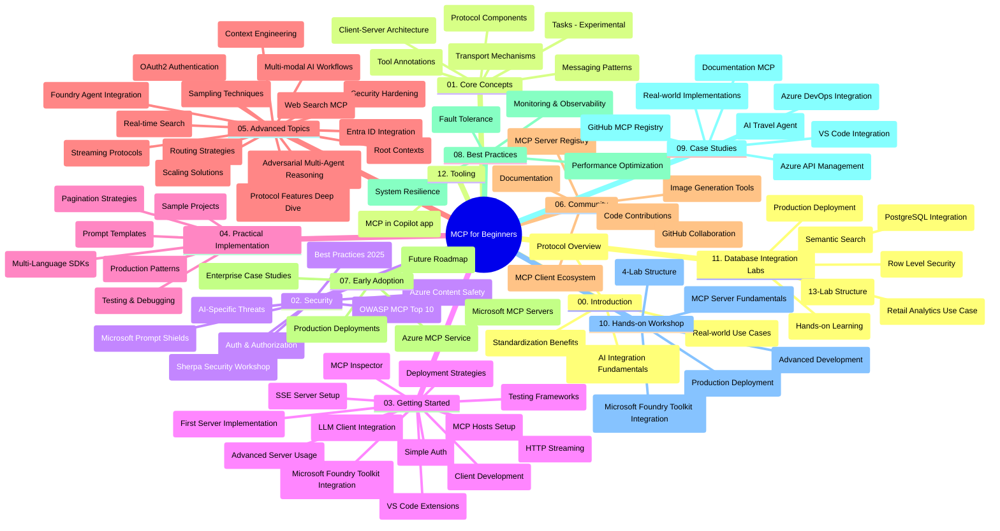

# Model Context Protocol (MCP) aloittelijoille - Opas

Tämä opas tarjoaa yleiskatsauksen "Model Context Protocol (MCP) aloittelijoille" -oppimateriaalin arkistorakenteesta ja sisällöstä. Käytä tätä opasta arkiston tehokkaaseen selaamiseen ja saatavilla olevien resurssien hyödyntämiseen.

## Arkiston yleiskatsaus

Model Context Protocol (MCP) on standardoitu kehys tekoälymallien ja asiakasohjelmien välisille vuorovaikutuksille. Alun perin Anthropicin luoma, MCP:tä ylläpitää nyt laajempi MCP-yhteisö virallisen GitHub-organisaation kautta. Tämä arkisto tarjoaa kattavan oppimateriaalin käytännön koodiesimerkeillä C#, Java, JavaScript, Python ja TypeScript -kielillä, suunnattu tekoälykehittäjille, järjestelmäarkkitehdeille ja ohjelmistoinsinööreille.

## Visuaalinen oppimateriaalikartta

## Arkiston rakenne

Arkisto on järjestetty kahteentoista pääosioon, joista jokainen keskittyy MCP:n eri osa-alueisiin:

1. **Johdanto (00-Introduction/)**
   - Model Context Protocolin yleiskatsaus
   - Miksi standardointi on tärkeää tekoälyputkissa
   - Käytännön käyttötapaukset ja hyödyt

2. **Peruskäsitteet (01-CoreConcepts/)**
   - Asiakas-palvelin -arkkitehtuuri
   - Keskeiset protokollan osat
   - Viestintämallit MCP:ssä
   - Nykyinen spesifikaatio: [Mitä MCP:ssä on muuttunut: 28.7.2026 spesifikaatio](./01-CoreConcepts/mcp-2026-07-28.md) — tilattoman protokollan ydin, Laajennuskehys sekä Roots/Sampling/Logging -vanhentumiset

3. **Turvallisuus (02-Security/)**
   - Turvauhat MCP-pohjaisissa järjestelmissä
   - Parhaat käytännöt suojatun toteutuksen aikaansaamiseksi
   - Todennus- ja valtuutusstrategiat
   - Käytännön [CIMD- ja DCR-valtuutusnäytteet](./02-Security/samples/cimd-dcr-auth/README.md)
   - **Laaja turvallisuusdokumentaatio**:
     - MCP:n parhaat turvallisuuskäytännöt
     - Azure Content Safety -toteutusopas
     - MCP:n turvakontrollit ja -menetelmät
     - MCP:n parhaat käytännöt -pikaviite
   - **Keskeiset turvallisuusaiheet**:
     - Kehoteinjektio ja työkalumyrkytyshyökkäykset
     - Istunnon kaappaus ja sekaannuksen aiheuttavat ongelmat
     - Tokenin läpikulkuhaavoittuvuudet
     - Liialliset oikeudet ja pääsynhallinta
     - Toimitusketjun turvallisuus tekoälykohteissa
     - Microsoft Prompt Shields -integraatio

4. **Aloittaminen (03-GettingStarted/)**
   - Ympäristön asennus ja konfigurointi
   - Perus MCP -palvelinten ja -asiakkaiden luominen
   - Integrointi olemassa oleviin sovelluksiin
   - Sisältää osiot:
     - Ensimmäinen palvelin
     - Asiakasohjelman kehitys
     - LLM-asiakasintegraatio
     - VS Code -integraatio
     - Server-Sent Events (SSE) palvelin
     - Edistynyt palvelinkäyttö
     - HTTP-striimaus
    - Microsoft Foundry Toolkit -integraatio
     - Testausstrategiat
     - Julkaisun ohjeet

5. **Käytännön toteutus (04-PracticalImplementation/)**
   - SDK:iden käyttö eri ohjelmointikielillä
   - Virheenkorjaus, testaus ja validointimenetelmät
   - Uudelleenkäytettävien kehote- ja työnkulkujen laatiminen
   - Esimerkkiprojektit toteutusnäytteineen

6. **Edistyneet aiheet (05-AdvancedTopics/)**
   - Kontekstisuunnittelun tekniikat
   - Foundry-agentin integrointi
   - Monimuotoiset tekoälytyönkulut
   - OAuth2-todennusdemot
   - Reaaliaikaiset hakutoiminnot
   - Reaaliaikainen striimaus
   - Root-kontekstien toteutus
   - Reitityksen strategiat
   - Otantamenetelmät
   - Skaalausratkaisut
   - Turvallisuusnäkökohdat
   - Entra ID -turvallisuusintegraatio
   - Verkkohakuintegraatio
   - Vastustava moniagenttijärjestelmä (väittelymallit)

7. **Yhteisön panokset (06-CommunityContributions/)**
   - Kuinka osallistua koodin ja dokumentaation tuottamiseen
   - Yhteistyö GitHubin kautta
   - Yhteisön ohjaamat parannukset ja palaute
   - Useiden MCP-asiakkaiden käyttö (Claude Desktop, Cline, VSCode)
   - Suositut MCP-palvelimet, mukaan lukien kuvanluonti

8. **Varhaisen käyttöönoton kokemukset (07-LessonsfromEarlyAdoption/)**
   - Todelliset toteutukset ja menestystarinat
   - MCP-pohjaisten ratkaisujen rakentaminen ja käyttöönotto
   - Trendejä ja tulevaisuuden suunnitelma
   - **Microsoft MCP Servers Guide**: Kattava opas 10 tuotantovalmiiseen Microsoft MCP -palvelimeen, mukaan lukien:
     - Microsoft Learn Docs MCP Server
     - Azure MCP Server (yli 15 erikoissovitinta)
     - GitHub MCP Server
     - Azure DevOps MCP Server
     - MarkItDown MCP Server
     - SQL Server MCP Server
     - Playwright MCP Server
     - Dev Box MCP Server
     - Microsoft Foundry MCP Server
     - Microsoft 365 Agents Toolkit MCP Server

9. **Parhaat käytännöt (08-BestPractices/)**
   - Suorituskyvyn viritys ja optimointi
   - Vikasietoisten MCP-järjestelmien suunnittelu
   - Testaus- ja resilienssistrategiat

10. **Case-esimerkit (09-CaseStudy/)**
    - **Seitsemän kattavaa case-esimerkkiä** MCP:n monipuolisuuden osoittamiseksi erilaisissa tilanteissa:
    - **Azure AI Travel Agents**: Moniagenttiorganisointi Azure OpenAI:n ja AI Searchin avulla
    - **Azure DevOps -integraatio**: Työnkulkujen automatisointi YouTube-data päivityksen avulla
    - **Reaaliaikainen dokumenttien haku**: Python-konsoliasiakas HTTP-striimauksella
    - **Interaktiivinen opintosuunnitelman generaattori**: Chainlit-verkkosovellus keskustelevaan tekoälyyn perustuen
    - **Editorin sisäinen dokumentaatio**: VS Code -integraatio GitHub Copilot -työnkulkujen kanssa
    - **Azure API Management**: Yritystason API-integraatio MCP-palvelimen luomisen avulla
    - **GitHub MCP Registry**: Ekosysteemin kehitys ja agenttipohjainen integrointialusta
    - Toteutusnäytteitä yritysintegraatioista, kehittäjätuottavuudesta ja ekosysteemin kehityksestä

11. **Käytännön työpaja (10-StreamliningAIWorkflowsBuildingAnMCPServerWithAIToolkit/)**
    - Kattava käytännön työpaja, joka yhdistää MCP:n Microsoft Foundry Toolkitin kanssa
    - Älykkäiden sovellusten rakentaminen, jotka yhdistävät tekoälymallit todellisen maailman työkaluihin
    - Käytännön moduulit, jotka kattavat perusteet, räätälöidyn palvelinkehityksen ja tuotantojulkaisun strategiat
    - **Työpajan rakenne**:
      - Työpaja 1: MCP-palvelimen perusteet
      - Työpaja 2: Edistynyt MCP-palvelimen kehitys
      - Työpaja 3: Microsoft Foundry Toolkit -integraatio
      - Työpaja 4: Tuotantojulkaisu ja skaalaus
    - Työpajapohjainen oppiminen askel askeleelta ohjein

12. **MCP-palvelimen tietokantaintegraatiotyöpajat (11-MCPServerHandsOnLabs/)**
    - **Kattava 13 työpajan oppimispolku** tuotantovalmiiden MCP-palvelimien rakentamiseen PostgreSQL-integraatiolla
    - **Todellisen maailman vähittäiskaupan analytiikan toteutus** Zava Retail -käyttötapauksella
    - **Yritysluokan mallit** kuten Row Level Security (RLS), semanttinen haku ja monivuokralaispohjainen tietojen käyttöoikeus
    - **Kokonaisvaltainen työpajarakenne**:
      - **Työpajat 00-03: Perusteet** - Johdanto, arkkitehtuuri, turvallisuus, ympäristön asennus
      - **Työpajat 04-06: MCP-palvelimen rakentaminen** - Tietokantasunnittelu, MCP-palvelimen toteutus, työkalujen kehitys
      - **Työpajat 07-09: Edistyneet ominaisuudet** - Semanttinen haku, testaus ja virheenkorjaus, VS Code -integraatio
      - **Työpajat 10-12: Tuotanto & parhaat käytännöt** - Julkaisu, valvonta, optimointi
    - **Käytetyt teknologiat**: FastMCP-framework, PostgreSQL, Azure OpenAI, Azure Container Apps, Application Insights
    - **Oppimistavoitteet**: Tuotantovalmiit MCP-palvelimet, tietokantaintegraatiomallit, tekoälypohjainen analytiikka, yritysturvallisuus

13. **Työkalut (12-tooling/)**
    - Opettele käyttämään MCP:tä Copilot-sovelluksessa ja muissa työkaluissa

## Lisäresurssit

Arkistossa on mukana tukiresursseja:

- **Kuvat-kansio**: Sisältää kaavioita ja kuvauksia, joita käytetään koko oppimateriaalissa
- **Käännökset**: Monikielinen tuki dokumentaation automaattisilla käännöksillä
- **Viralliset MCP-resurssit**:
  - [MCP-dokumentaatio](https://modelcontextprotocol.io/)
  - [MCP-specifikaatio](https://modelcontextprotocol.io/specification/2026-07-28/)
  - [MCP GitHub-arkisto](https://github.com/modelcontextprotocol)

## Kuinka käyttää tätä arkistoa

1. **Järjestelmällinen opiskelu**: Seuraa lukujärjestystä (00–11) rakenteellisen oppimiskokemuksen saavuttamiseksi.
2. **Kielikohtainen painotus**: Jos olet kiinnostunut tietystä ohjelmointikielestä, tutustu esimerkkihakemistoihin oman suosikkikielesi toteutusten löytämiseksi.
3. **Käytännön toteutus**: Aloita "Aloittaminen"-osiosta asentaaksesi ympäristösi ja luodaksesi ensimmäisen MCP-palvelimen ja -asiakkaan.
4. **Edistynyt tutkimus**: Kun perusasiat ovat hallussa, sukella syvemmin edistyneisiin aiheisiin tietojesi laajentamiseksi.
5. **Yhteisöosallistuminen**: Liity MCP-yhteisöön GitHub-keskustelujen ja Discord-kanavien kautta yhteyden saamiseksi asiantuntijoihin ja muihin kehittäjiin.

## MCP-asiakkaat ja -työkalut

Oppimateriaali käsittelee erilaisia MCP-asiakkaita ja -työkaluja:

1. **Viralliset asiakkaat**:
   - Visual Studio Code
   - MCP Visual Studio Codessa
   - Claude Desktop
   - Claude VSCode:ssa
   - Claude API

2. **Yhteisön asiakkaat**:
   - Cline (päätelaitepohjainen)
   - Cursor (koodieditori)
   - ChatMCP
   - Windsurf

3. **MCP-hallintatyökalut**:
   - MCP CLI
   - MCP Manager
   - MCP Linker
   - MCP Router

## Suositut MCP-palvelimet

Arkisto esittelee erilaisia MCP-palvelimia, mukaan lukien:

1. **Viralliset Microsoft MCP -palvelimet**:
   - Microsoft Learn Docs MCP Server
   - Azure MCP Server (yli 15 erikoissovitinta)
   - GitHub MCP Server
   - Azure DevOps MCP Server
   - MarkItDown MCP Server
   - SQL Server MCP Server
   - Playwright MCP Server
   - Dev Box MCP Server
   - Microsoft Foundry MCP Server
   - Microsoft 365 Agents Toolkit MCP Server

2. **Viralliset referenssipalvelimet**:
   - Filesystem
   - Fetch
   - Memory
   - Sequential Thinking

3. **Kuvantuotanto**:
   - Azure OpenAI DALL-E 3
   - Stable Diffusion WebUI
   - Replicate

4. **Kehitystyökalut**:
   - Git MCP
   - Terminal Control
   - Code Assistant

5. **Erikoistuneet palvelimet**:
   - Salesforce
   - Microsoft Teams
   - Jira & Confluence

## Osallistuminen

Tämä arkisto ottaa mielellään vastaan yhteisön panoksia. Katso Yhteisön panokset -osio, josta löydät ohjeet tehokkaaseen osallistumiseen MCP-ekosysteemiin.

----

*Tämä opas päivitettiin viimeksi 9. syyskuuta 2026. Se perustuu MCP
spesifikaatioon `2026-07-28`, nykyiseen protokollapäivitykseen. Jotkin käytännön
esimerkit ovat edelleen selkeästi versionumeroituja kohdassa `2025-11-25`, kun taas niiden SDK:t ja työkalut
käyttävät tilattomia protokollan rajapintoja.*

---

<!-- CO-OP TRANSLATOR DISCLAIMER START -->
**Vastuuvapauslauseke**:
Tämä asiakirja on käännetty käyttämällä tekoälypohjaista käännöspalvelua [Co-op Translator](https://github.com/Azure/co-op-translator). Vaikka pyrimme tarkkuuteen, otathan huomioon, että automaattiset käännökset saattavat sisältää virheitä tai epätarkkuuksia. Alkuperäinen asiakirja sen alkuperäiskielellä on virallinen lähde. Tärkeissä asioissa suositellaan ammattimaista ihmiskäännöstä. Emme ole vastuussa tämän käännöksen käytöstä aiheutuvista väärinymmärryksistä tai tulkinnoista.
<!-- CO-OP TRANSLATOR DISCLAIMER END -->