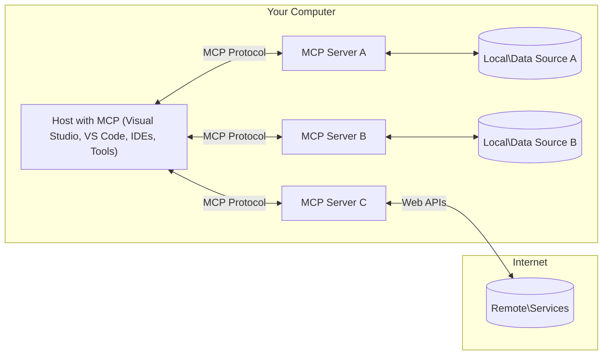

# מושגי ליבה של MCP: שליטה בפרוטוקול הקשר הדגם לאינטגרציה של בינה מלאכותית

[](https://youtu.be/earDzWGtE84)

_(לחץ על התמונה למעלה כדי לצפות בסרטון של השיעור)_

ה-[Model Context Protocol (MCP)](https://github.com/modelcontextprotocol) הוא מסגרת סטנדרטית חזקה שמייעלת את התקשורת בין דגמים לשוניים גדולים (LLMs) לכלים, אפליקציות, ומקורות נתונים חיצוניים.
מדריך זה יוביל אותך דרך מושגי הליבה של MCP. תלמד על ארכיטקטורת לקוח-שרת, רכיבים חיוניים, מכניקת התקשורת, והנחיות לביצוע מיטבי.

- **שליטה והסכמה של המשתמש**: מארחים חייבים להציג ברור אילו נתונים וכלים השרת חשוף, לאפשר למשתמשים לסרב לפעולות, ולקבל אישור מפורש לפעולות רגישות או בעלות השלכה. MCP אינו דורש דיאלוג אישור לפני כל קריאת כלי.


- **הגנת פרטיות הנתונים**: נתוני המשתמש נחשפים רק עם הסכמה מפורשת ויש להגן עליהם באמצעות בקרות גישה חזקות לאורך כל מחזור ההתקשרות. מימושים חייבים למנוע שידור נתונים לא מורשה ולשמור על גבולות פרטיות מחמירים.

- **בטיחות הפעלת כלים**: מארחים צריכים להציג הפעלות כלי באופן גלוי ולאפשר לבן אדם לסרב להן. פעולות רגישות צריכות להציג את קלטי הכלי וההשפעה לפני ההפעלה, עם גבולות אבטחה המונעים פעולות לא מכוונות או זדוניות.


- **אבטחת תקשורת**: חיבורים מרוחקים צריכים להשתמש ב-HTTPS ובמודל האישור של MCP. שרתי stdio מקומיים נשענים על בידוד תהליכים, קונפיגורציה מהימנה, וטיפול בטוח באישורים שיורשים.


#### קווי הנחיה למימוש:

- **ניהול הרשאות**: מימוש מערכות הרשאה מפורטות המאפשרות למשתמשים לשלוט אילו שרתים, כלים ומשאבים נגישים
- **אימות ואישור**: שימוש בשיטות אימות מאובטחות (OAuth, מפתחות API) עם ניהול נכון של אסימונים ותאריך תפוגה  
- **אימות קלט**: אימות כל הפרמטרים ונתוני הקלט בהתאם לסכימות מוגדרות למניעת מתקפות הזרקה
- **רישום ביקורת**: שמירה על לוגים מקיפים של כל הפעולות למעקב אבטחה וציות

## סקירה כללית

שיעור זה בוחן את הארכיטקטורה והמרכיבים היסודיים שיוצרים את מערכת Model Context Protocol (MCP). תלמד על ארכיטקטורת לקוח-שרת, רכיבים מרכזיים, ומנגנוני תקשורת שמגבירים את האינטראקציות ב-MCP.

## מטרות למידה מרכזיות

בסיום שיעור זה, תוכל:

- להבין את ארכיטקטורת הלקוח-שרת של MCP.
- לזהות את התפקידים והאחריות של מארחים, לקוחות ושרתים.
- לנתח את התכונות המרכזיות שהופכות את MCP לשכבת אינטגרציה גמישה.
- ללמוד כיצד מידע זורם במערכת האקולוגית של MCP.
- לקבל תובנות מעשיות דרך דוגמאות קוד ב-.NET, Java, Python, ו-JavaScript.

## ארכיטקטורת MCP: מבט מעמיק יותר

מערכת MCP בנויה על מודל לקוח-שרת. מבנה מודולרי זה מאפשר לאפליקציות בינה מלאכותית אינטראקציה יעילה עם כלים, מאגרי נתונים, APIs, ומשאבים הקשריים. בוא נפרק את הארכיטקטורה לרכיביה המרכזיים.

בליבת העניין, MCP עוקב אחרי ארכיטקטורת לקוח-שרת שבה אפליקציית מארח יכולה להתחבר למספר שרתים:



- **מארחי MCP**: תוכניות כמו VSCode, Claude Desktop, IDEs, או כלים של AI שרוצים לגשת לנתונים דרך MCP
- **לקוחות MCP**: רכיבי פרוטוקול שמתחזקים מערכת יחסים לוגית אחת
  עם שרת; בקשות MCP `2026-07-28` אינן תלויות בחיבור או מושב מתמשך אחד
  או מושב
- **שרתים של MCP**: תוכניות קלות שמשתמשות ביכולות ספציפיות באמצעות פרוטוקול מודל קונטקסט סטנדרטי
- **מקורות נתונים מקומיים**: הקבצים, מסדי הנתונים והשירותים במחשב שלך ששרתי MCP יכולים לגשת אליהם בצורה מאובטחת
- **שירותים מרוחקים**: מערכות חיצוניות הזמינות דרך האינטרנט ששרתי MCP יכולים להתחבר אליהן דרך APIs.

פרוטוקול MCP הוא תקן מתפתח המשתמש בגרסאות מבוססות תאריך
(פורמט YYYY-MM-DD). גרסת הפרוטוקול הנוכחית היא **2026-07-28**. ראו את
[מפרט הפרוטוקול 2026-07-28](https://modelcontextprotocol.io/specification/2026-07-28/).

> **גרסה נוכחית:** MCP `2026-07-28` הופך את הפרוטוקול ללא-מדינתי בשכבת התעבורה
> על ידי הסרת לחיצת היד `initialize` ומזהי המושב ברמת הפרוטוקול. הוא גם פורמליזציה
> של מסגרת הרחבות ומפסיק את השימוש ב-
> Roots, Sampling, ו-Logging לטובת דפוסים חדשים. ראו
> [מה השתנה ב-MCP: מפרט 2026-07-28](./mcp-2026-07-28.md)
> לפירוט מלא והנחיות למעבר. דוגמאות הפוגשות במפורש את
> `2025-11-25` נשמרות כלקחים של תאימות מורשת.

### 1. מארחים

בפרוטוקול מודל הקונטקסט (MCP), **המארחים** הם יישומי בינה מלאכותית המשמשים כממשק ראשי דרכו משתמשים מתקשרים עם הפרוטוקול. המארחים מתאמים ומנהלים חיבורים למספר שרתי MCP על ידי יצירת לקוחות MCP ייעודיים לכל חיבור שרת. דוגמאות למארחים כוללות:

- **יישומי AI**: Claude Desktop, Visual Studio Code, Claude Code
- **סביבות פיתוח**: IDE וערכי קוד עם אינטגרציה ל-MCP  
- **יישומים מותאמים**: סוכני AI וכלים שנבנו במיוחד

**מארחים** הם יישומים המתאמים אינטראקציות עם מודלים של AI. הם:

- **מתזמנים מודלי AI**: מבצעים או מתקשרים עם LLMים ליצירת תגובות ומתיאום תהליכי עבודה בינה מלאכותית
- **מנהל קשרי לקוח**: יוצרים ומנהלים לקוח MCP אחד לכל שרת MCP שהמארח משתמש בו
  
- **שולטים בממשק משתמש**: מטפלים בזרימת שיחה, אינטראקציות משתמש והצגת תגובות  
- **אוכפים אבטחה**: שולטים בהרשאות, מגבלות אבטחה ואימות
- **מטפלים בקבלת הסכמות משתמש**: מנהלים אישור משתמש לשיתוף נתונים ולהפעלת כלים


### 2. לקוחות

**לקוחות** הם רכיבי פרוטוקול שנוצרו על ידי מארח לשרתי MCP מסוימים. זוהי מערכת יחסים לוגית אחד-לאחד, לא דרישה לחיבור רשת מתמשך. ב-MCP `2026-07-28`, כל בקשה היא עצמאית וניתן לטפל בה על ידי כל מופע של השרת.

**לקוחות** הם רכיבים מחברים בתוך יישום המארח. הם:


- **גילוי יכולות**: משתמשים ב-`server/discover` כדי ללמוד על גרסאות הפרוטוקול, יכולות והרחבות שהשרת תומך בהן

- **עדכונים בזמן אמת**: מטפלים בהודעות ועדכונים בזמן אמת מהשרתים
- **עיבוד תגובות**: מעבדים ומעוצבים תגובות שרת להצגה למשתמשים

### 3. שרתים

**שרתים** הם תוכניות שמספקות הקשר, כלים, ויכולות ללקוחות MCP. הם יכולים לפעול באופן מקומי (אותו מחשב שבו המארח) או מרחוק (על פלטפורמות חיצוניות), ואחראים לטיפול בבקשות הלקוחות ולספק תגובות מובנות. השרתים חושפים פונקציונליות מסוימת באמצעות פרוטוקול מודל הקונטקסט הסטנדרטי.

**שרתים** הם שירותים המספקים הקשר ויכולות. הם:

- **רישום תכונות**: רושמים וחשופים פרימיטיבים זמינים (משאבים, סיוגים, כלים) ללקוחות

- **סיפוק הקשר**: מספקים מידע וקונטקסט לשיפור תגובות המודל

- **רישום תכונות**: רישום וחשיפת פרימיטיבים זמינים (משאבים, הנחיות, כלים) ללקוחות
- **עיבוד בקשות**: קבלת והפעלת קריאות כלים, בקשות משאבים ובקשות הנחיות מלקוחות
- **אספקת הקשר**: מתן מידע ונתונים הקשריים לשיפור תגובות המודל
- **ניהול מצב**: שמירת מצב היישום עם ידיות מפורשות שמועברות
  בבקשות לפי הצורך; ל-MCP `2026-07-28` אין מושבי פרוטוקול ברמה
- **התראות בזמן אמת**: שליחת התראות בנוגע לשינויים ביכולות ועדכונים ללקוחות מחוברים

שרתים יכולים להיות מפותחים על ידי כל אחד כדי להרחיב את יכולות המודל עם פונקציונליות מיוחדת, והם תומכים בתרחישי פריסה מקומית ומרחוק.

### 4. פרימיטיבים של השרת

שרתים בפרוטוקול הקשר של מודל (MCP) מספקים שלושה **פרימיטיבים** מרכזיים שמגדירים את אבני הבניין הבסיסיות לאינטראקציות עשירות בין לקוחות, מארחים ומודלים לשוניים. הפרימיטיבים האלה מגדירים את סוגי המידע ההקשרי והפעולות הזמינות דרך הפרוטוקול.

שרתי MCP יכולים לחשוף כל שילוב מהשלושה פרימיטיבים המרכזיים הבאים:

#### משאבים 

**משאבים** הם מקורות נתונים המספקים מידע הקשרי ליישומי בינה מלאכותית. הם מייצגים תוכן סטטי או דינמי שיכול לשפר את ההבנה והקבלת ההחלטות של המודל:

- **נתונים הקשריים**: מידע מובנה והקשר לצריכת מודל ה-AI
- **בסיסי ידע**: מאגרי מסמכים, מאמרים, מדריכים ומאמרי מחקר
- **מקורות נתונים מקומיים**: קבצים, מסדי נתונים ומידע של המערכת המקומית  
- **נתונים חיצוניים**: תגובות API, שירותי רשת ונתוני מערכת מרוחקים
- **תוכן דינמי**: נתונים בזמן אמת שמתעדכנים בהתאם לתנאים חיצוניים

המשאבים מזוהים על ידי URI ותומכים בגילוי דרך שיטות `resources/list` ושליפה דרך שיטות `resources/read`:

```text
file://documents/project-spec.md
database://production/users/schema
api://weather/current
```

#### תמריצים

**תמריצים** הם תבניות לשימוש חוזר שעוזרות למבנה אינטראקציות עם מודלי שפה. הם מספקים דפוסי אינטראקציה סטנדרטיים וזרימות עבודה בתבנית:

- **אינטראקציות מבוססות תבניות**: הודעות מובנות מראש ומתחילי שיחה
- **תבניות זרימת עבודה**: רצפים סטנדרטיים למשימות ואינטראקציות נפוצות
- **דוגמאות עם מעט דגימות**: תבניות המבוססות על דוגמאות להנחיית המודל
- **תמריצי מערכת**: תמריצי יסוד שמגדירים את התנהגות ההקשר של המודל
- **תבניות דינמיות**: תמריצים מפראמטרים שמסתגלים להקשרים ספציפיים

תמריצים תומכים בהחלפת משתנים וניתן לגלות אותם באמצעות `prompts/list` ולשלוף עם `prompts/get`:

```markdown
Generate a {{task_type}} for {{product}} targeting {{audience}} with the following requirements: {{requirements}}
```

#### כלים

**כלים** הם פונקציות ניתנות להרצה שניתן להפעיל על ידי מודלים של בינה מלאכותית כדי לבצע פעולות ספציפיות. הם מייצגים את "הפועל" במערכת אקוסיסטם MCP, ומאפשרים למודלים אינטראקציה עם מערכות חיצוניות:

- **פונקציות ניתנות להרצה**: פעולות נפרדות שניתן להפעיל עם פרמטרים ספציפיים
- **אינטגרציה עם מערכות חיצוניות**: קריאות API, שאילתות מסד נתונים, פעולות קבצים, חישובים
- **זהות ייחודית**: לכל כלי שם, תיאור וסקמת פרמטרים מובחנים
- **קלט/פלט מובנה**: הכלים מקבלים פרמטרים מאומתים ומחזירים תגובות מובנות ומטיפוס
- **יכולות פעולה**: מאפשרים למודלים לבצע פעולות בעולם האמיתי ולשלוף נתונים חיים

הכלים מוגדרים עם JSON Schema לאימות פרמטרים ומתגלים דרך `tools/list` ומופעלים באמצעות `tools/call`. כלים יכולים לכלול גם **אייקונים** כמטה-נתונים נוספים להצגת ממשק משתמש טובה יותר.

**הערות על כלים**: כלים תומכים בהערות התנהגותיות (למשל, `readOnlyHint`, `destructiveHint`) שמתארות אם כלי הוא לקריאה בלבד או הרסני, כדי לעזור ללקוחות לקבל החלטות מושכלות לגבי הפעלת הכלי.

דוגמה להגדרת כלי:

```typescript
server.tool(
  "search_products", 
  {
    query: z.string().describe("Search query for products"),
    category: z.string().optional().describe("Product category filter"),
    max_results: z.number().default(10).describe("Maximum results to return")
  }, 
  async (params) => {
    // Execute search and return structured results
    return await productService.search(params);
  }
);
```

## יסודות לקוח

בפרוטוקול הקשר מודל (MCP), **לקוחות** יכולים לחשוף יסודות שמאפשרים לשרתים לבקש יכולות נוספות מיישום המארח. יסודות צד הלקוח הללו מאפשרים מימושי שרת עשירים ואינטרקטיביים יותר שיכולים לגשת ליכולות מודל ה-AI ולאינטראקציות משתמש.

### דיגום

> **מיושן ב-MCP `2026-07-28`:** דגימה נשמרת לזמינות עבור
> תאימות, אך יישומים חדשים צריכים להתממשק ישירות עם ממשק API של ספק LLM.
> היא עשויה להיות מוסרת בתיקון המפרט הראשון שיתפרסם ב-28 ביולי 2027 או לאחר מכן.
> ראה
> [מה השתנה ב-MCP: מפרט התאריך 2026-07-28](./mcp-2026-07-28.md).

**דגימה** מאפשרת לשרתים לבקש השלמות של מודל שפה מיישום ה-AI של הלקוח. פעולת יסוד זו מאפשרת לשרתים לקבל גישה ליכולות LLM מבלי להטמיע תלות במודל משלהם:

- **גישה בלתי תלויה במודל**: שרתים יכולים לבקש השלמות ללא כלול SDKs של LLM או ניהול גישה למודל
- **AI ביוזמת השרת**: מאפשר לשרתים ליצור תוכן באופן עצמאי באמצעות מודל ה-AI של הלקוח
- **אינטראקציות רקורסיביות עם LLM**: תומך בתרחישים מורכבים בהם שרתים זקוקים לעזרת AI בעיבוד
- **יצירת תוכן דינמית**: מאפשר לשרתים ליצור תגובות בהקשר תוך שימוש במודל של המארח
- **תמיכה בקריאת כלים**: שרתים יכולים לכלול פרמטרים `tools` ו-`toolChoice` כדי לאפשר למודל של הלקוח להפעיל כלים במהלך הדגימה

דגימה משתמשת בשיטה `sampling/createMessage`, בה השרתים מבקשים
השלמה מלקוחות.

### שורשים

> **מיושן ב-MCP `2026-07-28`:** שורשים נשארים זמינים עבור
> תאימות, אך יישומים חדשים צריכים להעביר ספריות או קבצים באמצעות
> פרמטרים של כלים, URI של משאבים או תצורת שרת. שורשים עשויים להיות
> מוסרים בתיקון המפרט הראשון שיתפרסם ב-28 ביולי 2027 או לאחר מכן.
> ראה
> [מה השתנה ב-MCP: מפרט התאריך 2026-07-28](./mcp-2026-07-28.md).

**שורשים** מספקים דרך סטנדרטית ללקוחות לזהות מיקומי מערכת קבצים
שרלוונטיים לשרתי:

- **רמזים ממערכת הקבצים**: מזהים ספריות וקבצים שרלוונטיים לבקשה
- **הרשאות נפרדות**: אינם מעניקים גישה או מכריחים גבול אבטחה
- **יכולת על בסיס בקשה**: לקוחות מצהירים על תמיכה בשורשים במטא-נתוני הבקשה
- **זיהוי מבוסס URI**: שורשים משתמשים ב-URI של `file://` לזיהוי ספריות וקבצים נגישים

ב-MCP `2026-07-28`, שרת מבקש `roots/list` דרך
`InputRequiredResult` בתהליך עיבוד בקשה נתמכת של הלקוח.
הלקוח מחזיר את השורשים כאשר הוא מנסה שוב את אותה הבקשה המקורית.

### איסוף מידע

**איסוף מידע** מאפשר לשרתים לבקש מידע נוסף או אישור מהמשתמשים דרך ממשק הלקוח:

- **בקשות קלט משתמש**: שרתים יכולים לבקש מידע נוסף במידת הצורך להפעלת כלים
- **דיאלוגי אישור**: בקשת אישור מהמשתמש לפעולות רגישות או בעלות השפעה
- **זרימות עבודה אינטראקטיביות**: מאפשר לשרתים ליצור אינטראקציות שלב-אחר-שלב עם משתמשים
- **איסוף פרמטרים דינמי**: איסוף פרמטרים חסרים או אופציונליים במהלך הפעלת הכלי

איסוף מידע משתמש בשיטה `elicitation/create` בתוך
`InputRequiredResult` לאיסוף קלט ממשתמש דרך ממשק הלקוח.

**אילוץ במצב URL**: שרתים יכולים גם לבקש אינטראקציות עם המשתמש מבוססות URL, המאפשרות לשרתים לכוון משתמשים לדפי אינטרנט חיצוניים לאימות, אישור או הזנת נתונים.

### רישום יומנים

> **מיושן ב-MCP `2026-07-28`:** רישום היומנים נשאר זמין לתאימות, אבל יישומים חדשים צריכים להשתמש ב-`stderr` עם stdio ו-
> OpenTelemetry לתצפית מובנית. רישום היומנים עשוי להיות מוסר
> במהדורת התקן הראשונה שתפורסם ב-או לאחר 28 ביולי 2027. ראו
> [מה השתנה ב-MCP: התקן מ-28-07-2026](./mcp-2026-07-28.md).


**רישום יומנים** מאפשר לשרתים לשלוח הודעות יומן מובנות ללקוחות לצורך איתור תקלות, ניטור, ולקבלת שקיפות תפעולית:

- **תמיכת איתור תקלות**: מאפשר לשרתים לספק יומני ביצוע מפורטים לפתרון בעיות
- **ניטור תפעולי**: שליחת עדכוני מצב ומדדי ביצועים ללקוחות
- **דיווח שגיאות**: מתן הקשר שגיאה מפורט ומידע אבחוני
- **עקבות ביקורת**: יצירת יומנים מקיפים של פעולות והחלטות השרת

הודעות רישום נשלחות ללקוחות כדי לספק שקיפות בפעולות השרת ולהקל על איתור תקלות.

## זרימת מידע ב-MCP

פרוטוקול הקשר למודל (MCP) מגדיר זרימת מידע מובנית בין מארחים, לקוחות, שרתים ומודלים. הבנת זרימה זו מסייעת להבהיר כיצד בקשות משתמש מעובדות וכיצד כלים חיצוניים ונתונים משולבים בתגובות המודל.

- **המארח יוזם את החיבור**  
  אפליקציית המארח (כגון IDE או ממשק שיחה) מקימה חיבור לשרת MCP, בדרך כלל באמצעות STDIO, WebSocket או אמצעי תעבורה נתמך אחר.

- **משא ומתן על יכולות**  
  הלקוח (שנועד במארח) והשרת מחליפים מידע אודות התכונות, הכלים, המשאבים וגרסאות הפרוטוקול הנתמכות אצלם. זה מבטיח ששני הצדדים מבינים אילו יכולות זמינות למפגש.

- **בקשת משתמש**  
  המשתמש מתקשר עם המארח (למשל, מזין פקודה או בקשת קלט). המארח אוסף את הקלט הזה ומעביר אותו ללקוח לעיבוד.

- **שימוש במשאב או כלי**  
  - הלקוח עשוי לבקש הקשר נוסף או משאבים מהשרת (כגון קבצים, רשומות בסיס נתונים, או מאמרים מבסיס ידע) להעשיר את הבנת המודל.
  - אם המודל קובע כי יש צורך בכלי (לדוגמה, לשליפת נתונים, ביצוע חישוב, או קריאת API), הלקוח שולח בקשת הפעלת כלי לשרת, מציין את שם הכלי והפרמטרים.

- **ביצוע בשרת**  
  השרת מקבל את בקשת המשאב או הכלי, מבצע את הפעולות הנדרשות (כגון הרצת פונקציה, שאילתא בבסיס נתונים, או שליפת קובץ) ומחזיר את התוצאות ללקוח בפורמט מובנה.

- **יצירת תגובה**  
  הלקוח משלב את תגובות השרת (נתוני משאבים, פלט כלים וכו') באינטראקציה המתמשכת עם המודל. המודל משתמש במידע זה כדי ליצור תגובה מקיפה ורלוונטית להקשר.

- **הצגת תוצאה**  
  המארח מקבל את הפלט הסופי מהלקוח ומציג אותו למשתמש, לעיתים כולל גם את הטקסט שנוצר על ידי המודל וגם תוצאות מביצוע כלים או שליפת משאבים.

זרימה זו מאפשרת ל-MCP לתמוך באפליקציות AI מתקדמות, אינטראקטיביות ומודעות להקשר על ידי חיבור רציף בין מודלים לכלים ונתונים חיצוניים.

## ארכיטקטורת הפרוטוקול ושכבותיו

MCP מורכב משתי שכבות ארכיטקטוניות נפרדות שעובדות יחד כדי לספק מסגרת תקשורת מלאה:

### שכבת הנתונים

**שכבת הנתונים** מממשת את פרוטוקול MCP המרכזי באמצעות **JSON-RPC 2.0** כבסיס שלה. שכבה זו מגדירה את מבנה ההודעה, סמנטיקה ודפוסי האינטראקציה:

#### רכיבים עיקריים:

- **פרוטוקול JSON-RPC 2.0**: כל התקשורת משתמשת בפורמט הודעות JSON-RPC 2.0 סטנדרטי לקריאות שיטות, תגובות והודעות יודעות
- **ניהול מחזור חיים**: מטפל באתחול החיבור, במשא ומתן על יכולות, ובסיום מושב בין לקוחות לשרתים
- **פרימיטיבים של שרת**: מאפשר לשרתים לספק פונקציונליות מרכזית דרך כלים, משאבים, והנחיות
- **פרימיטיבים של לקוח**: מאפשר לשרתים לבקש דגימה מ-LLMs, לאלץ קלט משתמש, ולשלוח הודעות יומן
- **הודעות בזמן אמת**: תומך בהודעות אסינכרוניות לעדכונים דינמיים ללא סקר

#### תכונות עיקריות:

- **משא ומתן על גרסת פרוטוקול**: משתמש בגרסאות מבוססות תאריך (YYYY-MM-DD) כדי להבטיח תאימות
- **גילוי יכולות**: לקוחות ושרתים מחליפים מידע על תכונות נתמכות באתחול
- **מושבים בעלי מצבים**: שומר על מצב החיבור לאורך כמה אינטראקציות להרצף הקשרי

### שכבת תעבורה

**שכבת התעבורה** מנהלת ערוצי תקשורת, מיסגור הודעות, ואימות זהות בין משתתפי MCP:

#### מנגנוני תעבורה נתמכים:

1. **תעבורת STDIO**:
   - משתמש בזרמי קלט/פלט סטנדרטיים לתקשורת ישירה בין תהליכים
   - אופטימלי לתהליכים מקומיים באותה מכונה ללא עומס רשת
   - נפוץ ליישומי שרת MCP מקומיים

2. **תעבורת HTTP סטרימינג**:
   - משתמשת ב-HTTP POST להודעות מלקוח לשרת  
   - אירועי שרת נשלחים (SSE) אופציונליים לסטרימינג משרת ללקוח
   - מאפשר תקשורת שרת מרוחקת בין רשתות
   - תומך באימות HTTP סטנדרטי (טוקנים, מפתחות API, כותרות מותאמות)
   - MCP ממליץ על OAuth לאימות בטוח מבוסס טוקן

#### הפשטת תעבורה:

שכבת התעבורה מפשטת את פרטי התקשורת משכבת הנתונים, ומאפשרת שימוש באותו פורמט הודעות JSON-RPC 2.0 בכל מנגנוני התעבורה. הפשטה זו מאפשרת לאפליקציות לעבור בין שרתים מקומיים ומרוחקים ללא תקלות.

### שיקולי אבטחה

יישומי MCP חייבים לעמוד בכמה עקרונות אבטחה קריטיים כדי להבטיח אינטראקציות בטוחות, אמינות ומאובטחות בכל פעולות הפרוטוקול:

- **הסכמה ושליטה של המשתמש**: משתמשים חייבים לתת הסכמה מפורשת לפני גישה לנתונים או ביצוע פעולות. עליהם להיות בעלי שליטה ברורה על אילו נתונים משותפים ואילו פעולות מורשות, בתמיכה בממשקי משתמש אינטואיטיביים לסקירה ואישור פעילויות.

- **פרטיות נתונים**: נתוני משתמשים יחשפו רק בהסכמה מפורשת וחייבים להיות מוגנים באמצעות בקרות גישה מתאימות. יישומי MCP חייבים למנוע העברת נתונים לא מורשית ולהבטיח שהפרטיות נשמרת בכל האינטראקציות.

- **בטיחות כלים**: לפני הפעלת כל כלי, דרושה הסכמת משתמש מפורשת. יש לספק למשתמשים הבנה ברורה של פונקציונליות כל כלי, ולקיים גבולות אבטחה חזקים למניעת ביצוע כלים בלתי צפוי או לא בטוח.

באימוץ עקרונות אבטחה אלו, MCP מוודא אמון, פרטיות ובטיחות המשתמשים נשמרים בכל אינטראקציית הפרוטוקול, תוך אפשרות אינטגרציות חכמות וחזקות.

## דוגמאות קוד: רכיבים עיקריים

להלן דוגמאות קוד במספר שפות תכנות פופולריות המדגימות כיצד לממש רכיבי שרת MCP וכלים עיקריים.

### דוגמת .NET: יצירת שרת MCP פשוט עם כלים

להלן דוגמת קוד מעשית ב-.NET הממחישה איך לממש שרת MCP פשוט עם כלים מותאמים אישית. דוגמה זו מציגה כיצד להגדיר ולרשום כלים, לטפל בבקשות, ולחבר את השרת באמצעות פרוטוקול הקשר למודל.

```csharp
using System;
using System.Threading.Tasks;
using ModelContextProtocol.Server;
using ModelContextProtocol.Server.Transport;
using ModelContextProtocol.Server.Tools;

public class WeatherServer
{
    public static async Task Main(string[] args)
    {
        // Create an MCP server
        var server = new McpServer(
            name: "Weather MCP Server",
            version: "1.0.0"
        );
        
        // Register our custom weather tool
        server.AddTool<string, WeatherData>("weatherTool", 
            description: "Gets current weather for a location",
            execute: async (location) => {
                // Call weather API (simplified)
                var weatherData = await GetWeatherDataAsync(location);
                return weatherData;
            });
        
        // Connect the server using stdio transport
        var transport = new StdioServerTransport();
        await server.ConnectAsync(transport);
        
        Console.WriteLine("Weather MCP Server started");
        
        // Keep the server running until process is terminated
        await Task.Delay(-1);
    }
    
    private static async Task<WeatherData> GetWeatherDataAsync(string location)
    {
        // This would normally call a weather API
        // Simplified for demonstration
        await Task.Delay(100); // Simulate API call
        return new WeatherData { 
            Temperature = 72.5,
            Conditions = "Sunny",
            Location = location
        };
    }
}

public class WeatherData
{
    public double Temperature { get; set; }
    public string Conditions { get; set; }
    public string Location { get; set; }
}
```

### דוגמת Java: רכיבי שרת MCP

דוגמה זו מדגימה את אותו שרת MCP ורישום כלים כמו בדוגמת .NET לעיל, אך מיושמת ב-Java.

```java
import io.modelcontextprotocol.server.McpServer;
import io.modelcontextprotocol.server.McpToolDefinition;
import io.modelcontextprotocol.server.transport.StdioServerTransport;
import io.modelcontextprotocol.server.tool.ToolExecutionContext;
import io.modelcontextprotocol.server.tool.ToolResponse;

public class WeatherMcpServer {
    public static void main(String[] args) throws Exception {
        // Create an MCP server
        McpServer server = McpServer.builder()
            .name("Weather MCP Server")
            .version("1.0.0")
            .build();
            
        // Register a weather tool
        server.registerTool(McpToolDefinition.builder("weatherTool")
            .description("Gets current weather for a location")
            .parameter("location", String.class)
            .execute((ToolExecutionContext ctx) -> {
                String location = ctx.getParameter("location", String.class);
                
                // Get weather data (simplified)
                WeatherData data = getWeatherData(location);
                
                // Return formatted response
                return ToolResponse.content(
                    String.format("Temperature: %.1f°F, Conditions: %s, Location: %s", 
                    data.getTemperature(), 
                    data.getConditions(), 
                    data.getLocation())
                );
            })
            .build());
        
        // Connect the server using stdio transport
        try (StdioServerTransport transport = new StdioServerTransport()) {
            server.connect(transport);
            System.out.println("Weather MCP Server started");
            // Keep server running until process is terminated
            Thread.currentThread().join();
        }
    }
    
    private static WeatherData getWeatherData(String location) {
        // Implementation would call a weather API
        // Simplified for example purposes
        return new WeatherData(72.5, "Sunny", location);
    }
}

class WeatherData {
    private double temperature;
    private String conditions;
    private String location;
    
    public WeatherData(double temperature, String conditions, String location) {
        this.temperature = temperature;
        this.conditions = conditions;
        this.location = location;
    }
    
    public double getTemperature() {
        return temperature;
    }
    
    public String getConditions() {
        return conditions;
    }
    
    public String getLocation() {
        return location;
    }
}
```

### דוגמת Python: בניית שרת MCP

דוגמה זו משתמשת ב-fastmcp, לכן יש לוודא התקנתה קודם:

```python
pip install fastmcp
```
דוגמת קוד:

```python
#!/usr/bin/env python3
import asyncio
from fastmcp import FastMCP
from fastmcp.transports.stdio import serve_stdio

# Create a FastMCP server
mcp = FastMCP(
    name="Weather MCP Server",
    version="1.0.0"
)

@mcp.tool()
def get_weather(location: str) -> dict:
    """Gets current weather for a location."""
    return {
        "temperature": 72.5,
        "conditions": "Sunny",
        "location": location
    }

# Alternative approach using a class
class WeatherTools:
    @mcp.tool()
    def forecast(self, location: str, days: int = 1) -> dict:
        """Gets weather forecast for a location for the specified number of days."""
        return {
            "location": location,
            "forecast": [
                {"day": i+1, "temperature": 70 + i, "conditions": "Partly Cloudy"}
                for i in range(days)
            ]
        }

# Register class tools
weather_tools = WeatherTools()

# Start the server
if __name__ == "__main__":
    asyncio.run(serve_stdio(mcp))
```

### דוגמת JavaScript: יצירת שרת MCP

דוגמה זו מראה יצירת שרת MCP ב-JavaScript ואיך לרשום שני כלים שקשורים למזג האוויר.

```javascript
// Using the official Model Context Protocol SDK
import { McpServer } from "@modelcontextprotocol/sdk/server/mcp.js";
import { StdioServerTransport } from "@modelcontextprotocol/sdk/server/stdio.js";
import { z } from "zod"; // For parameter validation

// Create an MCP server
const server = new McpServer({
  name: "Weather MCP Server",
  version: "1.0.0"
});

// Define a weather tool
server.tool(
  "weatherTool",
  {
    location: z.string().describe("The location to get weather for")
  },
  async ({ location }) => {
    // This would normally call a weather API
    // Simplified for demonstration
    const weatherData = await getWeatherData(location);
    
    return {
      content: [
        { 
          type: "text", 
          text: `Temperature: ${weatherData.temperature}°F, Conditions: ${weatherData.conditions}, Location: ${weatherData.location}` 
        }
      ]
    };
  }
);

// Define a forecast tool
server.tool(
  "forecastTool",
  {
    location: z.string(),
    days: z.number().default(3).describe("Number of days for forecast")
  },
  async ({ location, days }) => {
    // This would normally call a weather API
    // Simplified for demonstration
    const forecast = await getForecastData(location, days);
    
    return {
      content: [
        { 
          type: "text", 
          text: `${days}-day forecast for ${location}: ${JSON.stringify(forecast)}` 
        }
      ]
    };
  }
);

// Helper functions
async function getWeatherData(location) {
  // Simulate API call
  return {
    temperature: 72.5,
    conditions: "Sunny",
    location: location
  };
}

async function getForecastData(location, days) {
  // Simulate API call
  return Array.from({ length: days }, (_, i) => ({
    day: i + 1,
    temperature: 70 + Math.floor(Math.random() * 10),
    conditions: i % 2 === 0 ? "Sunny" : "Partly Cloudy"
  }));
}

// Connect the server using stdio transport
const transport = new StdioServerTransport();
server.connect(transport).catch(console.error);

console.log("Weather MCP Server started");
```

דוגמת JavaScript זו מדגימה כיצד ליצור שרת MCP באמצעות ערכת הפיתוח Model Context Protocol SDK. היא מציגה כיצד לרשום שני כלים בשם `weatherTool` ו-`forecastTool` ולהפוך אותם לזמינים ללקוחות MCP דרך ה-`StdioServerTransport`.

## אבטחה והרשאות

MCP כולל מספר מושגים ומנגנונים מובנים לניהול אבטחה והרשאות בכל אורך הפרוטוקול:

1. **בקרת הרשאות כלי**:  
  לקוחות יכולים לציין אילו כלים מודל רשאי להשתמש עבור כל בקשה או זרימת עבודה.  
  זה מבטיח שרק כלים שהורשו במפורש יהיו נגישים, ומקטין  
  את הסיכון לפעולות לא מכוונות או לא בטוחות.

2. **אימות זהות**:  
  שרתים יכולים לדרוש אימות לפני מתן גישה לכלים, משאבים או פעולות רגישות. זה יכול לכלול מפתחות API, טוקני OAuth, או סכמות אימות אחרות. אימות נכון מבטיח שרק לקוחות ומשתמשים מהימנים יוכלו להפעיל יכולות צד שרת.

3. **אימות ארגומנטים**:  
  אימות פרמטרים מוטל על כל הפעלות הכלים. כל כלי מגדיר את סוגי, פורמטי, ומגבלות הפרמטרים הצפויים, והשרת מאמת את הבקשות הנכנסות בהתאם. זה מונע קלט מעוות או זדוני מלהגיע למימושים של הכלים ועוזר לשמור על תקינות הפעולות.

4. **הגבלת קצב**:  
  כדי למנוע שימוש לרעה ולהבטיח ניצול הוגן של משאבי השרת, שרתי MCP יכולים  
  ליישם הגבלת קצב לקריאות כלי ולגישה למשאבים. מגבלות קצב יכולות  
  להיות מוטלות לכל משתמש, אישור, פעולה, או באופן כללי.

בשילוב מנגנונים אלו, MCP מספק בסיס בטוח לאינטגרציה של מודלי שפה עם כלים ונתונים חיצוניים, תוך מתן שליטה מדויקת למשתמשים ומפתחים על גישה ושימוש.

## הודעות פרוטוקול וזרימת תקשורת

תקשורת MCP משתמשת בהודעות מובנות **JSON-RPC 2.0** לייעול אינטראקציות ברורות ואמינות בין מארחים, לקוחות ושרתים. הפרוטוקול מגדיר דפוסי הודעות ספציפיים לסוגים שונים של פעולות:

### סוגי הודעות מרכזיים

#### **מטא-נתוני בקשה וגילוי**

- **מטא-נתונים לכל בקשה**: כל בקשת `2026-07-28` עצמאית וכוללת  
  גרסת פרוטוקול, זהות לקוח, ויכולות לקוח ב-`_meta`.
- **בקשת `server/discover`**: משיגה גרסאות פרוטוקול נתמכות,  
  זהות השרת, יכולות והרחבות כשהלקוח זקוק להן.
- **כותרות HTTP סטרימינג**: בקשות HTTP כוללות `MCP-Protocol-Version` ו-  
  `Mcp-Method`; שיטות שפונות לכלי או משאב בשם גם כוללות  
  `Mcp-Name`.

ה `initialize`/`initialized` איגרת הידיים וזיהויי מושב ברמת הפרוטוקול שייכים
לגרסאות קודמות של הפרוטוקול ואינם חלק מ-MCP `2026-07-28`.

#### **הודעות גילוי**
- **בקשת `tools/list`**: מגלתה כלים זמינים מהשרת
- **בקשת `resources/list`**: מציגה משאבים זמינים (מקורות נתונים)
- **בקשת `prompts/list`**: מביאה תבניות פקודות זמינות

#### **הודעות ביצוע**  
- **בקשת `tools/call`**: מפעילה כלי ספציפי עם הפרמטרים שניתנו
- **בקשת `resources/read`**: מביאה תוכן ממשאב ספציפי
- **בקשת `prompts/get`**: מושכת תבנית פקודה עם פרמטרים אופציונליים

#### **בקשות קלט מצד הלקוח**

- **`elicitation/create`**: השרת מבקש קלט מהמשתמש דרך הממשק של הלקוח בזמן טיפול בבקשת לקוח.

- **`sampling/createMessage`**: בקשת שרת מיושנת להשלמת LLM.
- **`roots/list`**: בקשת שרת מיושנת לשורשי מערכת הקבצים של הלקוח.

תחת `2026-07-28`, בקשות קלט מהשרת ללקוח משתמשות בתבנית `InputRequiredResult` רב-סיבובית
במקום להסתמך על מושב מתמשך.

#### **הודעות התראה**
- **`notifications/tools/list_changed`**: השרת מודיע ללקוח על שינויים בכלים
- **`notifications/resources/list_changed`**: השרת מודיע ללקוח על שינויים במשאבים  
- **`notifications/prompts/list_changed`**: השרת מודיע ללקוח על שינויים בפקודות

### מבנה הודעה:

כל הודעות MCP עוקבות אחרי פורמט JSON-RPC 2.0 עם:
- **הודעות בקשה**: כוללות את `id`, `method`, ו-`params` אופציונלי
- **הודעות תגובה**: כוללות את `id` ולפחות אחד מ-`result` או `error`  
- **הודעות התראה**: כוללות את `method` ו-`params` אופציונלי (בלי `id` או תגובה צפויה)

תקשורת מובנית זו מבטיחה אינטראקציות אמינות, ניתן למעקב ומורחבות התומכות בתרחישים מתקדמים כמו עדכונים בזמן אמת, שרשור כלים, וטיפול שגיאות חזק.

### הרחבת משימות

ב-MCP `2026-07-28`, משימות הן הרחבה רשמית ולא תכונה ניסיונית
בליבה. היא משתמשת במחזור חיים שהעוצב מחדש של `tasks/get`, `tasks/update` ו-
`tasks/cancel`; `tasks/list` הוסר. ממשק ה-API הניסיוני
`2025-11-25` של משימות אינו תואם לאחור עם הרחבה זו. ראו
[מה השתנה ב-MCP: המפרט מ-2026-07-28](./mcp-2026-07-28.md).

**משימות** מספקות עטיפות ביצוע עמידות לקבלת תוצאות ממושכות
ומעקב מצב:

- **פעולות ארוכות טווח**: עוקבות אחר חישובים יקרים, אוטומציה של תהליכי עבודה, ועיבוד באצוות
- **תוצאות מומחכות**: בודקות את מצב המשימה ומביאות תוצאות כשהפעולות מסתיימות
- **מעקב אחר מצב**: מנטרות את התקדמות המשימה דרך מצבי מחזור חיים מוגדרים
- **פעולות רב-שלביות**: תומכות בתהליכי עבודה מורכבים החוצים אינטראקציות מרובות

משימות עוטפות בקשות MCP סטנדרטיות כדי לאפשר דפוסי ביצוע אסינכרוניים לפעולות שאינן יכולות להסתיים מיד.

## נקודות עיקריות

- **ארכיטקטורה**: MCP משתמש בארכיטקטורת לקוח-שרת שבה המארחים מנהלים חיבורים מרובים לשרתים
- **משתתפים**: האקו-סיסטם כולל מארחים (יישומי בינה מלאכותית), לקוחות (מחברי פרוטוקול), ושרתים (ספקי יכולות)
- **מנגנוני העברה**: התקשורת תומכת ב-stdio (מקומי) וב-Streamable
  HTTP (מרוחק); `2026-07-28` מסיר את זרם האירועים GET העצמאי
- **Primitive בסיסיים**: השרתים מציגים כלים (פונקציות להרצה), משאבים (מקורות נתונים), ופקודות (תבניות)
- **Primitive של לקוח**: איתור נתמך בקלט משתמש, בעוד Sampling ו-
  Roots נשמרים רק כתכונות תאימות מיושנות
- **הרחבות**: התוסף הרשמי של משימות מספק עטיפות ביצוע עמידות
  עבור פעולות ארוכות טווח
- **בסיס הפרוטוקול**: מבוסס על JSON-RPC 2.0 עם גרסת תאריך
  (נוכחי: `2026-07-28`)
- **יכולות בזמן אמת**: תומך בהתראות לעדכונים דינמיים וסנכרון בזמן אמת
- **ביטחון קודם כל**: הסכמה מפורשת של המשתמש, הגנת פרטיות נתונים, ותחבורה מאובטחת הם דרישות בסיסיות

## תרגיל

עצב כלי MCP פשוט שיהיה שימושי בתחום שלך. הגדיר:
1. מה שם הכלי
2. אילו פרמטרים הוא יקבל
3. איזה פלט הוא יחזיר
4. איך דגם עשוי להשתמש בכלי זה כדי לפתור בעיות של משתמש


---

## מה הלאה

הבא: [פרק 2: אבטחה](../02-Security/README.md)

קרא את [מה השתנה ב-MCP: המפרט של 2026-07-28](./mcp-2026-07-28.md)
עבור הנחיות הגירה מ-`2025-11-25`.

---

<!-- CO-OP TRANSLATOR DISCLAIMER START -->
**כתב ויתור**:
מסמך זה תורגם באמצעות שירות תרגום אוטומטי [Co-op Translator](https://github.com/Azure/co-op-translator). למרות שאנו שואפים לדיוק, יש לקחת בחשבון שתרגומים אוטומטיים עלולים להכיל שגיאות או אי-דיוקים. יש להחשיב את המסמך המקורי בשפתו הטבעית כמקור הסמכות. למידע קריטי מומלץ להשתמש בתרגום מקצועי על ידי מתרגם אדם. אנו לא אחראים לכל אי-הבנה או פירוש שגוי הנובע מהשימוש בתרגום זה.
<!-- CO-OP TRANSLATOR DISCLAIMER END -->