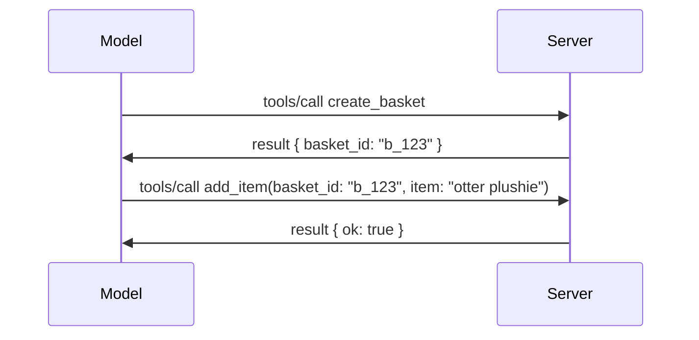

# מה השתנה ב-MCP: המפרט מ-28-07-2026

> **סטטוס:** סופי. מפרט MCP `2026-07-28` שוחרר ב-28 ביולי 2026
> והוא התיקון הנוכחי לפרוטוקול. שיעור זה מתאר את המפרט הסופי.
> כמה דוגמאות בלימוד נותרו מגרסאות ספציפיות ל-
> `2025-11-25` כי ערכות הפיתוח שלהן עדיין לא אימצו את ה-API החדש חסר המצב;
> יש להתייחס אל הדוגמאות הללו כהנחיות תאימות למורשת.

## סקירה כללית

`2026-07-28` הוא התיקון הגדול ביותר ל-MCP מאז השקתו. שישה
הצעות לשיפור מפרטים (SEP) מסירות מושבי פרוטוקול ברמת הפרוטוקול ו-
הופכות את MCP לחסר מצב בשכבת ההובלה, תוספים הופכים למנגנון ממוספר
וראשוני, וכמה תכונות שנכללו מוקדם יותר בלימוד (Roots, Sampling, Logging)
מבוטלות תחת מדיניות מחזור חיים חדשה. שיעור זה
מסכם מה השתנה, למה זה חשוב ומה המשמעות עבור קוד
שנכתב מול `2025-11-25`.

מקור: [מועמד לשחרור מפרט MCP מ-28-07-2026](https://blog.modelcontextprotocol.io/posts/2026-07-28-release-candidate/) (בלוג פרוטוקול הקשר מודל, דיוויד סוריה פארה ודן דלימארסקי).

## מטרות הלמידה

בסוף שיעור זה, תהיה מסוגל:

- להסביר מדוע MCP עובר לפרוטוקול ליבת חסר מצב ואיזו בעיה זה פותר בפריסות בקנה מידה אופקי.
- תאר כיצד מתקשר `initialize`/`initialized` וכותרת `Mcp-Session-Id` מוחלפים.
- זהה את הכותרות החדשות `Mcp-Method` ו-`Mcp-Name` ואת המטא-נתונים של המטמון `ttlMs`/`cacheScope`.
- זהה את מסגרת התוספים ושני תוספים שנכללים בשחרור זה: אפליקציות MCP ומשימות.
- סכם את ההקשחה באישור ואת הפסקת השימוש בהרשמת לקוח דינמית.
  
- זהה אילו תכונות ליבה (Roots, Sampling, Logging) כעת הופכות מיושנות, ומה המשמעות המעשית של זה.
- הסבר את שינוי תקן JSON המלא 2020-12 לכלי `inputSchema`/`outputSchema`.

## פרוטוקול חסר-מדינה

השינוי המרכזי: MCP הופך לפרוטוקול חסר-מדינה בשכבת הפרוטוקול.

### לפני (25-11-2025): סשנים קושרים אותך למופע שרת יחיד

קריאה לכלי מעל Streamable HTTP מתחילה במתקן יד `initialize`. השרת משיב עם כותרת `Mcp-Session-Id` שכל בקשה לאחר מכן חייבת לשאת:

```http
POST /mcp HTTP/1.1
Mcp-Session-Id: 1868a90c-3a3f-4f5b
Content-Type: application/json

{"jsonrpc":"2.0","id":2,"method":"tools/call",
 "params":{"name":"search","arguments":{"q":"otters"}}}
```

מכיוון שהסשן קשור למופע השרת שהנפיק אותו, פריסות בקנה מידה אופקי דורשות **ניתוב דביק** בבלנסר העומסים ו-**אחסון סשן משותף** בין מופעים.

### אחרי (28-07-2026): כל בקשה עצמאית ומכילה את הנתונים שלה

```http
POST /mcp HTTP/1.1
MCP-Protocol-Version: 2026-07-28
Mcp-Method: tools/call
Mcp-Name: search
Content-Type: application/json

{"jsonrpc":"2.0","id":1,"method":"tools/call",
 "params":{"name":"search","arguments":{"q":"otters"},
           "_meta":{"io.modelcontextprotocol/protocolVersion":"2026-07-28",
                    "io.modelcontextprotocol/clientInfo":{"name":"my-app","version":"1.0"},
                    "io.modelcontextprotocol/clientCapabilities":{}}}}
```

כל מופע שרת יכול לטפל בבקשה זו. שינויים עיקריים:

- **מתקן היד `initialize`/`initialized` הוסר** ([SEP-2575](https://github.com/modelcontextprotocol/modelcontextprotocol/pull/2575)). גרסת הפרוטוקול, מידע על הלקוח ויכולות הלקוח מועברים ל-`_meta` בכל בקשה. שיטת `server/discover` חדשה מאפשרת ללקוח לקבל את יכולות השרת מראש כשצריך.
- **כותרת `Mcp-Session-Id` וסשן ברמת הפרוטוקול הוסרו** ([SEP-2567](https://github.com/modelcontextprotocol/modelcontextprotocol/pull/2567)). ניתוב דביק ואחסון סשנים משותפים אינם נדרשים עוד בשכבת הפרוטוקול.

### פרוטוקול חסר-מדינה, אפליקציות עם מדינה

הסרת הסשן ברמת הפרוטוקול לא אומרת שהשרת שלך לא יכול להיות עם מדינה. הדפוס המומלץ הוא אותו דפוס ששימש תמיד API של HTTP: להנפיק טפל מפורש (`basket_id`, `browser_id`) משיחת כלי אחת, ולהעביר את הטפל חזרה כארגומנט רגיל בשיחות הבאות.



דבר זה הופך את המדינה לנראית והגיונית למודל במקום להסתיר אותה במטא-נתוני ההעברה, ומאפשר לכל מופע שרת לטפל בכל שיחה.

### בקשות משרת ללקוח, מובנות מחדש

פרוטוקול חסר-מדינה עדיין צריך דרך עבור שרת לבקש משהו מהלקוח באמצע השיחה (למשל, בקשה לאיסוף מידע):

- **בקשות שהושקו על ידי השרת מותרות רק בזמן שהשרת מעבד בקשת לקוח פעילה** ([SEP-2260](https://github.com/modelcontextprotocol/modelcontextprotocol/pull/2260)) — בעבר המלצה, כעת דרישה. משתמש לא יקבל הפעלה פתאומית.
- **בקשות רב-סבביות** ([SEP-2322](https://github.com/modelcontextprotocol/modelcontextprotocol/pull/2322)) מחליפות חיבור SSE נשאר פתוח. במקום זאת, השרת מחזיר `InputRequiredResult`:

  ```json
  {
    "resultType": "input_required",
    "inputRequests": {
      "confirm": {
        "type": "elicitation",
        "message": "Delete 3 files?",
        "schema": { "type": "boolean" }
      }
    },
    "requestState": "eyJzdGVwIjoxLCJmaWxlcyI6WyJhIiwiYiIsImMiXX0="
  }
  ```

הלקוח אוסף את התשובות ומשחרר מחדש את השיחה המקורית עם `inputResponses` ועוד את `requestState` המשוחזר. כל מופע שרת יכול לטפל בניסיון חוזר כי כל מה שצריך נמצא בטעינה.

### ניתוב, מטמון, מעקב

שלושה שינויים קטנים מקלים על עבודה עם תעבורה חסרת-מדינה:

- **כותרות `Mcp-Method` ו-`Mcp-Name` נדרשות ב-Streamable HTTP** ([SEP-2243](https://github.com/modelcontextprotocol/modelcontextprotocol/pull/2243)) כדי שבלנסרים, שערים ומגבילים יוכלו לנתב לפי הפעולה מבלי לבדוק את גוף ה-JSON. שרתים דוחים בקשות בהם הכותרות והגוף סותרים.
- **`tools/list` ותוצאות קריאת משאבים נושאות `ttlMs` ו-`cacheScope`** ([SEP-2549](https://github.com/modelcontextprotocol/modelcontextprotocol/pull/2549)), בדוגמת HTTP `Cache-Control`. לקוחות יודעים כמה זמן רשימת תוצאות טרייה והאם ניתן לשתף אותה בין משתמשים בביטחה, ללא צורך בזרם SSE ארוך טווח ללמוד על שינויים.
- **תיעוד הפצת W3C Trace Context ב-`_meta`** ([SEP-414](https://github.com/modelcontextprotocol/modelcontextprotocol/pull/414)), מתקן את שמות המפתחות `traceparent`, `tracestate`, ו-`baggage` כדי שמעקב מבוזר יוכל לעקוב אחרי שיחה בין SDK הלקוח, שרת MCP ושרתי מערכת המשך ב-backend תואם [OpenTelemetry](https://opentelemetry.io/).

## תוספים הופכים בכירים

תוספים התקיימו באופן בלתי רשמי ב-`2025-11-25`. [SEP-2133](https://github.com/modelcontextprotocol/modelcontextprotocol/pull/2133) פורמליזציה אותם:

- תוספים מזוהים על ידי מזהי reverse-DNS.
- הם מתווכים דרך מפת `extensions` ביכולות הלקוח והשרת.
- הם חיים במאגרים עצמאיים משלהם `ext-*` עם מנהלים מועברים ומגרסה באופן עצמאי מהספציפיקציה הליבה.
- מסלול הרחבות חדש בתהליך SEP מעניק להם נתיב מהתנסותי לרשמי.

מהדורה זו כוללת שתי הרחבות רשמיות.

### אפליקציות MCP: ממשקי משתמש המיוצרים בשרת

[אפליקציות MCP](https://blog.modelcontextprotocol.io/posts/2026-01-26-mcp-apps/) ([SEP-1865](https://github.com/modelcontextprotocol/modelcontextprotocol/pull/1865)) מאפשרות לשרתים לשלוח ממשקי HTML אינטראקטיביים שהמארחים מציגים במסגרת iFrame מבודדת. כלים מצהירים על תבניות הממשק מראש כדי שהמארחים יוכלו לטעון מראש, לשמור במטמון ולבצע בדיקות אבטחה לפני שפועלת כל תוכנה. כבר כיסיתם את היסודות של זה ב-[שיעור 15: אפליקציות MCP](../03-GettingStarted/15-mcp-apps/README.md) — תחת מסגרת ההרחבות, אפליקציות MCP הן כעת הרחבה פורמלית ולא תכונה התנסותית בליבה.

### Tasks מתקדמים להרחבה

Tasks שוחררו כתכונה התנסותית בליבה ב-`2025-11-25`. השימוש בייצור חשף מספיק שינויים כך שהבית הנכון עבורו הוא הרחבה: [הרחבת Tasks](https://github.com/modelcontextprotocol/modelcontextprotocol/pull/2663) מעצבת מחדש את מחזור החיים סביב המודל ללא מצב — שרת יכול להשיב ב-`tools/call` עם טפל משימה, והלקוח מניע אותה קדימה עם `tasks/get`, `tasks/update`, ו-`tasks/cancel`. יצירת משימה מופנית על ידי השרת: הלקוח מפרסם את ההרחבה, והשרת מחליט מתי צריך לקרוא להרצה כמשימה. `tasks/list` הוסר לחלוטין כי לא ניתן לתחום אותו בבטחה ללא סשנים.

> **הערת העברה:** אם מימשת את API המשימות ההתנסותיי `2025-11-25`, תצטרך לעבור למחזור החיים של ההרחבה החדשה — הוא אינו תואם לאחור.

## חיזוק אישור

מספר SEPs מחזקים את
[ספציפיקציית האישור](https://modelcontextprotocol.io/specification/2026-07-28/basic/authorization)
להתאים יותר לפריסות OAuth 2.0 / OpenID Connect בעולם האמיתי:

| SEP | שינוי |
|---|---|
| [SEP-2468](https://github.com/modelcontextprotocol/modelcontextprotocol/pull/2468) | לקוחות חייבים לאמת את הפרמטר `iss` בתגובות אישור בהתאם ל-[RFC 9207](https://www.rfc-editor.org/rfc/rfc9207), כדי למנוע התקפות ערבוב נפוצות בדפוס ההפעלה של MCP עם לקוח יחיד ורבים שרתים. גרסה עתידית תדרוש דחיית תגובות החסרות `iss`. |
| [SEP-837](https://github.com/modelcontextprotocol/modelcontextprotocol/pull/837) | לקוחות רישום דינמי תואמים בלבד מצהירים על `application_type` של OpenID Connect שלהם, ומונעים ברירות מחדל שגויות של `"web"` עבור לקוחות שולחן עבודה ו-CLI. |
| [SEP-2352](https://github.com/modelcontextprotocol/modelcontextprotocol/pull/2352) | מידע הרישום התואם בלבד מקושר ל-`issuer` של שרת האישור המנפיק; הלקוחות מבצעים רישום חוזר אם המשאב עובר. |
| [SEP-2207](https://github.com/modelcontextprotocol/modelcontextprotocol/pull/2207) | מתעד כיצד לבקש אסימוני ריענון משרתי אישור בסגנון OpenID Connect. |
| [SEP-2350](https://github.com/modelcontextprotocol/modelcontextprotocol/pull/2350) | מבהיר הצטברות תחום במהלך הרשאת העלאת הרשאות. |
| [SEP-2351](https://github.com/modelcontextprotocol/modelcontextprotocol/pull/2351) | מבהיר את סיומת הגילוי `.well-known`. |

אם אתם בונים שרת הרשאה עבור MCP, ספקו `iss` בתגובות ההרשאה
ופעלו לפי המפרט הסופי של ההרשאה. ראו
[02-Security](../02-Security/README.md) לקבלת הנחיות יישום.

רישום דינמי של לקוחות נשאר זמין לתאימות אך גם
מיושן ב-`2026-07-28`. יישומים חדשים צריכים להשתמש במסמכי Client ID Metadata.


## תכונות מיושנות

תחת
[מדיניות מחזור חיים של תכונות](https://github.com/modelcontextprotocol/modelcontextprotocol/pull/2577),
Roots, Sampling, Logging, ורישום דינמי של לקוחות הם **מיושנים**:

| תכונה | תחליף מומלץ |
|---|---|
| Roots | פרמטרים של כלי, URI של משאבים, או תצורת שרת |
| Sampling | אינטגרציה ישירה עם API של ספקי LLM |
| Logging | `stderr` ל טרנזקציות stdio; OpenTelemetry לתצפיות מובנות |
| רישום דינמי של לקוחות | מסמכי Client ID Metadata |

תכונות אלו עדיין קיימות ב`2026-07-28` לתאימות. הן זכאיות להסרה
במהלך הרוויזיה הראשונה של המפרט שתפורסם ב-28 ביולי 2027 או לאחר מכן;
ההסרה בפועל עשויה להתרחש מאוחר יותר. יישומים חדשים צריכים להשתמש בדפוסי התחליף
המצוינים לעיל.

## סכמת JSON מלאה 2020-12 לכלים

כלי `inputSchema` ו-`outputSchema` מוגברים לסכמת [JSON Schema 2020-12](https://json-schema.org/draft/2020-12) המלאה ([SEP-2106](https://github.com/modelcontextprotocol/modelcontextprotocol/pull/2106)):

- סכמות הקלט שומרות על מגבלת השורש `type: "object"` אך עתה מאפשרות קומפוזיציה (`oneOf`, `anyOf`, `allOf`), תנאים, והפניות (`$ref`, `$defs`).
- סכמות הפלט בלתי מוגבלות, ו-`structuredContent` יכול כעת להיות כל ערך JSON במקום רק אובייקט.
- יישומים אסורים לבצע התייחסות אוטומטית ל-URI חיצוניים מסוג `$ref` וצריכים להגביל את עומק הסכמה וזמן האימות (שיקול מניעת שירות שחל אם מאמתים סכמות בצד השרת).

בנפרד, קוד השגיאה עבור משאב חסר משתנה מ-`-32002` הייעודי ל-MCP ל-`-32602` התקני של JSON-RPC (Invalid Params) ([SEP-2164](https://github.com/modelcontextprotocol/modelcontextprotocol/pull/2164)). אם הלקוח שלכם מתאים לערך המילולי `-32002`, תצטרכו לעדכן אותו.

## איך הפרוטוקול יתפתח מכאן

שחרור זה כולל שינויים מהותיים, שאינם צפויים על ידי מנהלי MCP להיות הנורמה בהמשך. שלושה SEPs ממשליים מיועדים למנוע חזרה:

- **מדיניות מחזור חיים של תכונות** מעניקה לכל תכונה נתיב פעיל → מיושן → מוסר עם לפחות שנים עשר חודשים בין ההזנחה להסרה האפשרית המוקדמת ביותר.
- **מסגרת הרחבות** מאפשרת יכולות חדשות להישלח כהרחבות אופציונליות ולהתייצב שם לפני (אם בכלל) המעבר למפרט הליבה.
- SEP למסלול תקנים כבר אינו יכול להגיע למעמד סופי עד שתסריט תואם ינחת ב[ערכת התאימות](https://github.com/modelcontextprotocol/conformance) ([SEP-2484](https://github.com/modelcontextprotocol/modelcontextprotocol/pull/2484)) — אותה ערכה שהמערכת [דרגת ה-SDK](https://github.com/modelcontextprotocol/modelcontextprotocol/pull/1777) בוחנת נגדה SDKs רשמיים.

## ציר זמן שחרור ואימות

- מועמד לשחרור ננעל ב-21 במאי 2026.
- מפרט סופי שוחרר ב-28 ביולי 2026.
- תמיכה ב-SDK עשויה לאחר את המפרט. בדקו את
  [תיעוד ה-SDK](https://modelcontextprotocol.io/docs/sdk) ואת
  ההערות לשחרור של ה-SDK לפני מעבר לדוגמה.
- עקבו אחרי השינויים הסופיים ב-
  [מפרט 2026-07-28](https://modelcontextprotocol.io/specification/2026-07-28/)
  ו-
  [יומן שינויים](https://modelcontextprotocol.io/specification/2026-07-28/changelog).

## מה זה אומר עבור תוכנית הלימודים הזו

תכנית הלימודים עוברת מ`2025-11-25` דוגמאות אל המפרט הנוכחי של
`2026-07-28`. באופן מוחשי:

- **Sessions ו-`initialize` handshake** בדוגמאות המכוונות במפורש ל-
  `2025-11-25` הם התנהגות מיושנת. פרוטוקול ה-`2026-07-28` מחליף אותם
  בדגם הבקשה ללא מדינה המפורט לעיל.
- **Sampling ו-Roots** נשארים זמינים לתאימות אך הם מיושנים.
  עיצובים חדשים צריכים להשתמש בתבניות ההחלפה המפורטות לעיל.
- **תכונת המשימות הניסיונית**, אם השתמשת בה, תצטרך לעבור למעגל החיים החדש של הרחבת המשימות.
- **אפליקציות MCP** ([שיעור 15](../03-GettingStarted/15-mcp-apps/README.md)) אינן מושפעות למעשה; הן רק עוברות תחת מסגרת ההרחבות הרשמית.

## משאבים נוספים

- [מפרט MCP 2026-07-28](https://modelcontextprotocol.io/specification/2026-07-28/)
- [יומן שינויים 2026-07-28](https://modelcontextprotocol.io/specification/2026-07-28/changelog)
- [מועמד לשחרור מפרט MCP ל-2026-07-28 (פוסט בלוג היסטורי)](https://blog.modelcontextprotocol.io/posts/2026-07-28-release-candidate/)
- [עתיד תעבורות MCP](https://blog.modelcontextprotocol.io/posts/2025-12-19-mcp-transport-future/)
- [קווי הנחיה של SEP](https://modelcontextprotocol.io/community/sep-guidelines)
- [מערכת דרגות SDK של MCP](https://modelcontextprotocol.io/docs/sdk)

## צעדים הבאים

חזור אל [מושגי ליבה](./README.md) או המשך אל
[אבטחה](../02-Security/README.md) כדי ליישם את ההנחיות הנוכחיות של `2026-07-28`.

---

<!-- CO-OP TRANSLATOR DISCLAIMER START -->
**כתב ויתור**:
מסמך זה תורגם באמצעות שירות תרגום אוטומטי [Co-op Translator](https://github.com/Azure/co-op-translator). למרות שאנו שואפים לדיוק, יש לקחת בחשבון שתרגומים אוטומטיים עלולים להכיל שגיאות או אי-דיוקים. יש להחשיב את המסמך המקורי בשפתו הטבעית כמקור הסמכות. למידע קריטי מומלץ להשתמש בתרגום מקצועי על ידי מתרגם אדם. אנו לא אחראים לכל אי-הבנה או פירוש שגוי הנובע מהשימוש בתרגום זה.
<!-- CO-OP TRANSLATOR DISCLAIMER END -->