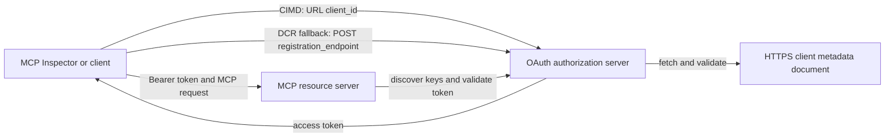

# דוגמת הרשאת CIMD ו-DCR

דוגמת TypeScript זו משווה בין שתי דרכים בהן לקוח OAuth יכול להשיג זהות
לפני גישה לשרת MCP מוגן:

- **Client ID Metadata Documents (CIMD)** משתמש במסלול HTTPS יציב כ-
  `client_id`. זוהי המנגנון המועדף ללקוחות ולשרתי הרשאה
  שאין להם מערכת יחסים קיימת מראש.
- **Dynamic Client Registration (DCR)** מבקש משרת ההרשאה ליצור
  מזהה לקוח מסתורי בזמן ריצה. MCP `2026-07-28` שומר על DCR רק למען תאימות לאחור.


הבקשה הסטטלי של MCP `2026-07-28`. היא פועלת עם שרת הרשאה חיצוני
מסוג OAuth 2.1/OpenID Connect כמו Auth0. שרת MCP הוא שרת משאבים:
הוא מאמת אסימוני גישה אך אינו מאמת משתמשים או מנפיק אסימונים.

## מטרות למידה

בסיום הדוגמה, תוכל:

- להסביר מדוע CIMD מועדף על DCR עבור לקוחות MCP חדשים.

- להגדיר שרת משאבים MCP לגילוי OAuth ולאימות JWT.
- לתרגל CIMD ו-DCR עם אותו שרת MCP ושרת הרשאה.
- לאכוף היקף OAuth בתוך כלי MCP.
- לזהות אילו תפקידים שייכים ללקוח, לשרת המשאבים ולשרת ההרשאה.

## ארכיטקטורה


## ארכיטקטורה



שרת ההרשאה בוחר ואימות את מנגנון ההרשמה.
שרת ה-MCP רואה רק את טענת `client_id` המאומתת שנוצרה. כתובת HTTPS
עם נתיב מזהה את ה-CIMD. זיהוי לא שקוף אינו מספיק להוכחת DCR מכיוון ש
לקוח שנרשם מראש יכול גם להשתמש בזיהוי לא שקוף; ההגדרה האופציונלית 
`DCR_CLIENT_ID_PREFIX` מספקת רמז הדגמה ספציפי לספק.

## סדר עדיפות הרשמה

לקוחות MCP התומכים בכל המנגנונים צריכים להשתמש בסדר הבא:

1. השתמש במידע של לקוח שנרשם מראש כאשר הוא כבר זמין.
2. השתמש ב-CIMD כאשר שרת ההרשאה מפרסם
   `client_id_metadata_document_supported: true`.
3. השתמש ב-DCR רק כאפשרות חלופית כאשר השרת מפרסם
   `registration_endpoint`.
4. בקש מהמשתמש מידע על לקוח שנרשם מראש כאשר אף אחד מהנ"ל אינו
   זמין.

## פריסת הפרויקט

```text
src/
  config.ts          Environment validation
  dcr.ts             DCR compatibility request
  mcp.ts             MCP tools and scope checks
  oauth.ts           Authorization metadata and JWT verification
  register-dcr.ts    DCR command-line helper
  registration.ts    CIMD document and mechanism classification
  server.ts          Express, OAuth discovery, and MCP endpoint
test/
  dcr.test.ts
  oauth.test.ts
  registration.test.ts
  server.test.ts
```

## דרישות מוקדמות

- Node.js גרסה 20.6 או חדשה יותר. התסריטים משתמשים ב-`--env-file` ו-`--import`.
- שרת הרשאות OAuth 2.1/OpenID Connect שתומך ב:
  - זרימת קוד הרשאה עם S256 PKCE.
  - OAuth Protected Resource Metadata ו-Resource Indicators.
  - אסימוני גישה JWT ונקודת קצה JWKS.
  - CIMD, בנוסף ל-DCR אם תרצה להשוות לגיבוי הישן.
- MCP Inspector או לקוח MCP `2026-07-28` אחר.
- כתובת HTTPS ציבורית למסמך CIMD. מנהרת פיתוח מתאימה
  למעבדה; השתמש בדומיין יציב בסביבת ייצור.

## התקנה ובדיקה

```bash
npm install
npm run build
npm test
```

השתים-עשרה הבדיקות משתמשות במפתחות מקומיים ובנקודות קצה HTTP מדומות. אין צורך בחשבון
של שרת הרשאה. הן מאמתות:

- צורת מסמך CIMD ומגבלות URL.
- סיווג כנה של כתובת URL וזיהוי לקוח לא שקוף.
- טיפול בבקשות ותשובות DCR.
- דחיית נקודות קצה DCR לא מאובטחות שאינן לולאת חזרה.
- אימות חתימת JWT, מוצא, קהל יעד, תוקף, מזהה לקוח ותחום.
- קריאת `2026-07-28` של MCP בתהליך ל-`registration-info`.

## הגדר את שרת ההרשאה

שמות השליטה המדויקים משתנים לפי ספק. הגדר יכולות אלו:

1. צור API או שרת משאבים שהמזהה שלו תואם בדיוק את URL ה-MCP שלך,
   כולל `/mcp`, לדוגמה `http://127.0.0.1:3001/mcp`.
2. השתמש באסימוני גישה RS256 וכלול טענת `client_id` או `azp`.
3. הוסף את ההרשאה או התחום `tool:greet`.
4. אפשר זרימת קוד הרשאה עם S256 PKCE ללקוחות מובנים ציבוריים.
5. אפשר Client ID Metadata Documents.
6. להשוואה בלבד, אפשר Dynamic Client Registration.
7. ודא שמטא-דטה של שרת ההרשאה מפרסם:
   - `issuer`
   - `authorization_endpoint`
   - `token_endpoint`
   - `jwks_uri`
   - `client_id_metadata_document_supported: true`
   - `registration_endpoint` כש-DCR מופעל

### דוגמה ל-Auth0

עבור Auth0, הפעל רישום מסמך Client ID Metadata, רישום דינמי לאפליקציות OIDC, ותאימות לארגומנט משאבים. צור API
שהמזהה שלו הוא הכתובת המדויקת של MCP והוסף את ההרשאה `tool:greet`.
אפשר למשתמש הבדיקה וללקוחות צד-שלישי לבקש הרשאה זו.


תיעוד הספק לפני שתשתמש בהגדרות אלה מחוץ למעבדה זו.


צור `.env` מהדוגמה:

```powershell
Copy-Item .env.example .env
```

במעטפות תואמות bash:

```bash
cp .env.example .env
```

הגדר את הערכים האלה:

```dotenv
MCP_SERVER_URL=http://127.0.0.1:3001/mcp
AUTHORIZATION_SERVER_ISSUER=https://your-tenant.example.com/
AUTHORIZATION_SERVER_METADATA_URL=https://your-tenant.example.com/.well-known/openid-configuration
CLIENT_METADATA_URL=https://your-public-host.example.com/client-metadata.json
OAUTH_REDIRECT_URIS=http://127.0.0.1:6274/oauth/callback
DCR_CLIENT_ID_PREFIX=tpc_
```

פרטים חשובים:

- `AUTHORIZATION_SERVER_ISSUER` חייב להתאים בדיוק ל-`issuer` במטא-נתוני שרת ההרשאה שהתגלו, כולל כל סלאש בסוף.

- `MCP_SERVER_URL` חייב להתאים לקהל של אסימון הגישה.
- `CLIENT_METADATA_URL` חייב להשתמש ב-HTTPS, להכיל נתיב שאינו שורש, ולהיות
  כתובת ה-URL הציבורית שמשרתת את מסלול המטא-נתונים. מחרוזות שאילתא ושברים
  נדחות כדי שהמסלול ו-`client_id` יישארו זהים.
- `OAUTH_REDIRECT_URIS` היא רשימת הרשאה מופרדת בפסיקים. ברירת המחדל היא הפנייה
  החוזרת של MCP Inspector.
- `DCR_CLIENT_ID_PREFIX` אופציונלי ותלוי בספק. השאר אותו ריק כאשר
  לספק שלך אין קידומת DCR אמינה.

## פרסם את מסמך CIMD

התחל מנהרה שמפנה את המקור הציבורי שלה ב-HTTPS אל `127.0.0.1:3001`.
הגדר את `CLIENT_METADATA_URL` לאותו מקור בתוספת `/client-metadata.json`, ואז הרץ:

```bash
npm run build
npm start
```

אמת את שני מסמכי הגילוי:

```bash
curl http://127.0.0.1:3001/health
curl http://127.0.0.1:3001/client-metadata.json
curl http://127.0.0.1:3001/.well-known/oauth-protected-resource/mcp
```

ה-`client_id` שמוחזר מכתובת ה-URL הציבורית של המטא-נתונים חייב להיות זהה ביתר פירוט ל-URL זה. 
שרת ההרשאה חייב לאמת את המסמך ואת כתובת ה-URI להחזרה לפני הוצאת האסימון.


> [!NOTE]
> הדוגמה מארחת את המסמך של הלקוח ואת שרת המשאבים MCP בתהליך אחד
> כדי לשמור על המעבדה קטנה. בייצור, לקוח ה-MCP הוא הבעלים ומארח את מסמך CIMD שלו
> בנפרד משרת המשאבים.

## השוו בין CIMD ו-DCR

הפעל את MCP Inspector:

```bash
npx @modelcontextprotocol/inspector
```

השתמש ב-Streamable HTTP והתחבר ל-`http://127.0.0.1:3001/mcp`.

### CIMD (מועדף)

1. הזן את ה-`CLIENT_METADATA_URL` הציבורי כ-Client ID של OAuth.
2. בקש את `tool:greet` בתוספת כל תחומי זהות הנדרשים על ידי הספק שלך.
3. השלם את תהליך ההתחברות וההסכמה.
4. קרא ל-`registration-info`. היא מדווחת על `mechanism: "cimd"`.
5. קרא ל-`greet` כדי לאמת את כוח האכיפה של התחום.

### DCR (פתרון תאימות חלופי)

1. נקה את מצב OAuth השמור של Inspector.
2. השאר את שדה OAuth Client ID ריק כדי ש-Inspector יוכל להשתמש ב-
   `registration_endpoint` המפורסם.
3. השלם את תהליך ההתחברות וההסכמה.
4. קרא ל-`registration-info`.
5. אם `DCR_CLIENT_ID_PREFIX` תואם ל-IDs שנוצרו על ידי הספק, הכלי
   מדווח על `mechanism: "dcr"`; אחרת הוא מדווח בצורה נכונה על
   `opaque-client-id`.

ניתן גם להדגים את בקשת הרישום ישירות:

```bash
npm run build
npm run register:dcr
```

העוזר מדפיס את מזהה הלקוח שהוחזר אך לעולם לא מדפיס סוד לקוח.
התייחס לכל סוד שהוחזר כרגיש ואחסן אותו במחסן סודות מתאים.

## כלים

| כלי | תחום נדרש | מטרה |
| --- | --- | --- |
| `registration-info` | לקוח מאומת | מדווח על סוג מזהה הלקוח |
| `greet` | `tool:greet` | מדגים הרשאות לפי כלי |

## הערות אבטחה

- אמת חתימות JWT באמצעות נקודת הקצה JWKS של שרת ההרשאות.
- דרוש התאמה מדויקת של המנפיק והקהל.
- דרוש תוקף וטענות מזהה לקוח.
- לעולם אל תקבל טוקן שהונפק עבור משאב שונה.
- לעולם אל תעביר את טוקן ה-MCP ל-API מדרגה שנייה.
- שמור על אישורי DCR קשורים למנפיק שיצר אותם.
- אמת URI הפניות מחדש של CIMD בהתאמה מדויקת.
- החל בקרות SSRF כאשר שרת האישור מושך URL-ים של CIMD.
- השתמש ב-HTTPS לנקודות קצה של אישור ומטא-נתונים מחוץ לסביבת פיתוח לולאה חוזרת
  (loopback).
- אל תסיק DCR מזהות לקוח שקופה אלא אם ספק השירות מתעד קונבנציה
  מהימנה לזיהוי.

## מקורות

- [מפרט אישור MCP](https://modelcontextprotocol.io/specification/2026-07-28/basic/authorization)
- [רישום לקוח MCP](https://modelcontextprotocol.io/specification/2026-07-28/basic/authorization/client-registration)
- [הנחיות אבטחת MCP הטובות ביותר](https://modelcontextprotocol.io/specification/2026-07-28/basic/security_best_practices)
- [מדריך אישור SDK של MCP ב-TypeScript v2](https://ts.sdk.modelcontextprotocol.io/v2/serving/authorization)
- [רישום לקוח דינמי OAuth (RFC 7591)](https://datatracker.ietf.org/doc/html/rfc7591)
- [טיוטת מסמך מטא-נתונים של מזהה לקוח OAuth](https://datatracker.ietf.org/doc/html/draft-ietf-oauth-client-id-metadata-document-00)

## הוקרה

גישת ההוראה זו-ליד-זו הושפעה מ-
[Sambego/auth0-xmcp-cimd](https://github.com/Sambego/auth0-xmcp-cimd). דוגמה זו היא מימוש מקורי, נייטרלי לספק, שנבנה באמצעות
SDK הרשמי של MCP ב-TypeScript v2 לתכנית הלימודים הזו.


---

<!-- CO-OP TRANSLATOR DISCLAIMER START -->
**כתב ויתור**:
מסמך זה תורגם באמצעות שירות תרגום אוטומטי [Co-op Translator](https://github.com/Azure/co-op-translator). למרות שאנו שואפים לדיוק, יש לקחת בחשבון שתרגומים אוטומטיים עלולים להכיל שגיאות או אי-דיוקים. יש להחשיב את המסמך המקורי בשפתו הטבעית כמקור הסמכות. למידע קריטי מומלץ להשתמש בתרגום מקצועי על ידי מתרגם אדם. אנו לא אחראים לכל אי-הבנה או פירוש שגוי הנובע מהשימוש בתרגום זה.
<!-- CO-OP TRANSLATOR DISCLAIMER END -->