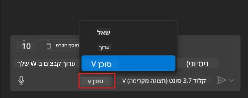
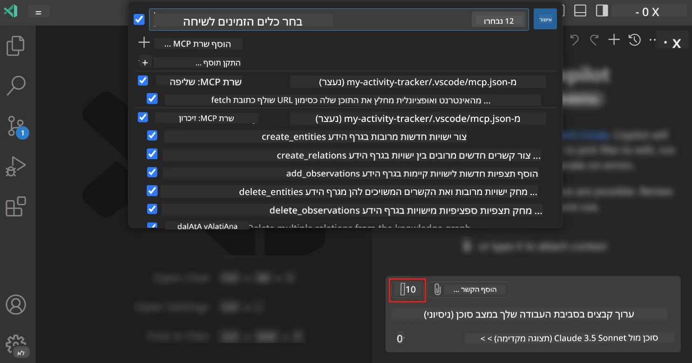
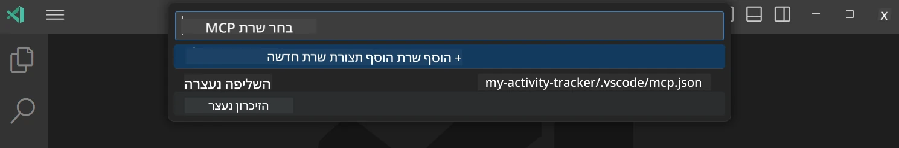
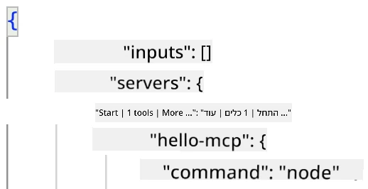
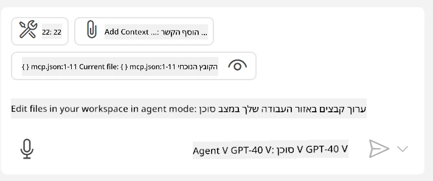
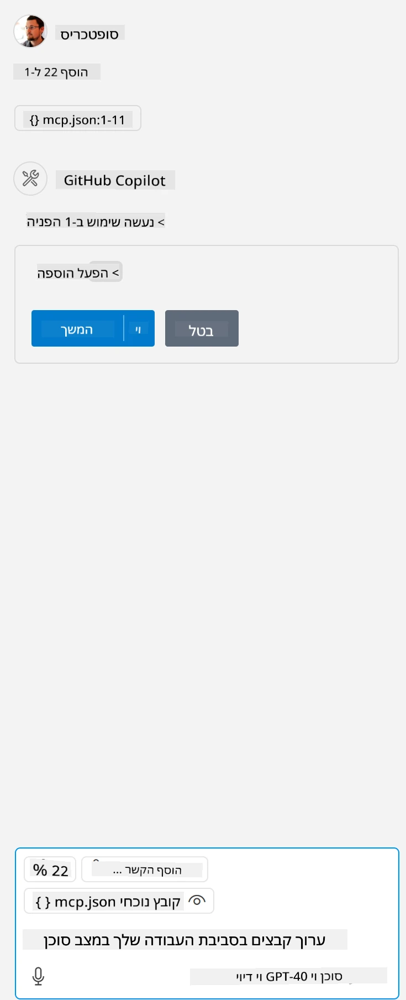

# שימוש בשרת ממצב GitHub Copilot Agent  

Visual Studio Code ו-GitHub Copilot יכולים לפעול כלקוח ולצרוך שרת MCP. אתם בטח שואלים למה נרצה לעשות את זה? ובכן, זה אומר שכל הפיצ'רים שיש לשרת MCP יכולים כעת לשמש מתוך סביבת הפיתוח שלכם. דמיינו שאתם מוסיפים למשל את שרת MCP של GitHub, זה יאפשר שליטה על GitHub דרך פקודות טבעיות במקום להקליד פקודות ספציפיות בטרמינל. או דמיינו כל דבר שיכול לשפר את חוויית המפתח שלכם וכל זה נשלט בשפה טבעית. עכשיו אתם רואים את היתרון, נכון?  

## סקירה כללית  

בשיעור זה נלמד כיצד להשתמש ב-Visual Studio Code ובמצב Agent של GitHub Copilot כלקוח עבור שרת MCP שלכם.  

## יעדי למידה  

בסופו של שיעור זה תוכלו:  

- לצרוך שרת MCP דרך Visual Studio Code.  
- להפעיל יכולות כמו כלים דרך GitHub Copilot.  
- להגדיר את Visual Studio Code כדי למצוא ולנהל את שרת MCP שלכם.  

## שימוש  

ניתן לשלוט בשרת MCP שלכם בשתי דרכים שונות:  

- ממשק משתמש, תראו כיצד זה נעשה בהמשך בפרק זה.  
- טרמינל, אפשר לשלוט בדברים מהטרמינל באמצעות הקובץ הניתן להרצה `code`:  

  כדי להוסיף שרת MCP לפרופיל המשתמש שלכם, השתמשו באפשרות השורת פקודה --add-mcp, וספקו את תצורת השרת ב-JSON בצורה {\"name\":\"server-name\",\"command\":...}.  

  ```
  code --add-mcp "{\"name\":\"my-server\",\"command\": \"uvx\",\"args\": [\"mcp-server-fetch\"]}"
  ```
  
### צילומי מסך  

  
  
  

בואו נדבר יותר על איך להשתמש בממשק הויזואלי בחלקים הבאים.  

## גישה  

כך אנו צריכים לגשת לזה ברמה גבוהה:  

- להגדיר קובץ למציאת שרת MCP שלנו.  
- להפעיל/להתחבר לשרת כדי לקבל את רשימת היכולות שלו.  
- להשתמש ביכולות דרך ממשק השיחה של GitHub Copilot.  

מעולה, עכשיו שאנחנו מבינים את הזרימה, בואו ננסה להשתמש בשרת MCP דרך Visual Studio Code בתרגיל.  

## תרגיל: שימוש בשרת  

בתרגיל זה, נגדיר את Visual Studio Code כדי למצוא את שרת MCP שלכם כך שניתן יהיה להשתמש בו דרך ממשק השיחה של GitHub Copilot.  

### -0- שלב מקדים, הפעלת גילוי שרתי MCP  

יתכן ותצטרכו להפעיל גילוי של שרתי MCP.  

1. גשו אל `File -> Preferences -> Settings` ב-Visual Studio Code.  

1. חפשו "MCP" והפעילו את `chat.mcp.discovery.enabled` בקובץ settings.json.  

### -1- יצירת קובץ קונפיגורציה  

התחילו ביצירת קובץ קונפיגורציה בשורש הפרויקט שלכם, צריך להיות קובץ בשם MCP.json ולמקם אותו בתיקייה בשם .vscode. הקובץ צריך להיראות כך:  

```text
.vscode
|-- mcp.json
```
  
לאחר מכן, נראה כיצד להוסיף רשומת שרת.  

### -2- הגדרת שרת  

הוסיפו את התוכן הבא ל-*mcp.json*:  

```json
{
    "inputs": [],
    "servers": {
       "hello-mcp": {
           "command": "node",
           "args": [
               "build/index.js"
           ]
       }
    }
}
```
  
דוגמה פשוטה למעלה כיצד להפעיל שרת שנכתב ב-Node.js, עבור סביבות ריצה אחרות ציינו את הפקודה המתאימה להפעלת השרת באמצעות `command` ו-`args`.  

### -3- הפעלת השרת  

עכשיו כשהוספתם את הרשומה, בואו נתחיל להפעיל את השרת:  

1. איתרו את הרשומה שלכם ב-*mcp.json* וודאו שקיים הסמל "השמעה":  

    

1. לחצו על סמל "השמעה", אמור להיראות אייקון הכלים בממשק השיחה של GitHub Copilot שמגדיל את כמות הכלים הזמינים. אם תלחצו על האייקון הזה, תראו רשימת כלים רשומים. תוכלו לסמן או להסיר סימון לכל כלי בהתאם אם תרצו ש-GitHub Copilot ישתמש בו כהקשר:  

    

1. כדי להפעיל כלי, הקלידו פקודה שאתם יודעים תתאים לתיאור של אחד הכלים שלכם, לדוגמה פקודה כמו "add 22 to 1":  

    

  אתם אמורים לראות תגובה שאומרת 23.  

## משימה  

נסו להוסיף רשומת שרת לקובץ *mcp.json* שלכם וודאו שאתם יכולים להפעיל/לכבות את השרת. וודאו גם שאתם יכולים לתקשר עם הכלים בשרת דרך ממשק השיחה של GitHub Copilot.  

## פתרון  

[פתרון](./solution/README.md)  

## נקודות מרכזיות  

הנקודות המרכזיות מפרק זה הן:  

- Visual Studio Code הוא לקוח מצוין שמאפשר לצרוך מספר שרתי MCP וכלים שלהם.  
- ממשק השיחה של GitHub Copilot הוא כיצד מתקשרים עם השרתים.  
- ניתן לבקש קלט מהמשתמש כמו מפתחות API שיכולים להימסר לשרת MCP בעת הגדרת רשומת השרת בקובץ *mcp.json*.  

## דוגמאות  

- [מחשבון ב-Java](../samples/java/calculator/README.md)  
- [מחשבון ב-.NET](../../../../03-GettingStarted/samples/csharp)  
- [מחשבון ב-JavaScript](../samples/javascript/README.md)  
- [מחשבון ב-TypeScript](../samples/typescript/README.md)  
- [מחשבון ב-Python](../../../../03-GettingStarted/samples/python)  

## משאבים נוספים  

- [תיעוד Visual Studio](https://code.visualstudio.com/docs/copilot/chat/mcp-servers)  

## מה הלאה  

- הבא: [יצירת שרת stdio](../05-stdio-server/README.md)  

---

<!-- CO-OP TRANSLATOR DISCLAIMER START -->
**כתב ויתור**:
מסמך זה תורגם באמצעות שירות תרגום אוטומטי [Co-op Translator](https://github.com/Azure/co-op-translator). למרות שאנו שואפים לדיוק, יש לקחת בחשבון שתרגומים אוטומטיים עלולים להכיל שגיאות או אי-דיוקים. יש להחשיב את המסמך המקורי בשפתו הטבעית כמקור הסמכות. למידע קריטי מומלץ להשתמש בתרגום מקצועי על ידי מתרגם אדם. אנו לא אחראים לכל אי-הבנה או פירוש שגוי הנובע מהשימוש בתרגום זה.
<!-- CO-OP TRANSLATOR DISCLAIMER END -->