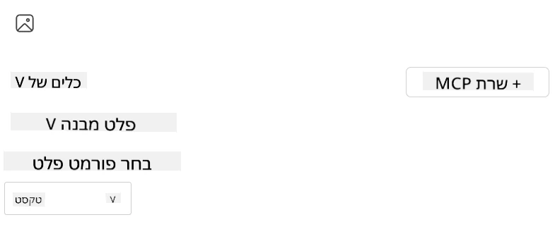
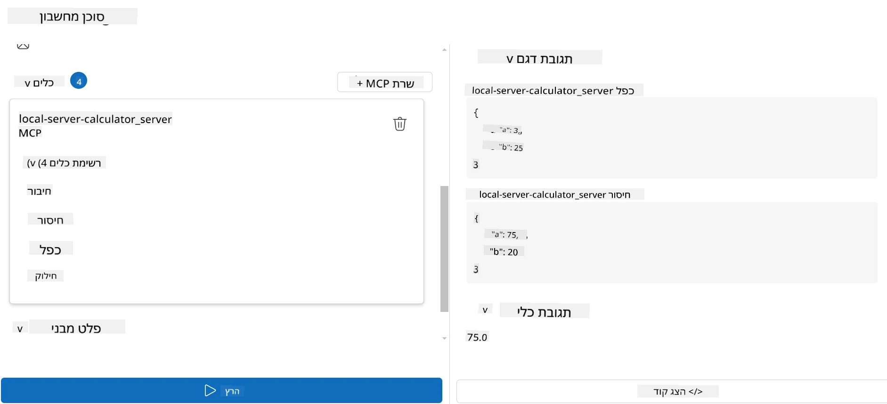

# צריכת שרת עם Microsoft Foundry Toolkit עבור Visual Studio Code

כשאתה בונה סוכן בינה מלאכותית, זה לא רק על יצירת תגובות חכמות; זה גם על מתן היכולת לסוכן שלך לפעול. כאן נכנס לתמונה פרוטוקול הקשר מודל (MCP). MCP מקל על סוכנים לגשת לכלים ושירותים חיצוניים בצורה עקבית. תחשוב על זה כמו לחבר את הסוכן שלך לתיבת כלים שהוא יכול *באמת* להשתמש בה.

נניח שאתה מחבר סוכן לשרת MCP של מחשבון. לפתע, הסוכן שלך יכול לבצע פעולות חשבון פשוט על ידי קבלת פקודה כמו "כמה זה 47 כפול 89?" — בלי צורך לקודד לוגיקה ידנית או לבנות APIs מותאמים אישית.

## סקירה כללית

שיעור זה יכסה כיצד לחבר שרת MCP של מחשבון לסוכן עם
[Microsoft Foundry Toolkit עבור Visual Studio Code](https://aka.ms/AIToolkit),
ולאפשר לסוכן שלך לבצע פעולות חשבון דרך שפת טבעית.

Microsoft Foundry Toolkit מפשט את פיתוח ובדיקת יישומי בינה מלאכותית גנרטיביים
עם דגמים מקומיים ומאוחסנים בענן.

*הערה*: ה-Toolkit תומך כרגע בתבניות MCP של Python ו-TypeScript.

## יעדים ללמידה

בסיום שיעור זה, תוכל:

- לצרוך שרת MCP עם Microsoft Foundry Toolkit.
- להגדיר תצורת סוכן כך שיוכל לגלות ולנצל כלים שמספק שרת MCP.
- להשתמש בכלי MCP דרך שפה טבעית.

## גישה

כך נצטרך לגשת לזה ברמה גבוהה:

- ליצור סוכן ולהגדיר לו פקודת מערכת.
- ליצור שרת MCP עם כלי מחשבון.
- לחבר את Agent Builder לשרת MCP.
- לבדוק את קריאת הכלים של הסוכן דרך שפה טבעית.

מצוין, עכשיו כשאנחנו מבינים את הזרימה, נגדיר סוכן בינה מלאכותית לנצל כלים חיצוניים באמצעות MCP, ונרחיב את היכולות שלו!

## דרישות מוקדמות

- [Visual Studio Code](https://code.visualstudio.com/)
- [Microsoft Foundry Toolkit עבור Visual Studio Code](https://aka.ms/AIToolkit)

## תרגיל: צריכת שרת

> [!WARNING]
> הערה למשתמשי macOS. אנו חוקרים כעת בעיה המשפיעה על התקנת תלותים ב-macOS. כתוצאה מכך, משתמשי macOS לא יוכלו להשלים את המדריך הזה כרגע. נעדכן את ההוראות ברגע שתוקן זמין. תודה על סבלנותכם והבנתכם!

בתרגיל זה, תבנה, תריץ, ותשפר סוכן בינה מלאכותית עם כלים מ
שרת MCP בתוך Visual Studio Code בעזרת Microsoft Foundry Toolkit.

### -0- שלב מקדים, הוסף פריסה של Microsoft Foundry GPT-5.1

צור משאב Microsoft Foundry, פרוס **GPT-5.1**, והוסף את הפריסה
ל**הדגמים שלי**. סקור את
[לוח הזמנים לפסילת דגמים](https://learn.microsoft.com/azure/foundry/openai/concepts/model-retirement-schedule)
בבחירת פריסה.

1. פתח את **Microsoft Foundry Toolkit** מה**סרגל הפעילות**.
1. בקטגוריית **קטלוג**, בחר **דגמים** כדי לפתוח את **קטלוג דגמים**. בחירה ב**דגמים** תפתח את **קטלוג הדגמים** בטאב עורך חדש.
1. חבר את פרויקט Microsoft Foundry שלך ובחר בפריסת **GPT-5.1**.
1. לחץ על **+ הוסף** כדי להוסיף את הפריסה ל**הדגמים שלי** שלך.
1. בסרגל הפעילות, וודא שהפריסה מופיעה ברשימה.

### -1- צור סוכן

ה**Agent (Prompt) Builder** מאפשר לך ליצור ולהתאים אישית סוכני בינה מלאכותית משלך. בחלק זה, תיצור סוכן חדש ותגדיר מודל להפעלת השיחה.

1. פתח את **Microsoft Foundry Toolkit** מה**סרגל הפעילות**.
1. בקטגוריית **כלים**, בחר **Agent (Prompt) Builder**. בחירת **Agent (Prompt) Builder** תפתח את העורך בקטגוריית סוכן בטאב חדש.
1. לחץ על כפתור **+ סוכן חדש**. התוסף יפעיל אשף הגדרות דרך **Command Palette**.
1. הזן את השם **סוכן מחשבון** ולחץ **Enter**.
1. ב**Agent (Prompt) Builder**, בחר את פריסת Foundry **GPT-5.1** שלך.

### -2- צור פקודת מערכת לסוכן

לאחר שהסוכן מסודר, הגיע הזמן להגדיר את האופי והמטרה שלו. בחלק זה, תשתמש בתכונה **צור פקודת מערכת** כדי לתאר את ההתנהגות המיועדת של הסוכן — במקרה זה, סוכן מחשבון — ולתת למודל לכתוב את פקודת המערכת עבורך.

1. עבור לקטגוריית **פקודות**, לחץ על כפתור **צור פקודת מערכת**. כפתור זה יפתח בבונה הפקודות אשר משתמש בבינה מלאכותית ליצירת פקודת מערכת לסוכן.
1. בחלון **צור פקודה**, הזן את הטקסט הבא: `You are a helpful and efficient math assistant. When given a problem involving basic arithmetic, you respond with the correct result.`
1. לחץ על כפתור **צור**. יופיע הודעה בפינה הימנית התחתונה המאשרת שפקודת המערכת נוצרת. לאחר השלמת יצירת הפקודה, היא תופיע בשדה **פקודת מערכת** של **Agent (Prompt) Builder**.
1. סקור את **פקודת המערכת** ותתקן במידת הצורך.

### -3- צור שרת MCP

עכשיו כשהגדרת את פקודת המערכת של הסוכן — המנחה את התנהגותו ותגובותיו — הגיע הזמן לצייד את הסוכן ביכולות מעשיות. בחלק זה, תיצור שרת MCP של מחשבון עם כלים לבצע חיבור, חיסור, כפל וחילוק. שרת זה יאפשר לסוכן שלך לבצע פעולות חשבון בזמן אמת בתגובה לפקודות בשפה טבעית.



חבילת Microsoft Foundry Toolkit כוללת תבניות ליצירת שרתי MCP. נשתמש
בתבנית Python עבור שרת ה-MCP למחשבון.

*הערה*: החבילה תומכת כעת בתבניות MCP של Python ו-TypeScript.

1. בקטגוריית **כלים** ב**Agent (Prompt) Builder**, לחץ על כפתור **+ MCP Server**. התוסף יפעיל אשף הגדרה דרך **Command Palette**.
1. בחר **+ Add Server**.
1. בחר **Create a New MCP Server**.
1. בחר את התבנית **python-weather**.
1. בחר ב**Default folder** לשמירת תבנית שרת ה-MCP.
1. הזן את השם הבא לשרת: **Calculator**
1. תפתח חלון חדש של Visual Studio Code. בחר **Yes, I trust the authors**.
1. דרך הטרמינל (**Terminal** > **New Terminal**), צור סביבת עבודה וירטואלית: `python -m venv .venv`
1. דרך הטרמינל, הפעל את סביבת העבודה הווירטואלית:
    1. Windows - `.venv\Scripts\activate`
    1. macOS/Linux - `source .venv/bin/activate`
1. דרך הטרמינל, התקן את התלויות: `pip install -e .[dev]`
1. ב**Explorer** בסרגל הפעילות, הרחב את תיקיית **src** ובחר ב**server.py** כדי לפתוח את הקובץ בעורך.
1. החלף את הקוד בקובץ **server.py** בקוד הבא ושמור:

    ```python
    """
    Sample MCP Calculator Server implementation in Python.

    
    This module demonstrates how to create a simple MCP server with calculator tools
    that can perform basic arithmetic operations (add, subtract, multiply, divide).
    """
    
    from mcp.server.fastmcp import FastMCP
    
    server = FastMCP("calculator")
    
    @server.tool()
    def add(a: float, b: float) -> float:
        """Add two numbers together and return the result."""
        return a + b
    
    @server.tool()
    def subtract(a: float, b: float) -> float:
        """Subtract b from a and return the result."""
        return a - b
    
    @server.tool()
    def multiply(a: float, b: float) -> float:
        """Multiply two numbers together and return the result."""
        return a * b
    
    @server.tool()
    def divide(a: float, b: float) -> float:
        """
        Divide a by b and return the result.
        
        Raises:
            ValueError: If b is zero
        """
        if b == 0:
            raise ValueError("Cannot divide by zero")
        return a / b
    ```

### -4- הפעל את הסוכן עם שרת MCP של מחשבון

עכשיו כשלסוכן שלך יש כלים, הגיע הזמן להשתמש בהם! בחלק זה, תגיש הוראות לסוכן כדי לבדוק ולאמת האם הסוכן משתמש בכלי המתאים משרת ה-MCP של המחשבון.



תפעל את שרת ה-MCP של המחשבון במכונה המקומית שלך באמצעות **Agent Builder** כלקוח MCP.

1. לחץ על `F5` כדי להתחיל בדיבוג של שרת ה-MCP. **Agent (Prompt) Builder** ייפתח בכרטיסיית עורך חדשה. מצב השרת נראה במסוף.
1. בשדה **User prompt** של **Agent (Prompt) Builder**, הזן את ההוראה הבאה: `I bought 3 items priced at $25 each, and then used a $20 discount. How much did I pay?`
1. לחץ על כפתור **Run** כדי ליצור את תגובת הסוכן.
1. סקור את הפלט של הסוכן. המודל אמור להסיק שהתשלום שלך היה **55$**.
1. הנה פירוט מה אמור להתרחש:
    - הסוכן בוחר את כלי ה-**multiply** ואת כלי ה-**subtract** כדי לסייע בחישוב.
    - הערכים המתאימים ל-`a` ו-`b` מוקצים לכלי ה-**multiply**.
    - הערכים המתאימים ל-`a` ו-`b` מוקצים לכלי ה-**subtract**.
    - התגובה מכל כלי סופקה בשדה **Tool Response** המתאים.
    - התוצאה הסופית מהמודל סופקה בשדה **Model Response** הסופי.
1. הגש הוראות נוספות כדי להמשיך לבדוק את הסוכן. ניתן לשנות את ההוראה הקיימת בשדה **User prompt** על ידי הקלקה בשדה והחלפת ההוראה הקיימת.
1. אחרי שתסיים לבדוק את הסוכן, תוכל לעצור את השרת דרך ה**טרמינל** על ידי לחיצה על **CTRL/CMD+C** כדי לצאת.

## מטלה

נסה להוסיף רשומת כלי נוספת בקובץ **server.py** שלך (לדוגמה: להחזיר את השורש הריבועי של מספר). הגש הוראות נוספות שיצריכו מהסוכן להשתמש בכלי החדש שלך (או בכלים קיימים). ודא לאתחל את השרת כדי לטעון כלים שנוספו לאחרונה.

## פתרון

[פתרון](./solution/README.md)

## נקודות מפתח

הנקודות המרכזיות מפרק זה הן:

- Microsoft Foundry Toolkit מסוגל לצרוך שרתי MCP וכלים שלהם.
- ניתן להוסיף כלים חדשים לשרתי MCP, להרחיב את יכולות הסוכן כדי לעמוד בדרישות משתנות.
- Microsoft Foundry Toolkit כולל תבניות לשרתי MCP ליצירת כלים מותאמים אישית.

## משאבים נוספים

- [תיעוד Microsoft Foundry Toolkit](https://aka.ms/AIToolkit/doc)

## מה הלאה
- הבא: [בדיקה ודיבוג](../08-testing/README.md)

---

<!-- CO-OP TRANSLATOR DISCLAIMER START -->
**כתב ויתור**:
מסמך זה תורגם באמצעות שירות תרגום אוטומטי [Co-op Translator](https://github.com/Azure/co-op-translator). למרות שאנו שואפים לדיוק, יש לקחת בחשבון שתרגומים אוטומטיים עלולים להכיל שגיאות או אי-דיוקים. יש להחשיב את המסמך המקורי בשפתו הטבעית כמקור הסמכות. למידע קריטי מומלץ להשתמש בתרגום מקצועי על ידי מתרגם אדם. אנו לא אחראים לכל אי-הבנה או פירוש שגוי הנובע מהשימוש בתרגום זה.
<!-- CO-OP TRANSLATOR DISCLAIMER END -->