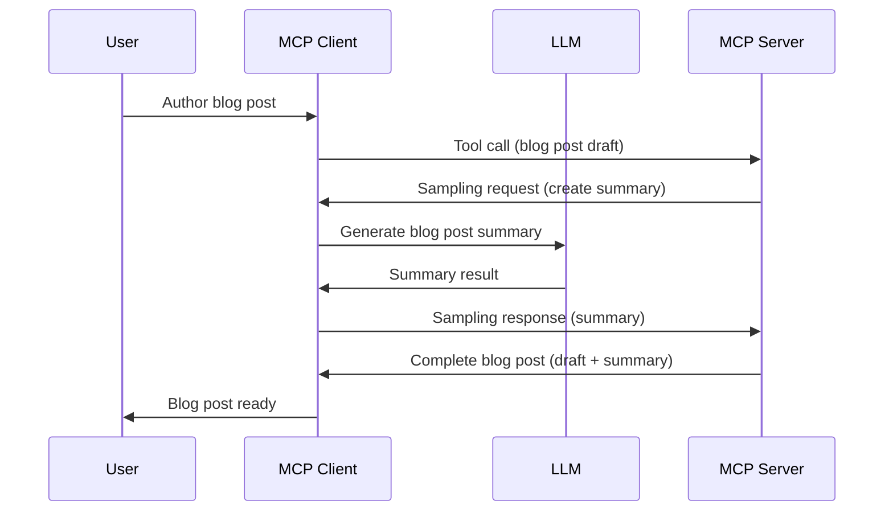

> [!WARNING]
> דגימה הוצאה מהשימוש ב-MCP `2026-07-28`. שיעור זה נשמר עבור
> מימושים ישנים. שרתים חדשים צריכים להשתלב ישירות עם API של ספק LLM.


# דגימה - להאציל תכונות ללקוח

> דגימה נשארת במפרט של `2026-07-28` לצורך תאימות והיא
> רשאית להסרה בגליון הראשון שיופץ בתאריך או אחרי ה-28 ביולי,
> 2027. דוגמאות בשיעור זה עשויות להשתמש ב-API של ערכת פיתוח שמיישמים את `2025-11-25`.
> ראה [מה השתנה ב-MCP: מפרט 2026-07-28](../../01-CoreConcepts/mcp-2026-07-28.md).

ביישומים ישנים, דגימה מאפשרת לשרת MCP לבקש סיוע מ-LLM
שמנוהל על ידי הלקוח. ביישומים חדשים, קוראים ישירות לספק ה-LLM שבחרת
במקום זאת.

בואו נחקור כמה מקרים שימוש ואיך לבנות פתרון הכולל דגימה.

## סקירה כללית

בשיעור זה, נתמקד בהסבר מתי ואיפה להשתמש בדגימה ואיך להגדיר אותה.

## מטרות הלמידה

בפרק זה נעסוק ב:

- הסבר מהי דגימה ומתי להשתמש בה.
- הצגת אופן התצוגה וההגדרה של דגימה ב-MCP.
- מתן דוגמאות לדגימה בפעולה.

## מהי דגימה ולמה להשתמש בה?

דגימה היא תכונה מתקדמת הפועלת כך:



### בקשת דגימה

טוב, עכשיו כשיש לנו מבט כללי על תרחיש אמין, נדבר על בקשת הדגימה שהשרת שולח חזרה ללקוח. כך בקשה כזו עשויה להיראות בפורמט JSON-RPC:

```json
{
  "jsonrpc": "2.0",
  "id": 1,
  "method": "sampling/createMessage",
  "params": {
    "messages": [
      {
        "role": "user",
        "content": {
          "type": "text",
          "text": "Create a blog post summary of the following blog post: <BLOG POST>"
        }
      }
    ],
    "modelPreferences": {
      "hints": [
        {
          "name": "gpt-5.1"
        }
      ],
      "intelligencePriority": 0.8,
      "speedPriority": 0.5
    },
    "systemPrompt": "You are a helpful assistant.",
    "maxTokens": 100
  }
}
```

יש כאן כמה דברים ששווה להדגיש:

- Prompt, תחת content -> text, הוא ההנחיה שמבקשת מ-LLM לסכם תוכן של פוסט בבלוג.

- **modelPreferences**. קטע זה הוא בדיוק זה, העדפה, המלצה לגבי תצורה להשתמש עם ה-LLM. המשתמש יכול לבחור האם ללכת אחר ההמלצות האלו או לשנות אותן. במקרה זה יש המלצות על דגם לשימוש ועל עדיפות שלירות וחכמה.
- **systemPrompt**, זוהי ההנחיה הרגילה למערכת שמעניקה ל-LLM שלך אישיות ומכילה הוראות.
- **maxTokens**, זוהי מאפיין נוסף שמשמש להגיד כמה טוקנים מומלץ להשתמש למשימה זו.

### תגובת דגימה

תגובה זו היא מה שלקוח MCP שולח חזרה לשרת ה-MCP ותוצאה של הלקוח שקורא ל-LLM, מחכה לתגובה ואז בונה את ההודעה הזו. כך היא יכולה להיראות ב-JSON-RPC:

```json
{
  "jsonrpc": "2.0",
  "id": 1,
  "result": {
    "role": "assistant",
    "content": {
      "type": "text",
      "text": "Here's your abstract <ABSTRACT>"
    },
    "model": "gpt-5.1",
    "stopReason": "endTurn"
  }
}
```

התגובה היא תקציר של פוסט הבלוג כפי שנתבקש. הלקוח
בחר את התקינת `gpt-5.1` הפעילה מתוך העדפה של דגם השרת;
העדפות הדגם הן המלצות, ולכן הלקוח עשוי לבחור התקנה פעילה אחרת
לפי הצורך.

טוב, עכשיו כשאנחנו מבינים את הזרימה העיקרית, ומשימה שימושית לה להשתמש בה ל"יצירת פוסט בבלוג + תקציר", נראה מה צריך לעשות כדי שזה יעבוד.

### סוגי הודעות

הודעות דגימה אינן מוגבלות לטקסט בלבד אלא גם ניתן לשלוח תמונות וקול. כך נראה JSON-RPC שונה:

**טקסט**

```json
{
  "type": "text",
  "text": "The message content"
}
```

**תוכן תמונה**

```json
{
  "type": "image",
  "data": "base64-encoded-image-data",
  "mimeType": "image/jpeg"
}
```

**תוכן אודיו**

```json
{
  "type": "audio",
  "data": "base64-encoded-audio-data",
  "mimeType": "audio/wav"
}
```

> הערה: למצב הנוכחי והנחיות ההגירה, ראה את
> [תיעוד דגימה מיושנת](https://modelcontextprotocol.io/specification/2026-07-28/client/sampling).

## איך להגדיר דגימה בלקוח

> הערה: אם אתה רק בונה שרת, אין צורך לעשות הרבה כאן.

בלקוח, יש להגדיר את התכונה כך:

```json
{
  "capabilities": {
    "sampling": {}
  }
}
```

זה יילקח בחשבון כאשר הלקוח שבחרת מאותחל עם השרת.

## דוגמה של דגימה בפעולה - יצירת פוסט בבלוג

בואו נכתוב שרת לדגימה יחד, נצטרך לעשות את הדברים הבאים:

1. ליצור כלי על השרת.
1. הכלי יוצר בקשת דגימה
1. הכלי יחכה לתשובת בקשת הדגימה של הלקוח.
1. לאחר מכן יופק תוצאת הכלי.

נראה את הקוד צעד אחר צעד:

### -1- יצירת הכלי

**python**

```python
@mcp.tool()
async def create_blog(title: str, content: str, ctx: Context[ServerSession, None]) -> str:
    """Create a blog post and generate a summary"""

```

### -2- יצירת בקשת דגימה

הרחב את הכלי שלך עם הקוד הבא:

**python**

```python
post = BlogPost(
        id=len(posts) + 1,
        title=title,
        content=content,
        abstract=""
    )

prompt = f"Create an abstract of the following blog post: title: {title} and draft: {content} "

result = await ctx.session.create_message(
        messages=[
            SamplingMessage(
                role="user",
                content=TextContent(type="text", text=prompt),
            )
        ],
        max_tokens=100,
)

```

### -3- המתן לתגובה והחזר את התגובה

**python**

```python
post.abstract = result.content.text

posts.append(post)

# return the complete product
return json.dumps({
    "id": post.title,
    "abstract": post.abstract
})
```

### -4- קוד מלא

**python**

```python
from starlette.applications import Starlette
from starlette.routing import Mount, Host

from mcp.server.fastmcp import Context, FastMCP

from mcp.server.session import ServerSession
from mcp.types import SamplingMessage, TextContent

import json


from uuid import uuid4
from typing import List
from pydantic import BaseModel


mcp = FastMCP("Blog post generator")

# app = FastAPI()

posts = []

class BlogPost(BaseModel):
    id: int
    title: str
    content: str
    abstract: str

posts: List[BlogPost] = []

@mcp.tool()
async def create_blog(title: str, content: str, ctx: Context[ServerSession, None]) -> str:
    """Create a blog post and generate a summary"""

    post = BlogPost(
        id=len(posts) + 1,
        title=title,
        content=content,
        abstract=""
    )

    prompt = f"Create an abstract of the following blog post: title: {title} and draft: {content} "

    result = await ctx.session.create_message(
        messages=[
            SamplingMessage(
                role="user",
                content=TextContent(type="text", text=prompt),
            )
        ],
        max_tokens=100,
    )

    post.abstract = result.content.text

    posts.append(post)

    # return the complete blog post
    return json.dumps({
        "id": post.title,
        "abstract": post.abstract
    })

if __name__ == "__main__":
    print("Starting server...")
    # mcp.run()
    mcp.run(transport="streamable-http")

# run app with: python server.py
```

### -5- בדיקה ב-Visual Studio Code

כדי לבדוק את זה ב-Visual Studio Code, עשה את הדברים הבאים:

1. הפעל את השרת בטרמינל
1. הוסף אותו ל-*mcp.json* (וודא שהוא מופעל) לדוגמה כך:

   ```json
   "servers": {
      "blog-server": {
        "type": "http",
        "url": "http://localhost:8000/mcp"
      }
   }
   ```

1. הקלד הנחיה:

   ```text
   create a blog post named "Where Python comes from", the content is "Python is actually named after Monty Python Flying Circus"
   ```

1. אפשר לדגימה להתרחש. בפעם הראשונה שתבדוק זה יוצג לך דו-שיח נוסף שצריך לאשר, ואז תראה את הדו-שיח הרגיל שביקש להריץ כלי

1. בדוק תוצאות. תראה את התוצאות מוצגות בצורה נאה בשיחה של GitHub Copilot וגם תוכל לבדוק את תגובת ה-JSON הגולמית.

**בונוס**. כלי Visual Studio Code תומכים היטב בדגימה. ניתן להגדיר גישה לדגימה על השרת המותקן שלך בכך שתנווט כך:

1. עבור לסעיף ההרחבות.
1. בחר באייקון ההגדרות לשרת שהותקן בקטע "MCP SERVERS - INSTALLED".
1 בחר "Configure Model Access", כאן תוכל לבחור אילו מודלים GitHub Copilot מורשה להשתמש כאשר מבצע דגימה. ניתן גם לראות את כל בקשות הדגימה שהיו לאחרונה באמצעות בחירה ב-"Show Sampling requests".

## משימה

במשימה זו, תבנה דגימה מעט שונה, כלומר אינטגרציית דגימה התומכת ביצירת תיאור מוצר. כך התרחיש שלך:

**תרחיש**: עובד אחורי בחנות מסחר אלקטרוני זקוק לעזרה, לוקח כמות זמן רבה מדי לייצר תיאורי מוצרים. לכן, עליך לבנות פתרון שבו תוכל לקרוא לכלי "create_product" עם פרמטרים "title" ו-"keywords" והוא יפיק מוצר מלא כולל שדה "description" שיתמלא על ידי LLM של הלקוח.

טיפ: השתמש במה שלמדת קודם כדי לבנות את השרת וכליו באמצעות בקשת דגימה.

## פתרון

[פתרון](./solution/README.md)

## נקודות מפתח

דגימה היא תכונה חזקה שמאפשרת לשרת להאציל משימות ללקוח כאשר הוא זקוק לסיוע של LLM.

## מה הלאה

- [פרק 4 - יישום מעשי](../../04-PracticalImplementation/README.md)

---

<!-- CO-OP TRANSLATOR DISCLAIMER START -->
**כתב ויתור**:
מסמך זה תורגם באמצעות שירות תרגום אוטומטי [Co-op Translator](https://github.com/Azure/co-op-translator). למרות שאנו שואפים לדיוק, יש לקחת בחשבון שתרגומים אוטומטיים עלולים להכיל שגיאות או אי-דיוקים. יש להחשיב את המסמך המקורי בשפתו הטבעית כמקור הסמכות. למידע קריטי מומלץ להשתמש בתרגום מקצועי על ידי מתרגם אדם. אנו לא אחראים לכל אי-הבנה או פירוש שגוי הנובע מהשימוש בתרגום זה.
<!-- CO-OP TRANSLATOR DISCLAIMER END -->