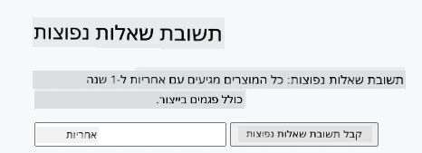
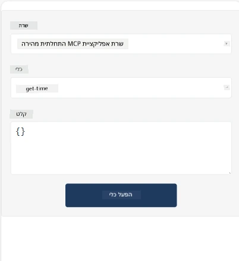
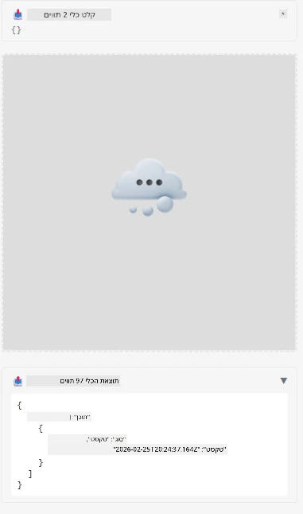

הנה דוגמה המדגימה את אפליקציית MCP

## התקנה

1. נווט לספריית *mcp-app*
1. הרץ `npm install`, זה אמור להתקין את התלויות של ה-frontend וה-backend

אמת את הקומפילציה של ה-backend על ידי הרצה של:

```sh
npx tsc --noEmit
```

לא אמורה להיות פלט אם הכל תקין.

## הרץ את ה-backend

> זה דורש קצת עבודה נוספת אם אתה במחשב של Windows כי הפתרון של MCP Apps משתמש בספריית `concurrently` להפעלה שאתה צריך למצוא לה תחליף. הנה השורה המדוברת בקובץ *package.json* באפליקציית MCP:

```json
"start": "concurrently \"cross-env NODE_ENV=development INPUT=mcp-app.html vite build --watch\" \"tsx watch main.ts\""
```

לאפליקציה הזו שני חלקים, חלק backend וחלק host.

התחל את ה-backend על ידי קריאה של:

```sh
npm start
```

זה אמור להפעיל את ה-backend על `http://localhost:3001/mcp`.

> שים לב, אם אתה ב-Codespace, ייתכן שתצטרך להגדיר את נראות הפורט לציבורית. בדוק שאתה יכול להגיע לנקודת הקצה בדפדפן דרך https://<name של Codespace>.app.github.dev/mcp

## אפשרות 1 - בדוק את האפליקציה ב-Visual Studio Code

כדי לבדוק את הפתרון ב-Visual Studio Code, בצע את הפעולות הבאות:

- הוסף ערך שרת ל-`mcp.json` באופן הבא:

    ```json
    {
        "servers": {
            "my-mcp-server-7178eca7": {
                "url": "http://localhost:3001/mcp",
                "type": "http"
            }
        },
        "inputs": []
    }
    ```

1. לחץ על כפתור "start" ב-*mcp.json*
1. ודא שחלון השיחה פתוח והקלד `get-faq`, אתה אמור לראות תוצאה כמו זו:

    

## אפשרות 2 - בדוק את האפליקציה עם host

המאגר <https://github.com/modelcontextprotocol/ext-apps> מכיל כמה hosts שונים שתוכל להשתמש בהם כדי לבדוק את אפליקציות ה-MVP שלך.

נציג לך כאן שתי אפשרויות שונות:

### מכשיר מקומי

- נווט ל-*ext-apps* לאחר ששכפלת את המאגר.

- התקן את התלויות

   ```sh
   npm install
   ```

- בחלון טרמינל נפרד, נווט ל-*ext-apps/examples/basic-host*

    > אם אתה ב-Codespace, עליך לנווט לקובץ serve.ts ולשורה 27 ולהחליף את http://localhost:3001/mcp ב-URL של ה-Codespace שלך עבור ה-backend, לדוגמה https://psychic-xylophone-657rpjgvxpc5g64-3001.app.github.dev/mcp

- הרץ את ה-host:

    ```sh
    npm start
    ```

    זה אמור לחבר את ה-host עם ה-backend ואתה אמור לראות את האפליקציה רצה כך:

    

### Codespace

לוקח קצת עבודה נוספת כדי לגרום לסביבת Codespace לעבוד. כדי להשתמש ב-host דרך Codespace:

- ראה את תיקיית *ext-apps* ונווט ל-*examples/basic-host*.
- הרץ `npm install` להתקנת התלויות
- הרץ `npm start` כדי להפעיל את ה-host.

## בדוק את האפליקציה

נסה את האפליקציה בדרך הבאה:

- בחר את כפתור "Call Tool" ואתה אמור לראות את התוצאות כך:

    

מצוין, הכל עובד.

---

<!-- CO-OP TRANSLATOR DISCLAIMER START -->
**כתב ויתור**:
מסמך זה תורגם באמצעות שירות תרגום אוטומטי [Co-op Translator](https://github.com/Azure/co-op-translator). למרות שאנו שואפים לדיוק, יש לקחת בחשבון שתרגומים אוטומטיים עלולים להכיל שגיאות או אי-דיוקים. יש להחשיב את המסמך המקורי בשפתו הטבעית כמקור הסמכות. למידע קריטי מומלץ להשתמש בתרגום מקצועי על ידי מתרגם אדם. אנו לא אחראים לכל אי-הבנה או פירוש שגוי הנובע מהשימוש בתרגום זה.
<!-- CO-OP TRANSLATOR DISCLAIMER END -->