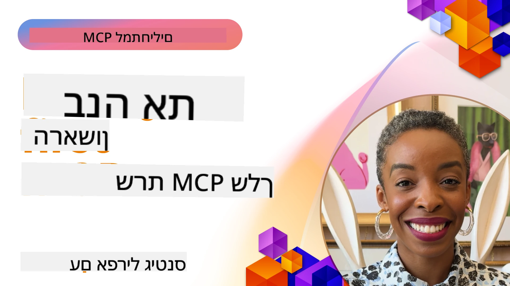

## התחלה  

_(לחץ על התמונה למעלה כדי לצפות בסרטון של השיעור)_

חלק זה מורכב ממספר שיעורים:

- **1 השרת הראשון שלך**, בשיעור הראשון הזה תלמד כיצד ליצור את השרת הראשון שלך ולבדוק אותו עם כלי הבודק, דרך חשובה לבדוק ולנטרל תקלות בשרת שלך, [לשיעור](01-first-server/README.md)

- **2 לקוח**, בשיעור זה תלמד כיצד לכתוב לקוח שיכול להתחבר לשרת שלך, [לשיעור](02-client/README.md)

- **3 לקוח עם LLM**, דרך טובה אף יותר לכתוב לקוח היא להוסיף לו LLM כך שיוכל "לנהל משא ומתן" עם השרת שלך מה לעשות, [לשיעור](03-llm-client/README.md)

- **4 שימוש במצב סוכן GitHub Copilot של שרת ב-MCP בתוך Visual Studio Code**. כאן, אנחנו מסתכלים על הרצת שרת MCP שלנו מתוך Visual Studio Code, [לשיעור](04-vscode/README.md)

- **5 שרת תחבורה stdio** תחבורת stdio היא הסטנדרט המומלץ לתקשורת מקומית בין שרת MCP ללקוח, המספק תקשורת מאובטחת מבוססת תהליך נפרד עם בידוד תהליך מובנה [לשיעור](05-stdio-server/README.md)

- **6 סטרימינג HTTP עם MCP (HTTP סטרימבילי)**. למד על התקן
	לתחבורה מרוחקת ב-[מפרט MCP 2026-07-28](https://modelcontextprotocol.io/specification/2026-07-28/basic/transports/streamable-http),
	וכן על המימוש הישן המבוסס על סשנים שנשמר בשיעור.
	[לשיעור](06-http-streaming/README.md)

- **7 שימוש ב-Microsoft Foundry Toolkit עבור Visual Studio Code** לצרוך ולבדוק את לקוחות ושרתים של MCP [בשיעור זה](07-aitk/README.md)

- **8 בדיקות**. כאן נתמקד במיוחד כיצד ניתן לבדוק את השרת והלקוח שלנו בדרכים שונות, [אל השיעור](08-testing/README.md)

- **9 פריסה**. פרק זה יסתכל על דרכים שונות לפריסת פתרונות MCP שלך, [אל השיעור](09-deployment/README.md)

- **10 שימוש מתקדם בשרת**. פרק זה מכסה שימוש מתקדם בשרת, [אל השיעור](./10-advanced/README.md)

- **11 אימות**. פרק זה מכסה כיצד להוסיף אימות פשוט, מאימות בסיסי ועד שימוש ב-JWT ו-RBAC. מומלץ להתחיל כאן ואז להסתכל על נושאים מתקדמים בפרק 5 ולבצע הקשחת אבטחה נוספת לפי ההמלצות בפרק 2, [אל השיעור](./11-simple-auth/README.md)

- **12 מארחי MCP**. הגדר והפעל לקוחות מארחים פופולריים של MCP כולל Claude Desktop, Cursor, Cline ו-Windsurf. למד סוגי תעבורה ופתרון בעיות, [אל השיעור](./12-mcp-hosts/README.md)

- **13 MCP Inspector**. נפה ובחן את שרתי MCP שלך אינטראקטיבית באמצעות כלי MCP Inspector. למד לפתור בעיות בכלים, משאבים והודעות פרוטוקול, [אל השיעור](./13-mcp-inspector/README.md)

- **14 דגימה**. למד את פרימיטיבית הדגימה הישנה עבור `2025-11-25` ו
	כיצד למנוע עיצובים חדשים לשילוב ישיר עם ספקי LLM. הדגימה
	מיושנת ב-MCP `2026-07-28`. [אל השיעור](./14-sampling/README.md)

- **15 אפליקציות MCP**. בניית שרתי MCP שמספקים גם הוראות UI, [אל השיעור](./15-mcp-apps/README.md)

פרוטוקול הקשר לדגם (MCP) הוא פרוטוקול פתוח שמסטנדרט כיצד אפליקציות מספקות הקשר ל-LLM. חשבו על MCP כמו יציאת USB-C לאפליקציות AI - הוא מספק דרך סטנדרטית לחבר דגמי AI למקורות נתונים וכלים שונים.

## מטרות הלמידה

בסיום השיעור הזה, תוכל:

- להקים סביבות פיתוח ל-MCP ב-C#, Java, Python, TypeScript ו-JavaScript
- לבנות ולפרוס שרתי MCP בסיסיים עם תכונות מותאמות אישית (משאבים, הזמנות וכלים)
- ליצור אפליקציות מארחות שמתחברות לשרתי MCP
- לבדוק ולפתור בעיות ביישומי MCP
- להבין אתגרים נפוצים בהגדרות ופתרונותיהם
- להתחבר ליישומי MCP עם שירותי LLM פופולריים

## הקמת סביבת MCP שלך

לפני שתתחיל לעבוד עם MCP, חשוב להכין את סביבת הפיתוח ולבין את זרימת העבודה הבסיסית. קטע זה ינחה אותך בשלבי ההקמה הראשונים כדי להבטיח התחלה חלקה עם MCP.

### דרישות מוקדמות

לפני שתצלול לפיתוח MCP, ודא שיש לך:

- **סביבת פיתוח**: עבור השפה שבחרת (C#, Java, Python, TypeScript או JavaScript)
- **IDE/עורך**: Visual Studio, Visual Studio Code, IntelliJ, Eclipse, PyCharm או כל עורך קוד מודרני
- **מנהל חבילות**: NuGet, Maven/Gradle, pip או npm/yarn
- **מפתחות API**: עבור כל שירות AI שאתה מתכנן להשתמש בו באפליקציות המארחות שלך

### SDK רשמיים

בפרקים הקרובים תראה פתרונות שנבנו באמצעות Python, TypeScript,
Java ו-.NET. הנה ה-SDK הרשמיים.

התמיכה ב-SDK עבור MCP `2026-07-28` מתפתחת באופן עצמאי לפי שפה.
לפני הרצת דוגמה, בדוק את גרסת החבילה והערות שחרור של ה-SDK
עבור גרסאות פרוטוקול נתמכות. ראו את
[רשימת ה-SDK הרשמית](https://modelcontextprotocol.io/docs/sdk):
- [C# SDK](https://github.com/modelcontextprotocol/csharp-sdk) - מתוחזק בשותפות עם Microsoft
- [Java SDK](https://github.com/modelcontextprotocol/java-sdk) - מתוחזק בשותפות עם Spring AI
- [TypeScript SDK](https://github.com/modelcontextprotocol/typescript-sdk) - מימוש רשמי ב-TypeScript
- [Python SDK](https://github.com/modelcontextprotocol/python-sdk) - מימוש רשמי בפייתון (FastMCP)
- [Kotlin SDK](https://github.com/modelcontextprotocol/kotlin-sdk) - מימוש רשמי בקוטלין
- [Swift SDK](https://github.com/modelcontextprotocol/swift-sdk) - מתוחזק בשותפות עם Loopwork AI
- [Rust SDK](https://github.com/modelcontextprotocol/rust-sdk) - מימוש רשמי ב-Rust
- [Go SDK](https://github.com/modelcontextprotocol/go-sdk) - מימוש רשמי ב-Go

## נקודות מפתח

- הקמת סביבת פיתוח MCP פשוטה עם SDK ספציפיים לשפה
- בניית שרתי MCP כוללת יצירה ורישום של כלים עם סכימות ברורות
- לקוחות MCP מתחברים לשרתים ולמודלים כדי לנצל יכולות מורחבות
- בדיקות ופתרון תקלות חיוניות ליישומי MCP יציבים
- אפשרויות פריסה נע בין פיתוח מקומי לפתרונות מבוססי ענן

## תרגול

יש לנו סדרת דוגמאות שמשלימות את התרגילים שתראה בכל הפרקים בקטע זה. בנוסף, לכל פרק יש גם תרגילים ומשימות משלו

- [מחשבון Java](./samples/java/calculator/README.md)
- [מחשבון .NET](../../../03-GettingStarted/samples/csharp)
- [מחשבון JavaScript](./samples/javascript/README.md)
- [מחשבון TypeScript](./samples/typescript/README.md)
- [מחשבון Python](../../../03-GettingStarted/samples/python)

## משאבים נוספים

- [בניית סוכנים באמצעות Model Context Protocol על Azure](https://learn.microsoft.com/azure/developer/ai/intro-agents-mcp)
- [MCP מרוחק עם Azure Container Apps (Node.js/TypeScript/JavaScript)](https://learn.microsoft.com/samples/azure-samples/mcp-container-ts/mcp-container-ts/)
- [סוכן OpenAI MCP עבור .NET](https://learn.microsoft.com/samples/azure-samples/openai-mcp-agent-dotnet/openai-mcp-agent-dotnet/)

## מה הלאה

התחל עם השיעור הראשון: [יצירת שרת MCP הראשון שלך](01-first-server/README.md)

לאחר שסיימת מודול זה, המשך אל: [מודול 4: יישום מעשי](../04-PracticalImplementation/README.md)

---

<!-- CO-OP TRANSLATOR DISCLAIMER START -->
**כתב ויתור**:
מסמך זה תורגם באמצעות שירות תרגום אוטומטי [Co-op Translator](https://github.com/Azure/co-op-translator). למרות שאנו שואפים לדיוק, יש לקחת בחשבון שתרגומים אוטומטיים עלולים להכיל שגיאות או אי-דיוקים. יש להחשיב את המסמך המקורי בשפתו הטבעית כמקור הסמכות. למידע קריטי מומלץ להשתמש בתרגום מקצועי על ידי מתרגם אדם. אנו לא אחראים לכל אי-הבנה או פירוש שגוי הנובע מהשימוש בתרגום זה.
<!-- CO-OP TRANSLATOR DISCLAIMER END -->