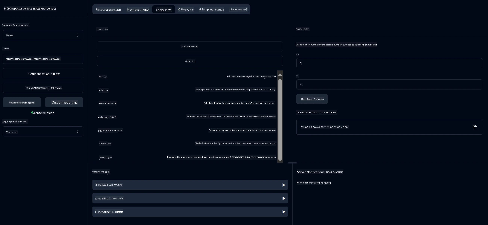

# שירות מחשבון בסיסי MCP

> [!NOTE]
> דוגמה זו משתמשת בהעברת HTTP+SSE ישנה וממוקדת ב-SDK התואם ל-MCP `2025-11-25`. שרתים מרוחקים חדשים צריכים להשתמש בתמיכה ב-HTTP `2026-07-28` Streamable.

> HTTP תמיכה.

שירות זה מספק פעולות מחשבון בסיסיות דרך פרוטוקול הקשר למודל (MCP) באמצעות Spring Boot עם העברת WebFlux. הוא מיועד כדוגמה פשוטה למתחילים הלומדים על יישומי MCP.

למידע נוסף, ראו את תיעוד ההפניה של [MCP Server Boot Starter](https://docs.spring.io/spring-ai/reference/api/mcp/mcp-server-boot-starter-docs.html).

## סקירה כללית

השירות מציג:
- תמיכה ב-SSE (Server-Sent Events)
- רישום אוטומטי של כלים באמצעות הסימון `@Tool` של Spring AI
- פונקציות מחשבון בסיסיות:
  - חיבור, חיסור, כפל, חילוק
  - חישוב חזקה ושורש ריבועי
  - שארית וחישוב ערך מוחלט
  - פונקציית עזרה לתיאור פעולות

## תכונות

שירות המחשבון הזה מציע את היכולות הבאות:

1. **פעולות אריתמטיות בסיסיות**:
   - חיבור של שני מספרים
   - חיסור של מספר אחד מאחר
   - כפל של שני מספרים
   - חילוק של מספר אחד באחר (עם בדיקת חילוק באפס)

2. **פעולות מתקדמות**:
   - חישוב חזקה (העלאת בסיס למעריך)
   - חישוב שורש ריבועי (עם בדיקת מספר שלילי)
   - חישוב שארית
   - חישוב ערך מוחלט

3. **מערכת עזרה**:
   - פונקציית עזרה מובנית המסבירה את כל הפעולות הזמינות

## שימוש בשירות

השירות מציג את נקודות הקצה של ה-API הבאות דרך פרוטוקול MCP:

- `add(a, b)`: החבר שני מספרים יחד
- `subtract(a, b)`: חיסור המספר השני מהראשון
- `multiply(a, b)`: כפל שני מספרים
- `divide(a, b)`: חילוק המספר הראשון בשני (עם בדיקת אפס)
- `power(base, exponent)`: חישוב החזקת מספר
- `squareRoot(number)`: חישוב השורש הריבועי (עם בדיקת מספר שלילי)
- `modulus(a, b)`: חישוב השארית מחילוק
- `absolute(number)`: חישוב הערך המוחלט
- `help()`: השגת מידע על פעולות זמינות

## לקוח לבדיקה

לקוח בדיקה פשוט כלול ב-`com.microsoft.mcp.sample.client` החבילה. מחלקת `SampleCalculatorClient` מדגימה את הפעולות הזמינות של שירות המחשבון.

## שימוש בלקוח LangChain4j

הפרויקט כולל לקוח דוגמה ל-LangChain4j ב
`com.microsoft.mcp.sample.client.LangChain4jClient` שמדגים כיצד
לשלב את שירות המחשבון עם מודל Microsoft Foundry.

### דרישות מוקדמות

1. צור משאב Microsoft Foundry ופרוס מודל פעיל כגון
   `gpt-5.1`.
2. הגדר את נקודת הקצה של המודל, מפתח ה-API ושם הפריסה:

   ```bash
   export AZURE_OPENAI_ENDPOINT="https://<resource-name>.openai.azure.com"
   export AZURE_OPENAI_API_KEY="<api-key>"
   export AZURE_OPENAI_DEPLOYMENT="gpt-5.1"
   ```

3. בדוק את
   [לוח זמנים לפרישת מודל Microsoft Foundry](https://learn.microsoft.com/azure/foundry/openai/concepts/model-retirement-schedule)
   לפני בחירת פריסה.
4. ודא ששרת המחשבון פועל ב-`localhost:8080`.

### הרצת לקוח LangChain4j

דוגמה זו מדגימה:
- חיבור לשרת מחשבון MCP דרך תחבורה מסוג SSE
- שימוש ב-LangChain4j ליצירת בוט צ'אט שמנצלת פעולות מחשבון
- שילוב עם מודל Microsoft Foundry שפורש

הלקוח שולח את שאילתות הדוגמה הבאות כדי להדגים פונקציונליות:
1. חישוב סכום שני מספרים
2. מציאת השורש הריבועי של מספר
3. קבלת מידע עזרה על פעולות מחשבון זמינות

הרץ את הדוגמה ובדוק את פלט הקונסולה כדי לראות כיצד מודל ה-AI משתמש בכלי המחשבון כדי להגיב לשאילתות.

### תצורת מודל Microsoft Foundry

לקוח LangChain4j משתמש בנקודת קצה תואמת Azure OpenAI v1 החשופה על ידי
Microsoft Foundry:

```java
String endpoint = System.getenv("AZURE_OPENAI_ENDPOINT");
ChatLanguageModel model = OpenAiOfficialChatModel.builder()
   .baseUrl(endpoint.replaceAll("/+$", "") + "/openai/v1/")
   .apiKey(System.getenv("AZURE_OPENAI_API_KEY"))
   .isAzure(true)
   .modelName(System.getenv().getOrDefault("AZURE_OPENAI_DEPLOYMENT", "gpt-5.1"))
    .timeout(Duration.ofSeconds(60))
    .build();
```

`AZURE_OPENAI_DEPLOYMENT` חייב להתאים לשם שהוקצה כשהמודל
הופץ, שעשוי להיות שונה משם המודל הבסיסי.

## תלותים

הפרויקט דורש את התלותים המרכזיים הבאים:

```xml
<!-- For MCP Server -->
<dependency>
    <groupId>org.springframework.ai</groupId>
    <artifactId>spring-ai-starter-mcp-server-webflux</artifactId>
</dependency>

<!-- For LangChain4j integration -->
<dependency>
    <groupId>dev.langchain4j</groupId>
    <artifactId>langchain4j-mcp</artifactId>
    <version>${langchain4j.version}</version>
</dependency>

<!-- For Microsoft Foundry's OpenAI-compatible endpoint -->
<dependency>
    <groupId>dev.langchain4j</groupId>
   <artifactId>langchain4j-open-ai-official</artifactId>
    <version>${langchain4j.version}</version>
</dependency>
```

## בניית הפרויקט

בנה את הפרויקט באמצעות Maven:
```bash
./mvnw clean install -DskipTests
```

## הרצת השרת

### שימוש ב-Java

```bash
java -jar target/calculator-server-0.0.1-SNAPSHOT.jar
```

### שימוש ב-MCP Inspector

MCP Inspector הוא כלי מועיל לאינטראקציה עם שירותי MCP. לשימוש בו עם שירות המחשבון הזה:

1. **התקן והרץ את MCP Inspector** בחלון טרמינל חדש:
   ```bash
   npx @modelcontextprotocol/inspector
   ```

2. **גש לממשק הווב** בלחיצה על כתובת ה-URL שמוצגת על ידי האפליקציה (בדרך כלל http://localhost:6274)

3. **הגדר את החיבור**:
   - הגדר את סוג התחבורה ל-"SSE"
   - הגדר את כתובת ה-URL לנקודת הקצה SSE של השרת שלך: `http://localhost:8080/sse`
   - לחץ על "Connect"

4. **השתמש בכלים**:
   - לחץ על "List Tools" כדי לראות את פעולות המחשבון הזמינות
   - בחר כלי ולחץ על "Run Tool" כדי לבצע פעולה



### שימוש בדוקר

הפרויקט כולל Dockerfile לפריסה במכולה:

1. **בנה את תמונת הדוקר**:
   ```bash
   docker build -t calculator-mcp-service .
   ```

2. **הפעל את מכולת הדוקר**:
   ```bash
   docker run -p 8080:8080 calculator-mcp-service
   ```

זה י:
- יבנה תמונת דוקר רב-שלבית עם Maven 3.9.9 ו-Eclipse Temurin 24 JDK
- ייצור תמונת מכולה אופטימלית
- יחשוף את השירות על פורט 8080
- יפעיל את שירות המחשבון MCP בתוך המכולה

תוכל לגשת לשירות ב-`http://localhost:8080` ברגע שהמכולה רצה.

## פתרון בעיות

### בעיות נפוצות בחיבור למודל

1. **שגיאות אימות**: אמת ש-`AZURE_OPENAI_API_KEY` שייך ל-
   המשאב שזוהה על ידי `AZURE_OPENAI_ENDPOINT`.
2. **פריסה לא נמצאה**: אמת ש-`AZURE_OPENAI_DEPLOYMENT` תואם בדיוק
   את שם הפריסה ב-Microsoft Foundry.
3. **הגבלת תיעוד (Rate limiting)**: בדוק את מכסת הפריסה ונסה שוב לאחר התקופה
   שצוינה על ידי השירות.

לעזרה נוספת, ראה את
[התיעוד של LangChain4j](https://github.com/langchain4j/langchain4j) ואת
[התיעוד של Microsoft Foundry](https://learn.microsoft.com/azure/ai-foundry/).

---

<!-- CO-OP TRANSLATOR DISCLAIMER START -->
**כתב ויתור**:
מסמך זה תורגם באמצעות שירות תרגום אוטומטי [Co-op Translator](https://github.com/Azure/co-op-translator). למרות שאנו שואפים לדיוק, יש לקחת בחשבון שתרגומים אוטומטיים עלולים להכיל שגיאות או אי-דיוקים. יש להחשיב את המסמך המקורי בשפתו הטבעית כמקור הסמכות. למידע קריטי מומלץ להשתמש בתרגום מקצועי על ידי מתרגם אדם. אנו לא אחראים לכל אי-הבנה או פירוש שגוי הנובע מהשימוש בתרגום זה.
<!-- CO-OP TRANSLATOR DISCLAIMER END -->