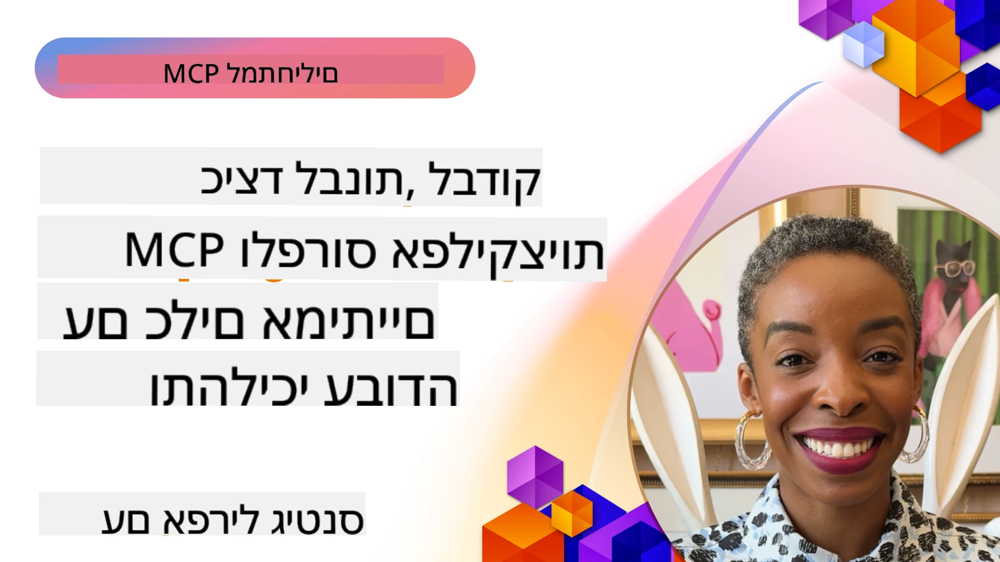
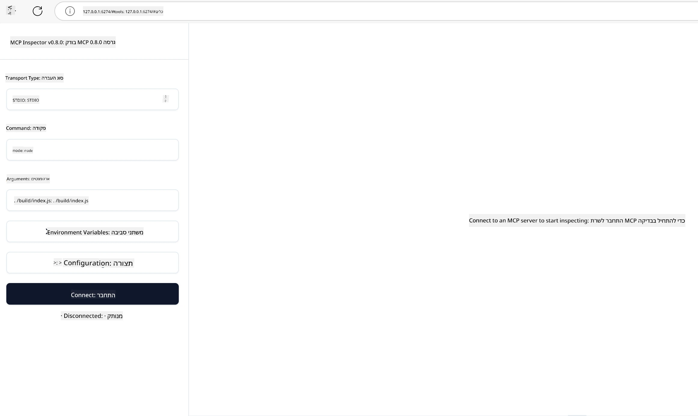

# יישום מעשי

[](https://youtu.be/vCN9-mKBDfQ)

_(לחץ על התמונה למעלה כדי לצפות בסרטון של השיעור הזה)_

היישום המעשי הוא המקום שבו כוחו של פרוטוקול הקשר המודלי (MCP) הופך למוחשי. בעוד שהבנת התיאוריה והארכיטקטורה שמאחורי MCP חשובה, הערך האמיתי צץ כאשר אתה מיישם את המושגים הללו כדי לבנות, לבדוק ולפרוס פתרונות הפותרים בעיות מהעולם האמיתי. פרק זה מהווה גשר בין הידע התיאורטי לפיתוח מעשי, ומדריך אותך בתהליך הבאת אפליקציות מבוססות MCP לחיים.

בין אם אתה מפתח עוזרים חכמים, משלב בינה מלאכותית בתזרימי עבודה עסקיים, או בונה כלים מותאמים לעיבוד נתונים, MCP מספק יסוד גמיש. העיצוב הניטרלי לשפה שלו ו-SDK רשמיים לשפות תכנות פופולריות הופכים אותו לנגיש למגוון רחב של מפתחים. באמצעות ניצול SDK אלו, תוכל ליצור אב-טיפוס במהירות, לבצע איטרציות ולהרחיב את הפתרונות שלך בפלטפורמות וסביבות שונות.

בקטעים הבאים תמצא דוגמאות מעשיות, קוד לדוגמה, ואסטרטגיות פריסה המדגימות כיצד ליישם MCP ב-C#, Java עם Spring, TypeScript, JavaScript, ופייתון. תלמד גם כיצד לנפות באגים ולבדוק את שרתי MCP שלך, לנהל APIs, ולפרוס פתרונות לענן באמצעות Azure. משאבים אלו, המלווים בתרגול, נועדו להאיץ את הלמידה שלך ולעזור לך לבנות בביטחון אפליקציות MCP יציבות ומוכנות לפרודקשן.

## סקירה כללית

השיעור הזה מתמקד בהיבטים מעשיים של יישום MCP בשפות תכנות רבות. נחקור כיצד להשתמש ב-SDK של MCP ב-C#, Java עם Spring, TypeScript, JavaScript ו-Python כדי לבנות יישומים יציבים, לנפות שגיאות ולבדוק שרתי MCP, וליצור משאבים, פרומפטים וכלים לשימוש חוזר.

## מטרות הלמידה

בסיום השיעור תוכל:

- ליישם פתרונות MCP באמצעות SDK רשמיים בשפות תכנות שונות
- לנפות תקלות ולבדוק שרתי MCP בצורה שיטתית
- ליצור ולהשתמש בתכונות שרת (משאבים, פרומפטים וכלים)
- לתכנן זרימות עבודה אפקטיביות ב-MCP למשימות מורכבות
- לאופטם יישומי MCP לביצועים ואמינות

## משאבי SDK רשמיים

פרוטוקול הקשר הדגם מציע SDK רשמיים לשפות מרובות. תמיכת ה-SDK
עבור MCP `2026-07-28` מתבצעת בנפרד, לכן יש לבדוק את הערות השחרור של כל
SDK ואת גרסת החבילה של הדוגמה לפני הנחה של תאימות הפרוטוקול.
ראה את [רשימת ה-SDK הרשמית](https://modelcontextprotocol.io/docs/sdk):

- [C# SDK](https://github.com/modelcontextprotocol/csharp-sdk)
- [Java with Spring SDK](https://github.com/modelcontextprotocol/java-sdk) **הערה:** דורש תלות ב-[Project Reactor](https://projectreactor.io). (ראה [דיון מספר 246](https://github.com/orgs/modelcontextprotocol/discussions/246).)
- [מארז TypeScript SDK](https://github.com/modelcontextprotocol/typescript-sdk)
- [מארז Python SDK](https://github.com/modelcontextprotocol/python-sdk)
- [מארז Kotlin SDK](https://github.com/modelcontextprotocol/kotlin-sdk)
- [מארז Go SDK](https://github.com/modelcontextprotocol/go-sdk)

## עבודה עם מארזי MCP

מדור זה מספק דוגמאות מעשיות ליישום MCP בכמה שפות תכנות. ניתן למצוא קוד לדוגמה בתיקיית `samples` הממוינת לפי שפה.

### דוגמאות זמינות

המאגר כולל [יישומים לדוגמה](../../../04-PracticalImplementation/samples) בשפות הבאות:

- [C#](./samples/csharp/README.md)
- [Java עם Spring](./samples/java/containerapp/README.md)
- [TypeScript](./samples/typescript/README.md)
- [JavaScript](./samples/javascript/README.md)
- [Python](./samples/python/README.md)

כל דוגמה מציגה מושגי מפתח ודפוסי יישום של MCP לשפה ולאקוסיסטם הספציפיים.

### מדריכים מעשיים

מדריכים נוספים ליישום מעשי של MCP:

- [דפי תוצאות גדולים ודפדוף](./pagination/README.md) - טיפול בדפדוף מבוסס מצביע לכלים, משאבים וקבוצות נתונים גדולות

## תכונות ליבה של השרת

שרתי MCP יכולים ליישם כל שילוב של התכונות הבאות:

### משאבים

משאבים מספקים הקשר ונתונים למשתמש או למודל AI לשימוש:

- מאגרי מסמכים
- בסיסי ידע
- מקורות נתונים מובנים
- מערכות קבצים

### ההנחיות

ההנחיות הן תבניות הודעות וזרימות עבודה למשתמשים:

- תבניות שיחה מוגדרות מראש
- דפוסי אינטראקציה מוכווני הדרכה
- מבני דיאלוג מיוחדים

### כלים

כלים הם פונקציות שמודל AI יכול להפעיל:

- כלי עיבוד נתונים
- אינטגרציות API חיצוניות
- יכולות חישוביות
- פונקציות חיפוש

## יישומי דוגמה: יישום C#

מאגר מארז C# הרשמי מכיל כמה דוגמאות הממחישות היבטים שונים של MCP:

- **לקוח MCP בסיסי**: דוגמה פשוטה שמראה איך ליצור לקוח MCP ולהפעיל כלים
- **שרת MCP בסיסי**: יישום שרת מינימלי עם רישום כלי בסיסי
- **שרת MCP מתקדם**: שרת מלא תכונות עם רישום כלים, אימות וטיפול בשגיאות
- **אינטגרציה עם ASP.NET**: דוגמאות להדגמת אינטגרציה עם ASP.NET Core
- **דפוסי יישום כלים**: דפוסים שונים ליישום כלים עם רמות מורכבות שונות

מארז MCP ל-C# נמצא בבדיקה וממשקי ה-API עשויים להשתנות. אנו נעדכן את הבלוג בהתפתחות המארז.

### תכונות מפתח

- [חבילת Nuget ModelContextProtocol ל-MCP ב-C#](https://www.nuget.org/packages/ModelContextProtocol)
- בניית [שרת MCP ראשון שלך](https://devblogs.microsoft.com/dotnet/build-a-model-context-protocol-mcp-server-in-csharp/).

לדוגמאות יישום מלאות ב-C#, בקר ב-[מאגר דוגמאות מארז C# הרשמי](https://github.com/modelcontextprotocol/csharp-sdk)

## דוגמת יישום: Java עם Spring

מארז Java עם Spring מציע אפשרויות יציבות ליישום MCP עם תכונות ברמת ארגונית.

### תכונות מרכזיות

- אינטגרציה עם Spring Framework
- בטיחות טיפוסים חזקה
- תמיכה בתכנות תגובתי
- טיפול בשגיאות מקיף

לדוגמה מלאה של יישום Java עם Spring, ראה [דוגמת Java עם Spring](samples/java/containerapp/README.md) בתיקיית הדוגמאות.

## דוגמת יישום: JavaScript

מארז JavaScript מספק גישה קלה וגמישה ליישום MCP.

### תכונות מרכזיות

- תמיכה ב-Node.js ודפדפן
- ממשק API מבוסס הבטחות
- אינטגרציה קלה עם Express ומסגרות אחרות
- תמיכה ב-WebSocket להזנה רציפה

לדוגמה מלאה של יישום JavaScript, ראה [דוגמת JavaScript](samples/javascript/README.md) בתיקיית הדוגמאות.

## דוגמת יישום: Python

מארז Python מציע גישה פייתונית ליישום MCP עם אינטגרציות מעולות למסגרות למידה חישובית.

### תכונות מרכזיות

- תמיכה ב-async/await עם asyncio
- אינטגרציה עם FastAPI
- רישום כלים פשוט
- אינטגרציה מקומית עם ספריות למידה חישובית פופולריות

לדוגמה מלאה של יישום Python, ראה [דוגמת Python](samples/python/README.md) בתיקיית הדוגמאות.

## ניהול API

Azure API Management היא תשובה מצוינת לשאלה איך ניתן לאבטח שרתי MCP. הרעיון הוא למקם מופע Azure API Management מול שרת MCP ולתת לו לטפל בתכונות שצפויות להידרש כמו:

- הגבלת קצב
- ניהול אסימונים
- ניטור
- איזון עומסים
- אבטחה

### דוגמת Azure

הנה דוגמת Azure שמבצעת בדיוק את זה, כלומר [יצירת שרת MCP והגנה עליו עם Azure API Management](https://github.com/Azure-Samples/remote-mcp-apim-functions-python).

ראה כיצד זרימת ההרשאה מתבצעת בתמונה למטה:


בתמונה הקודמת, מתבצעים הדברים הבאים:

- אימות/הרשאה מתבצעת באמצעות Microsoft Entra.
- Azure API Management משמש כשער ונעשה שימוש במדיניות לניתוב וניהול התנועה.
- Azure Monitor מתעד את כל הבקשות לניתוח נוסף.

#### זרימת הרשאה

הבה נבחן את זרימת ההרשאה בפירוט רב יותר:


#### מפרט הרשאת MCP

למידע נוסף על
[מפרט הרשאת MCP](https://modelcontextprotocol.io/specification/2026-07-28/basic/authorization/).

## פריסת שרת MCP מרוחק ל-Azure

בואו נראה אם נוכל לפרוס את הדוגמה שהוזכרה קודם:

1. שכפל את המאגר

    ```bash
    git clone https://github.com/Azure-Samples/remote-mcp-apim-functions-python.git
    cd remote-mcp-apim-functions-python
    ```

1. הירשם כספק המשאב `Microsoft.App`.

   - אם אתה משתמש ב-Azure CLI, הרץ `az provider register --namespace Microsoft.App --wait`.
   - אם אתה משתמש ב-Azure PowerShell, הרץ `Register-AzResourceProvider -ProviderNamespace Microsoft.App`. לאחר מכן הרץ `(Get-AzResourceProvider -ProviderNamespace Microsoft.App).RegistrationState` לאחר זמן מה לבדוק אם ההרשמה הושלמה.

1. הרץ את פקודת [azd](https://aka.ms/azd) זו כדי לספק את שירות ניהול ה-API, אפליקציית הפונקציות (עם קוד) וכל שאר משאבי Azure הנדרשים

    ```shell
    azd up
    ```

    פקודות אלו צריכות לפרוס את כל משאבי הענן ב-Azure

### בדיקת השרת שלך עם MCP Inspector

1. בחלון טרמינל חדש, התקן והרץ את MCP Inspector

    ```shell
    npx @modelcontextprotocol/inspector
    ```

    אמור להופיע ממשק דומה ל:

    

1. CTRL-קליק כדי לטעון את אפליקציית הווב MCP Inspector מה-URL שמוצג באפליקציה (למשל [http://127.0.0.1:6274/#resources](http://127.0.0.1:6274/#resources))
1. הגדר את סוג ההעברה ל-`SSE`
1. קבע את ה-URL לנקודת הקצה SSE לניהול API שלך שמוצג לאחר `azd up` ו**התחבר**:

    ```shell
    https://<apim-servicename-from-azd-output>.azure-api.net/mcp/sse
    ```

1. **רשימת כלים**. לחץ על כלי ו**הפעל כלי**.  

אם כל השלבים עבדו, אתה מחובר עכשיו לשרת MCP והצלחת לקרוא כלי.

## שרתי MCP ל-Azure

[Remote-mcp-functions](https://github.com/Azure-Samples/remote-mcp-functions-dotnet): סט מאגרים זה הוא תבנית להתחלה מהירה לבניית ופריסת שרתי MCP מרוחקים מותאמים אישית באמצעות Azure Functions עם Python, C# .NET או Node/TypeScript.

הדוגמאות מספקות פתרון מלא המאפשר למפתחים:

- לבנות ולהריץ מקומית: פיתוח וניפוי שגיאות של שרת MCP על מכונה מקומית
- לפרוס ב-Azure: פריסה פשוטה לענן בעזרת פקודת azd up
- להתחבר מלקוחות: התחברות לשרת MCP מלקוחות שונים כולל מצב סוכן Copilot ב-VS Code וכלי MCP Inspector

### תכונות מרכזיות

- אבטחה מעיצוב: שרת MCP מאובטח באמצעות מפתחות ו-HTTPS
- אפשרויות אימות: תומך ב-OAuth באמצעות אימות מובנה ו/או ניהול API
- בידוד רשת: מאפשר בידוד רשת באמצעות Azure Virtual Networks (VNET)
- ארכיטקטורה ללא שרת: מנצל Azure Functions לביצוע מדרגי מונחה אירועים
- פיתוח מקומי: תמיכה מקיפה בפיתוח וניפוי שגיאות מקומי
- פריסה פשוטה: תהליך פריסה משולב ל-Azure

המאגר כולל את כל קבצי הקונפיגורציה, קוד המקור והגדרות התשתית הדרושים כדי להתחיל במהירות עם יישום שרת MCP מוכן לפרודקשן.

- [Azure Remote MCP Functions Python](https://github.com/Azure-Samples/remote-mcp-functions-python) - דוגמת יישום MCP באמצעות Azure Functions עם Python

- [Azure Remote MCP Functions .NET](https://github.com/Azure-Samples/remote-mcp-functions-dotnet) - דוגמת יישום MCP באמצעות Azure Functions עם C# .NET

- [Azure Remote MCP Functions Node/Typescript](https://github.com/Azure-Samples/remote-mcp-functions-typescript) - דוגמת יישום MCP באמצעות Azure Functions עם Node/TypeScript.

## מסקנות מרכזיות

- מארזי MCP מספקים כלים ספציפיים לשפה ליישום פתרונות MCP חזקים
- תהליך ניפוי השגיאות והבדיקות קריטי ליישומים מהימנים של MCP
- תבניות הנחיות לשימוש חוזר מאפשרות אינטראקציות עקביות עם AI
- זרימות עבודה מתוכננות היטב יכולות לתזמור משימות מורכבות באמצעות כלים מרובים
- יישום פתרונות MCP מחייב התייחסות לאבטחה, ביצועים וטיפול בשגיאות

## תרגיל

עצב זרימת עבודה מעשית של MCP שמטפלת בבעיה אמיתית בתחום שלך:

1. זהה 3-4 כלים שיהיו שימושיים לפתירת הבעיה
2. צור דיאגרמת זרימת עבודה שמראה איך כלים אלו מתקשרים
3. יישם גרסה בסיסית של אחד הכלים באמצעות השפה המועדפת עליך
4. צור תבנית הנחיה שתעזור למודל להשתמש בכלי שלך בצורה יעילה

## מקורות נוספים

---

## מה הלאה

הבא: [נושאים מתקדמים](../05-AdvancedTopics/README.md)

---

<!-- CO-OP TRANSLATOR DISCLAIMER START -->
**כתב ויתור**:
מסמך זה תורגם באמצעות שירות תרגום אוטומטי [Co-op Translator](https://github.com/Azure/co-op-translator). למרות שאנו שואפים לדיוק, יש לקחת בחשבון שתרגומים אוטומטיים עלולים להכיל שגיאות או אי-דיוקים. יש להחשיב את המסמך המקורי בשפתו הטבעית כמקור הסמכות. למידע קריטי מומלץ להשתמש בתרגום מקצועי על ידי מתרגם אדם. אנו לא אחראים לכל אי-הבנה או פירוש שגוי הנובע מהשימוש בתרגום זה.
<!-- CO-OP TRANSLATOR DISCLAIMER END -->