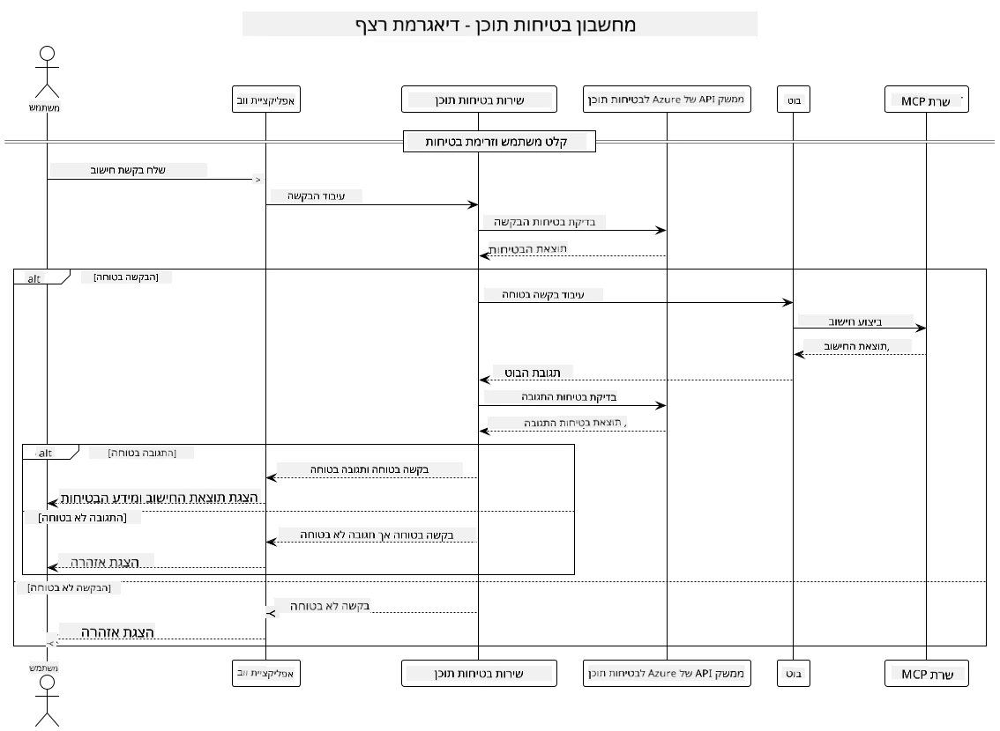

## ארכיטקטורת המערכת

פרויקט זה מדגים יישום ווב המשתמש בבדיקת בטיחות תוכן לפני העברת בקשות משתמש לשירות מחשבון דרך פרוטוקול הקשר של המודל (MCP).



### כיצד זה עובד

1. **קלט משתמש**: המשתמש מזין בקשת חישוב בממשק הוובי
2. **בדיקת בטיחות תוכן (קלט)**: הבקשה מנותחת על ידי API של Azure Content Safety
3. **החלטת בטיחות (קלט)**:
   - אם התוכן בטוח (חומרה < 2 בכל הקטגוריות), הוא ממשיך למחשבון
   - אם התוכן מסומן כפוטנציאלית מזיק, התהליך נעצר ומוחזרת אזהרה
4. **אינטגרציה עם מחשבון**: תוכן בטוח מעובד על ידי LangChain4j, אשר מתקשר עם שרת המחשבון MCP
5. **בדיקת בטיחות תוכן (פלט)**: תגובת הבוט מנותחת על ידי API של Azure Content Safety
6. **החלטת בטיחות (פלט)**:
   - אם תגובת הבוט בטוחה, היא מוצגת למשתמש
   - אם תגובת הבוט מסומנת כפוטנציאלית מזיקה, היא מוחלפת באזהרה
7. **תגובה**: התוצאות (אם בטוחות) מוצגות למשתמש יחד עם שתי ניתוחי הבטיחות

## שימוש בפרוטוקול הקשר של המודל (MCP) עם שירותי מחשבון

פרויקט זה מדגים כיצד להשתמש בפרוטוקול הקשר של המודל (MCP) לקריאת שירותי מחשבון MCP מ-LangChain4j. המימוש משתמש בשרת MCP מקומי הרץ על פורט 8080 לספק פעולות מחשבון.

### הגדרת שירות Azure Content Safety

לפני השימוש בתכונות בטיחות התוכן, יש ליצור משאב שירות Azure Content Safety:

1. היכנס ל[פורטל Azure](https://portal.azure.com)
2. לחץ על "Create a resource" וחפש "Content Safety"
3. בחר "Content Safety" ולחץ על "Create"
4. הזן שם ייחודי למשאב שלך
5. בחר את המנוי וקבוצת המשאבים שלך (או צור חדשה)
6. בחר אזור נתמך (בדוק את [זמינות האזור](https://azure.microsoft.com/en-us/global-infrastructure/services/?products=cognitive-services) לפרטים)
7. בחר רמת תמחור מתאימה
8. לחץ על "Create" לפריסת המשאב
9. לאחר השלמת הפריסה, לחץ על "Go to resource"
10. בתפריט השמאלי, תחת "Resource Management", בחר "Keys and Endpoint"
11. העתק אחת מהמפתחות וכתובת נקודת הקצה לשימוש בשלב הבא

### הקונפיגורציה של משתני סביבה

הגדר את נקודת הקצה של מודל Microsoft Foundry, מפתח ה-API ושם הפריסה:
```sh
export AZURE_OPENAI_ENDPOINT="https://<resource-name>.openai.azure.com"
export AZURE_OPENAI_API_KEY="<api-key>"
export AZURE_OPENAI_DEPLOYMENT="gpt-5.1"
```

עבור תכונות בטיחות תוכן, הגדר:
```sh
export CONTENT_SAFETY_ENDPOINT=<your_content_safety_endpoint>
export CONTENT_SAFETY_KEY=<your_content_safety_key>
```

משתני סביבה אלו משמשים את היישום לאימות מול שירות Azure Content Safety. אם משתנים אלו אינם מוגדרים, היישום ישתמש בערכי מיקום לצורך הדגמה, אך תכונות בטיחות התוכן לא יעבדו כראוי.

### הפעלת שרת MCP המחשבון

לפני הרצת הלקוח, יש להפעיל את שרת המחשבון MCP במצב SSE בכתובת localhost:8080.

## תיאור הפרויקט

פרויקט זה מדגים את האינטגרציה של פרוטוקול הקשר של המודל (MCP) עם LangChain4j לקריאת שירותי מחשבון. תכונות מרכזיות כוללות:

- שימוש ב-MCP להתחברות לשירות מחשבון עבור פעולות מתמטיות בסיסיות
- בדיקת בטיחות תוכן דו-שכבתית הן על בקשות המשתמש והן על תגובות הבוט
- אינטגרציה עם מודל Microsoft Foundry פרוס דרך LangChain4j
- שימוש באירועים שנשלחים מהשרת (SSE) עבור תעבורת MCP

## אינטגרציית בטיחות תוכן

הפרויקט כולל תכונות בטיחות תוכן מקיפות כדי לוודא כי הן הקלטות המשתמש והן תגובות המערכת נקיים מתוכן מזיק:

1. **בדיקת קלט**: כל בקשות המשתמש מנותחות לקטגוריות תוכן מזיק כגון דיבור שונא, אלימות, פגיעה עצמית ותוכן מיני לפני העיבוד.

2. **בדיקת פלט**: גם כאשר משתמשים במודלים פוטנציאלית לא מצונזרים, המערכת בודקת את כל התגובות שנוצרות דרך אותם מסנני בטיחות תוכן לפני הצגתן למשתמש.

גישה דו-שכבתית זו מבטיחה שהמערכת נשארת בטוחה ללא קשר לאיזה מודל AI נעשה שימוש, ומגנה על המשתמשים הן מהקלט מזיק והן מפלטים בעייתיים שנוצרו על ידי AI.

## לקוח ווב

היישום כולל ממשק ווב ידידותי למשתמש המאפשר אינטראקציה עם מערכת מחשבון בטיחות תוכן:

### תכונות ממשק הווב

- טופס פשוט ואינטואיטיבי להזנת בקשות חישוב
- אימות בטיחות תוכן דו-שכבתי (קלט ופלט)
- משוב בזמן אמת על בטיחות הבקשה והתגובה
- אינדיקטורים צבעוניים לבטיחות להקל על הפרשנות
- עיצוב נקי ורספונסיבי שעובד על מגוון מכשירים
- דוגמאות לבקשות בטוחות להנחיית המשתמשים

### שימוש בלקוח הווב

1. הפעל את היישום:
   ```sh
   mvn spring-boot:run
   ```

2. פתח את הדפדפן ונווט ל-`http://localhost:8087`

3. הזן בקשת חישוב באזור הטקסט המסופק (לדוגמה, "חשב את סכום 24.5 ו-17.3")

4. לחץ על "Submit" לעיבוד בקשתך

5. צפה בתוצאות אשר יכללו:
   - ניתוח בטיחות תוכן של הבקשה שלך
   - התוצאה המחושבת (אם הבקשה הייתה בטוחה)
   - ניתוח בטיחות תוכן של תגובת הבוט
   - כל אזהרות בטיחות אם הקלט או הפלט סומנו

לקוח הווב מטפל אוטומטית בשני תהליכי אימות בטיחות התוכן, ומבטיח שכל האינטראקציות בטוחות ומתאימות ללא קשר לאיזה מודל AI נעשה שימוש.

---

<!-- CO-OP TRANSLATOR DISCLAIMER START -->
**כתב ויתור**:
מסמך זה תורגם באמצעות שירות תרגום אוטומטי [Co-op Translator](https://github.com/Azure/co-op-translator). למרות שאנו שואפים לדיוק, יש לקחת בחשבון שתרגומים אוטומטיים עלולים להכיל שגיאות או אי-דיוקים. יש להחשיב את המסמך המקורי בשפתו הטבעית כמקור הסמכות. למידע קריטי מומלץ להשתמש בתרגום מקצועי על ידי מתרגם אדם. אנו לא אחראים לכל אי-הבנה או פירוש שגוי הנובע מהשימוש בתרגום זה.
<!-- CO-OP TRANSLATOR DISCLAIMER END -->