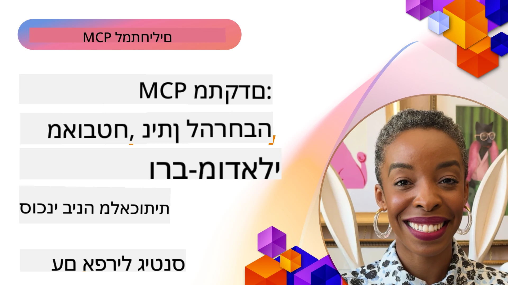

# נושאים מתקדמים ב-MCP

_(לחץ על התמונה למעלה כדי לצפות בסרטון השיעור)_

פרק זה מכסה סדרת נושאים מתקדמים ביישום פרוטוקול הקשר למודל (MCP), כולל אינטגרציה רב-מודאלית, מדרגיות, שיטות אבטחה מיטביות ואינטגרציה ארגונית. נושאים אלו חיוניים לבניית יישומי MCP יציבים ומוכנים לייצור שיכולים לעמוד בדרישות של מערכות בינה מלאכותית מודרניות.

## מבוא

שיעור זה חוקר מושגים מתקדמים ביישום פרוטוקול הקשר למודל, תוך התמקדות באינטגרציה רב-מודאלית, מדרגיות, שיטות אבטחה מיטביות ואינטגרציה ארגונית. נושאים אלו חיוניים לבניית יישומי MCP ברמת ייצור שיכולים להתמודד עם דרישות מורכבות בסביבות ארגוניות.

> **הערת מפרט נוכחית:** MCP `2026-07-28` מבטל את היסודות של Roots ו-
> Sampling המכוסים בשיעורים 5.4 ו-5.6. כמו כן, הוא מעביר את
> מאפיין המשימות הניסיוני המוזכר ב-Protocol Features (5.16) להארכת
> משימות מיוחדת. שיעורים אלה נשמרים ליישומים קיימים ב-`2025-11-25`
> וכוללים הנחיות למעבר. ראו
> [מה השתנה ב-MCP: מפרט 2026-07-28](../01-CoreConcepts/mcp-2026-07-28.md).

## מטרות הלמידה

בסוף שיעור זה, תוכל:

- ליישם יכולות רב-מודאליות במסגרת MCP
- לתכנן ארכיטקטורות MCP מדרגיות לתרחישי דרישה גבוהה
- ליישם שיטות אבטחה מיטביות התואמות עקרונות האבטחה של MCP
- לשלב את MCP עם מערכות ומסגרות בינה מלאכותית ארגוניות
- לשפר ביצועים ואמינות בסביבות ייצור

## שיעורים ודוגמאות פרויקטים

| קישור | כותרת | תיאור |
|------|-------|-------------|
| [5.1 אינטגרציה עם Azure](./mcp-integration/README.md) | אינטגרציה עם Azure | למד כיצד לשלב את שרת MCP שלך ב-Azure |
| [5.2 דוגמה רב-מודאלית](./mcp-multi-modality/README.md) | דוגמאות רב-מודאליות ב-MCP | דוגמאות לאודיו, תמונה ותגובה רב-מודאלית |
| [5.3 דוגמת MCP OAuth2](../../../05-AdvancedTopics/mcp-oauth2-demo) | הדגמת MCP OAuth2 | אפליקציית Spring Boot מינימלית המציגה OAuth2 עם MCP, הן כסרבר הרשאה והן כסרבר משאבים. מדגימה הנפקת טוקנים מאובטחים, נקודות קצה מוגנות, פריסת Azure Container Apps, ואינטגרציה עם ניהול API. |
| [5.4 הקשרים Root](./mcp-root-contexts/README.md) | הקשרים Root | למד את היסוד המיושן `2025-11-25` Roots ואת אפשרויות המעבר הנוכחיות (מבוטל ב-`2026-07-28`) |
| [5.5 ניתוב](./mcp-routing/README.md) | ניתוב | למד סוגים שונים של ניתוב |
| [5.6 Sampling](./mcp-sampling/README.md) | Sampling | למד את היסוד המיושן `2025-11-25` Sampling ואת אפשרויות המעבר הנוכחיות (מבוטל ב-`2026-07-28`) |
| [5.7 מדרגיות](./mcp-scaling/README.md) | מדרגיות | למד על מדרגיות |
| [5.8 אבטחה](./mcp-security/README.md) | אבטחה | אבטח את שרת MCP שלך |
| [5.9 דוגמת חיפוש ווב](./web-search-mcp/README.md) | חיפוש ווב ב-MCP | שרת ולקוח MCP ב-Python המשתלבים עם SerpAPI לחיפוש אינטרנט, חדשות, מוצרים ושאלות ותשובות בזמן אמת. מדגים תיאום כלים מרובים, אינטגרציה עם API חיצוני, וטיפול שגיאות יציב. |
| [5.10 הזרמת מידע בזמן אמת](./mcp-realtimestreaming/README.md) | הזרמה | הזרמת מידע בזמן אמת הפכה לקריטית בעולם המונחה נתונים של היום, בו עסקים ואפליקציות דורשים גישה מיידית למידע לקבלת החלטות בזמן אמת.|
| [5.11 חיפוש ווב בזמן אמת](./mcp-realtimesearch/README.md) | חיפוש ווב | כיצד MCP משנה את חיפוש האינטרנט בזמן אמת על ידי מתן גישה סטנדרטית לניהול הקשר בין מודלי AI, מנועי חיפוש ואפליקציות.|
| [5.12 אימות Entra ID לשרתים ב-Model Context Protocol](./mcp-security-entra/README.md) | אימות Entra ID | Microsoft Entra ID מספק פתרון חזק לניהול זהות וגישה מבוסס ענן, המסייע להבטיח שרק משתמשים ואפליקציות מורשים יוכלו לתקשר עם שרת MCP שלך.|
| [5.13 אינטגרציה עם סוכני Microsoft Foundry](./mcp-foundry-agent-integration/README.md) | אינטגרציה Microsoft Foundry | למד כיצד לשלב שרתי Model Context Protocol עם סוכני Microsoft Foundry, מה שמאפשר תיאום כלים עוצמתי ויכולות בינה מלאכותית ארגוניות עם חיבורי מקור נתונים חיצוניים סטנדרטיים.|
| [5.14 הנדסת הקשר](./mcp-contextengineering/README.md) | הנדסת הקשר | ההזדמנות העתידית של טכניקות הנדסת הקשר עבור שרתי MCP, כולל אופטימיזציית הקשר, ניהול הקשר דינמי ואסטרטגיות למהנדסי פקודות בתוך מסגרות MCP.|
| [5.15 העברת מידע מותאמת אישית ב-MCP](./mcp-transport/README.md) | העברת מידע מותאמת אישית | למד כיצד ליישם מנגנוני העברה מותאמים אישית לתרחישי תקשורת MCP מיוחדים.|
| [5.16 התכונות העמוקות של הפרוטוקול](./mcp-protocol-features/README.md) | תכונות פרוטוקול | התמחה בתכונות פרוטוקול מתקדמות כולל התראות על התקדמות, ביטול בקשות, תבניות משאבים ודפוסי טיפול בשגיאות.|
| [5.17 הסקת מסקנות בין-סוכנית עוינת](./mcp-adversarial-agents/README.md) | סוכנים עוינים | השתמש בשניים סוכנים עם עמדות מנוגדות, שמשתפים סט כלים אחד ב-MCP, כדי לתפוס הזיות, לחשוף מקרים קיצוניים, ולהפיק פלטים מכוילים טוב יותר באמצעות ויכוח מבנה.|

> **הערת היסטוריית `2025-11-25`:** שהגרסה הציגה את המשימות הניסיוניות
> והרחיבה מספר תכונות פרוטוקול. ב-`2026-07-28`, המשימות הועברו ל-
> תוסף רשמי ו-Rooots בוטלו. אל תשתמש במצב
> התכונה `2025-11-25` כהנחיה עדכנית; עיין ב-
> [יומן השינויים 2026-07-28](https://modelcontextprotocol.io/specification/2026-07-28/changelog).

## מקורות נוספים

למידע העדכני ביותר על נושאי MCP מתקדמים, עיין ב:
- [תיעוד MCP](https://modelcontextprotocol.io/)
- [מפרט MCP (2026-07-28)](https://modelcontextprotocol.io/specification/2026-07-28/)
- [מאגר GitHub](https://github.com/modelcontextprotocol)
- [OWASP MCP עשרת הגדולים](https://microsoft.github.io/mcp-azure-security-guide/mcp/) - סיכוני אבטחה והפחתותיהם
- [סדנת פסגה לאבטחת MCP (שרפה)](https://azure-samples.github.io/sherpa/) - אימוני אבטחה מעשיים

## מסקנות מפתח

- יישומי MCP רב-מודאליים מרחיבים את יכולות ה-AI מעבר לעיבוד טקסט
- קנה מידה הוא חיוני לפריסות ארגוניות וניתן להתמודד איתו דרך קנה מידה אופקי ואנכי
- אמצעי אבטחה מקיפים מגנים על נתונים ומבטיחים שליטה נאותה בגישה
- אינטגרציה ארגונית עם פלטפורמות כמו Azure OpenAI ו-Microsoft AI Foundry משפרת את יכולות ה-MCP
- יישומי MCP מתקדמים נהנים מארכיטקטורות אופטימליות וניהול זהיר של משאבים

## תרגיל

עצב יישום MCP ברמת הארגון למקרה שימוש ספציפי:

1. זהה דרישות רב-מודאליות למקרה השימוש שלך
2. תאר את בקרות האבטחה הנדרשות להגנת נתונים רגישים
3. עצב ארכיטקטורה שניתנת להרחבה שיכולה להתמודד עם עומסים משתנים
4. תכנן נקודות אינטגרציה עם מערכות AI ארגוניות
5. תעד צווארי בקבוק ביצועים פוטנציאליים ואסטרטגיות הפחתה

## משאבים נוספים

- [תיעוד Azure OpenAI](https://learn.microsoft.com/en-us/azure/ai-services/openai/)
- [תיעוד Microsoft AI Foundry](https://learn.microsoft.com/en-us/ai-services/)

---

## מה הלאה

חקור את השיעורים במודול זה החל מ: [5.1 אינטגרציית MCP](./mcp-integration/README.md)

לאחר שסיימת מודול זה, המשך ל: [מודול 6: תרומות הקהילה](../06-CommunityContributions/README.md)

---

<!-- CO-OP TRANSLATOR DISCLAIMER START -->
**כתב ויתור**:
מסמך זה תורגם באמצעות שירות תרגום אוטומטי [Co-op Translator](https://github.com/Azure/co-op-translator). למרות שאנו שואפים לדיוק, יש לקחת בחשבון שתרגומים אוטומטיים עלולים להכיל שגיאות או אי-דיוקים. יש להחשיב את המסמך המקורי בשפתו הטבעית כמקור הסמכות. למידע קריטי מומלץ להשתמש בתרגום מקצועי על ידי מתרגם אדם. אנו לא אחראים לכל אי-הבנה או פירוש שגוי הנובע מהשימוש בתרגום זה.
<!-- CO-OP TRANSLATOR DISCLAIMER END -->