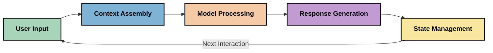
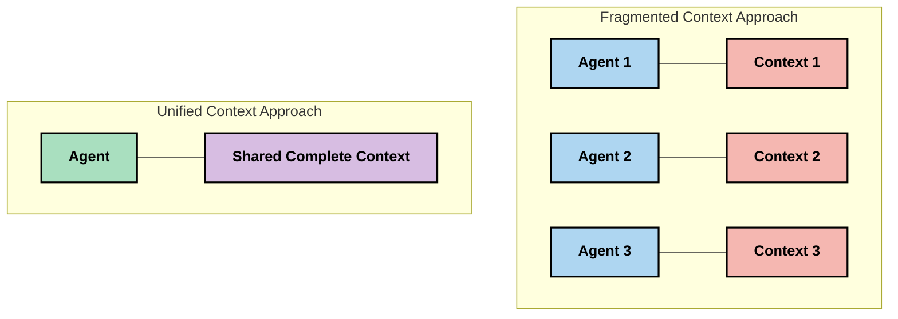
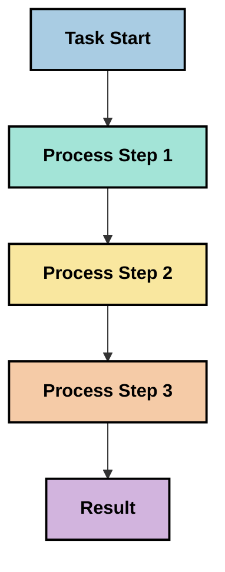
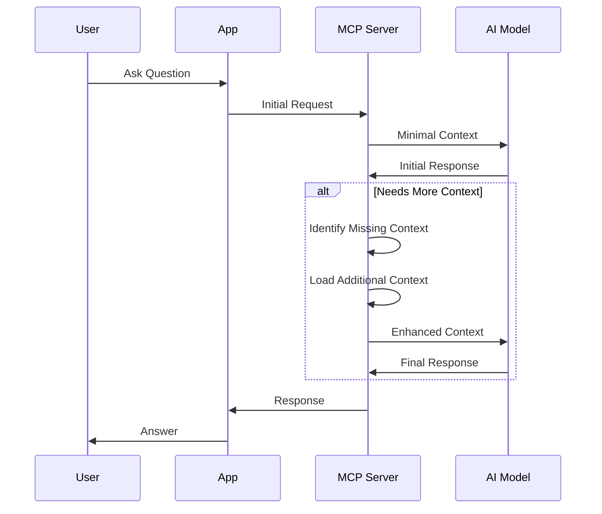
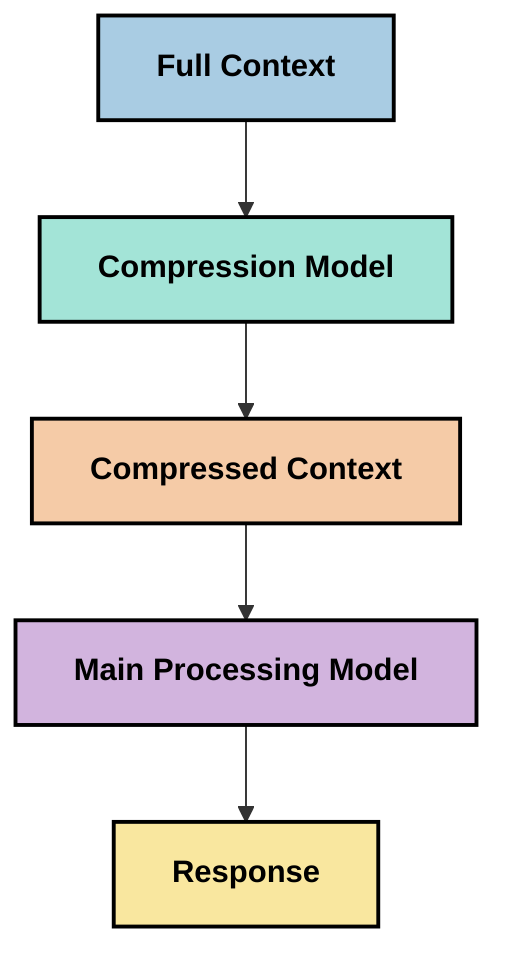
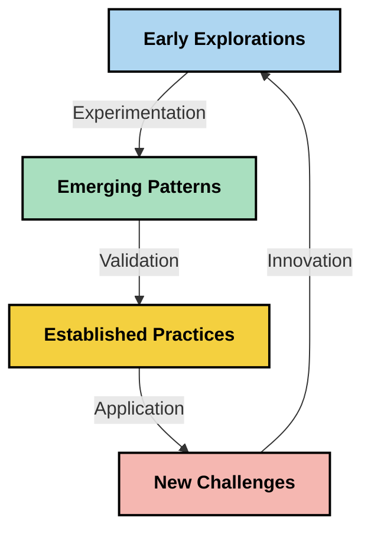

# הנדסת הקונטקסט: מושג מתהווה באקוסיסטם של MCP

## סקירה כללית

הנדסת הקונטקסט היא מושג מתהווה בתחום ה-AI החוקרת כיצד מידע ממורכב, מועבר ומנוהל לאורך אינטראקציות בין לקוחות לשירותי AI. ככל שהאקוסיסטם של פרוטוקול קונטקסט המודל (MCP) מתפתח, הבנת הדרך לנהל קונטקסט בצורה יעילה נעשית חשובה יותר. מודול זה מציג את מושג הנדסת הקונטקסט ומבחין ביישומיו האפשריים במימושי MCP.

## מטרות הלמידה

בסוף מודול זה תוכלו:

- להבין את מושג הנדסת הקונטקסט המתפתח ואת תפקידו הפוטנציאלי ביישומי MCP
- לזהות את האתגרים המרכזיים בניהול הקונטקסט שעליהם מתייחס תכנון פרוטוקול MCP
- לחקור טכניקות לשיפור ביצועי המודל באמצעות טיפול טוב יותר בקונטקסט
- לשקול גישות למדידה והערכה של יעילות הקונטקסט
- ליישם את המושגים המתהווים לשיפור חוויות ה-AI דרך מסגרת MCP

## מבוא להנדסת הקונטקסט

הנדסת הקונטקסט היא מושג מתהווה המתמקד בתכנון ממוקד ובניהול זרימת מידע בין משתמשים, יישומים ומודלי AI. בניגוד לתחומים מבוססים כמו הנדסת פרומפטים, הנדסת הקונטקסט עדיין מוגדרת על ידי מתרגלים הפועלים לפתור את האתגרים הייחודיים של אספקת מידע נכון למודלי AI בזמן הנכון.

עם ההתפתחות של מודלים שפתיים גדולים (LLMs), חשיבות הקונטקסט נעשתה ברורה יותר. האיכות, הרלוונטיות והמבנה של הקונטקסט שאנו מספקים משפיעים ישירות על פלט המודל. הנדסת הקונטקסט חוקרת את הקשר הזה ושואפת לפתח עקרונות לניהול קונטקסט יעיל.

> "בשנת 2025, המודלים שם הם אינטליגנטיים ביותר. אבל אפילו האדם החכם ביותר לא יוכל לבצע את עבודתו ביעילות בלי קונטקסט של מה שמבקשים ממנו לעשות... 'הנדסת הקונטקסט' היא השלב הבא בהנדסת הפרומפטים. זה עניין של ביצוע אוטומטי במערכת דינמית." — וואלדן יאן, Cognition AI

הנדסת הקונטקסט עשויה לכלול:

1. **בחירת קונטקסט**: קביעת איזה מידע רלוונטי למשימה נתונה
2. **מבנה הקונטקסט**: ארגון מידע למקסום הבנת המודל
3. **העברת קונטקסט**: אופטימיזציה של איך ומתי המידע נשלח למודלים
4. **תחזוקת קונטקסט**: ניהול המצב וההתפתחות של הקונטקסט לאורך זמן
5. **הערכת קונטקסט**: מדידה ושיפור יעילות הקונטקסט

תחומי הפוקוס הללו רלוונטיים במיוחד לאקוסיסטם של MCP, המספק דרך סטנדרטית ליישומים להעביר קונטקסט למודלים שפתיים גדולים.


## נקודת המבט של מסע הקונטקסט

דרך אחת להמחיש את הנדסת הקונטקסט היא לעקוב אחרי המסע שהמידע עושה במערכת MCP:



### שלבים מרכזיים במסע הקונטקסט:

1. **קלט משתמש**: מידע גולמי מהמשתמש (טקסט, תמונות, מסמכים)
2. **הרכבת קונטקסט**: שילוב קלט המשתמש עם קונטקסט מערכת, היסטוריית שיחה ומידע אחר שנשלף
3. **עיבוד מודל**: המודל מעבד את הקונטקסט שהורכב
4. **יצירת תגובה**: המודל מפיק פלט בהתבסס על הקונטקסט המסופק
5. **ניהול מצב**: המערכת מעדכנת את מצבה הפנימי בהתאם לאינטראקציה

נקודת מבט זו מדגישה את הטבע הדינמי של הקונטקסט במערכות AI ומעלה שאלות חשובות כיצד לנהל מידע בצורה הטובה ביותר בכל שלב.

## עקרונות מתהווים בהנדסת קונטקסט

ככל שתחום הנדסת הקונטקסט מתגבש, מספר עקרונות ראשוניים מתחילים להתברר מצד המתארגנים. עקרונות אלה עשויים לסייע להנחות את בחירות המימוש של MCP:

### עיקרון 1: לשתף את הקונטקסט במלואו

יש לשתף את הקונטקסט בשלמותו בין כל רכיבי המערכת במקום לפרגמנט אותו על פני סוכנים או תהליכים מרובים. כאשר הקונטקסט מחולק, החלטות שנעשות בחלק אחד של המערכת עלולות להתנגש עם אלו שבחלק אחר.



ביישומי MCP, הדבר מרמז על תכנון מערכות שבהן הקונטקסט זורם בצורה חלקה לאורך כל הפייפליין במקום להיות מחולק למקטעים.

### עיקרון 2: להכיר בכך שפעולות נושאות החלטות מרומזות

כל פעולה שהמודל מבצע מגלמת החלטות מרומזות לגבי איך לפרש את הקונטקסט. כאשר מספר רכיבים פועלים על קונטקסטים שונים, החלטות מרומזות אלה עלולות להיות סותרות, מה שמוביל לתוצאות לא עקביות.

לעיקרון זה יש השלכות חשובות ליישומי MCP:
- להעדיף עיבוד ליניארי של משימות מורכבות על פני ביצוע מקביל עם קונטקסט מפוגם
- להבטיח שכל נקודות ההחלטה יקבלו גישה למידע קונטקסטואלי אחיד
- לתכנן מערכות שבהן צעדים מאוחרים יכולים לראות את כל הקונטקסט של החלטות מוקדמות

### עיקרון 3: לאזן בין עומק הקונטקסט למגבלות חלון

כאשר שיחות ותהליכים מתארכים, חלונות הקונטקסט מתמלאים בסופו של דבר. הנדסת הקונטקסט היעילה חוקרת גישות לניהול המתח בין קונטקסט מקיף למגבלות טכניות.

גישות פוטנציאליות הנחקרות כוללות:
- דחיסת קונטקסט השומרת מידע חיוני ועם זאת מפחיתה שימוש בטוקנים
- טעינה התקדמותית של הקונטקסט בהתבסס על הרלוונטיות לצרכים הנוכחיים
- סיכום אינטראקציות קודמות תוך שמירה על החלטות ועובדות מרכזיות

## אתגרי קונטקסט ותכנון פרוטוקול MCP

פרוטוקול קונטקסט המודל (MCP) תוכנן בהבנה של האתגרים הייחודיים בניהול קונטקסט. הבנת האתגרים האלה מסבירה היבטים מרכזיים בתכנון הפרוטוקול:


### אתגר 1: מגבלות חלון קונטקסט
רוב מודלי ה-AI מוגבלים בגודל חלון הקונטקסט, מה שמגביל כמה מידע ניתן לעבד בו-זמנית.

**תגובה של תכנון MCP:** 
- הפרוטוקול תומך בקונטקסט מובנה מבוסס משאבים שניתן להפנות אליו ביעילות
- משאבים יכולים להיות מחולקים לעמודים ונטענים בהדרגה

### אתגר 2: קביעת רלוונטיות
קביעת איזה מידע הוא הרלוונטי ביותר לכלול בקונטקסט היא משימה קשה.

**תגובה של תכנון MCP:**
- כלים גמישים מאפשרים שליפה דינמית של מידע על בסיס הצורך
- פרומפטים מובנים מאפשרים ארגון קונטקסט עקבי

### אתגר 3: שימור הקונטקסט
ניהול מצב לאורך אינטראקציות דורש מעקב מדויק אחר הקונטקסט.

**תגובה של תכנון MCP:**
- ניהול מושבים סטנדרטי
- דפוסי אינטראקציה מוגדרים בבירור להתפתחות הקונטקסט

### אתגר 4: קונטקסט מולטימודלי
סוגי נתונים שונים (טקסט, תמונות, נתונים מובנים) מצריכים טיפול שונה.

**תגובה של תכנון MCP:**
- תכנון הפרוטוקול מותאם לסוגי תוכן שונים
- ייצוג סטנדרטי של מידע מולטימודלי

### אתגר 5: אבטחה ופרטיות
הקונטקסט מכיל לעתים מידע רגיש שיש להגן עליו.

**תגובה של תכנון MCP:**
- גבולות ברורים בין תחומי האחריות של הלקוח והשרת
- אפשרויות עיבוד מקומי כדי למזער חשיפת נתונים

הבנת האתגרים האלה ואופן ההתייחסות אליהם על ידי MCP מספקת בסיס לחקר טכניקות מתקדמות יותר של הנדסת קונטקסט.

## גישות מתהוות להנדסת הקונטקסט

ככל שתחום הנדסת הקונטקסט מתפתח, כמה גישות מבטיחות צצות. אלו מייצגות חשיבה עכשווית ולא שיטות מוסכמות, וסביר שיתפתחו עם צבירת ניסיון במימושי MCP.

### 1. עיבוד ליניארי בשרשור יחיד

בניגוד לארכיטקטורות מולטי-סוכן שמפזרות את הקונטקסט, חלק מהמתרגלים מגלים שעיבוד ליניארי בשרשור יחיד מייצר תוצאות עקביות יותר. זה מתאים לעיקרון של שמירת קונטקסט מאוחד.



למרות שגישה זו עשויה להיראות פחות יעילה מעיבוד במקביל, היא לעיתים קרובות מפיקה תוצאות ברורות ואמינות יותר כי כל שלב מתבסס על הבנה מלאה של החלטות קודמות.

### 2. חיתוך קונטקסט ומתן עדיפות

פיצול קונטקסטים גדולים לחלקים ניתנים לניהול ומתן עדיפות למה שחשוב ביותר.

```python
# Conceptual Example: Context Chunking and Prioritization
def process_with_chunked_context(documents, query):
    # 1. Break documents into smaller chunks
    chunks = chunk_documents(documents)
    
    # 2. Calculate relevance scores for each chunk
    scored_chunks = [(chunk, calculate_relevance(chunk, query)) for chunk in chunks]
    
    # 3. Sort chunks by relevance score
    sorted_chunks = sorted(scored_chunks, key=lambda x: x[1], reverse=True)
    
    # 4. Use the most relevant chunks as context
    context = create_context_from_chunks([chunk for chunk, score in sorted_chunks[:5]])
    
    # 5. Process with the prioritized context
    return generate_response(context, query)
```

הרעיון לעיל ממחיש כיצד ניתן לפרק מסמכים גדולים לחלקים ניתנים לניהול ולבחור רק את החלקים הרלוונטיים ביותר כקונטקסט. גישה זו יכולה לסייע לעמוד במגבלות חלון הקונטקסט ועדיין לנצל מאגרי ידע גדולים.

### 3. טעינת קונטקסט התקדמותית

טעינת הקונטקסט בהדרגה לפי הצורך במקום הכל בבת אחת.



טעינת קונטקסט התקדמותית מתחילה מקונטקסט מינימלי ומתרחבת רק כשנדרש. זה יכול להפחית משמעותית את שימוש בטוקנים בשאילתות פשוטות תוך שמירה על היכולת להתמודד עם שאלות מורכבות.

### 4. דחיסה וסיכום קונטקסט

הקטנת גודל הקונטקסט תוך שמירה על מידע חיוני.



דחיסת קונטקסט מתמקדת ב:
- הסרת מידע מיותר
- סיכום תוכן ארוך
- הוצאת עובדות ומידע מרכזי
- שמירת אלמנטים חשובים של הקונטקסט
- אופטימיזציה ליעילות טוקנים

גישה זו יכולה להיות חשובה במיוחד לשמירה על שיחות ארוכות בתוך חלונות קונטקסט או לעיבוד מסמכים גדולים ביעילות. חלק מהמתרגלים משתמשים במודלים מיוחדים שמתמחים בדחיסת קונטקסט וסיכום היסטוריית שיחה.


## שיקולים חקרניים בהנדסת הקונטקסט

ככל שאנו חוקרים את תחום הנדסת הקונטקסט המתהווה, ישנם מספר שיקולים שכדאי לזכור בעבודה עם מימושי MCP. אלו אינם שיטות מקובלות אלא תחומי מחקר שעשויים להביא לשיפורים במקרים הספציפיים שלכם.

### שקול את מטרות הקונטקסט שלך

לפני יישום פתרונות ניהול קונטקסט מורכבים, הגדר בבירור מה אתה מנסה להשיג:
- איזה מידע ספציפי המודל צריך להצליח?
- איזה מידע חיוני לעומת תוספתי?
- מהם מגבלות הביצועים שלך (שהייה, מגבלות טוקנים, עלויות)?

### חקור גישות קונטקסט בשכבות

חלק מהמתרגלים מגלים הצלחה בארגון הקונטקסט בשכבות מושגיות:
- **שכבת ליבה**: מידע חיוני שהמודל תמיד צריך
- **שכבת מצב**: קונטקסט ספציפי לאינטראקציה הנוכחית
- **שכבת תמיכה**: מידע נוסף שעשוי להיות מועיל
- **שכבת גיבוי**: מידע שניגשים אליו רק כשנדרש

### בדוק אסטרטגיות שליפה

יעילות הקונטקסט שלך תלויה לעיתים קרובות באופן שבו אתה מושך מידע:
- חיפוש סמנטי והטמעות למציאת מידע רלוונטי מבחינה מושגית
- חיפוש מבוסס מילות מפתח לפרטים עובדתיים ספציפיים
- גישות משולבות שמשלבות מספר שיטות שליפה
- סינון מטא-נתונים להצרה על פי קטגוריות, תאריכים או מקורות

### נסה קוהרנטיות קונטקסטואלית

המבנה וזרימת הקונטקסט עשויים להשפיע על הבנת המודל:
- קיבוץ מידע קשור יחד
- שימוש בפורמט וארגון עקביים
- שמירה על סדר לוגי או כרונולוגי כשמתאים
- הימנעות ממידע סותר

### שקול את היצירות מולטי-סוכן

למרות שמבני מולטי-סוכן פופולריים בהרבה מסגרות AI, הם מביאים אתגרים משמעותיים בניהול קונטקסט:
- פירוק הקונטקסט עלול להוביל להחלטות סותרות בין סוכנים
- עיבוד במקביל עלול ליצור סתירות שקשה לפשר
- עומס תקשורתי בין הסוכנים עשוי לבטל את יתרונות הביצועים
- נדרש ניהול מצב מורכב לשמירת קוהרנטיות

במקרים רבים, גישה של סוכן יחיד עם ניהול קונטקסט מקיף עשויה להניב תוצאות אמינות יותר מאשר סוכנים מרובים מומחים עם קונטקסט מפוגם.

### פתח שיטות הערכה

כדי לשפר את הנדסת הקונטקסט לאורך זמן, שקול כיצד תמדוד הצלחה:
- בדיקות A/B עם מבני קונטקסט שונים
- מעקב אחר שימוש בטוקנים וזמני תגובה
- מעקב אחר שביעות רצון המשתמשים ושיעורי השלמת משימות
- ניתוח מתי ולמה אסטרטגיות קונטקסט נכשלות

שיקולים אלה מייצגים תחומי מחקר פעילים בתחום הנדסת הקונטקסט. ככל שהתחום יתפתח, סביר שיתגבשו תבניות ושיטות ברורות יותר.

## מדידת יעילות הקונטקסט: מסגרת מתפתחת

ככל שהנדסת הקונטקסט מתפתחת כמושג, מתרגלים מתחילים לחקור כיצד למדוד את יעילותה. אין עדיין מסגרת מוסכמת, אך שיקולים מגוונים נמצאים בדיון שעשויים להנחות עבודה עתידית.

### מידות מדידה פוטנציאליות


#### 1. שיקולים ביעילות הקלט

- **יחס קונטקסט לתגובה**: כמה קונטקסט דרוש יחסית לגודל התגובה?
- **שימוש בטוקנים**: כמה אחוזים מטוקני הקונטקסט משפיעים על התגובה?
- **הקטנת קונטקסט**: כמה יעיל דחיסת המידע הגולמי?

#### 2. שיקולים בביצועים

- **השפעה על שהייה**: כיצד ניהול הקונטקסט משפיע על זמן התגובה?
- **כלכלת הטוקנים**: האם אנו ממקסמים שימוש יעיל בטוקנים?
- **דיוק השליפה**: כמה המידע שנשלף רלוונטי?
- **שימוש במשאבים**: מה דרישות החישוב?

#### 3. שיקולים באיכות

- **רלוונטיות תגובה**: עד כמה התגובה עונה על השאלה?
- **דיוק עובדתי**: האם ניהול הקונטקסט משפר נכונות עובדתית?
- **עקביות**: האם התגובות עקביות בשאלות דומות?
- **קצב הלוצינציה**: האם קונטקסט טוב יותר מפחית הטיות מודל?

#### 4. שיקולים בחוויית המשתמש

- **שיעור מעקב**: כמה לעתים המשתמשים זקוקים להבהרה?
- **השלמת משימות**: האם המשתמשים משיגים את מטרותיהם בהצלחה?
- **מדדי שביעות רצון**: איך המשתמשים מדרגים את חווייתם?

### גישות חקרניות למדידה

בעת ניסוי בהנדסת קונטקסט במימושי MCP, שקול גישות חקרניות אלה:

1. **השוואות בסיס**: קבע קו בסיס עם גישות קונטקסט פשוטות לפני בדיקת שיטות מתוחכמות יותר

2. **שינויים מדורגים**: שנה היבט אחד של ניהול הקונטקסט בכל פעם כדי לנתח את השפעותיו

3. **הערכה ממוקדת משתמש**: שלב מדדים כמותיים יחד עם משוב איכותני מהמשתמשים

4. **ניתוח כישלונות**: בחן מקרים שבהם אסטרטגיות הקונטקסט נכשלות להבנת שיפורים אפשריים

5. **הערכה רב-ממדית**: שקול פשרות בין יעילות, איכות וחוויית משתמש

גישה ניסויית ורבת-ממדים זו למדידה עולה בקנה אחד עם אופיו המתהווה של תחום הנדסת הקונטקסט.

## מחשבות מסכמות

הנדסת הקונטקסט היא תחום מתהווה שעשוי להיות מרכזי ליישומי MCP יעילים. על ידי התבוננות בקפידה כיצד מידע זורם במערכת שלך, תוכל ליצור חוויות AI יעילות, מדויקות ובעלות ערך למשתמשים.

הטכניקות והגישות המתוארות במודול זה מייצגות חשיבה מוקדמת בתחום, לא שיטות מוסכמות. הנדסת הקונטקסט עשויה להתפתח לתחום מוגדר יותר ככל שיכולות ה-AI מתקדמות וההבנה מעמיקה. לעת עתה, ניסויים בשילוב מדידה מדויקת נראים הגישה הפורייה ביותר.

## כיווני עתיד פוטנציאליים

תחום הנדסת הקונטקסט עדיין בשלביו הראשוניים, אך כמה כיוונים מבטיחים צצים:

- עקרונות הנדסת הקונטקסט עשויים להשפיע משמעותית על ביצועי מודלים, יעילות, חוויית משתמש ואמינות
- גישות בשרשור יחיד עם ניהול קונטקסט מקיף עשויות להצטיין על פני ארכיטקטורות מולטי-סוכן במקרים רבים
- מודלים מיוחדים לדחיסת קונטקסט עשויים להפוך לרכיבים סטנדרטיים בפייפלייני AI
- המתח בין שלמות הקונטקסט למגבלות טוקנים כנראה יניע חדשנות בטיפול בקונטקסט
- ככל שהמודלים משתפרים בתקשורת יעילה בסגנון אנושי, שיתוף פעולה מולטי-סוכן אמיתי עשוי להפוך לברי קיימא יותר
- מימושי MCP עשויים להתפתח לסטנדרטיזציה של דפוסי ניהול קונטקסט שמתפתחים מהניסויים הנוכחיים



## משאבים

### משאבים רשמיים של MCP
- [אתר פרוטוקול קונטקסט המודל](https://modelcontextprotocol.io/)
- [מפרט פרוטוקול קונטקסט המודל](https://github.com/modelcontextprotocol/modelcontextprotocol)
- [תיעוד MCP](https://modelcontextprotocol.io/docs)
- [MCP C# SDK](https://github.com/modelcontextprotocol/csharp-sdk)
- [MCP Python SDK](https://github.com/modelcontextprotocol/python-sdk)
- [MCP TypeScript SDK](https://github.com/modelcontextprotocol/typescript-sdk)
- [MCP Inspector](https://github.com/modelcontextprotocol/inspector) - כלי בדיקה חזותית לשרתי MCP

### מאמרי הנדסת הקשר
- [אל תבנו סוכנים מרובים: עקרונות הנדסת הקשר](https://cognition.ai/blog/dont-build-multi-agents) - תובנות של וולדן יאן על עקרונות הנדסת הקשר
- [מדריך מעשי לבניית סוכנים](https://cdn.openai.com/business-guides-and-resources/a-practical-guide-to-building-agents.pdf) - מדריך של OpenAI לעיצוב סוכנים יעיל
- [בניית סוכנים אפקטיביים](https://www.anthropic.com/engineering/building-effective-agents) - הגישה של Anthropic לפיתוח סוכנים

### מחקר קשור
- [הגברת אחזור דינמי למודלים שפתיים גדולים](https://arxiv.org/abs/2310.01487) - מחקר על גישות אחזור דינמיות
- [אבוד באמצע: כיצד מודלים שפתיים משתמשים בהקשרים ארוכים](https://arxiv.org/abs/2307.03172) - מחקר חשוב על תבניות עיבוד הקשר
- [יצירת תמונות היררכית מותנית טקסט עם ערוצי CLIP](https://arxiv.org/abs/2204.06125) - מאמר DALL-E 2 עם תובנות על מבני הקשר
- [חקירת תפקיד ההקשר בארכיטקטורות מודלים שפתיים גדולים](https://aclanthology.org/2023.findings-emnlp.124/) - מחקר עדכני על טיפול בהקשר
- [שיתוף פעולה בין סוכנים: סקירה](https://arxiv.org/abs/2304.03442) - מחקר על מערכות רב-סוכניות ואתגריהן

### משאבים נוספים
- [טכניקות אופטימיזציה של חלון הקשר](https://learn.microsoft.com/en-us/azure/ai-services/openai/concepts/context-window)
- [טכניקות RAG מתקדמות](https://www.microsoft.com/en-us/research/blog/retrieval-augmented-generation-rag-and-frontier-models/)
- [תיעוד Semantic Kernel](https://github.com/microsoft/semantic-kernel)
- [ערכת כלים Microsoft Foundry עבור Visual Studio Code](https://github.com/microsoft/vscode-ai-toolkit)

## מה הלאה

- [5.15 MCP Custom Transport](../mcp-transport/README.md)

---

<!-- CO-OP TRANSLATOR DISCLAIMER START -->
**כתב ויתור**:
מסמך זה תורגם באמצעות שירות תרגום אוטומטי [Co-op Translator](https://github.com/Azure/co-op-translator). למרות שאנו שואפים לדיוק, יש לקחת בחשבון שתרגומים אוטומטיים עלולים להכיל שגיאות או אי-דיוקים. יש להחשיב את המסמך המקורי בשפתו הטבעית כמקור הסמכות. למידע קריטי מומלץ להשתמש בתרגום מקצועי על ידי מתרגם אדם. אנו לא אחראים לכל אי-הבנה או פירוש שגוי הנובע מהשימוש בתרגום זה.
<!-- CO-OP TRANSLATOR DISCLAIMER END -->