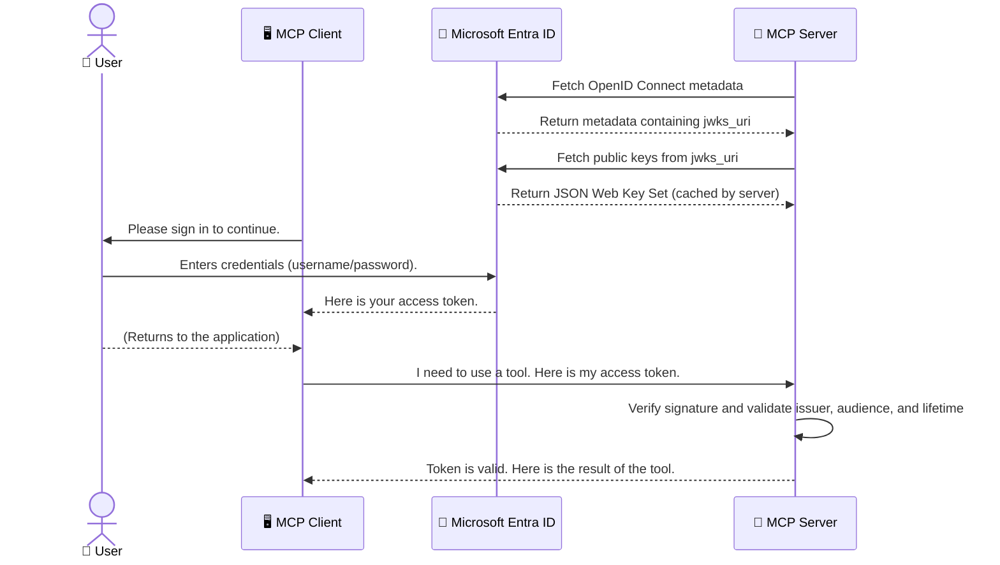

# אבטחת זרימות עבודה של בינה מלאכותית: אימות Entra ID לשרתי פרוטוקול הקשר דגם

> [!NOTE]
> קוד השרת המרוחק בשיעור זה מגן על נקודות קצה עוקבות `/sse` ו- `/message`
> ומיועד ל- MCP `2025-11-25`. שמור על שיטות הזיהוי ואימות האסימון שלו,
> אך עבור יישומים חדשים השתמש בהעברת HTTP מסוג Streamable התואמת ל- `2026-07-28`.


## הקדמה
אבטחת שרת פרוטוקול הקשר דגם (MCP) שלך חשובה כמו לנעול את דלת הכניסה לביתך. השארת שרת MCP פתוח חושפת את הכלים והנתונים שלך לגישה בלתי מורשית, שעלולה לגרום להפרות אבטחה. Microsoft Entra ID מספק פתרון ניהול זהות וגישה מבוסס ענן חזק, המסייע להבטיח שרק משתמשים ויישומים מורשים יוכלו לקיים אינטראקציה עם שרת MCP שלך. בחלק זה, תלמד כיצד להגן על זרימות העבודה של הבינה המלאכותית שלך באמצעות אימות Entra ID.

## יעדי הלמידה
בסיום חלק זה תוכל:

- להבין את חשיבות אבטחת שרתי MCP.
- להסביר את יסודות Microsoft Entra ID ואימות OAuth 2.0.
- להבחין בין לקוחות ציבוריים לסודיים.
- ליישם אימות Entra ID בסצנריו שרתי MCP מקומיים (לקוח ציבורי) ומרוחקים (לקוח סודי).
- ליישם שיטות אבטחה מיטביות בפיתוח זרימות עבודה של בינה מלאכותית.

## אבטחה ו- MCP

כמו שלא תשאיר את דלת הכניסה לביתך בלתי נעולה, לא כדאי להשאיר את שרת MCP פתוח לכל אחד. אבטחת זרימות העבודה של הבינה המלאכותית שלך היא חיונית לבניית יישומים חזקים, אמינים ובטוחים. פרק זה יציג כיצד להשתמש ב- Microsoft Entra ID כדי לאבטח את שרתי MCP שלך, תוך הבטחה שרק משתמשים ויישומים מורשים יוכלו לקיים אינטראקציה עם הכלים והנתונים שלך.

## מדוע אבטחה חשובה לשרתים של MCP

דמיין ששרת ה-MCP שלך כולל כלי שיכול לשלוח מיילים או לגשת למסד נתונים של לקוחות. שרת לא מאובטח פירושו שכל אחד עלול להשתמש בכלי הזה, מה שעלול להוביל לגישה לא מורשית לנתונים, לדואר זבל או לפעילויות זדוניות נוספות.

באמצעות יישום אימות, אתה מבטיח שכל בקשה לשרת שלך תיבדק, תוך אימות זהות המשתמש או היישום ששולח את הבקשה. זו השלב הראשון והחשוב ביותר באבטחת זרימות העבודה של הבינה המלאכותית שלך.

## הקדמה ל- Microsoft Entra ID

[**Microsoft Entra ID**](https://adoption.microsoft.com/microsoft-security/entra/) הוא שירות ניהול זהות וגישה מבוסס ענן. חשוב עליו כשומר ביטחון אוניברסלי עבור היישומים שלך. השירות מטפל בתהליך המורכב של אימות זהות משתמשים (authentication) וקביעת ההרשאות שלהם (authorization).

באמצעות Entra ID תוכל:

- לאפשר כניסה מאובטחת למשתמשים.
- להגן על API ושירותים.
- לנהל מדיניות גישה ממקום מרכזי.

עבור שרתי MCP, Entra ID מספק פתרון חזק ואמין לניהול מי יכול לגשת לפונקציות השרת.

---

## הבנת הקסם: כיצד פועל אימות Entra ID

Entra ID משתמש בסטנדרטים פתוחים כמו **OAuth 2.0** כדי לטפל באימות. למרות שהפרטים יכולים להיות מורכבים, הרעיון המרכזי פשוט וניתן להסבר בדימוי.

### הקדמה עדינה ל-OAuth 2.0: מפתח הוולאת'

חשוב על OAuth 2.0 כשירות וולאת' לרכב שלך. כשאתה מגיע למסעדה, אינך נותן לוולאת' את המפתח הראשי שלך. במקום זאת, אתה מספק **מפתח וולאת'** עם הרשאות מוגבלות — הוא יכול להדליק את הרכב ולנעול את הדלתות, אך לא לפתוח את תא המטען או את תיבת הכפפות.

בדימוי זה:

- **אתה** הוא ה- **משתמש**.
- **הרכב שלך** הוא שרת ה- **MCP** עם הכלים והנתונים היקרים שלו.
- ה- **וולאת'** הוא **Microsoft Entra ID**.
- השומר בחניה הוא **לקוח MCP** (היישום שמנסה לגשת לשרת).
- **מפתח הוולאת'** הוא **אסימון הגישה (Access Token)**.

אסימון הגישה הוא מחרוזת בטוחה של טקסט שהלקוח MCP מקבל מ- Entra ID לאחר ההתחברות שלך. הלקוח מציג את האסימון הזה לשרת MCP בכל בקשה. השרת יכול לאמת את האסימון כדי לוודא שהבקשה חוקית ושהלקוח מחזיק בהרשאות הנדרשות, וכל זאת בלי הצורך לטפל בפרטי ההתחברות שלך (כמו סיסמתך).

### זרימת האימות

כך התהליך פועל בפועל:



שרת ה-MCP אינו קורא ל-Entra ID כדי לאמת כל אסימון גישה. הוא
מאמת באופן קריפטוגרפי את חתימת JWT עם מפתח ציבורי מאוחסן של Entra ID
ומוודא את טענות האסימון, כולל המנפיק, הקהל ותוקף האסימון.
השרת קורא `jwks_uri` ממטא-נתוני OpenID Connect, מושך את המפתחות הציבוריים
מה-URI והמרענן אותם באופן תקופתי לטיפול בהחלפת המפתחות. יש להשתמש
בספריית אימות אסימונים נתמכת במקום ליישם לוגיקה זו בעצמך. לפרטים, ראה
[אמת אסימונים בפלטפורמת זהות מיקרוסופט](https://learn.microsoft.com/entra/identity-platform/access-tokens#validate-tokens).


- **היא מפשטת פיתוח:** היא מסתירה את המורכבות של פרוטוקולי OAuth 2.0 ו- OpenID Connect, ומאפשרת לך להוסיף אימות חזק ליישום שלך רק בכמה שורות קוד.
- **היא מתוחזקת:** מיקרוסופט משמרת ומעדכנת את MSAL באופן פעיל כדי לטפל באיומי אבטחה חדשים ושינויים בפלטפורמה.


כדי ללמוד עוד על MSAL, תוכל לבדוק את ה[תיעוד הסקירה הרשמי של MSAL](https://learn.microsoft.com/entra/identity-platform/msal-overview).

---

## אבטחת השרת MCP שלך עם Entra ID: מדריך שלב אחר שלב

עכשיו, בואו נעבור איך לאבטח שרת MCP מקומי (אשר מתקשר דרך `stdio`) באמצעות Entra ID. דוגמה זו משתמשת ב**לקוח ציבורי**, המתאים ליישומים שרצים על מכשיר המשתמש, כמו אפליקציית שולחן עבודה או שרת פיתוח מקומי.

### תרחיש 1: אבטחת שרת MCP מקומי (עם לקוח ציבורי)

בתרחיש זה, נבחן שרת MCP שרץ באופן מקומי, מתקשר דרך `stdio`, ומשתמש ב-Entra ID לאימות המשתמש לפני שמאפשר גישה לכליו. לשרת יהיה כלי אחד שמושך את פרטי הפרופיל של המשתמש מ- Microsoft Graph API.

#### 1.הגדרת היישום ב-Entra ID

לפני כתיבת קוד, עליך לרשום את היישום שלך ב-Microsoft Entra ID. זה מודיע ל-Entra ID על היישום שלך ומעניק לו הרשאה להשתמש בשירות האימות.

1. עבור ל- **[פורטל Microsoft Entra](https://entra.microsoft.com/)**.
2. עבור ל- **App registrations** ולחץ על **New registration**.
3. תן שם ליישום שלך (לדוגמה, "שרת MCP מקומי שלי").
4. תחת **Supported account types**, בחר **Accounts in this organizational directory only**.
5. ניתן להשאיר את **Redirect URI** ריק בדוגמה זו.
6. לחץ על **Register**.

לאחר ההרשמה, רשום את ה-**Application (client) ID** ואת ה-**Directory (tenant) ID**. תזדקק להם בקוד שלך.

#### 2. הקוד: פירוט

נבחן את החלקים המרכזיים בקוד המטפלים באימות. הקוד המלא לדוגמה זו זמין בתיקיה [Entra ID - Local - WAM](https://github.com/Azure-Samples/mcp-auth-servers/tree/main/src/entra-id-local-wam) במאגר ה-GitHub של [mcp-auth-servers](https://github.com/Azure-Samples/mcp-auth-servers).

**`AuthenticationService.cs`**

מחלקה זו אחראית על הטיפול באינטראקציה עם Entra ID.

- **`CreateAsync`**: שיטה זו מאתחלת את `PublicClientApplication` מספריית MSAL (Microsoft Authentication Library). היא מוגדרת עם `clientId` ו-`tenantId` של היישום שלך.
- **`WithBroker`**: מאפשרת שימוש ב-broker (כמו Windows Web Account Manager), שנותן חווית כניסה אחת מאובטחת וחלקה יותר.
- **`AcquireTokenAsync`**: זו השיטה המרכזית. היא מנסה תחילה לקבל טוקן בשקט (כלומר, שהמשתמש לא יצטרך להיכנס שוב אם כבר יש לו session תקף). אם לא ניתן לקבל טוקן בשקט, המשתמש יתבקש להיכנס באופן אינטראקטיבי.

```csharp
// Simplified for clarity
public static async Task<AuthenticationService> CreateAsync(ILogger<AuthenticationService> logger)
{
    var msalClient = PublicClientApplicationBuilder
        .Create(_clientId) // Your Application (client) ID
        .WithAuthority(AadAuthorityAudience.AzureAdMyOrg)
        .WithTenantId(_tenantId) // Your Directory (tenant) ID
        .WithBroker(new BrokerOptions(BrokerOptions.OperatingSystems.Windows))
        .Build();

    // ... cache registration ...

    return new AuthenticationService(logger, msalClient);
}

public async Task<string> AcquireTokenAsync()
{
    try
    {
        // Try silent authentication first
        var accounts = await _msalClient.GetAccountsAsync();
        var account = accounts.FirstOrDefault();

        AuthenticationResult? result = null;

        if (account != null)
        {
            result = await _msalClient.AcquireTokenSilent(_scopes, account).ExecuteAsync();
        }
        else
        {
            // If no account, or silent fails, go interactive
            result = await _msalClient.AcquireTokenInteractive(_scopes).ExecuteAsync();
        }

        return result.AccessToken;
    }
    catch (Exception ex)
    {
        _logger.LogError(ex, "An error occurred while acquiring the token.");
        throw; // Optionally rethrow the exception for higher-level handling
    }
}
```

**`Program.cs`**

כאן מוגדר שרת ה-MCP ומשולב שירות האימות.

- **`AddSingleton<AuthenticationService>`**: רשום את ה-`AuthenticationService` במכולת ה-injection, כך שיכולים להשתמש בו חלקים אחרים של היישום (כמו הכלי שלנו).
- **`GetUserDetailsFromGraph` tool**: כלי זה דורש מופע של `AuthenticationService`. לפני שהוא עושה משהו, הוא קורא ל-`authService.AcquireTokenAsync()` כדי לקבל טוקן גישה תקף. אם האימות מצליח, הוא משתמש בטוקן לקרוא ל-Microsoft Graph API ולמשוך את פרטי המשתמש.

```csharp
// Simplified for clarity
[McpServerTool(Name = "GetUserDetailsFromGraph")]
public static async Task<string> GetUserDetailsFromGraph(
    AuthenticationService authService)
{
    try
    {
        // This will trigger the authentication flow
        var accessToken = await authService.AcquireTokenAsync();

        // Use the token to create a GraphServiceClient
        var graphClient = new GraphServiceClient(
            new BaseBearerTokenAuthenticationProvider(new TokenProvider(authService)));

        var user = await graphClient.Me.GetAsync();

        return System.Text.Json.JsonSerializer.Serialize(user);
    }
    catch (Exception ex)
    {
        return $"Error: {ex.Message}";
    }
}
```

#### 3. איך זה עובד יחד

1. כאשר לקוח ה-MCP מנסה להשתמש בכלי `GetUserDetailsFromGraph`, הכלי קורא קודם ל-`AcquireTokenAsync`.
2. `AcquireTokenAsync` מפעיל את ספריית MSAL לבדוק טוקן תקף.
3. אם לא נמצא טוקן, MSAL, דרך ה-broker, תבקש מהמשתמש להיכנס עם חשבון Entra ID שלו.
4. לאחר הכניסה, Entra ID מוציא טוקן גישה.
5. הכלי מקבל את הטוקן ומשתמש בו כדי לבצע קריאה מאובטחת ל-Microsoft Graph API.
6. פרטי המשתמש מוחזרים ללקוח MCP.

תהליך זה מוודא שרק משתמשים מאומתים יכולים להשתמש בכלי, ובכך מאבטח באופן אפקטיבי את שרת ה-MCP המקומי שלך.

### תרחיש 2: אבטחת שרת MCP מרוחק (עם לקוח חסוי)

כאשר שרת ה-MCP שלך רץ על מכונה מרוחקת (כמו שרת בענן) ומתקשר דרך פרוטוקול כמו HTTP Streaming, דרישות האבטחה שונות. במקרה זה, יש להשתמש ב**לקוח חסוי** ובזרימת **Authorization Code Flow**. זו שיטה מאובטחת יותר מאחר וסודות היישום לעולם לא נחשפים לדפדפן.

דוגמה זו משתמשת בשרת MCP מבוסס TypeScript שמטפל בבקשות HTTP עם Express.js.

#### 1. הגדרת היישום ב-Entra ID

ההגדרה ב-Entra ID דומה לזו של הלקוח הציבורי, אך עם הבדל מפתח אחד: יש ליצור **סוד לקוח**.

1. עבור ל- **[פורטל Microsoft Entra](https://entra.microsoft.com/)**.
2. בהרשמת היישום שלך, עבור ללשונית **Certificates & secrets**.
3. לחץ על **New client secret**, תן לו תיאור ולחץ על **Add**.
4. **חשוב:** העתק את הערך של הסוד מיד. לא תוכל לראות אותו שוב.
5. יש גם להגדיר **Redirect URI**. עבור ללשונית **Authentication**, לחץ על **Add a platform**, בחר **Web**, והכנס את ה-redirect URI של היישום שלך (לדוגמה, `http://localhost:3001/auth/callback`).

> **⚠️ הערת אבטחה חשובה:** ליישומים בסביבת ייצור, מיקרוסופט ממליצה בחום להשתמש בשיטות אימות ללא סודות כגון **Managed Identity** או **Workload Identity Federation** במקום סודות לקוח. סודות לקוח הם סיכוני אבטחה מכיוון שהם עלולים להיחשף או להיות מופרים. זהויות מנוהלות מספקות גישה מאובטחת יותר על ידי הסרת הצורך לאחסן אישורים בקוד או בהגדרות.
>
> למידע נוסף על זהויות מנוהלות וכיצד ליישמן, ראה את [סקירת זהויות מנוהלות למשאבי Azure](https://learn.microsoft.com/entra/identity/managed-identities-azure-resources/overview).

#### 2. הקוד: פירוט

דוגמה זו משתמשת בגישה מבוססת session. כשהמשתמש מאומת, השרת מאחסן את טוקן הגישה ואת טוקן הריענון ב-session ומעניק למשתמש טוקן session. טוקן זה משמש לבקשות הבאות. הקוד המלא לדוגמה זו זמין בתיקיה [Entra ID - Confidential client](https://github.com/Azure-Samples/mcp-auth-servers/tree/main/src/entra-id-cca-session) במאגר ה-GitHub של [mcp-auth-servers](https://github.com/Azure-Samples/mcp-auth-servers).

**`Server.ts`**

קובץ זה מגדיר את שרת Express ואת שכבת התעבורה של MCP.

- **`requireBearerAuth`**: זוהי middleware שמגנה על נקודות הקצה של `/sse` ו-`/message`. היא בודקת טוקן בעל תוקף ב-`Authorization` של הבקשה.
- **`EntraIdServerAuthProvider`**: מחלקה מותאמת אישית שמממשת את ממשק `McpServerAuthorizationProvider`. היא אחראית על ניהול זרימת OAuth 2.0.
- **`/auth/callback`**: נקודת קצה זו מטפלת ב-redirect מ-Entra ID לאחר שהמשתמש אותת. היא מחליפה את קוד ההרשאה בטוקן גישה וטוקן ריענון.

```typescript
// Simplified for clarity
const app = express();
const { server } = createServer();
const provider = new EntraIdServerAuthProvider();

// Protect the SSE endpoint
app.get("/sse", requireBearerAuth({
  provider,
  requiredScopes: ["User.Read"]
}), async (req, res) => {
  // ... connect to the transport ...
});

// Protect the message endpoint
app.post("/message", requireBearerAuth({
  provider,
  requiredScopes: ["User.Read"]
}), async (req, res) => {
  // ... handle the message ...
});

// Handle the OAuth 2.0 callback
app.get("/auth/callback", (req, res) => {
  provider.handleCallback(req.query.code, req.query.state)
    .then(result => {
      // ... handle success or failure ...
    });
});
```

**`Tools.ts`**

קובץ זה מגדיר את הכלים ששרת MCP מספק. הכלי `getUserDetails` דומה לזה בדוגמה הקודמת, אך הוא מקבל את אסימון הגישה מה-session.

```typescript
// Simplified for clarity
server.setRequestHandler(CallToolRequestSchema, async (request) => {
  const { name } = request.params;
  const context = request.params?.context as { token?: string } | undefined;
  const sessionToken = context?.token;

  if (name === ToolName.GET_USER_DETAILS) {
    if (!sessionToken) {
      throw new AuthenticationError("Authentication token is missing or invalid. Ensure the token is provided in the request context.");
    }

    // Get the Entra ID token from the session store
    const tokenData = tokenStore.getToken(sessionToken);
    const entraIdToken = tokenData.accessToken;

    const graphClient = Client.init({
      authProvider: (done) => {
        done(null, entraIdToken);
      }
    });

    const user = await graphClient.api('/me').get();

    // ... return user details ...
  }
});
```

**`auth/EntraIdServerAuthProvider.ts`**

מחלקה זו מטפלת בלוגיקה עבור:

- הפניית המשתמש לדף ההתחברות של Entra ID.
- החלפת קוד האישור באסימון גישה.
- אחסון האסימונים ב-`tokenStore`.
- ריענון אסימון הגישה כשהוא פג תוקף.

#### 3. איך כל זה עובד יחד

1. כאשר משתמש מנסה להתחבר לשרת MCP בפעם הראשונה, ה-middleware של `requireBearerAuth` יזהה שאין לו session חוקי ויפנה אותו לדף ההתחברות של Entra ID.
2. המשתמש נכנס עם חשבון Entra ID שלו.
3. Entra ID מפנה את המשתמש חזרה לנקודת הקצה `/auth/callback` עם קוד אישור.
4. השרת מחליף את הקוד באסימון גישה ואסימון ריענון, מאחסן אותם ויוצר אסימון session שנשלח ללקוח.
5. הלקוח יכול כעת להשתמש באסימון ה-session בכותרת `Authorization` עבור כל הבקשות העתידיות לשרת MCP.
6. כאשר הכלי `getUserDetails` נקרא, הוא משתמש באסימון ה-session לאיתור אסימון הגישה Entra ID ואז משתמש בזה לקרוא ל-API של Microsoft Graph.

זרימה זו מורכבת יותר מזו של הלקוח הציבורי, אך נדרשת לנקודות קצה הפונות לאינטרנט. מכיוון ששרתים מרוחקים של MCP נגישים דרך האינטרנט הציבורי, הם זקוקים לאמצעי אבטחה חזקים יותר להגנה מפני גישה לא מורשית ותקיפות אפשריות.


## שיטות עבודה מומלצות לאבטחה

- **תמיד השתמש ב-HTTPS**: הצפן את התקשורת בין הלקוח לשרת כדי להגן על האסימונים מפני יירוט.
- **הפעל בקרת גישה מבוססת תפקידים (RBAC)**: אל תבדוק רק *אם* משתמש מאומת; בדוק *מה* הוא מורשה לעשות. ניתן להגדיר תפקידים ב-Entra ID ולבדוק אותם בשרת MCP שלך.
- **נטר ובצע ביקורת**: רשום את כל אירועי האימות כדי שתוכל לזהות ולהגיב לפעילות חשודה.
- **טפל בהגבלת קצב וכיסוי**: Microsoft Graph ו-APIs אחרים מיישמים הגבלת קצב למניעת שימוש לרעה. הטמע לוגיקת נסיון חוזר עם backoff אקספוננציאלי בשרת MCP שלך לטיפול בהודעות HTTP 429 (יותר מדי בקשות). שקול מטמון לנתונים נפוצים כדי להפחית קריאות API.
- **אחסון מאובטח של אסימונים**: אחסן אסימוני גישה ואסימוני ריענון בצורה מאובטחת. עבור יישומים מקומיים, השתמש במנגנוני אחסון מאובטחים של המערכת. עבור יישומי שרת, שקול שימוש באחסון מוצפן או שירותי ניהול מפתחות מאובטחים כמו Azure Key Vault.
- **טיפול בפג תוקף אסימונים**: לאסימוני גישה יש חיי תקף מוגבלים. הפעל ריענון אוטומטי של אסימונים באמצעות אסימוני ריענון לשמירה על חוויית משתמש חלקה ללא צורך באימות מחדש.
- **שקול שימוש ב-Azure API Management**: בעוד שאבטחה ישירה בשרת MCP נותנת לך שליטה מדויקת, שערי API כמו Azure API Management יכולים לטפל בהרבה מהחששות האבטחתיים האלה באופן אוטומטי, כולל אימות, הרשאה, הגבלת קצב וניטור. הם מספקים שכבת אבטחה מרכזית שיושבת בין הלקוחות לשרתים. לפרטים נוספים על שימוש בשערי API עם MCP, ראה את [Azure API Management Your Auth Gateway For MCP Servers](https://techcommunity.microsoft.com/blog/integrationsonazureblog/azure-api-management-your-auth-gateway-for-mcp-servers/4402690).


## נקודות מפתח

- אבטחת שרת MCP שלך היא קריטית להגנה על הנתונים והכלים שלך.
- Microsoft Entra ID מספק פתרון חזק ואפשרי לסקיילינג לאימות והרשאה.
- השתמש ב-**לקוח ציבורי** עבור יישומים מקומיים וב-**לקוח סודי** עבור שרתים מרוחקים.
- **זרימת קוד האישור** היא האופציה המאובטחת ביותר לאפליקציות ווב.


## תרגיל

1. חשוב על שרת MCP שייתכן ותבנה. האם יהיה שרת מקומי או שרת מרוחק?
2. בהתבסס על התשובה, האם תשתמש בלקוח ציבורי או סודי?
3. איזו הרשאה שרת MCP שלך יבקש לביצוע פעולות מול Microsoft Graph?


## תרגילים מעשיים

### תרגיל 1: רישום אפליקציה ב-Entra ID
עבור לפורטל Microsoft Entra.
רשם אפליקציה חדשה לשרת MCP שלך.
רשום את מזהה האפליקציה (לקוח) ואת מזהה הספריה (דייר).

### תרגיל 2: אבטח שרת MCP מקומי (לקוח ציבורי)
- עקוב אחר דוגמת הקוד לשילוב MSAL (Microsoft Authentication Library) לאימות משתמש.
- בדוק את זרימת האימות על ידי קריאה לכלי MCP שמביא פרטי משתמש מ-Microsoft Graph.

### תרגיל 3: אבטח שרת MCP מרוחק (לקוח סודי)
- רשם לקוח סודי ב-Entra ID ויצר סוד ללקוח.
- קבע את שרת MCP ב-Express.js שלך להשתמש בזרימת קוד האישור.
- בדוק את נקודות הקצה המוגנות ואמת גישה מבוססת אסימון.

### תרגיל 4: הפעל שיטות עבודה מומלצות לאבטחה
- הפעל HTTPS עבור השרת המקומי או המרוחק שלך.
- יישם בקרת גישה מבוססת תפקידים (RBAC) בלוגיקת השרת שלך.
- הוסף טיפול בפג תוקף אסימונים ואחסון מאובטח.

## משאבים

1. **תיעוד מבוא ל-MSAL**  
   למד איך ספריית האימות של מיקרוסופט (MSAL) מאפשרת רכישת אסימונים בטוחה בין פלטפורמות:  
   [MSAL Overview on Microsoft Learn](https://learn.microsoft.com/en-gb/entra/msal/overview)

2. **מאגר GitHub Azure-Samples/mcp-auth-servers**  
   יישומים לדוגמה של שרתי MCP שמדגימים זרימות אימות:  
   [Azure-Samples/mcp-auth-servers on GitHub](https://github.com/Azure-Samples/mcp-auth-servers)

3. **סקירת זהויות מנוהלות למשאבי Azure**  
   הבן איך לבטל סודות באמצעות זהויות מנוהלות שהוקצו למערכת או למשתמש:  
   [Managed Identities Overview on Microsoft Learn](https://learn.microsoft.com/en-us/entra/identity/managed-identities-azure-resources/)

4. **Azure API Management: שער האימות שלך לשרתי MCP**  
   מבט מעמיק על השימוש ב-APIM כשער OAuth2 מאובטח לשרתי MCP:  
   [Azure API Management Your Auth Gateway For MCP Servers](https://techcommunity.microsoft.com/blog/integrationsonazureblog/azure-api-management-your-auth-gateway-for-mcp-servers/4402690)

5. **רשימת הרשאות Microsoft Graph**  
   רשימה מקיפה של הרשאות מורשות ומשוחזרות עבור Microsoft Graph:  
   [Microsoft Graph Permissions Reference](https://learn.microsoft.com/zh-tw/graph/permissions-reference)


## תוצאות למידה
לאחר השלמת חלק זה, תוכל:

- להסביר מדוע אימות הוא קריטי לשרתי MCP וזרימות עבודה של AI.
- להגדיר ולהגדיר אימות Entra ID עבור תרחישי שרת MCP מקומיים ומרוחקים.
- לבחור את סוג הלקוח המתאים (ציבורי או סודי) בהתבסס על פריסת השרת שלך.
- ליישם שיטות קידוד מאובטחות, כולל אחסון אסימונים והרשאה מבוססת תפקידים.
- להגן בביטחון על שרת MCP שלך וכליו מפני גישה לא מורשית.

## מה הלאה

- [5.13 אינטגרציית פרוטוקול הקשר של דגם (MCP) עם Microsoft Foundry](../mcp-foundry-agent-integration/README.md)

---

<!-- CO-OP TRANSLATOR DISCLAIMER START -->
**כתב ויתור**:
מסמך זה תורגם באמצעות שירות תרגום אוטומטי [Co-op Translator](https://github.com/Azure/co-op-translator). למרות שאנו שואפים לדיוק, יש לקחת בחשבון שתרגומים אוטומטיים עלולים להכיל שגיאות או אי-דיוקים. יש להחשיב את המסמך המקורי בשפתו הטבעית כמקור הסמכות. למידע קריטי מומלץ להשתמש בתרגום מקצועי על ידי מתרגם אדם. אנו לא אחראים לכל אי-הבנה או פירוש שגוי הנובע מהשימוש בתרגום זה.
<!-- CO-OP TRANSLATOR DISCLAIMER END -->