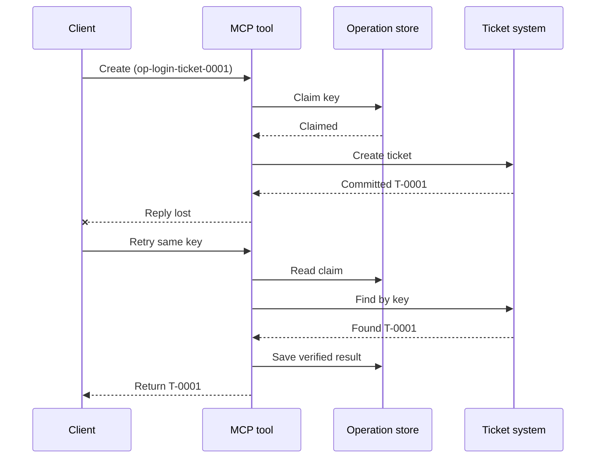
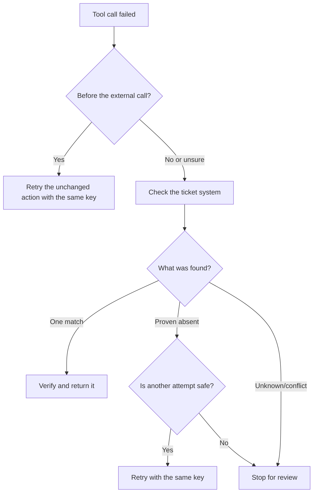

# ניסיונות בטוחים לכלי MCP: תבנית סיידקאר לאמינות

היעדר תגובה אינו אומר שהפעולה נעדרת. כלי תמיכה בכרטיסים עשוי
ליצור את הכרטיס `T-0001` ואז לאבד את החיבור לפני שהלקוח רואה
את התוצאה. אם הלקוח מנסה שוב בעיוורון, ייתכן שייצר `T-0002`.

שיעור זה מראה כיצד לזהות תוצאה לא ודאית זו, לשמור על זהות יציבה אחת
עבור הפעולה המיועדת, ולבדוק את מערכת הכרטיסים לפני שניסים שוב.
תרגיל ה-Python המצורף רץ באופן מקומי עם הספרייה הסטנדרטית ו-SQLite.


## למה חציית זמן הינה "תוצאה לא ידועה"

נניח שהלקוח קורא ל-`create_support_ticket` עם מפתח פעולה
`op-login-ticket-0001`:



החיבור נכשל לאחר שפעולת הכרטיס בוצעה אך לפני שהתוצאה הגיעה.
הלקוח יודע רק שהתשובה חסרה. הוא לא יודע אם הכרטיס חסר. שימוש חוזר במפתח הפעולה מאפשר לכלי למצוא ולהחזיר
את `T-0001` במקום ליצור `T-0002`.


## מה עושה Reliability Sidecar

Reliability sidecar הוא קוד יישום ששומר מצב התאוששות סביב כלי.
יכול להיות ספרייה, middleware, שירות מבוסס מאגר מידע, או פשוט
חלק ממימוש הכלי. הוא לא חייב להיות תהליך נפרד,
והוא אינו תכונה בפרוטוקול MCP.

ל-sidecar יש ארבע משימות:

1. לשמור את הפעולה המתכוונת לפני קריאה למערכת החיצונית;
2. לאפשר לעובד יחיד לטעון באחריות לפעולה זו;
3. לזכור מספיק מצב כדי להתאושש לאחר קריסה; ו-
4. לבדוק את המערכת החיצונית כשהתוצאה אינה ודאית.

שיעור זה מתמקד במפרט הסופי של MCP `2026-07-28`. ל-MCP אין
מושג של מושב ברמת הפרוטוקול, ולכן מפתח הפעולה הוא ארגומנט כלי רגיל
התומך במצב יישום עמיד. אותו תבנית עובדת גם עם גרסאות MCP מוקדמות יותר.


## ארבעה מזהים שפותרות בעיות שונות

מזהים אלו קשורים, אבל אינם ניתנים להחלפה:

| מזהה | מה הוא מזהה | שורד ניסיון חוזר? |
| --- | --- | --- |
| מזהה JSON-RPC | בקשה אחת ותשובה אחת | לא; השתמש במזהה בקשה חדש |
| מזהה משימת MCP | משימה אחת ארוכת טווח | כן; שמור אותו לבדיקה מחודשת |
| מפתח הפעולה | פעולה אחת מתוכננת | כן; השתמש בו מחדש עבור אותה פעולה |
| מזהה כרטיס | התוצאה השמורה | כן; החזר אותו לאחר אימות |

התראות התקדמות וקונטקסט עקבה עוזרות לך לעקוב אחר בקשה.
ביטול מבקש להפסיק עבודה. אף אחד מהם לא מונע יצירת כרטיס כפול.

## לבנות את המגן

צור את מפתח הפעולה לפני הקריאה הראשונה לכלי ושמור אותו עם
תהליך העבודה. כל ניסיון ליצור את אותו הכרטיס המתוכנן משתמש באותו מפתח:

```json
{
  "operation_key": "op-login-ticket-0001",
  "title": "Cannot sign in"
}
```

כרטיס מתוכנן שונה מקבל מפתח חדש. בייצור, הפק ערך אטום,
בלתי ניתן לניחוש במקום להכניס נתוני לקוח למפתח.

להלן הסכמה המלאה של כלי MCP שבו נעשה שימוש בשיעור זה:

```json
{
  "name": "create_support_ticket",
  "title": "Create support ticket",
  "description": "Creates or recovers one support ticket for an operation key.",
  "inputSchema": {
    "$schema": "https://json-schema.org/draft/2020-12/schema",
    "type": "object",
    "properties": {
      "operation_key": {
        "type": "string",
        "minLength": 16,
        "maxLength": 128,
        "description": "Stable key reused for the same intended action."
      },
      "title": {
        "type": "string",
        "minLength": 1,
        "maxLength": 200
      }
    },
    "required": ["operation_key", "title"],
    "additionalProperties": false
  },
  "outputSchema": {
    "$schema": "https://json-schema.org/draft/2020-12/schema",
    "type": "object",
    "properties": {
      "ticket_id": {
        "type": "string"
      },
      "operation_key": {
        "type": "string"
      },
      "status": {
        "type": "string",
        "const": "verified"
      }
    },
    "required": ["ticket_id", "operation_key", "status"],
    "additionalProperties": false
  }
}
```

זהות המתקשר המאומתת מגיעה מהקונטקסט של השרת, לא מקלט הכלי שסופק על ידי הדגם.
הגדר כל פעולה שמורה ל:

- אותו מתקשר, שוכר או חשבון שירות;
- שם הכלי והגרסה; ו-
- גיבוב של הקלט המנורמל שמגדיר את הפעולה החיצונית.

הגיבוב בקלט עונה על שאלה פשוטה: "האם זה ניסיון חוזר המבקש את אותו הכרטיס?"
אם המפתח שייך כבר לכותרת שונה, דחה את הקריאה.
החזרת תוצאה מוקדמת עם קלט שונה תסתיר שגיאת חוזה.

שמור את התביעה בפעולת מסד נתונים אטומית אחת. "אטומית" פירושה ששני עובדים
לא יכולים להתבונן בשני רשומות ריקות ולהפוך לבעלים שניהם. נעילה מקומית
לתהליך אינה מספיקה כאשר מופע שרת אחר יכול לקבל את הניסיון החוזר.

תהליך העבודה יוצר את המפתח בזמן שהפעולה היא `planned`. לאחר מכן המדגם
שומר מצבים אלו:

- `claimed`: עובד אחד הזמין את הפעולה;
- `completed`: מערכת הכרטיסים החזירה תוצאה; ו
- `verified`: קריאה ממערכת הכרטיסים מאשרת את התוצאה.

קריסה יכולה להשאיר את המצב השמור ב-`claimed` גם לאחר שהכרטיס נוצר.
התייחס לכל תביעה לא סופית כלא ודאית עד שהאימות החיצוני יפתור זאת.
אל תניח ש-`claimed` אומר "שום דבר לא קרה."

## התאושש לפני שתנסה שוב

כאשר קריאת כלי נכשלת, החלט מה ידוע לפני שליחה נוספת של
כתיבה חיצונית:



אימות שנכשל לפני קריאת ה-API של הכרטיס הוא כשל ידוע.
נסה שוב פעולה שלא שונתה עם אותו מפתח פעולה. אם תיקון הקלט
משנה את הכרטיס המתוכנן, צור מפתח חדש לפעולה החדשה.

אם הבקשה ייתכן שהגיעה למערכת הכרטיסים, בצע פיוס קודם.
פיוס פירושו השוואת התביעה שנשמרה עם רשומת הכרטיס הסמכותית.
החזר את הכרטיס הקיים כאשר נמצאה בדיוק רשומה מתאימה אחת.
נסה שוב רק כאשר הכרטיס חסר באופן מוחלט והחוזה התחתון
מאפשר ניסיון נוסף בבטחה.

"לא נמצא" לא תמיד הוא חד-משמעי. ספק עם חיפוש עקבי סופי
עשוי להזדקק להמתנה מוגבלת ובדיקה נוספת. אם לא ניתן לחפש במערכת,
אם התוצאות סותרות, או אם לא ניתן לבצע הסרה בטוחה של כפילויות
בניסיון נוסף, עצור ודווח על `outcome unknown`. עצירה כאן נקראת לפעמים
"כשל סגור": תהליך העבודה מסרב לנחש.

## ראיות, משימות וביטול

תגובת הכלי אומרת מה הכלי דיווח. נקודת הביקורת השמורה אומרת מה
תהליך העבודה תועד. הראיה החזקה ביותר מגיעה מהמערכת שבבעלותה את
התוצאה: במקרה זה, קריאה ממערכת הכרטיסים שמוצאת בדיוק כרטיס
תואם אחד.

התאמת הראיות לסיכון. מזהה הודעת ספק עשוי להספיק ל
הודעה בעלת סיכון נמוך. תשלומים, פריסות ופעולות הרסניות עשויות
להזדקק לסטטוס ספק, ספר חשבונות, או ראיות סקירה ידנית.

תוסף משימות MCP משלים תבנית זו לעבודה ארוכת טווח. מזהה משימה
מאפשר ללקוח לחדש את הפולינג לאחר ניתוק, אך הוא אינו מזהה
או מסיר כפילויות של הכרטיס עצמו. כאשר משתמשים במשימות, הזהויות מתחברות
כך:

```text
operation key -> Task ID -> ticket ID -> verification evidence
```

הביטול הוא שיתופי, לא ביטול פעולה. הכרטיס עדיין עשוי להיווצר
לאחר אישור הביטול, ולכן תוצאה לא ודאית עדיין צריכה
פיוס.

## הרץ את תרגיל הזרקת הכשל

הדוגמה משתמשת בשני קבצי SQLite: אחד מייצג את חנות הפעולות ו-
האחד מייצג את מערכת הכרטיסים החיצונית. אין עסקה שתופסת
את שני הקבצים. הכשל מוזרק לאחר שהכרטיס נשמר אך לפני ש
הרישומים של ה-sidecar מסיימים.

שיטת פייתון ישירה מקבלת את `caller_id` כנציג להקשר שרת מאומת.
אל תוסיף `caller_id` למודל-הנתונים של MCP המנוהל על ידי המודל.
סכמה.

נבא את התוצאה לפני הרצת הבדיקות:

| נתיב | תוצאה לאחר ניסיון חוזר | מספר כרטיסים |
| --- | --- | --- |
| ניסיון חוזר עיוור | יוצר `T-0002` לאחר אובדן התגובה עבור `T-0001` | 2 |
| ניסיון חוזר מוגן | מוצא ומחזיר את `T-0001` | 1 |

הרץ:

```bash
cd 08-BestPractices/reliability-sidecars/python
python -m unittest discover -p "test_*.py" -v
```

ששת הבדיקות מראות כי:

1. ניסיון חוזר עיוור יוצר כפיל;
2. אובדן תגובה פלוס הפעלה מחדש משחזרים כרטיס אחד מטענה עמידה;
3. ניסיון חוזר מאומת משתמש בתוצאה שנשמרה;
4. שינוי בקלט או ראיה חיצונית בסתירה נדחים;
5. טענה קיימת ללא ראיה חיצונית עוצרת בבטחה; ו
6. טענות מתוזמנות מקבלות בעלים אחד ללא נסיגה בתוצאה המאומתת.

פתח את הדוגמה:

- [מימוש בפייתון](../../../../08-BestPractices/reliability-sidecars/python/reliability_sidecar.py)
- [בדיקות דטרמיניסטיות](../../../../08-BestPractices/reliability-sidecars/python/test_reliability_sidecar.py)

הדוגמה מתעלמת במכוון מהשכרות טענות מיושנות. מדיניות השתלטות
בפרודקשן דורשת שכירות מוגבלת, העברת בעלות אטומית, ובדיקה חיצונית נוספת
לפני ביצוע.

## מימוש קהילתי אפשרי

Agent Enhancer Utilities היא מימוש קהילתי של
תבנית ברמת היישום הזאת. המתכנן שלה בוחר גישת שיקום, בעוד
נקודת הביקורת שלה רושמת סטטי טענה ותוצאה לא ודאית. כלי התחום או שרת MCP
מבצעים ומאמתים את הפעולה האמיתית. שירות זה לא חלק מה-
מפרט MCP ואינו דרוש לשיעור זה.

| מושג השיעור | רכיב Agent Enhancer | הגבלה חשובה |
| --- | --- | --- |
| תכנית שיקום | `workflow-guard-planner` | אינו קורא לכלי התחום |
| טענה ושיקום | `workflow-checkpoint` | `external_proof` נשאר `false` |
| השמעת צד מדויקת | `lab.invoke_tool` | משתמש במפתח אי-כפילות נפרד |
| אמת את הפעולה האמיתית | חיפוש/קריאה חזרה ליעד | בעלות MCP תחום |

לניסיון חוזר מדויק של קריאת צד אחד, `lab.invoke_tool` מקבל `idempotency_key` חיצוני.
מפתח זה מזהה את קריאת הצד; זה אינו ה-
עסק `operation_key` ששימש עבור הכרטיס.

החוזה הציבורי המתויג ודוגמה רשתית אופציונלית זמינים
כאן:

- [חוזה Reliability Sidecar גרסה 1](https://github.com/artiehinz/Agent-Enhancer-Utilities/blob/v1.6.0/docs/RELIABILITY_SIDECAR_CONTRACT_V1.md)
- [דוגמה של מתכנן ודומיין מדומה](https://github.com/artiehinz/Agent-Enhancer-Utilities/tree/v1.6.0/examples/reliability-sidecar)

קישורים אלה ממחישים את דפוס היישום. הם אינם טוענים כי
השירות המאוחסן תואם ל-MCP `2026-07-28`, ומצב נקודת הבדיקה אף פעם אינו נחשב
כהוכחה חיצונית של הכרטיס.

## רשימת בדיקה לייצור

- [ ] צור ושמור את מפתח הפעולה לפני ניסיון חיצוני ראשון.
- [ ] קשר את המפתח למתקשר, גרסת הכלי, וחתימת קלט מנורמלת.
- [ ] דחה קלט ששונה תחת מפתח קיים.
- [ ] אפשר בעלים אחד עם פעולה אטומית של אחסון משותף.
- [ ] העבר את המפתח לספק התחתון כשזה תומך באידמפוטנטיות.
- [ ] פייס תוצאות לא ודאיות לפני כתיבה נוספת.
- [ ] שמור תוצאות ואסמכתאות מאומתות למשך כל חלון הניסיון מחדש.
- [ ] עצור לסקירה כאשר לא ניתן לקבוע בבטחה את התוצאה החיצונית.

## הפניות

- [מפרט MCP `2026-07-28`](https://modelcontextprotocol.io/specification/2026-07-28)
- [הנחיות כלי MCP `2026-07-28`](https://modelcontextprotocol.io/specification/2026-07-28/server/tools)
- [הרחבת משימות MCP](https://modelcontextprotocol.io/extensions/tasks/overview)
- [מפרט JSON-RPC 2.0](https://www.jsonrpc.org/specification)

---

<!-- CO-OP TRANSLATOR DISCLAIMER START -->
**כתב ויתור**:
מסמך זה תורגם באמצעות שירות תרגום אוטומטי [Co-op Translator](https://github.com/Azure/co-op-translator). למרות שאנו שואפים לדיוק, יש לקחת בחשבון שתרגומים אוטומטיים עלולים להכיל שגיאות או אי-דיוקים. יש להחשיב את המסמך המקורי בשפתו הטבעית כמקור הסמכות. למידע קריטי מומלץ להשתמש בתרגום מקצועי על ידי מתרגם אדם. אנו לא אחראים לכל אי-הבנה או פירוש שגוי הנובע מהשימוש בתרגום זה.
<!-- CO-OP TRANSLATOR DISCLAIMER END -->