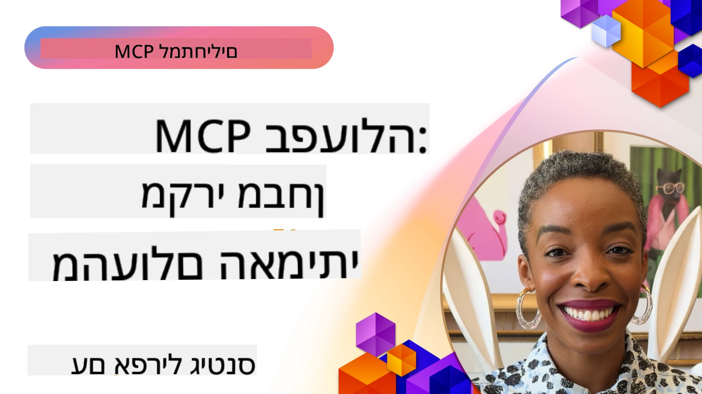

# MCP בפעולה: מקרי מבחן מהעולם האמיתי

_(לחץ על התמונה למעלה לצפייה בווידאו של השיעור הזה)_

פרוטוקול הקשר מודל (MCP) משנה את האופן שבו יישומי AI מתקשרים עם נתונים, כלים ושירותים. בחלק זה מוצגים מקרי מבחן מהעולם האמיתי המדגימים יישומים מעשיים של MCP בתרחישים ארגוניים שונים.

## סקירה כללית

חלק זה מציג דוגמאות מוחשיות של יישומי MCP, המדגיש כיצד ארגונים מנצלים פרוטוקול זה לפתרון אתגרים עסקיים מורכבים. באמצעות בחינת מקרי המבחן האלו, תרוויחו תובנות על הגמישות, הסקלביליות והיתרונות המעשיים של MCP בתרחישים מהחיים.

## מטרות למידה מרכזיות

בחקר מקרי המבחן האלה, תוכלו:

- להבין כיצד ניתן ליישם MCP לפתרון בעיות עסקיות ספציפיות
- ללמוד על דפוסי אינטגרציה שונים וגישות ארכיטקטוניות
- לזהות שיטות עבודה מומלצות ליישום MCP בסביבות ארגוניות
- לקבל תובנות לגבי אתגרים ופתרונות שצצו ביישומים מהעולם האמיתי
- לאתר הזדמנויות ליישם דפוסים דומים בפרויקטים שלכם

## מקרי מבחן מובחרים

### 1. [סוכני נסיעות AI ב-Azure – יישום הפניה](./travelagentsample.md)

מקרה מבחן זה בוחן את הפתרון המקיף של מיקרוסופט הממחיש כיצד לבנות אפליקציית תכנון נסיעות עם סוכנים מרובים, מבוססי AI, באמצעות MCP, Azure OpenAI ו-Azure AI Search. הפרויקט מציג:

- תזמור סוכנים מרובים דרך MCP
- אינטגרציה ארגונית של נתונים עם Azure AI Search
- ארכיטקטורה מאובטחת וסקלבילית המשתמשת בשירותי Azure
- כלים ניתנים להרחבה עם רכיבי MCP לשימוש חוזר
- חוויית משתמש שיחתית מופעלת על ידי Azure OpenAI

פרטי הארכיטקטורה והיישום מספקים תובנות חשובות לבניית מערכות מרובות סוכנים מורכבות עם MCP כשכבת תיאום.

### 2. [עדכון פריטים ב-Azure DevOps מנתוני YouTube](./UpdateADOItemsFromYT.md)

מקרה מבחן זה מדגים יישום מעשי של MCP לאוטומציה של תהליכי עבודה. הוא מראה כיצד ניתן להשתמש בכלי MCP כדי:

- להוציא נתונים מפלטפורמות מקוונות (YouTube)
- לעדכן פריטי עבודה במערכות Azure DevOps
- ליצור תהליכי אוטומציה שניתן לשחזר
- לאחד נתונים בין מערכות נפרדות

דוגמה זו ממחישה כיצד גם יישומי MCP יחסית פשוטים יכולים לספק שיפורי יעילות משמעותיים על ידי אוטומציה של משימות שגרתיות ושיפור עקביות הנתונים בין מערכות.

### 3. [אחזור תיעוד בזמן אמת באמצעות MCP](./docs-mcp/README.md)

מקרה מבחן זה מדריך אתכם כיצד לחבר לקוח קונסול Python לשרת Model Context Protocol (MCP) כדי לאחזר ולתעד תיעוד Microsoft מעודכן ושקוף להקשר בזמן אמת. תלמדו איך:

- להתחבר לשרת MCP באמצעות לקוח Python וה-SDK הרשמי של MCP
- להשתמש בלקוחות HTTP שטיפה לאחזור יעיל של נתונים בזמן אמת
- לקרוא לכלי תיעוד בשרת ולרשום תגובות ישירות לקונסול
- לשלב תיעוד מעודכן של Microsoft בתהליך העבודה שלכם מבלי לצאת מהטרמינל

הפרק כולל תרגיל מעשי, דוגמת קוד מינימלית וקישורים למשאבים נוספים ללמידה מעמיקה יותר. ראו את ההתקדמות המלאה והקוד בפרק המקושר כדי להבין כיצד MCP משנה את הגישה לתיעוד ואת הפרודוקטיביות של מפתחים בסביבות קונסול.

### 4. [אפליקציית יצירת תוכנית לימודים אינטראקטיבית עם MCP](./docs-mcp/README.md)

מקרה מבחן זה מדגים כיצד לבנות אפליקציית רשת אינטראקטיבית באמצעות Chainlit ו-Model Context Protocol (MCP) ליצירת תוכניות לימודים מותאמות אישית לכל נושא. משתמשים יכולים לציין נושא (כגון "הסמכת AI-900") ומשך לימודים (למשל, 8 שבועות), והאפליקציה תספק פירוט שבוע-אחר-שבוע של תוכן מומלץ. Chainlit מאפשר ממשק שיחת צ'אט, מה שהופך את החוויה למרתקת ומתאימה.

- אפליקציית רשת שיחתית מופעלת על ידי Chainlit
- קלט משתמש המנחה את הנושא והמשך
- המלצות תוכן שבועיות באמצעות MCP
- תגובות בזמן אמת, מותאמות בממשק שיחה

הפרויקט ממחיש כיצד ניתן לשלב בינה מלאכותית שיחתית ו-MCP ליצירת כלים חינוכיים דינמיים מונעי משתמש בסביבת רשת מודרנית.

### 5. [תיעוד בתוך עורך באמצעות שרת MCP ב-VS Code](./docs-mcp/README.md)

מקרה מבחן זה מראה כיצד ניתן לשלב את מסמכי Microsoft Learn ישירות בסביבת VS Code באמצעות שרת MCP—בלי להחליף לשוניות דפדפן! תראו כיצד:

- לבצע חיפוש מיידי וקריאת מסמכים בתוך VS Code באמצעות לוח MCP או פלטת פקודות
- להפנות לתיעוד ולהוסיף קישורים ישירות לקובצי README או Markdown של הקורס
- להשתמש ב-GitHub Copilot וב-MCP יחד לזרימות עבודה חלקות של תיעוד וקוד מופעלים על ידי AI
- לאמת ולשפר את התיעוד שלכם עם משוב בזמן אמת ודיוק ממקורות Microsoft
- לשלב MCP עם זרימות עבודה ב-GitHub לאימות תיעוד רציף

היישום כולל:

- הדגמת תצורה `.vscode/mcp.json` להגדרה קלה
- הדרכות עם צילומי מסך של חוויית העורך
- טיפים לשילוב Copilot ו-MCP לפרודוקטיביות מקסימלית

תרחיש זה אידיאלי למחברי קורסים, כותבי תיעוד ומפתחים שרוצים להישאר מרוכזים בעורך בזמן העבודה עם מסמכים, Copilot וכלי אימות—כל זאת מופעל על ידי MCP.

### 6. [יצירת שרת MCP עם APIM](./apimsample.md)

מקרה מבחן זה מספק מדריך שלב-אחר-שלב ליצירת שרת MCP באמצעות Azure API Management (APIM). הוא מכסה:

- הקמת שרת MCP ב-Azure API Management
- חשיפת פעולות API ככלי MCP
- תצורת מדיניות להגבלת קצב ואבטחה
- בדיקת שרת MCP באמצעות Visual Studio Code ו-GitHub Copilot

דוגמה זו ממחישה כיצד לנצל את יכולות Azure ליצירת שרת MCP יציב שניתן להשתמש בו ביישומים שונים, המשפר את האינטגרציה של מערכות AI עם API ארגוניים.

### 7. [רישום MCP של GitHub — האצת אינטגרציה סוכנית](https://github.com/mcp)

מקרה מבחן זה בוחן כיצד רישום MCP של GitHub, שהושק בספטמבר 2025, מתמודד עם אתגר מרכזי באקוסיסטם של AI: גילוי והפעלה מפוזרים של שרתי Model Context Protocol (MCP).

#### סקירה כללית
**רישום MCP** פותר את הכאב שגרם פיזור שרתי MCP במאגרים וברישומים שונים, שהאט את האינטגרציה והוביל לשגיאות. שרתים אלו מאפשרים לסוכני AI לתקשר עם מערכות חיצוניות כמו APIs, מאגרי נתונים, ומקורות תיעוד.

#### הצגת הבעיה
מפתחים שמבנים זרימות עבודה סוכניות התמודדו עם כמה אתגרים:
- **גילוי לקוי** של שרתי MCP בפלטפורמות שונות
- **שאלות הגדרה מיותרות** שנפוצו בפורומים ובתיעוד
- **סיכוני אבטחה** ממקורות לא מאומתים ולא מהימנים
- **חוסר סטנדרטיזציה** באיכות וקומפטיביליות של השרתים

#### ארכיטקטורת הפתרון
רישום MCP של GitHub מרכז שרתים אמינים עם תכונות מפתח:
- **התקנה בלחיצה אחת** באמצעות VS Code להגדרה פשוטה
- **מיון אות מול רעש** לפי כוכבים, פעילות ואימות קהילתי
- **אינטגרציה ישירה** עם GitHub Copilot וכלים תואמי MCP אחרים
- **מודל תרומה פתוח** המאפשר שותפויות קהילה וארגוניות לתרום

#### השפעה עסקית
הרישום הביא לשיפורים מדידים:
- **הכנה מהירה יותר** למפתחים בעזרת כלים כמו Microsoft Learn MCP Server, הזורם תיעוד רשמי ישירות לסוכנים
- **פרודוקטיביות משופרת** באמצעות שרתים מתמחים כמו `github-mcp-server`, המאפשר אוטומציה בשפת טבעית ב-GitHub (יצירת PR, הרצת CI מחדש, סריקת קוד)
- **אמון חזק יותר באקוסיסטם** דרך רשימות מתואמות ותקני תצורה שקופים

#### ערך אסטרטגי
עבור מומחים בניהול מחזור חיים של סוכנים וזרימות עבודה חוזרות, רישום MCP מספק:
- **יכולת פריסה מודולרית של סוכנים** עם רכיבים סטנדרטיים
- **קווי הערכה מבוססי רישום** לבדיקות ואימות עקביים
- **אינטרופרביליות בין כלים** מאפשרת אינטגרציה חלקה בפלטפורמות AI שונות

מקרה מבחן זה מדגים שרישום MCP הוא לא רק ספרייה, אלא פלטפורמה יסודית לשילוב מודלים מדרגית ופריסת מערכות סוכניות בעולם האמיתי.

### 8. [פרסום לרשתות חברתיות מסוכן](./publora-social-publishing.md)

מקרה מבחן זה מתאר שרת MCP מרוחק עם יכולת כתיבה — כלים שלו מבצעים פעולות בלתי הפיכות בשם המשתמש — כשפרסום חברתי משמש כדוגמה. סוכן מנסח פוסט, אדם מאשר, והשרת מתזמן את הפרסום ברשתות.

החלק המעניין הוא מגבלות העיצוב שהפרסום מטיל, החלות על כל שרת שמבצע כתיבה ולא קריאה:

- **גילוי פתוח, הפעלה מאומתת** — `tools/list` עונה ללא אישורים כדי שרישומים ולקוחות יוכלו לבדוק, בעוד שכל `tools/call` דורש טוקן ומחזיר אחרת `401` עם כותרת `WWW-Authenticate`
- **רישום OAuth ללא שלב חיצוני** — רישום דינמי של לקוחות כיום, עם מסמכי Client ID Metadata כפי שהגדרת `2026-07-28` מציינת
- **הסבר כלים** (`readOnlyHint`, `destructiveHint`, `idempotentHint`) שהלקוחות משתמשים בהם להחליט מה לאשר — רמזים לא אכיפה, ומשהו שרשימות מחברים מצפות לו בביקורת
- **מזהים בלתי ניתנים להמצאה מחדש**, כך שערך מדומה נכשל בקול במקום לפעול על ערך נראה סביר
- **מפתחות איחודיות בכלים היוצרים פוסטים**, כך שניסיון חוזר של סוכן לא ייצור פרסום כפול
- **מטרה ללא פעולה המתוארת בסכמת הכלי** המפעילה את כל דרך הכתיבה אך לא מפרסמת דבר, לבוחנים ו-CI

הפרק מסתיים עם רשימת בדיקה קצרה שתוכלו ליישם על שרת שאתם מפתחים.

## סיכום

שמונת מקרי המבחן המקיפים האלה מדגימים את הגמישות המרשימה והיישומים המעשיים של פרוטוקול Model Context במגוון תרחישים מהעולם האמיתי. ממערכות תכנון נסיעות מורכבות מרובות סוכנים וניהול API ארגוני ועד זרימות עבודה מתוקשרות לתיעוד ורישום MCP המהפכני של GitHub — דוגמאות אלו מראות כיצד MCP מספק דרך סטנדרטית ומדרגית לקישור מערכות AI עם הכלים, הנתונים והשירותים הדרושים להן להעברת ערך יוצא דופן.

מקרי המבחן מכסים ממדים שונים של יישום MCP:
- **אינטגרציה ארגונית**: ניהול API ב-Azure ואוטומציה ב-Azure DevOps
- **תזמור סוכנים מרובים**: תכנון נסיעות עם סוכני AI מתואמים
- **פרודוקטיביות מפתחים**: אינטגרציה ב-VS Code וגישה לתיעוד בזמן אמת
- **פיתוח אקוסיסטם**: רישום MCP של GitHub כפלטפורמה יסודית
- **יישומים חינוכיים**: מחוללי תוכניות לימודים אינטראקטיביים וממשקי שיחה

בלימוד היישומים האלה, תרוויחו תובנות חיוניות לגבי:
- **דפוסי ארכיטקטורה** להיקפים ושימושים שונים
- **אסטרטגיות יישום** המאזנות בין פונקציונליות לתחזוקה
- **שיקולי אבטחה וסקלביליות** לפרוסות פרודקשן
- **שיטות עבודה מומלצות** לפיתוח שרתי MCP ואינטגרציית לקוח
- **חשיבה באקוסיסטם** לבניית פתרונות מחוברים מופעלים על ידי AI

דוגמאות אלו מדגימות במשותף ש-MCP אינו רק מסגרת תיאורטית אלא פרוטוקול בוגר, מוכן פרודקשן, המאפשר פתרונות מעשיים לאתגרים עסקיים מורכבים. בין אם אתם בונים כלים פשוטים לאוטומציה או מערכות מרובות סוכנים מתוחכמות, הדפוסים והגישות המוצגות כאן מספקים בסיס איתן לפרויקטים שלכם ב-MCP.

## משאבים נוספים

- [מאגר GitHub של סוכני נסיעות ב-Azure AI](https://github.com/Azure-Samples/azure-ai-travel-agents)
- [כלי MCP ל-Azure DevOps](https://github.com/microsoft/azure-devops-mcp)
- [כלי MCP ל-Playwright](https://github.com/microsoft/playwright-mcp)
- [שרת MCP לתיעוד Microsoft](https://github.com/MicrosoftDocs/mcp)
- [רישום MCP של GitHub — האצת אינטגרציה סוכנית](https://github.com/mcp)
- [דוגמאות קהילתיות של MCP](https://github.com/microsoft/mcp)

## מה הלאה

- קודם: [מודול 8: שיטות עבודה מומלצות](../08-BestPractices/README.md)
- הבא: [מודול 10: ייעול זרימות עבודה ב-AI: בניית שרת MCP עם Microsoft Foundry Toolkit](../10-StreamliningAIWorkflowsBuildingAnMCPServerWithAIToolkit/README.md)

---

<!-- CO-OP TRANSLATOR DISCLAIMER START -->
**כתב ויתור**:
מסמך זה תורגם באמצעות שירות תרגום אוטומטי [Co-op Translator](https://github.com/Azure/co-op-translator). למרות שאנו שואפים לדיוק, יש לקחת בחשבון שתרגומים אוטומטיים עלולים להכיל שגיאות או אי-דיוקים. יש להחשיב את המסמך המקורי בשפתו הטבעית כמקור הסמכות. למידע קריטי מומלץ להשתמש בתרגום מקצועי על ידי מתרגם אדם. אנו לא אחראים לכל אי-הבנה או פירוש שגוי הנובע מהשימוש בתרגום זה.
<!-- CO-OP TRANSLATOR DISCLAIMER END -->