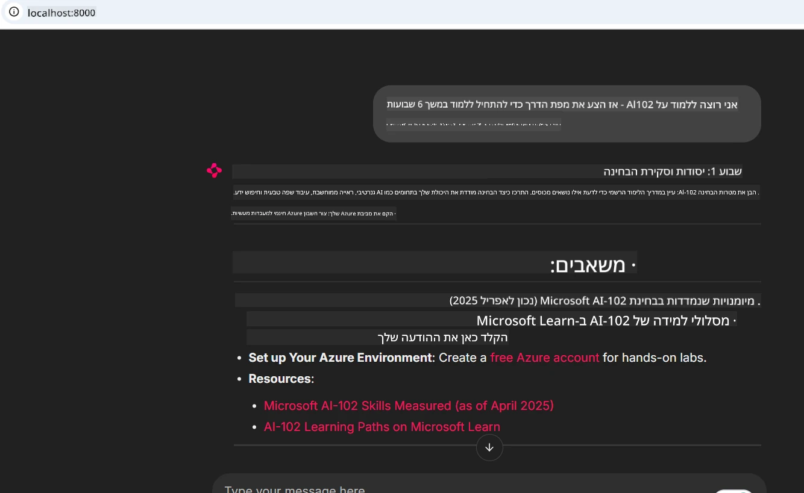
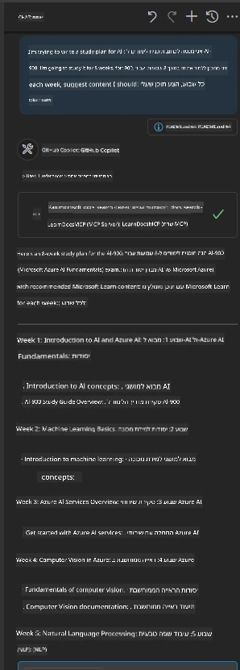

# מקרה בוחן: התחברות לשרת Microsoft Learn Docs MCP מהלקוח

האם אי פעם מצאת את עצמך מתמרן בין אתרי תיעוד, Stack Overflow ולשוניות מנוע חיפוש אינסופיות, תוך כדי שאתה מנסה לפתור בעיה בקוד שלך? אולי יש לך מסך שני רק לתיעוד, או שאתה ממשיך ללחוץ Alt-Tab בין סביבת הפיתוח שלך לדפדפן. האם לא יהיה טוב יותר אם תוכל להביא את התיעוד ישר לתוך זרימת העבודה שלך — משולב באפליקציות שלך, ב-IDE שלך, או אפילו בכלים מותאמים אישית שכתבת? במקרה בוחן זה נחקור בדיוק איך לעשות זאת על ידי התחברות ישירה לשרת Microsoft Learn Docs MCP מתוך אפליקציית הלקוח שלך.

## סקירה כללית

הפיתוח המודרני הוא יותר מרק כתיבת קוד — זה על מציאת המידע הנכון בזמן הנכון. התיעוד נמצא בכל מקום, אבל לרוב לא איפה שאתה צריך אותו ביותר: בתוך הכלים וזרימת העבודה שלך. על ידי שילוב קבלת התיעוד ישירות לתוך האפליקציות שלך, תוכל לחסוך זמן, להפחית מעבר הקשרים ולהגביר פרודוקטיביות. בסעיף זה נדגים איך להתחבר לשרת Microsoft Learn Docs MCP כדי שתוכל לגשת לתיעוד בזמן אמת, מודע להקשר, מבלי לעזוב את האפליקציה שלך.

נעבור יחד על תהליך יצירת החיבור, שליחת בקשה, וטיפול בתגובות סטרימינג ביעילות. גישה זו לא רק מייעלת את זרימת העבודה שלך אלא גם פותחת דלתות לבניית כלים חכמים ושימושיים יותר למפתחים.

## מטרות הלמידה

למה אנחנו עושים את זה? כי החוויות הטובות ביותר למפתח הן אלה שמפחיתות חיכוך. דמיין עולם שבו עורך הקוד שלך, הצ'טבוט או אפליקציית הרשת שלך יכולים לענות מיד על שאלות התיעוד שלך, תוך שימוש בתוכן העדכני ביותר מ-Microsoft Learn. בסוף פרק זה תדע איך:

- להבין את יסודות התקשורת בין שרת ללקוח MCP לתיעוד
- לממש אפליקציית קונסולה או ווב שמתחברת לשרת Microsoft Learn Docs MCP
- להשתמש ב-clients HTTP סטרימינג לקבלת תיעוד בזמן אמת
- לתעד ולהסביר תגובות תיעוד באפליקציה שלך

תראה איך מיומנויות אלה יעזרו לך לבנות כלים שהם לא רק ריאקטיביים, אלא אינטראקטיביים ומודעי הקשר באמת.

## תרחיש 1 - קבלת תיעוד בזמן אמת עם MCP

בתרחיש זה נראה איך להתחבר לשרת Microsoft Learn Docs MCP כדי שתוכל לגשת לתיעוד בזמן אמת, מודע להקשר, מבלי לצאת מהאפליקציה שלך.

בוא להפוך את זה למעשי. המשימה שלך היא לכתוב אפליקציה שמתחברת לשרת Microsoft Learn Docs MCP, מפעילה את כלי `microsoft_docs_search`, ומתעדת את תגובות הסטרימינג לקונסולה.

### למה הגישה הזו?
כי זה הבסיס לבניית אינטגרציות מתקדמות יותר — בין אם ברצונך להפעיל צ'טבוט, תוסף IDE, או לוח בקרה ווב.

תמצא את הקוד והוראות התרחיש בתיקיה [`solution`](./solution/README.md) בתוך מקרה הבוחן הזה. השלבים ינחו אותך בהקמת החיבור:
- השתמש ב-SDK הרשמי של MCP וב-client HTTP סטרימינג לחיבור
- קרא לכלי `microsoft_docs_search` עם פרמטר שאילתה לקבלת תיעוד
- מימוש רישום וניהול שגיאות מתאים
- צור ממשק קונסולה אינטראקטיבי כדי לאפשר למשתמשים להכניס מספר שאילתות

תרחיש זה ממחיש איך:
- להתחבר לשרת Docs MCP
- לשלוח שאילתה
- לפרש ולהדפיס את התוצאות

הנה איך פועל הפתרון עשוי להיראות:

```
Prompt> What is Azure Key Vault?
Answer> Azure Key Vault is a cloud service for securely storing and accessing secrets. ...
```

למטה פתרון מינימלי לדוגמה. הקוד המלא והפרטים זמינים בתיקיית הפתרון.

<details>
<summary>Python</summary>

```python
import asyncio
from mcp.client.streamable_http import streamablehttp_client
from mcp import ClientSession

async def main():
    async with streamablehttp_client("https://learn.microsoft.com/api/mcp") as (read_stream, write_stream, _):
        async with ClientSession(read_stream, write_stream) as session:
            await session.initialize()
            result = await session.call_tool("microsoft_docs_search", {"query": "Azure Functions best practices"})
            print(result.content)

if __name__ == "__main__":
    asyncio.run(main())
```

- למימוש ורישום מלאים, ראה [`scenario1.py`](../../../../09-CaseStudy/docs-mcp/solution/python/scenario1.py).
- להוראות התקנה ושימוש, ראה את הקובץ [`README.md`](./solution/python/README.md) באותה תיקייה.
</details>


## תרחיש 2 - אפליקציית ווב ליצירת תוכנית לימודים אינטראקטיבית עם MCP

בתרחיש זה תלמד איך לשלב את Docs MCP בפרויקט פיתוח ווב. המטרה היא לאפשר למשתמשים לחפש תיעוד מ-Microsoft Learn ישירות מתוך ממשק ווב, ולהפוך את התיעוד לנגיש מייד בתוך האפליקציה או האתר שלך.

תראה איך:
- להקים אפליקציית ווב
- להתחבר לשרת Docs MCP
- לטפל בקלט משתמש ולהציג תוצאות

הנה איך הפתרון עשוי להיראות בפעולה:

```
User> I want to learn about AI102 - so suggest the roadmap to get it started from learn for 6 weeks

Assistant> Here’s a detailed 6-week roadmap to start your preparation for the AI-102: Designing and Implementing a Microsoft Azure AI Solution certification, using official Microsoft resources and focusing on exam skills areas:

---
## Week 1: Introduction & Fundamentals
- **Understand the Exam**: Review the [AI-102 exam skills outline](https://learn.microsoft.com/en-us/credentials/certifications/exams/ai-102/).
- **Set up Azure**: Sign up for a free Azure account if you don't have one.
- **Learning Path**: [Introduction to Azure AI services](https://learn.microsoft.com/en-us/training/modules/intro-to-azure-ai/)
- **Focus**: Get familiar with Azure portal, AI capabilities, and necessary tools.

....more weeks of the roadmap...

Let me know if you want module-specific recommendations or need more customized weekly tasks!
```

למטה פתרון מינימלי לדוגמה. הקוד המלא והפרטים זמינים בתיקיית הפתרון.



<details>
<summary>Python (Chainlit)</summary>

Chainlit היא מסגרת לבניית אפליקציות ווב מבוססות AI שיחות. היא מקלה על יצירת צ'טבוטים ואסיסטנטים אינטראקטיביים שיכולים לקרוא לכלי MCP ולהציג תוצאות בזמן אמת. אידיאלית לפרוטוטייפינג מהיר וממשקי משתמש ידידותיים.

```python
import chainlit as cl
import requests

MCP_URL = "https://learn.microsoft.com/api/mcp"

@cl.on_message
def handle_message(message):
    query = {"question": message}
    response = requests.post(MCP_URL, json=query)
    if response.ok:
        result = response.json()
        cl.Message(content=result.get("answer", "No answer found.")).send()
    else:
        cl.Message(content="Error: " + response.text).send()
```

- למימוש מלא, ראה [`scenario2.py`](../../../../09-CaseStudy/docs-mcp/solution/python/scenario2.py).
- להוראות התקנה והרצה, ראה את [`README.md`](./solution/python/README.md).
</details>


## תרחיש 3: תיעוד בתוך העורך עם שרת MCP ב-VS Code

אם אתה רוצה לקבל את Microsoft Learn Docs ישירות בתוך VS Code (بدיל להחליף לשוניות דפדפן), תוכל להשתמש בשרת MCP בתוך העורך שלך. זה מאפשר לך:
- לחפש ולקרוא מסמכים ב-VS Code מבלי לעזוב את סביבת הפיתוח שלך.
- להפנות לתיעוד ולהכניס קישורים ישירות ל-README או לקבצי הקורס שלך.
- לשלב את GitHub Copilot ו-MCP יחד לזרימת עבודה חלקה מבוססת AI לתיעוד.

**תראה איך:**
- להוסיף קובץ `.vscode/mcp.json` תקין לשורש סביבת העבודה שלך (ראה דוגמה למטה).
- לפתוח את הפאנל של MCP או להשתמש בפלטת הפקודות ב-VS Code כדי לחפש ולהכניס תיעוד.
- להפנות לתיעוד ישירות בקבצי Markdown תוך כדי עבודה.
- לשלב את זרימת העבודה הזו עם GitHub Copilot לפעילות מוגברת עוד יותר.

הנה דוגמה איך להגדיר את שרת MCP ב-VS Code:

```json
{
  "servers": {
    "LearnDocsMCP": {
      "url": "https://learn.microsoft.com/api/mcp"
    }
  }
}
```

</details>

> למדריך מפורט עם צילומי מסך והנחיות שלב אחר שלב, ראה [`README.md`](./solution/scenario3/README.md).



גישה זו אידיאלית למי שבונה קורסים טכניים, כותב תיעוד או מפתח קוד עם צורכי הפנייה תכופים.

## נקודות מפתח

שילוב תיעוד ישירות לכלים שלך הוא לא רק נוחות — זו מהפכה בפרודוקטיביות. על ידי חיבור לשרת Microsoft Learn Docs MCP מתוך הלקוח שלך, תוכל:

- לבטל מעבר הקשרים בין הקוד שלך לתיעוד
- לקבל תיעוד עדכני ומודע להקשר בזמן אמת
- לבנות כלים חכמים, אינטראקטיביים יותר למפתחים

מיומנויות אלו יעזרו לך ליצור פתרונות שהם לא רק יעילים, אלא גם נעימים לשימוש.

## משאבים נוספים

כדי להעמיק את הבנתך, חקור את המשאבים הרשמיים הבאים:

- [שרת Microsoft Learn Docs MCP (GitHub)](https://github.com/MicrosoftDocs/mcp)
- [התחל עם שרת Azure MCP (mcp-python)](https://learn.microsoft.com/en-us/azure/developer/azure-mcp-server/get-started#create-the-python-app)
- [מהו שרת Azure MCP?](https://learn.microsoft.com/en-us/azure/developer/azure-mcp-server/)
- [הקדמה לפרוטוקול Model Context (MCP)](https://modelcontextprotocol.io/introduction)
- [הוספת תוספים משרת MCP (Python)](https://learn.microsoft.com/en-us/semantic-kernel/concepts/plugins/adding-mcp-plugins)

## מה הלאה

- חזרה ל: [סקירת מקרי בוחן](../README.md)
- המשך ל: [מודול 10: ייעול זרימות עבודה AI עם Microsoft Foundry Toolkit](../../10-StreamliningAIWorkflowsBuildingAnMCPServerWithAIToolkit/README.md)

---

<!-- CO-OP TRANSLATOR DISCLAIMER START -->
**כתב ויתור**:
מסמך זה תורגם באמצעות שירות תרגום אוטומטי [Co-op Translator](https://github.com/Azure/co-op-translator). למרות שאנו שואפים לדיוק, יש לקחת בחשבון שתרגומים אוטומטיים עלולים להכיל שגיאות או אי-דיוקים. יש להחשיב את המסמך המקורי בשפתו הטבעית כמקור הסמכות. למידע קריטי מומלץ להשתמש בתרגום מקצועי על ידי מתרגם אדם. אנו לא אחראים לכל אי-הבנה או פירוש שגוי הנובע מהשימוש בתרגום זה.
<!-- CO-OP TRANSLATOR DISCLAIMER END -->