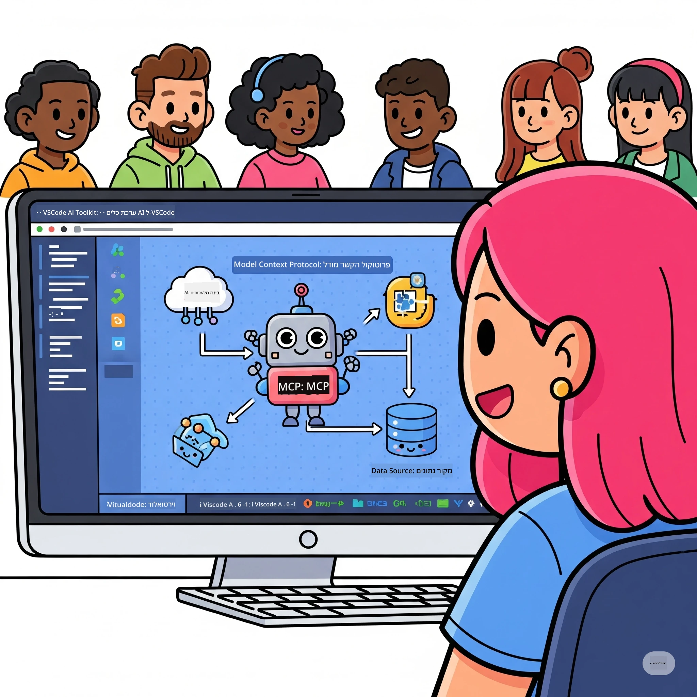
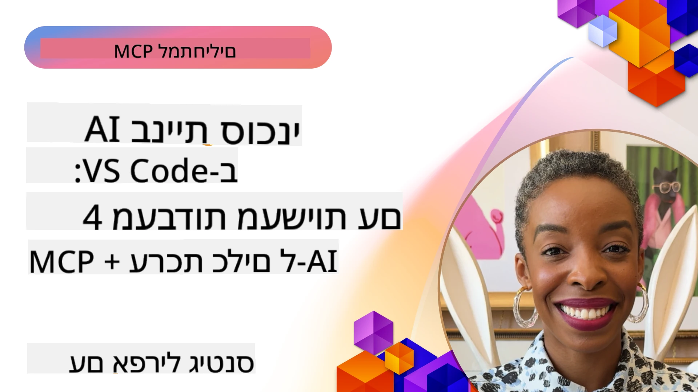

# ייעול זרמי עבודה של בינה מלאכותית: בניית שרת MCP עם Microsoft Foundry Toolkit

## 🎯 מבוא

_(לחצו על התמונה למעלה לצפייה בסרטון של השיעור)_

ברוכים הבאים לסדנת **פרוטוקול הקשר למודל (MCP)**! סדנה מקיפה זו משלבת שתי טכנולוגיות מתקדמות לשינוי מהפכני בפיתוח יישומי בינה מלאכותית:

> **הערת תאימות:** קוד הסדנה נבנה ונבדק עם MCP
> `2025-11-25`, כפי שמוצג על ידי הסמל למעלה. יש להשתמש ב-
> [מפרט `2026-07-28` העדכני](https://modelcontextprotocol.io/specification/2026-07-28/)
> ליישומים חדשים של פרוטוקולים ולסקור את הערות השחרור של ה-SDK לפני
> העברת המעבדות.

- **🔗 פרוטוקול הקשר למודל (MCP)**: תקן פתוח לאינטגרציה חלקה של כלים לבינה מלאכותית
- **🛠️ הרחבת Microsoft Foundry Toolkit ל-VS Code**: הרחבת הפיתוח החזקה של מיקרוסופט לבינה מלאכותית

### 🎓 מה תלמדו

בסיום סדנה זו, תשלוטו באמנות בניית יישומים אינטיליגנטיים שמקשרים בין מודלים של בינה מלאכותית עם כלים ושירותים מהעולם האמיתי. מבדיקות אוטומטיות ועד אינטגרציות API מותאמות אישית, תרכשו מיומנויות מעשיות לפתרון אתגרים עסקיים מורכבים.

## 🏗️ ערכת טכנולוגיה

### 🔌 פרוטוקול הקשר למודל (MCP)

MCP הוא **"USB-C לבינה מלאכותית"** - תקן אוניברסלי שמחבר מודלים של בינה מלאכותית לכלים חיצוניים ומקורות נתונים.

**✨ תכונות עיקריות:**

- 🔄 **אינטגרציה סטנדרטית**: ממשק אוניברסלי לחיבור כלים לבינה מלאכותית
- 🏛️ **ארכיטקטורה גמישה**: שרתים מקומיים ומרוחקים באמצעות stdio/SSE
- 🧰 **אקוסיסטם עשיר**: כלים, הפרומפטים ומשאבים בפרוטוקול אחד
- 🔒 **מוכנות ארגונית**: אבטחה ואמינות מובנות

**🎯 למה MCP חשוב:**
בדיוק כמו ש-USB-C ביטל את כאוס הכבלים, MCP מבטל את המורכבות של אינטגרציות בינה מלאכותית. פרוטוקול אחד, אפשרויות אינסופיות.

### 🤖 הרחבת Microsoft Foundry Toolkit ל-VS Code

הרחבת הפיתוח המובילה של מיקרוסופט לבינה מלאכותית שממירה את VS Code למוקד עוצמתי של בינה מלאכותית.

**🚀 יכולות מרכזיות:**

- 📦 **קטלוג מודלים**: גישה למודלים מ-Azure AI, GitHub, Hugging Face, Ollama
- ⚡ **הסקת מסקנות מקומית**: ביצוע מותאם ONNX על CPU/GPU/NPU
- 🏗️ **בניית סוכנים**: פיתוח סוכני AI חזותי עם אינטגרציית MCP
- 🎭 **רב-מודלי**: תמיכה בטקסט, ראייה ופלט מובנה

**💡 יתרונות הפיתוח:**

- פריסה ללא הגדרות
- הנדסת פרומפטים ויזואלית
- מגרש בדיקות בזמן אמת
- אינטגרציה חלקה עם שרת MCP

## 📚 מסלול למידה

### [🚀 מודול 1: יסודות Microsoft Foundry Toolkit](./lab1/README.md)

**משך**: 15 דקות

- 🛠️ התקנה וקונפיגורציה של Microsoft Foundry Toolkit ל-VS Code
- 🗂️ חקר קטלוג המודלים (מעל 100 מודלים מ-GitHub, ONNX, OpenAI, Anthropic, Google)
- 🎮 שליטה במגרש האינטראקטיבי לבדיקת מודלים בזמן אמת
- 🤖 בניית הסוכן הראשון שלך באמצעות Agent Builder
- 📊 הערכת ביצועי מודל עם מדדים מובנים (F1, רלוונטיות, דמיון, קוהרנטיות)
- ⚡ למידת עיבוד אצוות ותמיכת רב-מודליות

**🎯 תוצאה למידה**: יצירת סוכן AI פונקציונלי עם הבנה מקיפה של יכולות Microsoft Foundry Toolkit

### [🌐 מודול 2: MCP עם יסודות Microsoft Foundry Toolkit](./lab2/README.md)

**משך**: 20 דקות

- 🧠 שליטה בארכיטקטורת פרוטוקול הקשר למודל (MCP) ומושגיו
- 🌐 חקר אקוסיסטם שרתי MCP של מיקרוסופט
- 🤖 בניית סוכן אוטומציה לדפדפן באמצעות שרת Playwright MCP
- 🔧 אינטגרציה של שרתי MCP עם Agent Builder של Microsoft Foundry Toolkit
- 📊 קונפיגורציה ובדיקת כלי MCP בתוך הסוכנים שלך
- 🚀 ייצוא ופריסה של סוכני MCP למטרות ייצור

**🎯 תוצאה למידה**: פריסת סוכן AI משודרג עם כלים חיצוניים דרך MCP

### [🔧 מודול 3: פיתוח מתקדם של MCP עם Microsoft Foundry Toolkit](./lab3/README.md)

**משך**: 20 דקות

- 💻 יצירת שרתי MCP מותאמים אישית עם Microsoft Foundry Toolkit
- 🐍 קונפיגורציה ושימוש ב-SDK הפייתון העדכני של MCP (v1.9.3)
- 🔍 הקמה ושימוש ב-MCP Inspector לניפוי שגיאות
- 🛠️ בניית שרת מזג אוויר MCP עם זרמי עבודה מקצועיים לניפוי שגיאות
- 🧪 איתור תקלות בשרתי MCP גם בסביבות Agent Builder וגם ב-Inspector

**🎯 תוצאה למידה**: פיתוח וניפוי שגיאות של שרתי MCP מותאמים עם כלים מודרניים

### [🐙 מודול 4: פיתוח מעשי של MCP - שרת שיבוט GitHub מותאם אישית](./lab4/README.md)

**משך**: 30 דקות

- 🏗️ בניית שרת שיבוט GitHub אמיתי לזרמי עבודה בפיתוח
- 🔄 יישום שיבוט חכם של מאגר עם אימות וניהול שגיאות
- 📁 יצירת ניהול תיקיות אינטיליגנטי ואינטגרציה עם VS Code
- 🤖 שימוש במצב סוכן GitHub Copilot עם כלים מותאמים של MCP
- 🛡️ יישום אמינות מוכנה לייצור ותאימות בין-פלטפורמית

**🎯 תוצאה למידה**: פריסת שרת MCP מוכן לייצור שמייעל זרמי עבודה אמיתיים בפיתוח

## 💡 יישומים והשפעות בעולם האמיתי

### 🏢 מקרים שימושיים בארגונים

#### 🔄 אוטומציה ב-DevOps

הפכו את זרם הפיתוח שלכם עם אוטומציה אינטיליגנטית:

- **ניהול מאגרים חכם**: סקירת קוד והחלטות מיזוג מונחות בינה מלאכותית
- **CI/CD אינטיליגנטי**: אופטימיזציית צינורות אוטומטית על בסיס שינויים בקוד
- **מיון תקלות**: סיווג והקצאת באגים אוטומטית

#### 🧪 מהפכה באבטחת איכות

שפרו בדיקות עם אוטומציה מונחית בינה מלאכותית:

- **יצירת בדיקות אינטיליגנטית**: יצירת סטים מקיפים של בדיקות באופן אוטומטי
- **בדיקות רגרסיה ויזואלית**: זיהוי שינויים בממשק משתמש מונחה AI
- **מעקב ביצועים**: זיהוי ופתרון בעיות באופן יזום

#### 📊 אינטיליגנציה בצינורות נתונים

בנו זרמי עבודה חכמים יותר לעיבוד נתונים:

- **תהליכי ETL אדפטיביים**: טרנספורמציות נתונים מותנות עצמית
- **גילוי חריגות**: ניטור איכות נתונים בזמן אמת
- **ניתוב אינטיליגנטי**: ניהול זרימת נתונים חכמה

#### 🎧 שיפור חוויית לקוח

צרו אינטראקציות יוצאות דופן עם לקוחות:

- **תמיכה מודעת הקשר**: סוכני AI עם גישה להיסטוריית הלקוח
- **פתרון בעיות יזום**: שירות לקוחות חיזוי
- **אינטגרציה רב-ערוצית**: חוויית AI מאוחדת ברחבי הפלטפורמות

## 🛠️ דרישות מוקדמות והגדרות

### 💻 דרישות מערכת

| רכיב | דרישה | הערות |
|-----------|-------------|-------|
| **מערכת הפעלה** | Windows 10+, macOS 10.15+, Linux | כל מערכת הפעלה מודרנית |
| **Visual Studio Code** | הגרסה היציבה האחרונה | דרוש ל-Microsoft Foundry Toolkit |
| **Node.js** | v18.0+ ו-npm | לפיתוח שרת MCP |
| **Python** | 3.10+ | אופציונלי לשרתים MCP בפייתון |
| **זיכרון** | מינימום 8GB RAM | מומלץ 16GB למודלים מקומיים |

### 🔧 סביבת פיתוח

#### הרחבות מומלצות ל-VS Code

- **Microsoft Foundry Toolkit** (ms-windows-ai-studio.windows-ai-studio)
- **Python** (ms-python.python)
- **Python Debugger** (ms-python.debugpy)
- **GitHub Copilot** (GitHub.copilot) - אופציונלי אך שימושי

#### כלים אופציונליים

- **uv**: מנהל חבילות מודרני לפייתון
- **MCP Inspector**: כלי ניפוי שגיאות חזותי לשרתים MCP
- **Playwright**: עבור דוגמאות לאוטומציה באינטרנט

## 🎖️ תוצאות למידה ודרכי הסמכה

### 🏆 רשימת מיומנויות לשליטה

עם סיום סדנה זו, תשיגו שליטה ב:

#### 🎯 מיומנויות מרכזיות

- [ ] **שליטה בפרוטוקול MCP**: הבנה עמוקה של ארכיטקטורה ודפוסי יישום
- [ ] **מומחיות ב-Microsoft Foundry Toolkit**: שימוש ברמה מומחית ב-Microsoft Foundry Toolkit לפיתוח מהיר
- [ ] **פיתוח שרת מותאם אישית**: בנייה, פריסה ותחזוקה של שרתי MCP לייצור
- [ ] **מצוינות באינטגרציית כלים**: חיבור חלק של בינה מלאכותית עם זרמי עבודה קיימים
- [ ] **יישום פתרון בעיות**: יישום המיומנויות שלמדתם לאתגרים עסקיים אמיתיים

#### 🔧 מיומנויות טכניות

- [ ] התקנה וקונפיגורציה של Microsoft Foundry Toolkit ב-VS Code
- [ ] עיצוב ויישום שרתי MCP מותאמים אישית
- [ ] אינטגרציה של מודלים של Microsoft Foundry עם ארכיטקטורת MCP
- [ ] בניית זרמי עבודה לבדיקה אוטומטית עם Playwright
- [ ] פריסת סוכני AI לשימוש בייצור
- [ ] ניפוי וייעול ביצועי שרת MCP

#### 🚀 יכולות מתקדמות

- [ ] תכנון אינטגרציות בינה מלאכותית בקנה מידה ארגוני
- [ ] יישום פרקטיקות אבטחה מיטביות ליישומי בינה מלאכותית
- [ ] עיצוב ארכיטקטורות שרתי MCP מדרגיות
- [ ] יצירת שרשרות כלים מותאמות לתחומים ספציפיים
- [ ] הנחיית אחרים בפיתוח ילידי בינה מלאכותית

## 📖 משאבים נוספים

- [מפרט MCP (2026-07-28)](https://modelcontextprotocol.io/specification/2026-07-28/)
- [מאגר GitHub של Microsoft Foundry Toolkit](https://github.com/microsoft/vscode-ai-toolkit)
- [אוסף שרתי MCP לדוגמה](https://github.com/modelcontextprotocol/servers)
- [מדריך לפרקטיקות מיטביות](https://modelcontextprotocol.io/docs/best-practices)
- [OWASP MCP Top 10](https://microsoft.github.io/mcp-azure-security-guide/mcp/) - פרקטיקות אבטחה מיטביות

---

**🚀 מוכנים למהפכה בזרם העבודה שלכם לפיתוח בינה מלאכותית?**

בואו ונבנה יחד את עתיד היישומים האינטליגנטיים עם MCP ו-Microsoft Foundry Toolkit!

## מה הלאה

המשיכו ל: [מודול 11: מעבדות מעשיות לשרת MCP](../11-MCPServerHandsOnLabs/README.md)

---

<!-- CO-OP TRANSLATOR DISCLAIMER START -->
**כתב ויתור**:
מסמך זה תורגם באמצעות שירות תרגום אוטומטי [Co-op Translator](https://github.com/Azure/co-op-translator). למרות שאנו שואפים לדיוק, יש לקחת בחשבון שתרגומים אוטומטיים עלולים להכיל שגיאות או אי-דיוקים. יש להחשיב את המסמך המקורי בשפתו הטבעית כמקור הסמכות. למידע קריטי מומלץ להשתמש בתרגום מקצועי על ידי מתרגם אדם. אנו לא אחראים לכל אי-הבנה או פירוש שגוי הנובע מהשימוש בתרגום זה.
<!-- CO-OP TRANSLATOR DISCLAIMER END -->