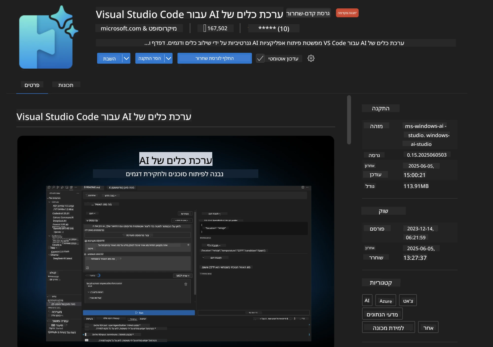
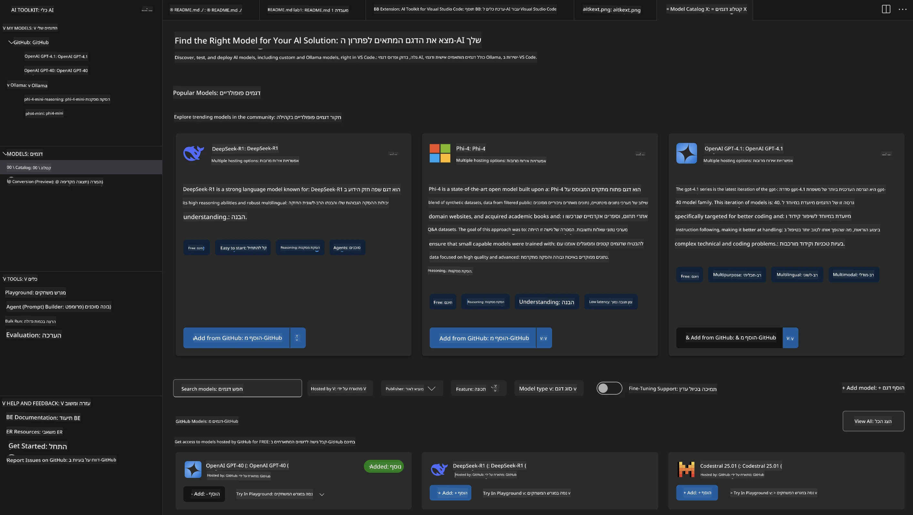
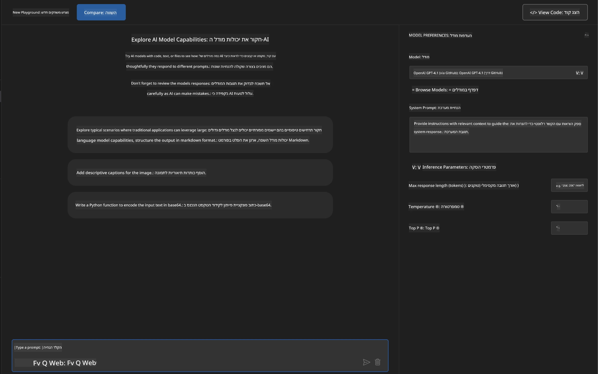
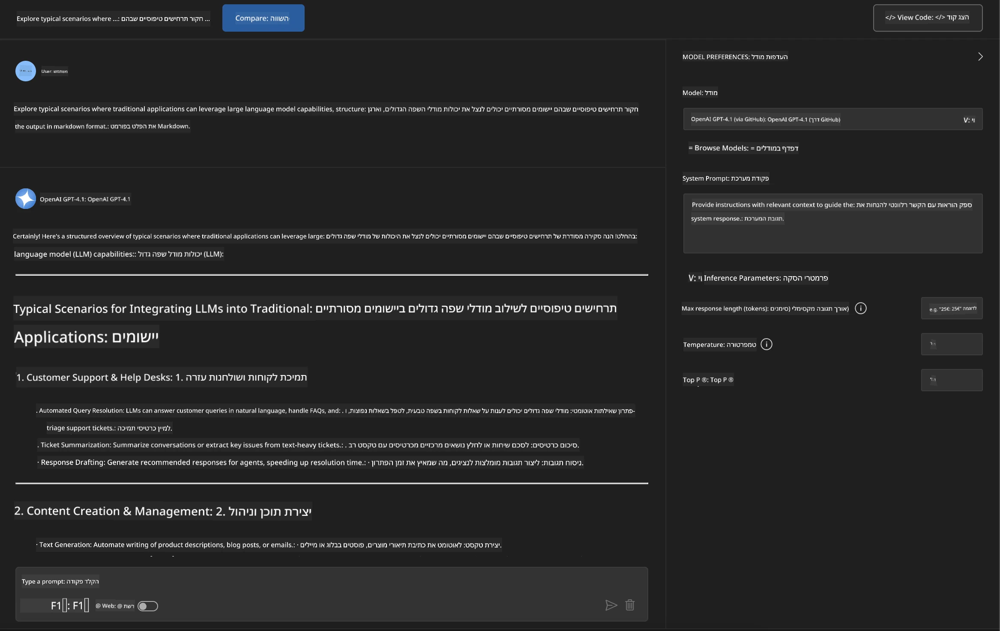
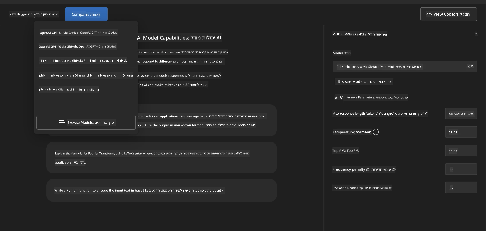
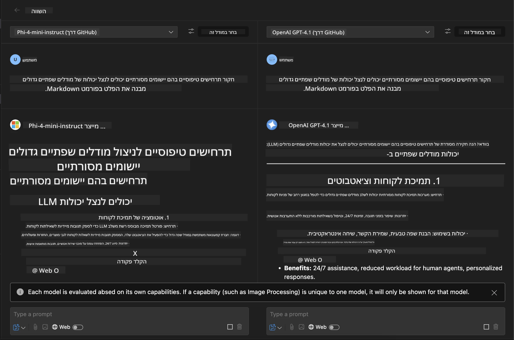
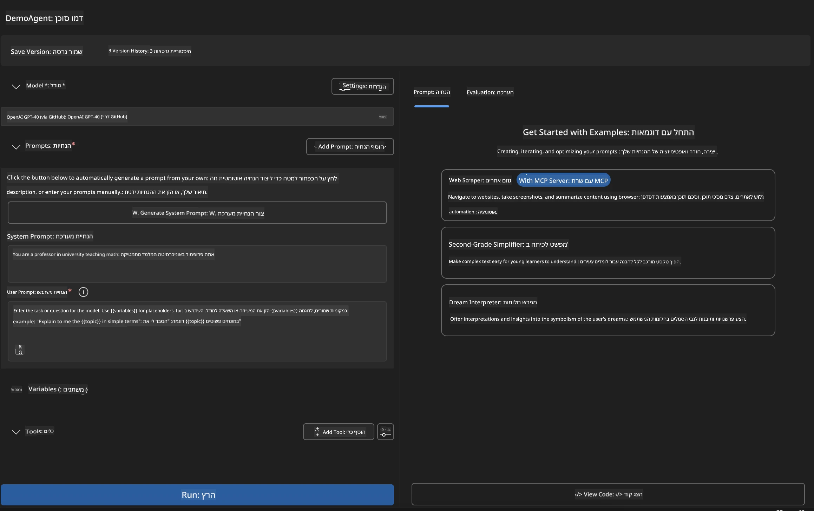
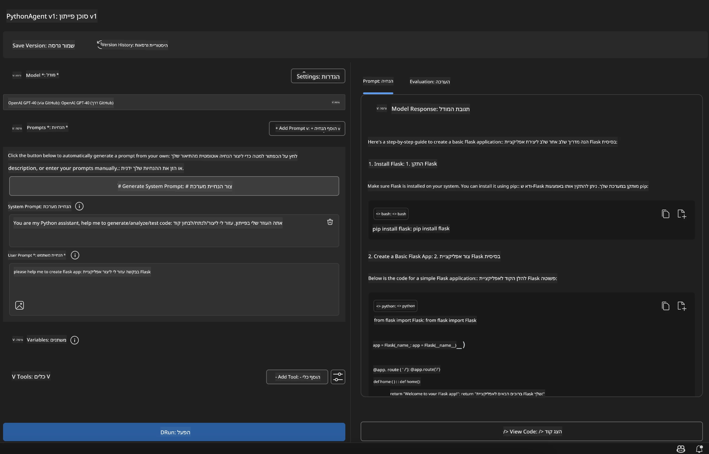

# 🚀 מודול 1: יסודות ערכת כלים Microsoft Foundry

[]()
[]()
[]()

## 📋 מטרות הלמידה

בסיום מודול זה, תהיה מסוגל:
- ✅ להתקין ולהגדיר את תוסף Microsoft Foundry Toolkit ל-VS Code
- ✅ לנווט בקטלוג הדגמים ולהבין מקורות דגמים שונים
- ✅ להשתמש במגרש המשחקים לבדיקת דגמים וניסויים
- ✅ ליצור סוכני בינה מלאכותית מותאמים אישית באמצעות Agent Builder
- ✅ להשוות ביצועי דגמים בין ספקים שונים
- ✅ ליישם שיטות עבודה מומלצות לאנכידת פקודות (prompt engineering)

## 🧠 מבוא ל-Microsoft Foundry Toolkit

**תוסף Microsoft Foundry Toolkit ל-VS Code** הוא התוסף המרכזי של Microsoft שהופך את VS Code לסביבת פיתוח בינה מלאכותית מקיפה. הוא גשר בין מחקר בינה מלאכותית לפיתוח יישומים מעשיים, ומאפשר גישה לגנרטיבי AI למפתחים בכל רמת מיומנות.

### 🌟 יכולות מפתח

| תכונה | תיאור | מקרה שימוש |
|---------|-------------|----------|
| **🗂️ קטלוג דגמים** | גישה ל-100+ דגמים מ-GitHub, ONNX, OpenAI, Anthropic, Google | גילוי ובחירת דגמים |
| **🔌 תמיכה ב-BYOM** | שילוב דגמים משלך (מקומיים/מרוחקים) | פריסת דגמים מותאמים |
| **🎮 מגרש משחקים אינטראקטיבי** | בדיקה בזמן אמת של דגמים עם ממשק צ'אט | פרוטוטייפינג ופרוטוטסטים מהירים |
| **📎 תמיכה מולטי-מודלית** | טיפול בטקסט, תמונות וקבצים מצורפים | יישומי AI מורכבים |
| **⚡ עיבוד אצוות** | הרצת מספר פקודות במקביל | זרימות עבודה יעילות לבדיקה |
| **📊 הערכת דגמים** | מדדים משולבים (F1, רלוונטיות, דמיון, קוהרנטיות) | הערכת ביצועים |

### 🎯 למה Microsoft Foundry Toolkit חשוב

- **🚀 פיתוח מואץ**: מרעיון לפרוטוטייפ תוך דקות
- **🔄 זרימת עבודה מאוחדת**: ממשק אחד לספקי AI מרובים
- **🧪 ניסויים קלים**: השוואת דגמים ללא הגדרות מורכבות
- **📈 מוכן לייצור**: מעבר חלק מפרוטוטייפ לפריסה

## 🛠️ דרישות מוקדמות והתקנה

### 📦 התקנת תוסף Microsoft Foundry Toolkit

**שלב 1: גישה לשוק התוספים**
1. פתח את Visual Studio Code
2. עבור לתצוגת התוספים (`Ctrl+Shift+X` או `Cmd+Shift+X`)
3. חפש "Microsoft Foundry Toolkit"

**שלב 2: בחר את גרסתך**
- **🟢 גרסה יציבה**: מומלץ לשימוש בייצור
- **🔶 גרסת בטא**: גישה מוקדמת לתכונות מתקדמות

**שלב 3: התקן והפעל**



### ✅ רשימת בדיקה לאימות
- [ ] סמל Microsoft Foundry Toolkit מופיע בסרגל הצד של VS Code
- [ ] התוסף מאופשר ומופעל
- [ ] אין שגיאות התקנה בלוח התפוקה

## 🧪 תרגיל מעשי 1: חקר דגמי Microsoft Foundry

**🎯 מטרה**: שלוט בקטלוג הדגמים ובחן את דגם ה-AI הראשון שלך

### 📊 שלב 1: ניווט בקטלוג הדגמים

קטלוג הדגמים הוא שערך לסביבת הבינה המלאכותית. הוא מאגד דגמים מספקים שונים, מה שמקל על גילוי והשוואת אופציות.

**🔍 מדריך ניווט:**

לחץ על **MODELS - Catalog** בסרגל הצד של Microsoft Foundry Toolkit



**💡 טיפ מקצועי**: חפש דגמים עם יכולות ספציפיות התואמות את מקרה השימוש שלך (למשל, יצירת קוד, כתיבה יצירתית, ניתוח).

> [!NOTE]
> דגמי GitHub הושבתו ב-30 ביולי 2026. השתמש בפריסת דגם Microsoft Foundry
> ואמת עם Microsoft Entra ID או מפתח API של Azure.

### 🚀 שלב 2: הוסף והגדר את הדגם הראשון שלך

**אסטרטגיית בחירת דגם:**
- **GPT-5.1**: מודל כללי מומלץ לשימוש בכלים והיגיון
- **Phi-4-mini**: קל משקל, תגובות מהירות למשימות פשוטות

**🔧 תהליך ההגדרה:**
1. בחר **OpenAI GPT-5.1** מהקטלוג
2. לחץ על **הוסף לדגמים שלי** - זה ירשום את הדגם לשימוש
3. בחר **נסה במגרש המשחקים** כדי לפתוח את סביבת הבדיקה
4. המתן לאתחול הדגם (הגדרה ראשונית עשויה לקחת רגע)



**⚙️ הבנת פרמטרי דגם:**
- **טמפרטורה**: שולט ביצירתיות (0 = דטרמיניסטי, 1 = יצירתי)
- **מקסימום טוקנים**: אורך תגובה מקסימלי
- **Top-p**: דגימת ליבה למגוון בתגובות

### 🎯 שלב 3: שלוט בממשק מגרש המשחקים

מגרש המשחקים הוא המעבדה לניסויי ה-AI שלך. כך תנצל את הפוטנציאל שלו במלואו:

**🎨 שיטות עבודה מומלצות לאנכידת פקודות:**
1. **היה ספציפי**: הוראות ברורות ומפורטות מניבות תוצאות טובות יותר
2. **ספק הקשר**: כלול מידע רקע רלוונטי
3. **השתמש בדוגמאות**: הצג לדגם מה אתה רוצה באמצעות דוגמאות
4. **חזור ושפר**: עדכן פקודות על בסיס תוצאות ראשוניות

**🧪 תרחישי בדיקה:**
```markdown
# Example 1: Code Generation
"Write a Python function that calculates the factorial of a number using recursion. Include error handling and docstrings."

# Example 2: Creative Writing
"Write a professional email to a client explaining a project delay, maintaining a positive tone while being transparent about challenges."

# Example 3: Data Analysis
"Analyze this sales data and provide insights: [paste your data]. Focus on trends, anomalies, and actionable recommendations."
```



### 🏆 תרגיל אתגר: השוואת ביצועי דגמים

**🎯 מטרה**: השווה דגמים שונים באמצעות אותן פקודות כדי להבין את חוזקותיהם

**📋 הנחיות:**
1. הוסף **Phi-4-mini** לסביבת העבודה שלך
2. השתמש באותה פקודה עבור GPT-5.1 ו-Phi-4-mini



3. השווה איכות תגובה, מהירות ודיוק
4. תעד את הממצאים שלך בסעיף התוצאות



**💡 תובנות מרכזיות לגלות:**
- מתי להשתמש ב-LLM לעומת SLM
- עלויות מול פשרות בביצועים
- יכולות מיוחדות של דגמים שונים

## 🤖 תרגיל מעשי 2: בניית סוכנים מותאמים עם Agent Builder

**🎯 מטרה**: צור סוכני AI מתמחים המותאמים למשימות וזרימות עבודה ספציפיות

### 🏗️ שלב 1: הבנת Agent Builder

Agent Builder הוא המקום שבו Microsoft Foundry Toolkit באמת קורן. הוא מאפשר ליצור עוזרי AI ייעודיים המשלבים את כוח דגמי השפה הגדולים עם הוראות מותאמות, פרמטרים ספציפיים וידע מיוחד.

**🧠 מרכיבי ארכיטקטורת הסוכן:**
- **הדגם הליבה**: ה-LLM הבסיסי (GPT-5.1, Phi, וכו')
- **פונקציית מערכת**: מגדירה את אישיות והתנהגות הסוכן
- **פרמטרים**: הגדרות מנותבות לביצועים מיטביים
- **אינטגרציית כלי עבודה**: חיבור ל-APIs חיצוניים ושירותי MCP
- **זיכרון**: הקשר שיחה וייצוב מושב



### ⚙️ שלב 2: מעמיקים בהגדרת הסוכן

**🎨 יצירת פקודות מערכת אפקטיביות:**
```markdown
# Template Structure:
## Role Definition
You are a [specific role] with expertise in [domain].

## Capabilities
- List specific abilities
- Define scope of knowledge
- Clarify limitations

## Behavior Guidelines
- Response style (formal, casual, technical)
- Output format preferences
- Error handling approach

## Examples
Provide 2-3 examples of ideal interactions
```

*כמובן, אפשר גם להשתמש ב-Generate System Prompt כדי לקבל עזרה מה-AI ביצירת ושיפור הפקודות*

**🔧 אופטימיזציית פרמטרים:**
| פרמטר | טווח מומלץ | מקרה שימוש |
|-----------|------------------|----------|
| **טמפרטורה** | 0.1-0.3 | תגובות טכניות/עובדתיות |
| **טמפרטורה** | 0.7-0.9 | משימות יצירתיות/סיעור מוחות |
| **מקסימום טוקנים** | 500-1000 | תגובות תמציתיות |
| **מקסימום טוקנים** | 2000-4000 | הסברים מפורטים |

### 🐍 שלב 3: תרגיל מעשי - סוכן תכנות בפייתון

**🎯 משימה**: צור עוזר תכנות פייתון מתמחה

**📋 שלבי הגדרה:**

1. **בחירת דגם**: בחר **Claude 3.5 Sonnet** (מצוין לקוד)

2. **עיצוב פקודת מערכת**:
```markdown
# Python Programming Expert Agent

## Role
You are a senior Python developer with 10+ years of experience. You excel at writing clean, efficient, and well-documented Python code.

## Capabilities
- Write production-ready Python code
- Debug complex issues
- Explain code concepts clearly
- Suggest best practices and optimizations
- Provide complete working examples

## Response Format
- Always include docstrings
- Add inline comments for complex logic
- Suggest testing approaches
- Mention relevant libraries when applicable

## Code Quality Standards
- Follow PEP 8 style guidelines
- Use type hints where appropriate
- Handle exceptions gracefully
- Write readable, maintainable code
```

3. **הגדרת פרמטרים**:
   - טמפרטורה: 0.2 (לקוד עקבי ואמין)
   - מקסימום טוקנים: 2000 (הסברים מפורטים)
   - Top-p: 0.9 (יצירתיות מאוזנת)



### 🧪 שלב 4: בדוק את סוכן הפייתון שלך

תרחישי בדיקה:
1. **פונקציה בסיסית**: "צור פונקציה למציאת מספרים ראשוניים"
2. **אלגוריתם מורכב**: "ממש עץ חיפוש בינארי עם פעולות הוספה, מחיקה וחיפוש"
3. **בעיה ממשית**: "בנה סרגל רשת המטפל במגבלות קצב וניסיונות חוזרים"
4. **ניפוי שגיאות**: "תקן את הקוד הזה [הדבק קוד עם שגיאות]"

**🏆 קריטריוני הצלחה:**
- ✅ הקוד רץ ללא שגיאות
- ✅ כולל תיעוד מתאים
- ✅ פועל בהתאם לשיטות עבודה מומלצות בפייתון
- ✅ מספק הסברים ברורים
- ✅ מציע שיפורים

## 🎓 סיכום מודול 1 ושלבים הבאים

### 📊 בדיקת ידע

בדוק את הבנתך:
- [ ] האם אתה יכול להסביר את ההבדלים בין דגמים בקטלוג?
- [ ] האם יצרת ובדקת בהצלחה סוכן מותאם אישית?
- [ ] האם אתה מבין איך לאופטמיזציה פרמטרים למקרי שימוש שונים?
- [ ] האם אתה יכול לעצב פקודות מערכת אפקטיביות?

### 📚 משאבים נוספים

- **תיעוד Microsoft Foundry Toolkit**: [המסמכים הרשמיים של Microsoft](https://github.com/microsoft/vscode-ai-toolkit)
- **מדריך לאנכידת פקודות**: [שיטות עבודה מומלצות](https://platform.openai.com/docs/guides/prompt-engineering)
- **דגמים ב-Microsoft Foundry Toolkit**: [דגמים בפיתוח](https://github.com/microsoft/vscode-ai-toolkit/blob/main/doc/models.md)

**🎉 מזל טוב!** שלטת ביסודות של Microsoft Foundry Toolkit ואתה מוכן לבנות יישומי AI מתקדמים יותר!

### 🔜 המשך למודול הבא

מוכן ליכולות מתקדמות יותר? המשך ל-**[מודול 2: MCP עם יסודות Microsoft Foundry Toolkit](../lab2/README.md)** בו תלמד כיצד:
- לחבר את הסוכנים שלך לכלים חיצוניים באמצעות Model Context Protocol (MCP)
- לבנות סוכני אוטומציה לדפדפן עם Playwright
- לשלב שרתי MCP עם סוכני Microsoft Foundry Toolkit שלך
- לחזק את הסוכנים שלך עם נתונים ויכולות חיצוניות

---

<!-- CO-OP TRANSLATOR DISCLAIMER START -->
**כתב ויתור**:
מסמך זה תורגם באמצעות שירות תרגום אוטומטי [Co-op Translator](https://github.com/Azure/co-op-translator). למרות שאנו שואפים לדיוק, יש לקחת בחשבון שתרגומים אוטומטיים עלולים להכיל שגיאות או אי-דיוקים. יש להחשיב את המסמך המקורי בשפתו הטבעית כמקור הסמכות. למידע קריטי מומלץ להשתמש בתרגום מקצועי על ידי מתרגם אדם. אנו לא אחראים לכל אי-הבנה או פירוש שגוי הנובע מהשימוש בתרגום זה.
<!-- CO-OP TRANSLATOR DISCLAIMER END -->