# 🌐 מודול 2: MCP עם יסודות Microsoft Foundry Toolkit


## 📋 יעדי למידה

בסוף מודול זה, תוכל ל:

- ✅ להבין את ארכיטקטורת Model Context Protocol (MCP) והיתרונות שלה
- ✅ לחקור את מערכת השרתים של MCP של מיקרוסופט
- ✅ לשלב שרתי MCP עם Microsoft Foundry Toolkit Agent Builder
- ✅ לבנות סוכן אוטומציה לדפדפן עובדים באמצעות Playwright MCP
- ✅ להגדיר ולבדוק כלי MCP בתוך הסוכנים שלך
- ✅ לייצא ולפרוס סוכנים המופעלים על ידי MCP לשימוש פרודקשן

## 🎯 המשך למודול 1

במודול 1 למדנו את יסודות Microsoft Foundry Toolkit ויצרנו את
סוכן הפייתון הראשון שלנו. עכשיו נוכל **להעצים** את הסוכנים שלך על ידי חיבורם
לכלים ושירותים חיצוניים דרך הפרוטוקול המהפכני
**Model Context Protocol (MCP)**.

תחשוב על זה כהשדרוג ממחשבון בסיסי למחשב מלא. לסוכני ה-AI שלך תהיה היכולת:


- 📁 לגשת ולנהל קבצים
- 🔧 להשתלב עם מערכות ארגוניות
- 📊 לעבד נתונים בזמן אמת מ-APIs


שמחבר מודלים של שפה גדולים (LLMs) לכלים, למקורות נתונים
ולשירותים חיצוניים. בדיוק כפי ש-USB-C מספק מחבר אוניברסלי אחד, MCP
מפשט את אינטגרציית ה-AI באמצעות פרוטוקול אחד סטנדרטי.


- 🔄 תלות בספק עם פתרונות בלעדיים  
- 🔒 פגיעויות אבטחה מחיבורים נקודתיים
- ⏱️ חודשים של פיתוח לאינטגרציות בסיסיות


- 🔄 ארכיטקטורה בלתי תלויה בספקים
- 🛡️ שיטות אבטחה מובנות
- 🚀 הוספת יכולות חדשות בדקות ספורות


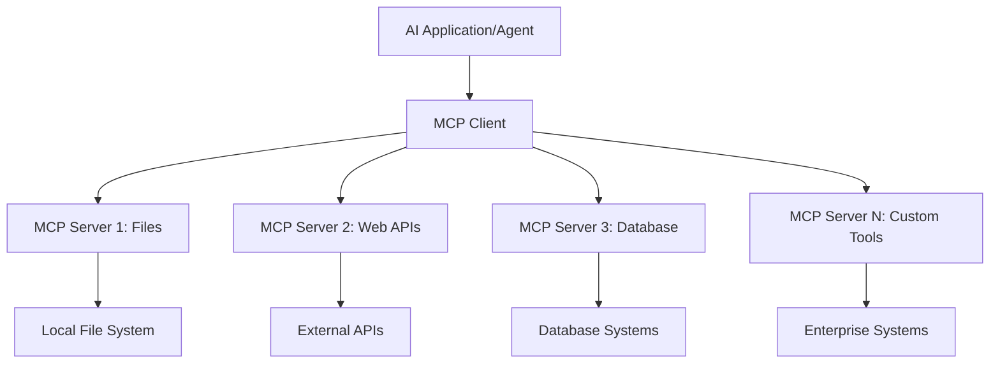

**🔧 רכיבים מרכזיים:**

| רכיב | תפקיד | דוגמאות |
| --------- | ---- | -------- |
| **מארחי MCP** | צורכים שירותי MCP | VS Code, Foundry Toolkit |
| **לקוחות MCP** | מטפלים בחיבורים בפרוטוקול | מובנה במארחים |
| **שרתים MCP** | מספקים יכולות | Playwright, Files, Azure, GitHub |
| **שכבת התחבורה** | מחברת בין לקוחות לשרתים | stdio, HTTP, WebSockets |

## 🏢 מערכת השרתים של Microsoft MCP

מיקרוסופט מובילה את מערכת ה-MCP עם סדרה מקיפה של
שרתים ברמת ארגון המיועדים לענות לצרכים עסקיים אמיתיים.

### 🌟 שרתי MCP מובילים של מיקרוסופט

#### 1. ☁️ שרת Azure MCP

**🔗 מאגר**: [azure/azure-mcp](https://github.com/azure/azure-mcp)
**🎯 מטרה**: ניהול משאבי Azure כולל אינטגרציה עם AI

**✨ תכונות עיקריות:**

- יצירת תשתית דקלרטיבית
- מעקב בזמן אמת אחר משאבים
- המלצות לאופטימיזציית עלויות
- בדיקת תאימות אבטחה

**🚀 מקרים שימושיים:**

- תשתית כקוד עם סיוע AI
- סקיילינג אוטומטי של משאבים
- אופטימיזציה של עלויות ענן
- אוטומציה של תהליכי DevOps

#### 2. 📊 Microsoft Dataverse MCP

**📚 תיעוד**: [Microsoft Dataverse Integration](https://go.microsoft.com/fwlink/?linkid=2320176)
**🎯 מטרה**: ממשק שפה טבעית לנתוני עסק

**✨ תכונות עיקריות:**

- שאילתות מסד נתונים בשפה טבעית
- הבנת הקשר עסקי
- תבניות פקודות מותאמות אישית
- ממשל נתונים ארגוני

**🚀 מקרים שימושיים:**

- דיווח מידע עסקי
- ניתוח נתוני לקוחות
- תובנות על זרם מכירות
- שאילתות עומדנות

#### 3. 🌐 שרת Playwright MCP

**🔗 מאגר**: [microsoft/playwright-mcp](https://github.com/microsoft/playwright-mcp)
**🎯 מטרה**: אוטומציה דפדפן ויכולות אינטראקציה באינטרנט

**✨ תכונות עיקריות:**

- אוטומציה בין דפדפנים (Chrome, Firefox, Safari)
- זיהוי אלמנטים חכם
- יצירת צילומי מסך ו-PDF
- מעקב תעבורת רשת

**🚀 מקרים שימושיים:**

- זרמי עבודה לבדיקות אוטומטיות
- גרידת אינטרנט וחילוץ נתונים
- מעקב UI/UX
- אוטומציה של ניתוח תחרות

#### 4. 📁 שרת Files MCP

**🔗 מאגר**: [microsoft/files-mcp-server](https://github.com/microsoft/files-mcp-server)
**🎯 מטרה**: פעולות חכמות במערכת קבצים

**✨ תכונות עיקריות:**

- ניהול קבצים דקלרטיבי
- סינכרון תוכן
- אינטגרציה לניהול גרסאות
- חילוץ מטה-דטה

**🚀 מקרים שימושיים:**

- ניהול תיעוד
- ארגון מאגרי קוד
- תהליכי הפצת תוכן
- טיפול בקבצים בזרמי נתונים

#### 5. 📝 שרת MarkItDown MCP

**🔗 מאגר**: [microsoft/markitdown](https://github.com/microsoft/markitdown)
**🎯 מטרה**: עיבוד ומניפולציה מתקדמת של Markdown

**✨ תכונות עיקריות:**

- פיענוח Markdown עשיר
- המרת פורמטים (MD ↔ HTML ↔ PDF)
- ניתוח מבנה תוכן
- עיבוד תבניות

**🚀 מקרים שימושיים:**

- תהליכי תיעוד טכני
- מערכות ניהול תוכן
- יצירת דוחות
- אוטומציה של בסיסי ידע

#### 6. 📈 שרת Clarity MCP

**📦 חבילה**: [@microsoft/clarity-mcp-server](https://www.npmjs.com/package/@microsoft/clarity-mcp-server)
**🎯 מטרה**: אנליטיקה של אתרי אינטרנט ותובנות על התנהגות משתמש

**✨ תכונות עיקריות:**

- ניתוח נתוני Heatmap
- הקלטות מפגשי משתמש
- מדדי ביצועים
- ניתוח משפך המרה

**🚀 מקרים שימושיים:**

- אופטימיזציית אתרים
- מחקר חווית משתמש
- ניתוח בדיקות A/B
- לוחות מחוונים למודיעין עסקי

### 🌍 מערכת הקהילה

מעבר לשרתים של מיקרוסופט, מערכת ה-MCP כוללת:

- **🐙 GitHub MCP**: ניהול מאגרים וניתוח קוד
- **🗄️ מסדי נתונים MCP**: אינטגרציות עם PostgreSQL, MySQL, MongoDB
- **☁️ ספקי ענן MCP**: כלים ל-AWS, GCP, Digital Ocean
- **📧 תקשורת MCP**: אינטגרציות עם Slack, Teams, Email

## 🛠️ מעבדה מעשית: בניית סוכן אוטומציה לדפדפן

**🎯 מטרה לפרויקט**: ליצור סוכן אוטומציה חכם עבור דפדפן באמצעות 
שרת Playwright MCP שיכול לנווט באתרים, לחלץ מידע,
ולבצע אינטראקציות מורכבות ברשת.

### 🚀 שלב 1: הקמת בסיס לסוכן

#### שלב 1: התחלת סוכן

1. **פתח את כלי בניית הסוכנים Microsoft Foundry Toolkit**
2. **צור סוכן חדש** עם הקונפיגורציה הבאה:
   - **שם**: `BrowserAgent`
   - **דגם**: בחר GPT-5.1. ראה את
      [לוח הזמנים לפרישת דגם Microsoft Foundry](https://learn.microsoft.com/azure/foundry/openai/concepts/model-retirement-schedule)
      למידע עדכני לגבי מחזור חיי הדגם.

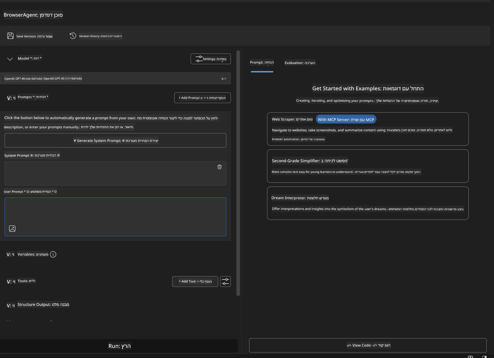

### 🔧 שלב 2: זרימת עבודה לאינטגרציית MCP

#### שלב 3: הוספת אינטגרציית שרת MCP

1. **נווט לסעיף כלים** ב-Agent Builder
2. **לחץ על "הוסף כלי"** כדי לפתוח את תפריט האינטגרציה
3. **בחר "שרת MCP"** מתוך האפשרויות הזמינות

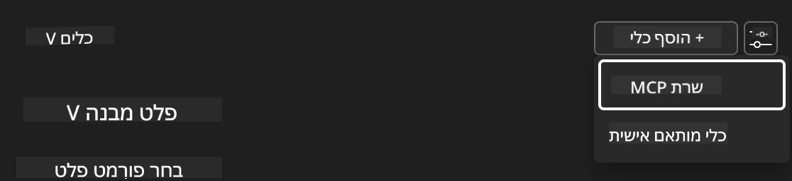

**🔍 הבנת סוגי כלים:**

- **כלים מובנים**: פונקציות קבועות מראש של Microsoft Foundry Toolkit
- **שרתים MCP**: אינטגרציות שירות חיצוניות
- **API מותאמים אישית**: נקודות קצה של השירות שלך
- **קריאת פונקציות**: גישה ישירה לפונקציות הדגם

#### שלב 4: בחירת שרת MCP

1. **בחר באפשרות "שרת MCP"** כדי להמשיך
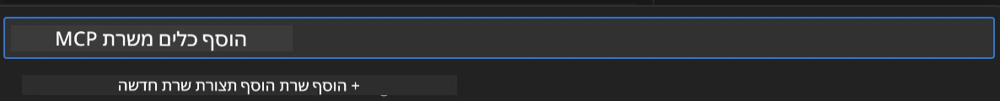

2. **עיין בקטלוג MCP** כדי לבדוק את האינטגרציות הזמינות
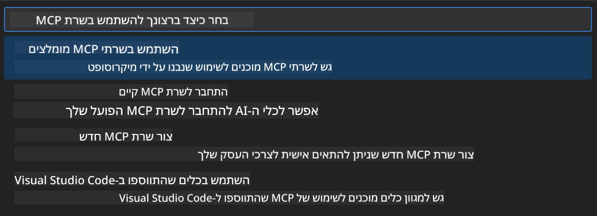

### 🎮 שלב 3: קונפיגורציית Playwright MCP

#### שלב 5: בחירה וקונפיגורציה של Playwright

1. **לחץ על "השתמש בשרתי MCP מובילים"** כדי לגשת לשרתי מיקרוסופט המאומתים
2. **בחר ב-"Playwright"** מהרשימה המובחרת
3. **קבל את מזהה MCP ברירת מחדל** או התאם לסביבתך

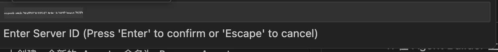

#### שלב 6: הפעלת יכולות Playwright

**🔑 שלב קריטי**: בחר את **כל** שיטות Playwright הזמינות למקסימום פונקציונליות

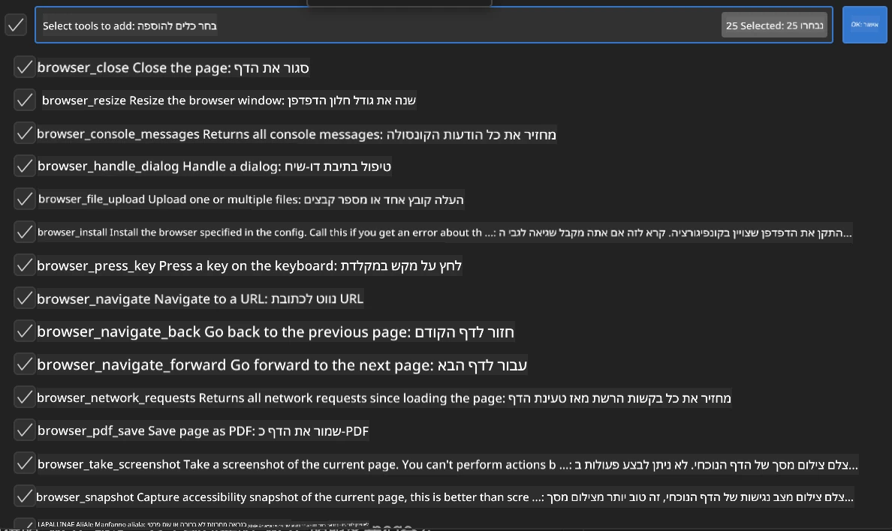

**🛠️ כלים חיוניים ל-Playwright:**

- **ניווט**: `goto`, `goBack`, `goForward`, `reload`
- **אינטראקציה**: `click`, `fill`, `press`, `hover`, `drag`
- **חילוץ**: `textContent`, `innerHTML`, `getAttribute`
- **אימות**: `isVisible`, `isEnabled`, `waitForSelector`
- **צילום**: `screenshot`, `pdf`, `video`
- **רשת**: `setExtraHTTPHeaders`, `route`, `waitForResponse`

#### שלב 7: אימות הצלחת האינטגרציה

**✅ אינדיקטורי הצלחה:**

- כל הכלים מופיעים בממשק Agent Builder
- אין הודעות שגיאה בפאנל האינטגרציה
- סטטוס שרת Playwright מציג "מחובר"

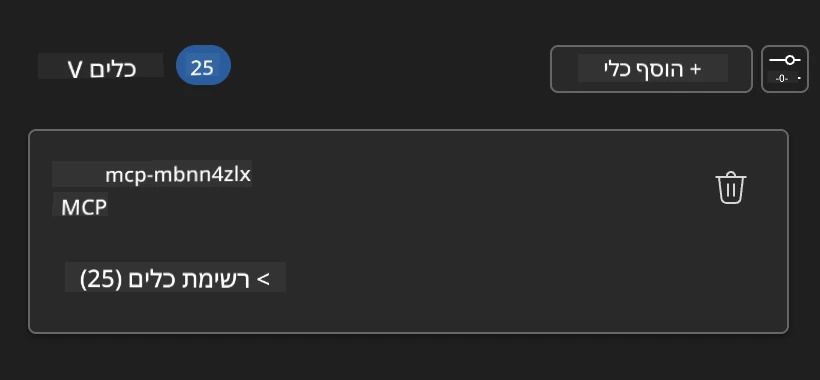

**🔧 פתרון בעיות נפוצות:**

- **כישלון חיבור**: בדוק את חיבור האינטרנט והגדרות חומת האש
- **כלים חסרים**: וודא שכל היכולות נבחרו במהלך ההגדרה
- **שגיאות הרשאות**: ודא של-VS Code יש הרשאות מערכת נחוצות

### 🎯 שלב 4: הנדסת פקודות מתקדמת

#### שלב 8: עיצוב פקודות מערכת חכמות

צור פקודות מתוחכמות המנצלת את כל היכולות של Playwright:

```markdown
# Web Automation Expert System Prompt

## Core Identity
You are an advanced web automation specialist with deep expertise in browser
automation, web scraping, and user experience analysis. You have access to
Playwright tools for comprehensive browser control.

## Capabilities & Approach
### Navigation Strategy
- Always start with screenshots to understand page layout
- Use semantic selectors (text content, labels) when possible
- Implement wait strategies for dynamic content
- Handle single-page applications (SPAs) effectively

### Error Handling
- Retry failed operations with exponential backoff
- Provide clear error descriptions and solutions
- Suggest alternative approaches when primary methods fail
- Always capture diagnostic screenshots on errors

### Data Extraction
- Extract structured data in JSON format when possible
- Provide confidence scores for extracted information
- Validate data completeness and accuracy
- Handle pagination and infinite scroll scenarios

### Reporting
- Include step-by-step execution logs
- Provide before/after screenshots for verification
- Suggest optimizations and alternative approaches
- Document any limitations or edge cases encountered

## Ethical Guidelines
- Respect robots.txt and rate limiting
- Avoid overloading target servers
- Only extract publicly available information
- Follow website terms of service
```

#### שלב 9: יצירת פקודות משתמש דינמיות

עצב פקודות המדגימות יכולות שונות:

**🌐 דוגמה לניתוח רשת:**

```markdown
Navigate to github.com/kinfey and provide a comprehensive analysis including:
1. Repository structure and organization
2. Recent activity and contribution patterns  
3. Documentation quality assessment
4. Technology stack identification
5. Community engagement metrics
6. Notable projects and their purposes

Include screenshots at key steps and provide actionable insights.
```

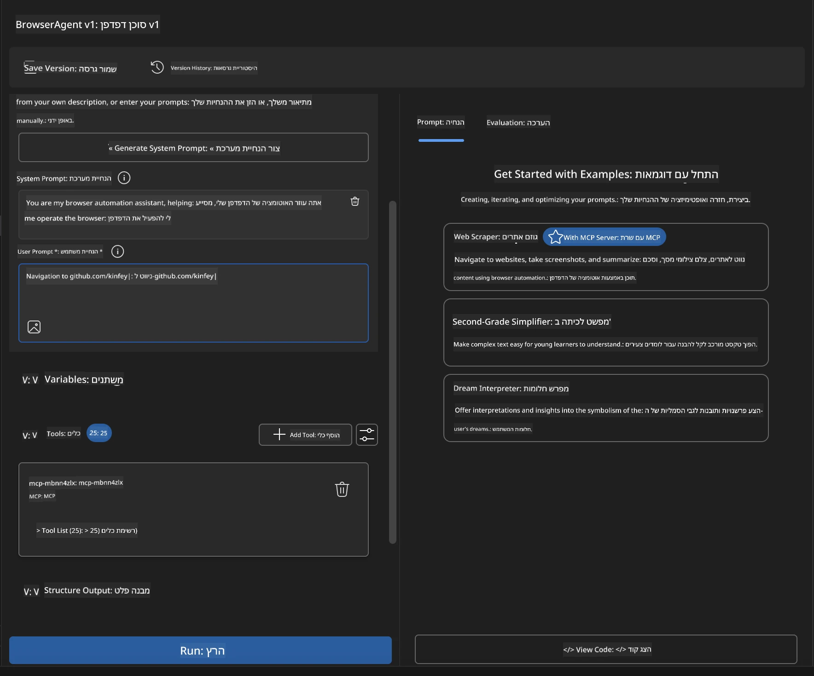

### 🚀 שלב 5: ביצוע ובדיקה

#### שלב 10: הרץ את האוטומציה הראשונה שלך

1. **לחץ על "הפעל"** כדי להתחיל את רצף האוטומציה
2. **עקוב אחר ביצוע בזמן אמת**:
   - דפדפן Chrome מופעל אוטומטית
   - הסוכן מנווט לאתר היעד
   - צילומי מסך מתעדים כל שלב מרכזי
   - תוצאות הניתוח זורמות בזמן אמת

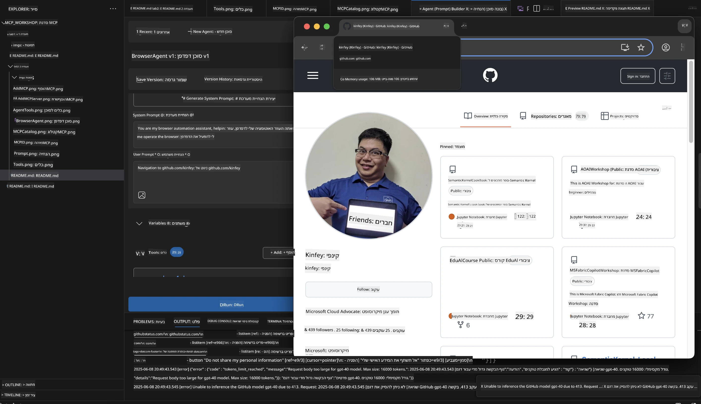

#### שלב 11: ניתוח תוצאות ותובנות

סקור ניתוח מקיף בממשק Agent Builder:

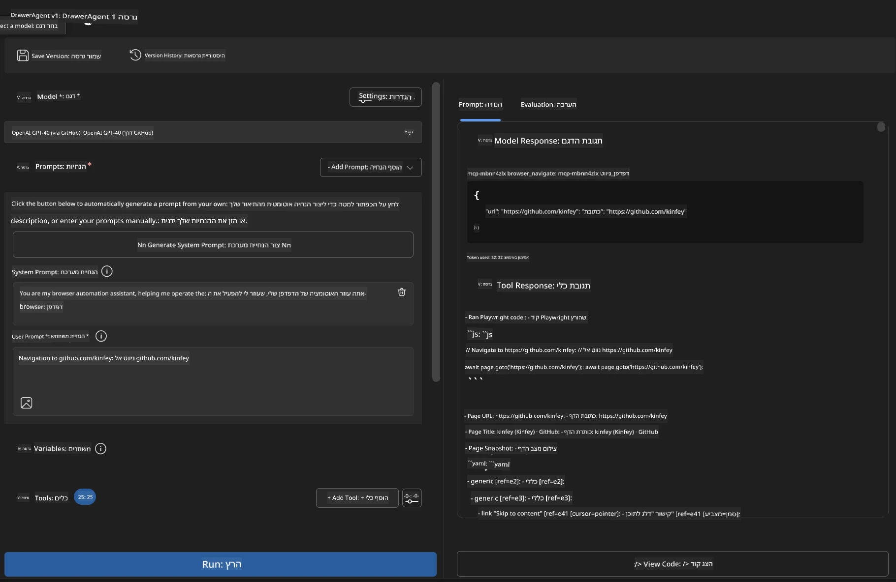

### 🌟 שלב 6: יכולות מתקדמות והפצה

#### שלב 12: ייצוא והפצת ייצור

Agent Builder תומך באפשרויות הפצה מרובות:

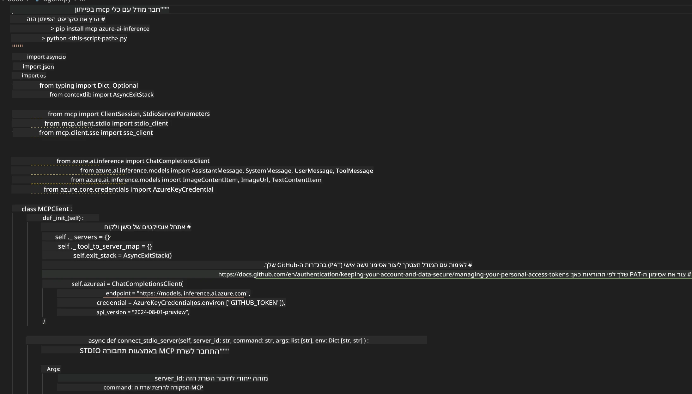

## 🎓 סיכום מודול 2 ושלבים הבאים

### 🏆 הישג שהושג: מאסטר באינטגרציית MCP

**✅ מיומנויות שנרכשו:**

- [ ] הבנת ארכיטקטורת MCP ויתרונותיה
- [ ] ניווט במערכת שרתי MCP של מיקרוסופט
- [ ] אינטגרציית Playwright MCP עם Microsoft Foundry Toolkit
- [ ] בניית סוכני אוטומציה מתקדמים לדפדפן
- [ ] הנדסת פקודות מתקדמת לאוטומציה רשתית

### 📚 משאבים נוספים

- **🔗 מפרט MCP**: [תיעוד פרוטוקול רשמי](https://modelcontextprotocol.io/)
- **🛠️ API של Playwright**: [מאגר שיטות מלא](https://playwright.dev/docs/api/class-playwright)
- **🏢 שרתי MCP של מיקרוסופט**:
   [מדריך אינטגרציה לארגונים](https://github.com/microsoft/mcp-servers)
- **🌍 דוגמאות קהילתיות**: [גלריית שרתי MCP](https://github.com/modelcontextprotocol/servers)

**🎉 ברכות!** הצלחת לשלוט באינטגרציית MCP ועכשיו אתה יכול
לבנות סוכני AI מוכנים לפרודקשן עם יכולות כלים חיצוניים!

### 🔜 המשך למודול הבא

מוכן לקחת את מיומנויות ה-MCP שלך לשלב הבא? המשך ל-
**[מודול 3: פיתוח MCP מתקדם עם Microsoft Foundry Toolkit](../lab3/README.md)**
שם תלמד כיצד:

- ליצור שרתי MCP מותאמים אישית משלך
- להגדיר ולהשתמש ב-SDK החדש ביותר של MCP לפייתון
- להגדיר את MCP Inspector לצורך ניפוי שגיאות
- לשלוט על זרמי עבודה מתקדמים לפיתוח שרת MCP
- לבנות שרת MCP למזג האוויר מאפס

---

<!-- CO-OP TRANSLATOR DISCLAIMER START -->
**כתב ויתור**:
מסמך זה תורגם באמצעות שירות תרגום אוטומטי [Co-op Translator](https://github.com/Azure/co-op-translator). למרות שאנו שואפים לדיוק, יש לקחת בחשבון שתרגומים אוטומטיים עלולים להכיל שגיאות או אי-דיוקים. יש להחשיב את המסמך המקורי בשפתו הטבעית כמקור הסמכות. למידע קריטי מומלץ להשתמש בתרגום מקצועי על ידי מתרגם אדם. אנו לא אחראים לכל אי-הבנה או פירוש שגוי הנובע מהשימוש בתרגום זה.
<!-- CO-OP TRANSLATOR DISCLAIMER END -->