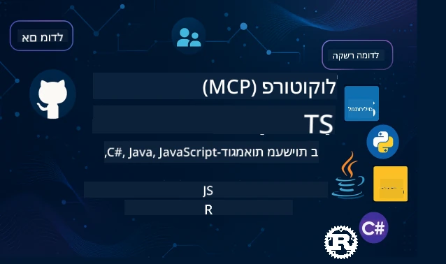

 

[](https://GitHub.com/microsoft/mcp-for-beginners/graphs/contributors)
[](https://GitHub.com/microsoft/mcp-for-beginners/issues)
[](https://GitHub.com/microsoft/mcp-for-beginners/pulls)
[](http://makeapullrequest.com)
[](https://mcptoplist.com/server/mcp.so%2Fmcp-for-beginners%2Fmicrosoft)

[](https://GitHub.com/microsoft/mcp-for-beginners/watchers)
[](https://GitHub.com/microsoft/mcp-for-beginners/fork)
[](https://GitHub.com/microsoft/mcp-for-beginners/stargazers)


[](https://discord.gg/nTYy5BXMWG)

עקוב/י אחר השלבים הבאים כדי להתחיל להשתמש במשאבים הללו:
1. **צור פיצול למאגר**: לחץ/י על [](https://GitHub.com/microsoft/mcp-for-beginners/fork)
2. **שכפל/י את המאגר**:   `git clone https://github.com/microsoft/mcp-for-beginners.git`
3. **הצטרף ל** [](https://discord.gg/nTYy5BXMWG)


### 🌐 תמיכה בריבוי שפות

#### תרגומים מתוחזקים עם [Co-op Translator](https://github.com/Azure/co-op-translator)

<!-- CO-OP TRANSLATOR LANGUAGES TABLE START -->
[ערבית](../ar/README.md) | [בנגלית](../bn/README.md) | [בולגרית](../bg/README.md) | [בורמזית (מיאנמר)](../my/README.md) | [סינית (מופשטת)](../zh-CN/README.md) | [סינית (מסורתית, הונג קונג)](../zh-HK/README.md) | [סינית (מסורתית, מקאו)](../zh-MO/README.md) | [סינית (מסורתית, טייוואן)](../zh-TW/README.md) | [קרואטית](../hr/README.md) | [צ’כית](../cs/README.md) | [דנית](../da/README.md) | [הולנדית](../nl/README.md) | [אסטונית](../et/README.md) | [פינית](../fi/README.md) | [צרפתית](../fr/README.md) | [גרמנית](../de/README.md) | [יוונית](../el/README.md) | [עברית](./README.md) | [הודית](../hi/README.md) | [הונגרית](../hu/README.md) | [אינדונזית](../id/README.md) | [איטלקית](../it/README.md) | [יפנית](../ja/README.md) | [קנדה](../kn/README.md) | [חמר](../km/README.md) | [קוריאנית](../ko/README.md) | [ליטאית](../lt/README.md) | [מלאית](../ms/README.md) | [מלאלאית](../ml/README.md) | [מניפורי (Meitei Mayek)](../mni/README.md) | [מרתי](../mr/README.md) | [נפאלית](../ne/README.md) | [ניגרית פידג’ין](../pcm/README.md) | [נורווגית](../no/README.md) | [פרסית (פארסי)](../fa/README.md) | [פולנית](../pl/README.md) | [פורטוגזית (ברזיל)](../pt-BR/README.md) | [פורטוגזית (פורטוגל)](../pt-PT/README.md) | [פנג’אבי (גורמוכי)](../pa/README.md) | [רומנית](../ro/README.md) | [רוסית](../ru/README.md) | [סרבית (קירילית)](../sr/README.md) | [סלובקית](../sk/README.md) | [סלובנית](../sl/README.md) | [ספרדית](../es/README.md) | [סווהילית](../sw/README.md) | [שוודית](../sv/README.md) | [טגאלוג (פיליפינית)](../tl/README.md) | [טמילית](../ta/README.md) | [טלוגו](../te/README.md) | [תאית](../th/README.md) | [טורקית](../tr/README.md) | [אוקראינית](../uk/README.md) | [אורדו](../ur/README.md) | [וייטנאמית](../vi/README.md)

> **מעדיף לשכפל מקומית?**
>
> מאגר זה כולל למעלה מ-50 תרגומים לשפות שונות, מה שמגדיל משמעותית את גודל ההורדה. לשכפל ללא תרגומים, השתמש בבדיקת Sparse:
>
> **Bash / macOS / Linux:**
> ```bash
> git clone --filter=blob:none --sparse https://github.com/microsoft/mcp-for-beginners.git
> cd mcp-for-beginners
> git sparse-checkout set --no-cone '/*' '!translations' '!translated_images'
> ```
>
> **CMD (Windows):**
> ```cmd
> git clone --filter=blob:none --sparse https://github.com/microsoft/mcp-for-beginners.git
> cd mcp-for-beginners
> git sparse-checkout set --no-cone "/*" "!translations" "!translated_images"
> ```
>
> זה נותן לך את כל מה שצריך כדי להשלים את הקורס במהירות הורדה גבוהה יותר.
<!-- CO-OP TRANSLATOR LANGUAGES TABLE END -->

# 🚀 תכנית הלימודים של Model Context Protocol (MCP) למתחילים

## **למדו MCP עם דוגמאות קוד מעשיות ב-C#, Java, JavaScript, Rust, Python ו-TypeScript**

## 🧠 סקירה כללית של תכנית הלימודים של Model Context Protocol
ברוכים הבאים למסע שלכם אל Model Context Protocol! אם אי פעם תהיתם כיצד יישומי בינה מלאכותית מתקשרים עם כלים ושירותים שונים, אתם עומדים לגלות את הפתרון האלגנטי שמשנה את אופן בניית המערכות החכמות על ידי מפתחים.

חשבו על MCP כמתרגם אוניברסלי ליישומי בינה מלאכותית - בדיוק כמו שיציאות USB מאפשרות לך לחבר כל מכשיר למחשב שלך, MCP מאפשר למודלים של בינה מלאכותית להתחבר לכל כלי או שירות בצורה סטנדרטית. בין אם אתם בונים את הצ’טבוט הראשון שלכם או עובדים על תהליכי AI מורכבים, הבנת MCP תיתן לכם את היכולת ליצור יישומים חזקים וגמישים יותר.

תכנית הלימודים הזו עוצבה בסבלנות ובדאגה למסע הלמידה שלכם. נתחיל במושגים פשוטים שאתם כבר מבינים, ונבנה את המומחיות שלכם בהדרגה באמצעות תרגול מעשי בשפת התכנות האהובה עליכם. כל שלב כולל הסברים ברורים, דוגמאות מעשיות והרבה עידוד לאורך הדרך.

בסיום המסע הזה, תרגישו ביטחון לבנות שרתי MCP משלכם, לשלב אותם עם פלטפורמות בינה מלאכותית פופולריות, ולהבין כיצד הטכנולוגיה הזו מעצבת את עתיד פיתוח הבינה המלאכותית. בואו נתחיל את ההרפתקה המרגשת הזו יחד!

### תיעוד רשמי ומפרטים

גרסת הפרוטוקול הנוכחית היא **MCP Specification 2026-07-28**. מפרט ה-MCP
משתמש בגירסה מבוססת תאריך (פורמט YYYY-MM-DD) כדי להפוך את
תאימות הפרוטוקול למפורשת.

> **הערת גרסה:** תכנית הלימודים מלמדת את המושגים הנוכחיים של `2026-07-28`
> , כולל בקשות ללא מצב, מסגרת ההרחבות, ו
> הדפסה של Roots, Sampling ו-Logging. חלק מהדוגמאות המעשיות עדיין
> מתויגות במפורש עם גרסאות `2025-11-25` עד שתמיכת ה-SDK תתעדכן. ראו
> [מה השתנה ב-MCP: מפרט 2026-07-28](./01-CoreConcepts/mcp-2026-07-28.md)
> עבור השינויים והנחיות ההגירה.

משאבים אלו הופכים ליותר יקרי ערך ככל שהבנתכם מתפתחת, אך אל תרגישו לחוצים לקרוא את הכל מיד. התחילו באזורים שמעניינים אתכם יותר!
- 📘 [תיעוד MCP](https://modelcontextprotocol.io/) – זהו המשאב שלכם למדריכים שלב אחר שלב ומדריכי משתמש. התיעוד נכתב במיוחד למתחילים, עם דוגמאות ברורות שתוכלו לעקוב אחריהן בקצב שלכם.
- 📜 [מפרט MCP](https://modelcontextprotocol.io/specification/2026-07-28) – ראו זאת כמדריך ההתייחסות המקיף שלכם. ככל שתתקדמו בתכנית הלימודים, תחזרו לכאן לחפש פרטים ספציפיים ולחקור תכונות מתקדמות.
- 📜 [גרסאות מפרט MCP](https://modelcontextprotocol.io/specification/versioning) – כאן תוכלו למצוא מידע על היסטוריית הגרסאות של הפרוטוקול וכיצד MCP משתמש בגירסאות מבוססות תאריכים (פורמט YYYY-MM-DD).
- 🧑‍💻 [מאגר GitHub של MCP](https://github.com/modelcontextprotocol) – כאן תמצאו SDKים, כלים ודוגמאות קוד בשפות תכנות שונות. זהו אוצר של דוגמאות מעשיות ורכיבים מוכנים לשימוש.
- 🌐 [קהילת MCP](https://github.com/orgs/modelcontextprotocol/discussions) – הצטרפו למידה ושיחות עם מפתחים מנוסים בנוגע ל-MCP. זוהי קהילה תומכת שבה שאלות מתקבלות בברכה והידע משתף בחופשיות.
  
## מטרות הלמידה

בסיום תכנית הלימודים הזו, תרגישו בטוחים ומלאי התלהבות לגבי היכולות החדשות שלכם. הנה מה שתשיגו:

• **הבנת יסודות MCP**: תבינו מהו Model Context Protocol ומדוע הוא משנה את אופן העבודה המשותפת של יישומי בינה מלאכותית, תוך שימוש באנלוגיות ודוגמאות שקל להבין.

• **בניית שרת MCP ראשון**: תיצרו שרת MCP עובד בשפת התכנות המועדפת עליכם, תתחילו בדוגמאות פשוטות ותגדילו את היכולות שלכם שלב אחרי שלב.

• **חיבור מודלים של בינה מלאכותית לכלים ממשיים**: תלמדו כיצד לגשר על הפער בין מודלים של AI לשירותים בפועל, ולתת ליישומים שלכם יכולות חדשות וחזקות.

• **יישום שיטות אבטחה מיטביות**: תבינו כיצד לשמור על יישומי MCP שלכם בטוחים ומוגנים, תוך הגנה על המשתמשים שלכם והיישומים עצמם.

• **פריסה עם ביטחון**: תדעו כיצד לקחת את פרויקטי MCP שלכם משלב הפיתוח לפריסה במציאות, עם אסטרטגיות פריסה מעשיות שעובדות בעולם האמיתי.

• **הצטרפות לקהילת MCP**: תהפכו לחלק מקהילה גוברת של מפתחים שמעצבים את עתיד פיתוח יישומי הבינה המלאכותית.

## רקע חיוני

לפני שנצלול לפרטים של MCP, בואו נוודא שאתם מרגישים נוח עם כמה מושגי יסוד. אל דאגה אם אינכם מומחים בתחומים אלו – נסביר כל מה שאתם צריכים לדעת תוך כדי התקדמות!

### הבנת פרוטוקולים (הבסיס)

חשבו על פרוטוקול כמו על הכללים של שיחה. כשאתה מתקשר לחבר, שניכם יודעים לומר "שלום" כשעונים, להחליף תורות בדיבור, ולאמר "להתראות" כשמסיימים. תוכניות מחשב צריכות כללים דומים כדי לתקשר ביעילות.

MCP הוא פרוטוקול – סט של כללים מוסכמים שעוזרים למודלים וליישומים של AI לנהל "שיחות" יעילות עם כלים ושירותים. בדיוק כמו שיש כללי שיחה שמשפרים את התקשורת האנושית, MCP עושה את התקשורת בין יישומי AI ליותר אמינה וחזקה.

### יחסי לקוח-שרת (כיצד תוכניות עובדות יחד)

אתה כבר משתמש ביחסי לקוח-שרת בכל יום! כאשר אתה משתמש בדפדפן (הלקוח) לבקר באתר אינטרנט, אתה מתחבר לשרת שמספק את התוכן של הדף. הדפדפן יודע כיצד לבקש מידע, והשרת יודע כיצד להשיב.

ב-MCP יש לנו מערכת דומה: מודלים של AI הם הלקוחות שמבקשים מידע או פעולה, בעוד ששרתי MCP מספקים את היכולות הללו. זה כמו שיש לך עוזר מועיל (השרת) שה-AI יכול לבקש ממנו לבצע משימות ספציפיות.

### מדוע סטנדרטיזציה חשובה (לגרום לדברים לעבוד ביחד)

דמיין שכל יצרן רכב השתמש בצורת משאבות דלק שונה - היית צריך מתאם שונה לכל רכב! סטנדרטיזציה פירושה הסכמה על גישות משותפות כדי שהדברים יעבדו בצורה חלקה.

MCP מספק את הסטנדרטיזציה הזו ליישומי AI. במקום שכל מודל AI יזדקק לקוד מותאם אישית לעבוד עם כל כלי, MCP יוצר דרך אוניברסלית לתקשורת ביניהם. זאת אומרת שמפתחים יכולים לבנות כלי אחד שיוכל לעבוד עם מערכות AI רבות ושונות.

## 🧭 סקירת מסלול הלמידה שלך

מסע ה-MCP שלך בנוי בקפידה כדי לבנות את הביטחון והכישורים שלך בהדרגה. כל שלב מציג מושגים חדשים תוך חיזוק מה שכבר למדת.

### 🌱 שלב היסוד: הבנת הבסיס (מודולים 0-2)

כאן מתחילה ההרפתקה שלך! נציג בפניך מושגי MCP באמצעות אנלוגיות מוכרות ודוגמאות פשוטות. תבין מהו MCP, מדוע הוא קיים, וכיצד הוא משתלב בעולם הרחב של פיתוח AI.

• **מודול 0 - מבוא ל-MCP**: נתחיל בחקירת מהו MCP ומדוע הוא חשוב כל כך ליישומי AI המודרניים. תראה דוגמאות מהעולם האמיתי של MCP בפעולה ותבין כיצד הוא פותר בעיות נפוצות של מפתחים.

• **מודול 1 - הסבר מושגי הליבה**: כאן תלמד את אבני הבניין החשובות של MCP. נשתמש בהרבה אנלוגיות ודוגמאות ויזואליות כדי לוודא שהמושגים האלו יהיו טבעיים ומובנים.

• **מודול 2 - אבטחה ב-MCP**: אבטחה יכולה להיראות מאיימת, אבל נראה לך כיצד MCP כולל תכונות בטיחות מובנות ונלמד שיטות מיטביות שמגנות על היישומים שלך מההתחלה.

### 🔨 שלב הבנייה: יצירת יישומי MCP ראשונים (מודול 3)

עכשיו מתחיל הכיף האמיתי! תקבל ניסיון מעשי בבניית שרתי ולקוחות MCP אמיתיים. אל דאגה – נתחיל פשוט ונדריך אותך בכל שלב ושלב.

המודול הזה כולל מספר מדריכים מעשיים שמאפשרים לך להתאמן בשפת התכנות המועדפת עליך. תיצור את השרת הראשון שלך, תבנה לקוח שיתחבר אליו, ואפילו תשלב עם כלים פופולריים לפיתוח כמו VS Code.

כל מדריך כולל דוגמאות קוד מלאות, טיפים לפתרון בעיות, והסברים מדוע עשינו בחירות עיצוב מסוימות. בסוף שלב זה, יהיו לך מימושי MCP שעובדים ותוכל להיות גאה בהם!

### 🚀 שלב הגדילה: מושגים מתקדמים ויישום בעולם האמיתי (מודולים 4-5)

לאחר שהבסיס נשלט, אתה מוכן לחקור תכונות MCP מתוחכמות יותר. נעסוק באסטרטגיות יישום מעשיות, טכניקות ניפוי באגים, ונושאים מתקדמים כמו אינטגרציה רב-מודלית של AI.

תלמד גם כיצד להרחיב את מימושי MCP לשימוש ייצור ולשלב עם פלטפורמות ענן כמו Azure. מודולים אלה מכינים אותך לבניית פתרונות MCP שיכולים להתמודד עם דרישות מהעולם האמיתי.

### 🌟 שלב המastery: קהילה והתמחות (מודולים 6-11)

השלב הסופי מתמקד בהצטרפות לקהילת MCP ובהתמחות בתחומים שמעניינים אותך במיוחד. תלמד כיצד לתרום לפרויקטים בקוד פתוח של MCP, לממש דפוסי אימות מתקדמים, ולבנות פתרונות מקיפים המשולבים עם מסדי נתונים.

למודול 11 מגיעה אזכור מיוחד – זה מסלול למידה מעשי של 13 מעבדות שמלמד אותך לבנות שרתי MCP מוכנים לייצור עם אינטגרציה ל-PostgreSQL. זה כמו פרויקט גמר שמאגד את כל מה שלמדת!

### 📚 מבנה הלימודים המלא

| מודול | נושא | תיאור | קישור |
|--------|-------|-------------|------|
| **מודול 0-3: יסודות** | | | |
| 00 | מבוא ל-MCP | סקירה כללית של פרוטוקול הקשר מודל וחשיבותו בצנרות AI | [קרא עוד](./00-Introduction/README.md) |
| 01 | מושגי יסוד מוסברים | חקירה מעמיקה של מושגי יסוד ב-MCP | [קרא עוד](./01-CoreConcepts/README.md) |
| 1.1 | מה השתנה ב-MCP (2026-07-28) | פרוטוקול ללא מצב, מסגרת הרחבות, והפחתות תכונה במפרט הנוכחי | [מדריך](./01-CoreConcepts/mcp-2026-07-28.md) |
| 02 | אבטחה ב-MCP | איומי אבטחה ושיטות עבודה מומלצות | [קרא עוד](./02-Security/README.md) |
| 2.1 | הרשאות CIMD ו-DCR | השוואת הרשמה מועדפת ל-CIMD עם החלופה המודרת של DCR באמצעות שרת MCP מוגן | [דוגמה](./02-Security/samples/cimd-dcr-auth/README.md) |
| 03 | התחלה עם MCP | הגדרת סביבה, שרתים/לקוחות בסיסיים, אינטגרציה | [קרא עוד](./03-GettingStarted/README.md) |
| **מודול 3: בניית השרת והלקוח הראשון שלך** | | | |
| 3.1 | השרת הראשון | צור את שרת MCP הראשון שלך | [מדריך](./03-GettingStarted/01-first-server/README.md) |
| 3.2 | הלקוח הראשון | פתח לקוח MCP בסיסי | [מדריך](./03-GettingStarted/02-client/README.md) |
| 3.3 | לקוח עם LLM | שלב מודלים גדולים של שפה | [מדריך](./03-GettingStarted/03-llm-client/README.md) |
| 3.4 | אינטגרציה ל-VS Code | שימוש בשרתי MCP ב-VS Code | [מדריך](./03-GettingStarted/04-vscode/README.md) |
| 3.5 | שרת stdio | צור שרתים באמצעות ממשק stdio | [מדריך](./03-GettingStarted/05-stdio-server/README.md) |
| 3.6 | סטרימינג HTTP | מימוש סטרימינג HTTP ב-MCP | [מדריך](./03-GettingStarted/06-http-streaming/README.md) |
| 3.7 | Microsoft Foundry Toolkit | השתמש ב-Microsoft Foundry Toolkit עם MCP | [מדריך](./03-GettingStarted/07-aitk/README.md) |
| 3.8 | בדיקות | בדוק את מימוש שרת MCP שלך | [מדריך](./03-GettingStarted/08-testing/README.md) |
| 3.9 | פריסה | פרוס שרתי MCP לייצור | [מדריך](./03-GettingStarted/09-deployment/README.md) |
| 3.10 | שימוש מתקדם בשרת | השתמש בשרתים מתקדמים לשימוש בתכונות מתקדמות וארכיטקטורה משופרת | [מדריך](./03-GettingStarted/10-advanced/README.md) |
| 3.11 | אימות פשוט | פרק שמציג אימות מההתחלה ו-RBAC | [מדריך](./03-GettingStarted/11-simple-auth/README.md) |
| 3.12 | מארחי MCP | הגדרת Claude Desktop, Cursor, Cline ומארחי MCP נוספים | [מדריך](./03-GettingStarted/12-mcp-hosts/README.md) |
| 3.13 | בודק MCP | ניפוי באגים ובדיקות שרתי MCP עם כלי הבודק | [מדריך](./03-GettingStarted/13-mcp-inspector/README.md) |
| 3.14 | דגימה | שימוש בדגימה לשיתוף פעולה עם הלקוח | [מדריך](./03-GettingStarted/14-sampling/README.md) |
| 3.15 | אפליקציות MCP | בניית אפליקציות MCP | [מדריך](./03-GettingStarted/15-mcp-apps/README.md) |
| **מודול 4-5: פרקטי ומתוחכם** | | | |
| 04 | מימוש מעשי | SDKים, ניפוי, בדיקות, תבניות תזכורת לשימוש חוזר | [קרא עוד](./04-PracticalImplementation/README.md) |
| 4.1 | דפדוף | טיפול במערכי תוצאות גדולים עם דפדוף מבוסס סמן | [מדריך](./04-PracticalImplementation/pagination/README.md) |
| 05 | נושאים מתקדמים ב-MCP | AI רב-מודלי, הרחבה, שימוש ארגוני | [קרא עוד](./05-AdvancedTopics/README.md) |
| 5.1 | אינטגרציה ל-Azure | אינטגרציה של MCP עם Azure | [מדריך](./05-AdvancedTopics/mcp-integration/README.md) |
| 5.2 | רב-מודליות | עבודה עם מודאליות מרובות | [מדריך](./05-AdvancedTopics/mcp-multi-modality/README.md) |
| 5.3 | הדגמת OAuth2 | מימוש אימות OAuth2 | [מדריך](./05-AdvancedTopics/mcp-oauth2-demo/README.md) |
| 5.4 | הקשרים שורשיים | הבנה ומימוש הקשרים שורשיים | [מדריך](./05-AdvancedTopics/mcp-root-contexts/README.md) |
| 5.5 | ניתוב | אסטרטגיות ניתוב ב-MCP | [מדריך](./05-AdvancedTopics/mcp-routing/README.md) |
| 5.6 | דגימה | טכניקות דגימה ב-MCP | [מדריך](./05-AdvancedTopics/mcp-sampling/README.md) |
| 5.7 | הרחבה | הרחבת מימושי MCP | [מדריך](./05-AdvancedTopics/mcp-scaling/README.md) |
| 5.8 | אבטחה | שיקולים מתקדמים באבטחה | [מדריך](./05-AdvancedTopics/mcp-security/README.md) |
| 5.9 | חיפוש ברשת | מימוש יכולות חיפוש באינטרנט | [מדריך](./05-AdvancedTopics/web-search-mcp/README.md) |
| 5.10 | סטרימינג בזמן אמת | בניית פונקציונליות סטרימינג בזמן אמת | [מדריך](./05-AdvancedTopics/mcp-realtimestreaming/README.md) |
| 5.11 | חיפוש בזמן אמת | מימוש חיפוש בזמן אמת | [מדריך](./05-AdvancedTopics/mcp-realtimesearch/README.md) |
| 5.12 | אימות Entra ID | אימות עם Microsoft Entra ID | [מדריך](./05-AdvancedTopics/mcp-security-entra/README.md) |
| 5.13 | אינטגרציה ל-Foundry | אינטגרציה עם Microsoft Foundry | [מדריך](./05-AdvancedTopics/mcp-foundry-agent-integration/README.md) |
| 5.14 | הנדסת הקשר | טכניקות להנדסת הקשר יעילה | [מדריך](./05-AdvancedTopics/mcp-contextengineering/README.md) |
| 5.15 | תעבורת MCP מותאמת אישית | מימושי תעבורה מותאמת אישית | [מדריך](./05-AdvancedTopics/mcp-transport/README.md) |
| 5.16 | תכונות פרוטוקול | הודעות התקדמות, ביטול, תבניות משאבים | [מדריך](./05-AdvancedTopics/mcp-protocol-features/README.md) |
| 5.17 | חשיבה אסטרטגית בין סוכנים | שני סוכנים מתווכחים בצידי ניגוד באמצעות כלי MCP משותפים, מעריך סוכן שופט | [מדריך](./05-AdvancedTopics/mcp-adversarial-agents/README.md) |
| **מודול 6-10: קהילה ושיטות עבודה מומלצות** | | | |
| 06 | תרומות קהילתיות | כיצד לתרום למערכת האקולוגית של MCP | [מדריך](./06-CommunityContributions/README.md) |
| 07 | תובנות מהאימוץ המוקדם | סיפורי מימוש מהעולם האמיתי | [מדריך](./07-LessonsfromEarlyAdoption/README.md) |
| 08 | שיטות עבודה מומלצות ל-MCP | ביצועים, עמידות לתקלות, חסינות | [מדריך](./08-BestPractices/README.md) |
| 09 | מקרי בוחן MCP | דוגמאות מימוש מעשיות | [מדריך](./09-CaseStudy/README.md) |
| 10 | סדנה מעשית | בניית שרת MCP עם Microsoft Foundry Toolkit | [מעבדה](./10-StreamliningAIWorkflowsBuildingAnMCPServerWithAIToolkit/README.md) |
| **מודול 11: מעבדת שרת MCP מעשית** | | | |
| 11 | אינטגרציה למסד נתונים של שרת MCP | מסלול למידה מעשי מקיף של 13 מעבדות לאינטגרציה ל-PostgreSQL | [מעבדות](./11-MCPServerHandsOnLabs/README.md) |
| 11.1 | מבוא | סקירה של MCP עם אינטגרציה למסד נתונים ושימוש באנליטיקה קמעונאית | [מעבדה 00](./11-MCPServerHandsOnLabs/00-Introduction/README.md) |
| 11.2 | ארכיטקטורה מרכזית | הבנת ארכיטקטורת שרת MCP, שכבות מסד נתונים ודפוסי אבטחה | [מעבדה 01](./11-MCPServerHandsOnLabs/01-Architecture/README.md) |
| 11.3 | אבטחה וריבוי שוכרים | אבטחת שורה ברמת השורה, אימות, וגישה נתונים מרובת שוכרים | [מעבדה 02](./11-MCPServerHandsOnLabs/02-Security/README.md) |
| 11.4 | הגדרת סביבה | הגדרת סביבת פיתוח, Docker, משאבי Azure | [מעבדה 03](./11-MCPServerHandsOnLabs/03-Setup/README.md) |
| 11.5 | עיצוב מסד נתונים | התקנת PostgreSQL, עיצוב סכמת קמעונאות ודוגמאות נתונים | [מעבדה 04](./11-MCPServerHandsOnLabs/04-Database/README.md) |
| 11.6 | מימוש שרת MCP | בניית שרת FastMCP עם אינטגרציה למסד הנתונים | [מעבדה 05](./11-MCPServerHandsOnLabs/05-MCP-Server/README.md) |
| 11.7 | פיתוח כלים | יצירת כלי שאילתות למסד נתונים ואינטרוספקציה של סכמות | [מעבדה 06](./11-MCPServerHandsOnLabs/06-Tools/README.md) |
| 11.8 | חיפוש סמנטי | מימוש הטמעות וקטור עם Azure OpenAI ו-pgvector | [מעבדה 07](./11-MCPServerHandsOnLabs/07-Semantic-Search/README.md) |
| 11.9 | בדיקות וניפוי באגים | אסטרטגיות בדיקה, כלי ניפוי והערכה | [מעבדה 08](./11-MCPServerHandsOnLabs/08-Testing/README.md) |
| 11.10 | אינטגרציה ל-VS Code | הגדרת אינטגרציה של MCP ב-VS Code ושימוש בשיחת AI | [מעבדה 09](./11-MCPServerHandsOnLabs/09-VS-Code/README.md) |
| 11.11 | אסטרטגיות פריסה | פריסת Docker, Azure Container Apps, ושיקולי הרחבה | [מעבדה 10](./11-MCPServerHandsOnLabs/10-Deployment/README.md) |
| 11.12 | ניטור | Application Insights, לוגים, ניטור ביצועים | [מעבדה 11](./11-MCPServerHandsOnLabs/11-Monitoring/README.md) |
| 11.13 | שיטות עבודה מומלצות | אופטימיזציית ביצועים, חיזוק אבטחה, וטיפים לייצור | [מעבדה 12](./11-MCPServerHandsOnLabs/12-Best-Practices/README.md) |
| **מודול 12: כלי MCP** | | | |
| 12.1 | כלי עבודה | שימוש ב-MCP באפליקציית Copilot | [מדריך](./12-tooling/README.md) |

### 💻 פרויקטי קוד לדוגמה

אחד החלקים המרתקים בלמידת MCP הוא לראות את מיומנויות הקוד שלך מתפתחות בהדרגה. עיצבנו את דוגמאות הקוד שלנו כך שיתחילו פשוט ויתקדמו למורכבות עם העמקת ההבנה שלך. כך אנו מציגים מושגים – עם קוד שקל להבין אך מדגים עקרונות אמיתיים של MCP, תבין לא רק מה הקוד עושה, אלא גם מדוע הוא בנוי כך וכיצד הוא משתלב ביישומי MCP גדולים.

#### דוגמאות בסיסיות למחשבון MCP

| שפה | תיאור | קישור |
|----------|-------------|------|
| C# | דוגמת שרת MCP | [הצג קוד](./03-GettingStarted/samples/csharp/README.md) |
| Java | מחשבון MCP | [הצג קוד](./03-GettingStarted/samples/java/calculator/README.md) |
| JavaScript | הדגמת MCP | [הצג קוד](./03-GettingStarted/samples/javascript/README.md) |
| Python | שרת MCP | [הצג קוד](../../03-GettingStarted/samples/python/mcp_calculator_server.py) |
| TypeScript | דוגמת MCP | [הצג קוד](./03-GettingStarted/samples/typescript/README.md) |
| Rust | דוגמת MCP | [הצג קוד](./03-GettingStarted/samples/rust/README.md) |

#### מימושים מתקדמים של MCP

| שפה | תיאור | קישור |
|----------|-------------|------|
| C# | דוגמה מתקדמת | [הצג קוד](./04-PracticalImplementation/samples/csharp/README.md) |
| Java עם Spring | דוגמת אפליקציית מכולה | [הצג קוד](./04-PracticalImplementation/samples/java/containerapp/README.md) |
| JavaScript | דוגמה מתקדמת | [הצג קוד](./04-PracticalImplementation/samples/javascript/README.md) |
| Python | מימוש מורכב | [הצג קוד](./04-PracticalImplementation/samples/python/README.md) |
| TypeScript | דוגמת מכולה | [הצג קוד](./04-PracticalImplementation/samples/typescript/README.md) |


## 🎯 דרישות מוקדמות ללימוד MCP

כדי להפיק את המרב ממסלול הלימודים הזה, כדאי שיהיו לך:

- ידע בסיסי בתכנות לפחות באחת מהשפות הבאות: C#, Java, JavaScript, Python, או TypeScript
- הבנה של מודל לקוח-שרת וממשקי API
- היכרות עם מושגי REST ו-HTTP
- (אופציונלי) רקע במושגי AI/ML

- הצטרפות לדיוני הקהילה שלנו לתמיכה

## 📚 מדריך לימוד ומשאבים

מאגר זה כולל מספר משאבים שיעזרו לך לנווט וללמוד בצורה יעילה:

### מדריך לימוד

מדריך לימוד מקיף [Study Guide](./study_guide.md) זמין כדי לעזור לך לנווט במאגר זה בצורה יעילה. מפת הלימודים הוויזואלית הזו מראה כיצד כל הנושאים מקושרים ומספקת הנחיות כיצד להשתמש בפרויקטי הדוגמה בצורה יעילה. זה מועיל במיוחד אם אתה לומד בצורה ויזואלית שאוהב לראות את התמונה הגדולה.

המדריך כולל:
- מפת תוכנית לימודים ויזואלית המציגה את כל הנושאים המצויים
- פירוט מפורט של כל חלק במאגר
- הנחיות לשימוש בפרויקטי דוגמה
- מסלולי למידה מומלצים לרמות מיומנות שונות
- משאבים נוספים להשלמת מסע הלמידה שלך

### יומן שינויים

אנו מתחזקים [יומן שינויים](./changelog.md) מפורט שעוקב אחרי כל עדכון משמעותי לחומרי תכנית הלימודים, כדי שתוכל להישאר מעודכן עם השיפורים והתוספות האחרונות.
- הוספת תוכן חדש
- שינויים מבניים
- שיפורים בתכונות
- עדכוני תיעוד

## 🛠️ כיצד להשתמש בתוכנית לימודים זו ביעילות

כל שיעור במדריך זה כולל:

1. הסברים ברורים של מושגי MCP  
2. דוגמאות קוד חיות בכמה שפות  
3. תרגילים לבניית אפליקציות אמתיות של MCP  
4. משאבים נוספים ללומדים מתקדמים

## 🎓 מסע ה-MCP שלך מתחיל

מזל טוב! זה הרגע שבו אתה נוקט את הצעד הראשון במסע מרגש שירחיב את יכולות התכנות שלך ויחבר אותך לקצה הקדמי של פיתוח בינה מלאכותית.

### מה שכבר השגת

בקריאה של מבוא זה, כבר התחלת לבנות את יסודות הידע שלך ב-MCP. אתה מבין מה זה MCP, מדוע זה חשוב, וכיצד תוכנית הלימודים הזו תתמוך במסע הלמידה שלך. זו הישג משמעותי והתחלה למומחיות שלך בטכנולוגיה חשובה זו.

### ההרפתקה שמלפניך

ככל שתתקדם במודולים, זכור שכל מומחה היה פעם מתחיל. המושגים שנראים מורכבים עכשיו יהפכו לטבע שני ככל שתתאמן ותיישם אותם. כל צעד קטן בונה לכישורים חזקים שישרתו אותך לאורך כל הקריירה שלך בפיתוח.

### רשת התמיכה שלך

אתה מצטרף לקהילה של לומדים ומומחים שמתלהבים מ-MCP ונרגשים לעזור לאחרים להצליח. בין אם אתה שנתקע באתגר קוד ובין אם אתה מתלהב לשתף פריצת דרך, הקהילה כאן כדי לתמוך במסע שלך.

אם תיתקל בקשיים או יש לך שאלות על בניית אפליקציות AI, הצטרף ללומדים ומפתחים מנוסים בדיונים על MCP. זו קהילה תומכת שבה שאלות מוזמנות והידע משותף בחופשיות.

[](https://discord.gg/nTYy5BXMWG)

אם יש לך משוב על המוצר או שגיאות בזמן הבנייה, בקר בכתובת:

[](https://aka.ms/foundry/forum)

### מוכן להתחיל?

ההרפתקה שלך עם MCP מתחילה עכשיו! התחל עם מודול 0 כדי לצלול לחוויות ה-MCP הפרקטיות הראשונות שלך, או חקור את פרויקטי הדוגמה כדי לראות מה תבנה. זכור – כל מומחה התחיל בדיוק במקום שבו אתה נמצא עכשיו, ועם סבלנות ותרגול, תתפלא מה תוכל להשיג.

ברוך הבא לעולם פיתוח פרוטוקול הקשר של המודל. בוא נבנה משהו מדהים ביחד!

## 🤝 תרומה לקהילת הלומדים

תוכנית הלימודים הזו מתעצמת עם תרומות של לומדים כמוך! בין אם אתה מתקן טעות הקלדה, מציע הסבר ברור יותר, או מוסיף דוגמה חדשה, התרומות שלך עוזרות למתחילים אחרים להצליח.

תודה למקצוען המכובד של מיקרוסופט [Shivam Goyal](https://www.linkedin.com/in/shivam2003/) על תרומות בדוגמאות קוד.

תהליך התרומה תוכנן להיות מזמין ותומך. רוב התרומות דורשות הסכם רישיון לתרומה (CLA), אך הכלים האוטומטיים ינחו אותך בתהליך בצורה חלקה.

## 📜 למידה בקוד פתוח

כל תוכנית הלימודים הזו זמינה תחת רישיון MIT [LICENSE](../../LICENSE), כלומר תוכל להשתמש בה, לשנות אותה ולשתף אותה בחופשיות. זה תומך במשימתנו להפוך את הידע ב-MCP לנגיש למפתחים בכל העולם.
## 🤝 קווי מנחה לתרומה

פרויקט זה מקבל בברכה תרומות והצעות. רוב התרומות מחייבות הסכמתך
להסכם רישיון לתורם (CLA) המצהיר שיש לך את הזכות, ואתה באמת מעניק לנו
את הזכויות להשתמש בתרומתך. לפרטים, בקר ב-<https://cla.opensource.microsoft.com>.

כשאתה מגיש בקשת משיכה, בוט CLA יקבע באופן אוטומטי אם עליך לספק
הסכם CLA ויעסיק את בקשת המשיכה בהתאם (למשל, בדיקת מצב, תגובה). פשוט פעל לפי ההוראות
שהבוט מספק. תצטרך לעשות זאת רק פעם אחת בכל המאגרי קוד שמשתמשים ב-CLA שלנו.

הפרויקט אימץ את [קוד ההתנהלות של מיקרוסופט לקוד פתוח](https://opensource.microsoft.com/codeofconduct/).
למידע נוסף ראה את [שאלות נפוצות לגבי קוד ההתנהלות](https://opensource.microsoft.com/codeofconduct/faq/) או
פנה ל-[opencode@microsoft.com](mailto:opencode@microsoft.com) עם שאלות או הערות נוספות.

---

*מוכן להתחיל את מסע ה-MCP שלך? התחל עם [מודול 00 - מבוא ל-MCP](./00-Introduction/README.md) וקח את הצעדים הראשונים לעולם פיתוח פרוטוקול הקשר של המודל!*


## 🎒 קורסים אחרים
הצוות שלנו מייצר קורסים נוספים! בדוק את:

<!-- CO-OP TRANSLATOR OTHER COURSES START -->
### LangChain
[](https://aka.ms/langchain4j-for-beginners)
[](https://aka.ms/langchainjs-for-beginners?WT.mc_id=m365-94501-dwahlin)
[](https://github.com/microsoft/langchain-for-beginners?WT.mc_id=m365-94501-dwahlin)
---

### Azure / Edge / MCP / סוכנים
[](https://github.com/microsoft/AZD-for-beginners?WT.mc_id=academic-105485-koreyst)
[](https://github.com/microsoft/edgeai-for-beginners?WT.mc_id=academic-105485-koreyst)
[](https://github.com/microsoft/mcp-for-beginners?WT.mc_id=academic-105485-koreyst)
[](https://github.com/microsoft/ai-agents-for-beginners?WT.mc_id=academic-105485-koreyst)

---
 
### סדרת AI גנרטיבי
[](https://github.com/microsoft/generative-ai-for-beginners?WT.mc_id=academic-105485-koreyst)
[-9333EA?style=for-the-badge&labelColor=E5E7EB&color=9333EA)](https://github.com/microsoft/Generative-AI-for-beginners-dotnet?WT.mc_id=academic-105485-koreyst)
[-C084FC?style=for-the-badge&labelColor=E5E7EB&color=C084FC)](https://github.com/microsoft/generative-ai-for-beginners-java?WT.mc_id=academic-105485-koreyst)
[-E879F9?style=for-the-badge&labelColor=E5E7EB&color=E879F9)](https://github.com/microsoft/generative-ai-with-javascript?WT.mc_id=academic-105485-koreyst)

---
 
### למידה מרכזית
[](https://aka.ms/ml-beginners?WT.mc_id=academic-105485-koreyst)
[](https://aka.ms/datascience-beginners?WT.mc_id=academic-105485-koreyst)
[](https://aka.ms/ai-beginners?WT.mc_id=academic-105485-koreyst)
[](https://github.com/microsoft/Security-101?WT.mc_id=academic-96948-sayoung)
[](https://aka.ms/webdev-beginners?WT.mc_id=academic-105485-koreyst)
[](https://aka.ms/iot-beginners?WT.mc_id=academic-105485-koreyst)
[](https://github.com/microsoft/xr-development-for-beginners?WT.mc_id=academic-105485-koreyst)

---
 
### סדרת קופיילוט
[](https://aka.ms/GitHubCopilotAI?WT.mc_id=academic-105485-koreyst)
[](https://github.com/microsoft/mastering-github-copilot-for-dotnet-csharp-developers?WT.mc_id=academic-105485-koreyst)
[](https://github.com/microsoft/CopilotAdventures?WT.mc_id=academic-105485-koreyst)
<!-- CO-OP TRANSLATOR OTHER COURSES END -->

---

<!-- CO-OP TRANSLATOR DISCLAIMER START -->
**כתב ויתור**:
מסמך זה תורגם באמצעות שירות תרגום אוטומטי [Co-op Translator](https://github.com/Azure/co-op-translator). למרות שאנו שואפים לדיוק, יש לקחת בחשבון שתרגומים אוטומטיים עלולים להכיל שגיאות או אי-דיוקים. יש להחשיב את המסמך המקורי בשפתו הטבעית כמקור הסמכות. למידע קריטי מומלץ להשתמש בתרגום מקצועי על ידי מתרגם אדם. אנו לא אחראים לכל אי-הבנה או פירוש שגוי הנובע מהשימוש בתרגום זה.
<!-- CO-OP TRANSLATOR DISCLAIMER END -->