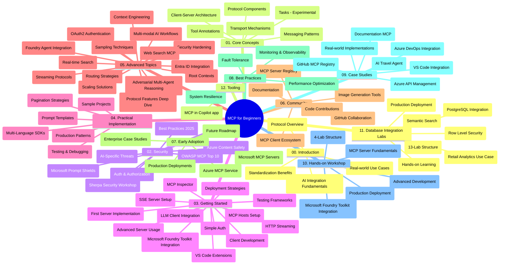

# פרוטוקול הקשר מודל (MCP) למתחילים - מדריך לימודים

מדריך לימודים זה מספק סקירה של מבנה ותוכן המאגר עבור תוכנית הלימודים "פרוטוקול הקשר מודל (MCP) למתחילים". השתמש במדריך זה כדי לנווט במאגר ביעילות ולהפיק את המרב מהמשאבים הזמינים.

## סקירת המאגר

פרוטוקול הקשר מודל (MCP) הוא מסגרת סטנדרטית לאינטראקציות בין מודלים של בינה מלאכותית ליישומי לקוח. נוצר במקור על ידי Anthropic, MCP מתוחזק כיום על ידי קהילת MCP הרחבה דרך ארגון GitHub הרשמי. מאגר זה מספק תוכנית לימודים מקיפה עם דוגמאות קוד מעשיות ב-C#, Java, JavaScript, Python ו-TypeScript, המיועדת למפתחי AI, ארכיטקטים של מערכות ומהנדסי תוכנה.

## מפת תוכנית לימודים חזותית

## מבנה המאגר

המאגר מאורגן לשנים עשר חלקים עיקריים, כל אחד מתמקד בהיבטים שונים של MCP:

1. **הקדמה (00-Introduction/)**
   - סקירה של פרוטוקול הקשר מודל
   - מדוע סטנדרטיזציה חשובה בצינורות AI
   - מקרים ויישומים מעשיים ויתרונותיהם

2. **מושגי יסוד (01-CoreConcepts/)**
   - ארכיטקטורת לקוח-שרת
   - רכיבים מרכזיים בפרוטוקול
   - דפוסי הודעות ב-MCP
   - המפרט הנוכחי: [מה השתנה ב-MCP: מפרט 2026-07-28](./01-CoreConcepts/mcp-2026-07-28.md) — ליבת פרוטוקול ללא סטייט, מסגרת הרחבות, והפקעות השורשים / דגימה / רישום

3. **אבטחה (02-Security/)**
   - איומי אבטחה במערכות מבוססות MCP
   - שיטות מומלצות לאבטחת יישומים
   - אסטרטגיות אימות והרשאה
   - דוגמה מעשית לאימות [CIMD ו-DCR](./02-Security/samples/cimd-dcr-auth/README.md)
   - **תיעוד אבטחה מקיף**:
     - שיטות אבטחה מומלצות ל-MCP
     - מדריך יישום Azure Content Safety
     - בקרים וטכניקות אבטחה ל-MCP
     - הפניה מהירה לשיטות מומלצות ל-MCP
   - **נושאי אבטחה מרכזיים**:
     - התקפות הזרקת פרומפט ורעלת כלים
     - חטיפת מושב ובעיות נציג מבולבל
     - פרצות מעבר אסימון
     - הרשאות מופרזות ובקרת גישה
     - אבטחת שרשרת אספקה לרכיבי AI
     - אינטגרציית Microsoft Prompt Shields

4. **התחלה מהירה (03-GettingStarted/)**
   - הקמת סביבה וקונפיגורציה
   - יצירת שרתי ולקוחות MCP בסיסיים
   - אינטגרציה עם יישומים קיימים
   - כולל סקטורים עבור:
     - מימוש שרת ראשון
     - פיתוח לקוח
     - אינטגרציית לקוח LLM
     - אינטגרציית VS Code
     - שרת אירועים נשלחים (SSE)
     - שימוש מתקדם בשרת
     - סטרימינג HTTP
    - אינטגרציית Microsoft Foundry Toolkit
     - אסטרטגיות בדיקות
     - הנחיות לפריסה

5. **מימוש מעשי (04-PracticalImplementation/)**
   - שימוש ב-SDKs בשפות תכנות שונות
   - טכניקות דיבוג, בדיקות ואימות
   - יצירת תבניות פרומפט וזרימות עבודה לשימוש חוזר
   - פרויקטים לדוגמה עם דוגמאות מימוש

6. **נושאים מתקדמים (05-AdvancedTopics/)**
   - טכניקות הנדסת הקשר
   - אינטגרציית סוכן Foundry
   - זרימות עבודה מולטי-מודל של AI
   - הדגמות אימות OAuth2
   - יכולות חיפוש בזמן אמת
   - סטרימינג בזמן אמת
   - מימוש הקשרים שורשיים
   - אסטרטגיות ניתוב
   - טכניקות דגימה
   - גישות סקלינג
   - שיקולי אבטחה
   - אינטגרציית אבטחה עם Entra ID
   - אינטגרציית חיפוש באינטרנט
   - חשיבה רב-סוכנית עוינת (דפוסי וויכוח)

7. **תרומות קהילתיות (06-CommunityContributions/)**
   - כיצד לתרום קוד ותיעוד
   - שיתוף פעולה דרך GitHub
   - שיפורים והערות מונחות קהילה
   - שימוש בלקוחות MCP שונים (Claude Desktop, Cline, VSCode)
   - עבודה עם שרתי MCP פופולריים כולל יצירת תמונות

8. **לקחים מאימוץ מוקדם (07-LessonsfromEarlyAdoption/)**
   - מימושים מהעולם האמיתי וסיפורי הצלחה
   - בנייה ופריסה של פתרונות מבוססי MCP
   - מגמות ומפת דרכים עתידית
   - **מדריך שרתי MCP של מיקרוסופט**: מדריך מקיף ל-10 שרתי MCP מוכנים לייצור של מיקרוסופט כולל:
     - שרת Microsoft Learn Docs MCP
     - שרת Azure MCP (15+ מחברים מיוחדים)
     - שרת GitHub MCP
     - שרת Azure DevOps MCP
     - שרת MarkItDown MCP
     - שרת SQL Server MCP
     - שרת Playwright MCP
     - שרת Dev Box MCP
     - שרת Microsoft Foundry MCP
     - שרת Microsoft 365 Agents Toolkit MCP

9. **שיטות מיטביות (08-BestPractices/)**
   - כיוונון ביצועים ואופטימיזציה
   - תכנון מערכות MCP עמידות לתקלות
   - אסטרטגיות בדיקה ועמידות

10. **מקרי מבחן (09-CaseStudy/)**
    - **שבע מקרי מבחן מקיפים** המדגימים וורסטיליות של MCP בתרחישים מגוונים:
    - **סוכני נסיעות בינה מלאכותית של Azure**: תזמור מולטי סוכנים עם Azure OpenAI ו-AI Search
    - **אינטגרציית Azure DevOps**: אוטומציה של תהליכי זרימה עם עדכוני נתונים מ-YouTube
    - **שליפת מסמכים בזמן אמת**: לקוח קונסול פייתון עם סטרימינג HTTP
    - **מחולל תוכניות לימוד אינטראקטיבי**: אפליקציית רשת Chainlit עם בינה שיח
    - **תיעוד בתוך עורך**: אינטגרציית VS Code עם זרימות עבודה של GitHub Copilot
    - **ניהול API של Azure**: אינטגרציית API ארגונית עם יצירת שרת MCP
    - **רישום MCP של GitHub**: פלטפורמת פיתוח אקוסיסטם ואינטגרציית סוכנים
    - דוגמאות מימוש המשתרעות על אינטגרציית ארגונים, פרודוקטיביות מפתחים ופיתוח אקוסיסטם

11. **סדנת עבודה מעשית (10-StreamliningAIWorkflowsBuildingAnMCPServerWithAIToolkit/)**
    - סדנת עבודה מעשית מקיפה המשולבת עם Microsoft Foundry Toolkit
    - בניית יישומים אינטליגנטיים המחברים בין מודלי AI לכלים מהעולם האמיתי
    - מודולים מעשיים הכוללים יסודות, פיתוח שרת מותאם ואסטרטגיות פריסה בייצור
    - **מבנה המעבדה**:
      - מעבדה 1: יסודות שרת MCP
      - מעבדה 2: פיתוח שרת MCP מתקדם
      - מעבדה 3: אינטגרציית Microsoft Foundry Toolkit
      - מעבדה 4: פריסה וסקיילינג בייצור
    - גישת למידה מבוססת מעבדה עם הוראות צעד-אחר-צעד

12. **מעבדות אינטגרציית בסיס נתונים לשרת MCP (11-MCPServerHandsOnLabs/)**
    - **נתיב למידה מקיף של 13 מעבדות** לבניית שרתי MCP מוכנים לייצור עם אינטגרציה ל-PostgreSQL
    - **מימוש ניתוחי קמעונאות מהעולם האמיתי** באמצעות מקרה שימוש Zava Retail
    - **דפוסי ארגונים ברמה ארגונית** כולל אבטחת שורת שורות (RLS), חיפוש סמנטי, וגישה מרובת שוכרים לנתונים
    - **מבנה מעבדות מלא**:
      - **מעבדות 00-03: יסודות** - הקדמה, ארכיטקטורה, אבטחה, הקמת סביבה
      - **מעבדות 04-06: בניית שרת MCP** - תכנון בסיס נתונים, מימוש שרת MCP, פיתוח כלים
      - **מעבדות 07-09: תכונות מתקדמות** - חיפוש סמנטי, בדיקות ודיבוג, אינטגרציית VS Code
      - **מעבדות 10-12: ייצור ושיטות מיטביות** - פריסה, ניטור, אופטימיזציה
    - **טכנולוגיות מכוסות**: מסגרת FastMCP, PostgreSQL, Azure OpenAI, Azure Container Apps, Application Insights
    - **תוצאות למידה**: שרתי MCP מוכנים לייצור, דפוסי אינטגרציית בסיסי נתונים, אנליטיקה מונעת AI, אבטחה ארגונית

13. **כלי עבודה (12-tooling/)**
    - ללמוד כיצד להשתמש ב-MCP באפליקציית Copilot וכלים אחרים

## משאבים נוספים

המאגר כולל משאבים תומכים:

- **תיקיית תמונות**: מכילה דיאגרמות והמחשות המשמשות לאורך כל תוכנית הלימודים
- **תרגומים**: תמיכה בריבוי שפות עם תרגומים אוטומטיים של תיעוד
- **משאבים רשמיים של MCP**:
  - [תיעוד MCP](https://modelcontextprotocol.io/)
  - [מפרט MCP](https://modelcontextprotocol.io/specification/2026-07-28/)
  - [מאגר GitHub של MCP](https://github.com/modelcontextprotocol)

## כיצד להשתמש במאגר זה

1. **למידה רציפה**: עקוב אחרי הפרקים לפי הסדר (00 עד 11) לחוויית למידה ממובנית.
2. **מוקד שפת תכנות ספציפית**: אם אתה מעוניין בשפת תכנות מסוימת, חקור את תיקיות הדוגמאות עבור יישומים בשפה המועדפת עליך.
3. **מימוש מעשי**: התחל בסעיף "התחלה מהירה" להקמת הסביבה שלך וליצירת שרת ולקוח MCP ראשונים.
4. **חקירה מתקדמת**: לאחר שתהיה בנוח עם היסודות, העמק לנושאים המתקדמים להרחבת הידע.
5. **מעורבות קהילתית**: הצטרף לקהילת MCP דרך דיונים ב-GitHub וערוצי Discord כדי להתחבר למומחים ולמפתחים נוספים.

## לקוחות וכלי MCP

תוכנית הלימודים כוללת לקוחות וכלים שונים של MCP:

1. **לקוחות רשמיים**:
   - Visual Studio Code
   - MCP ב-Visual Studio Code
   - Claude Desktop
   - Claude ב-VSCode
   - Claude API

2. **לקוחות קהילתיים**:
   - Cline (ממשק טרמינל)
   - Cursor (עורך קוד)
   - ChatMCP
   - Windsurf

3. **כלי ניהול MCP**:
   - MCP CLI
   - MCP Manager
   - MCP Linker
   - MCP Router

## שרתי MCP פופולריים

המאגר מציג שרתי MCP שונים, כולל:

1. **שרתי MCP רשמיים של מיקרוסופט**:
   - שרת Microsoft Learn Docs MCP
   - שרת Azure MCP (15+ מחברים מיוחדים)
   - שרת GitHub MCP
   - שרת Azure DevOps MCP
   - שרת MarkItDown MCP
   - שרת SQL Server MCP
   - שרת Playwright MCP
   - שרת Dev Box MCP
   - שרת Microsoft Foundry MCP
   - שרת Microsoft 365 Agents Toolkit MCP

2. **שרתי הפניה רשמיים**:
   - מערכת קבצים
   - Fetch
   - זיכרון
   - חשיבה רציפה

3. **יצירת תמונות**:
   - Azure OpenAI DALL-E 3
   - Stable Diffusion WebUI
   - Replicate

4. **כלי פיתוח**:
   - Git MCP
   - שליטה בטרמינל
   - עוזר קוד

5. **שרתים מיוחדים**:
   - Salesforce
   - Microsoft Teams
   - Jira & Confluence

## תרומה

מאגר זה מקבל בברכה תרומות מהקהילה. ראה את סעיף תרומות קהילתיות לקבלת הכוונה כיצד לתרום בצורה יעילה לאקוסיסטם של MCP.

----

*מדריך לימודים זה עודכן לאחרונה ב-9 בספטמבר 2026. הוא משקף את מפרט MCP
`2026-07-28`, גרסת הפרוטוקול הנוכחית. חלק מהדוגמאות הפרקטיות
נשארות מפורשות בגרסה `2025-11-25` בעוד ש-SDKs וכלים אימצו את ממשקי ה-API של פרוטוקול ללא סטייט.*
לאמץ את ממשקי ה-API חסרי המצב.*

---

<!-- CO-OP TRANSLATOR DISCLAIMER START -->
**כתב ויתור**:
מסמך זה תורגם באמצעות שירות תרגום אוטומטי [Co-op Translator](https://github.com/Azure/co-op-translator). למרות שאנו שואפים לדיוק, יש לקחת בחשבון שתרגומים אוטומטיים עלולים להכיל שגיאות או אי-דיוקים. יש להחשיב את המסמך המקורי בשפתו הטבעית כמקור הסמכות. למידע קריטי מומלץ להשתמש בתרגום מקצועי על ידי מתרגם אדם. אנו לא אחראים לכל אי-הבנה או פירוש שגוי הנובע מהשימוש בתרגום זה.
<!-- CO-OP TRANSLATOR DISCLAIMER END -->