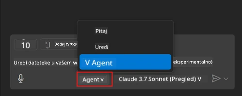
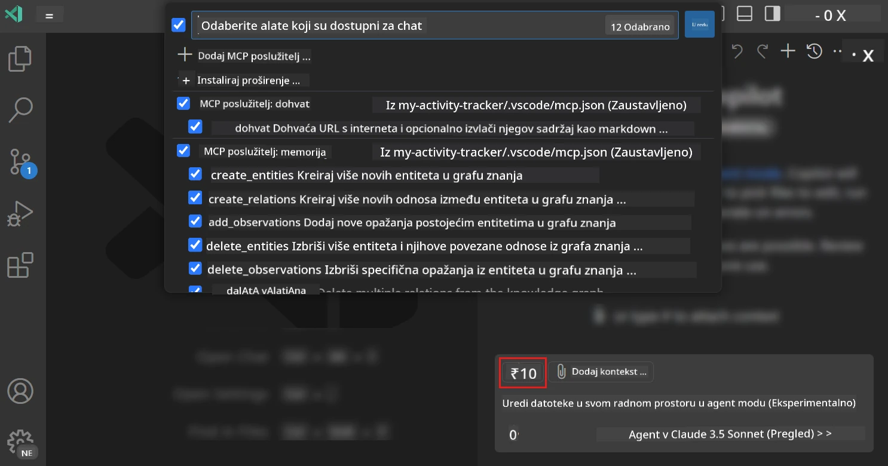
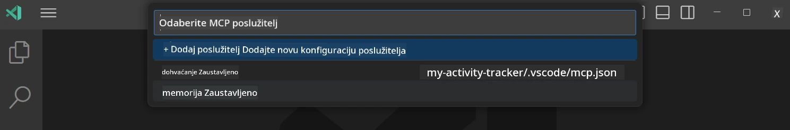
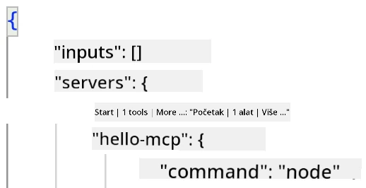
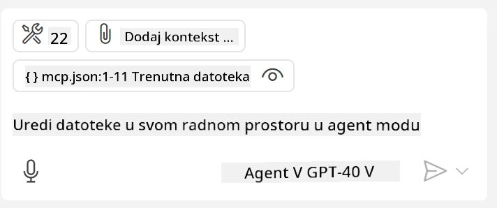
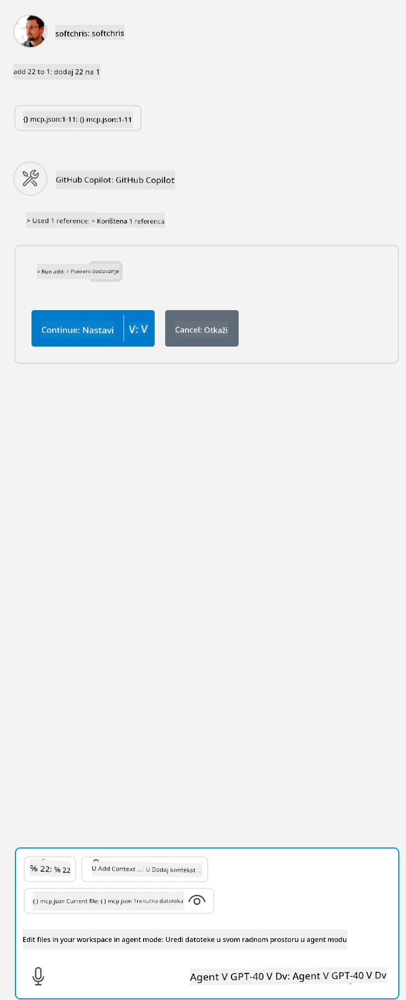

# Korištenje servera iz načina rada GitHub Copilot Agenta

Visual Studio Code i GitHub Copilot mogu djelovati kao klijent i koristiti MCP Server. Možda se pitate zašto bismo to željeli? Pa, to znači da se sve značajke MCP Servera sada mogu koristiti unutar vašeg IDE-a. Zamislite, primjerice, da dodate GitHubov MCP server, to bi omogućilo upravljanje GitHubom putem naredbi preko prompta umjesto tipkanja specifičnih naredbi u terminalu. Ili zamislite bilo što što bi moglo poboljšati vaše programersko iskustvo, a sve kontrolirano prirodnim jezikom. Sad već vidite prednosti, zar ne?

## Pregled

Ova lekcija pokriva kako koristiti Visual Studio Code i GitHub Copilot Agent način rada kao klijenta za vaš MCP Server.

## Ciljevi učenja

Do kraja ove lekcije, moći ćete:

- Koristiti MCP Server putem Visual Studio Code-a.
- Pokretati funkcionalnosti poput alata putem GitHub Copilota.
- Konfigurirati Visual Studio Code za pronalazak i upravljanje vašim MCP Serverom.

## Upotreba

MCP server možete kontrolirati na dva različita načina:

- Korisničko sučelje, vidjet ćete kako se to radi kasnije u ovom poglavlju.
- Terminal, moguće je upravljati stvarima iz terminala koristeći izvršnu datoteku `code`:

  Za dodavanje MCP servera u vaš korisnički profil, upotrijebite opciju naredbenog retka --add-mcp, i navedite konfiguraciju servera u JSON obliku {\"name\":\"server-name\",\"command\":...}.

  ```
  code --add-mcp "{\"name\":\"my-server\",\"command\": \"uvx\",\"args\": [\"mcp-server-fetch\"]}"
  ```

### Snimke zaslona





Razgovarajmo više o tome kako koristiti vizualno sučelje u sljedećim odjeljcima.

## Pristup

Evo kako trebamo pristupiti ovome na visokoj razini:

- Konfigurirati datoteku za pronalazak MCP Servera.
- Pokrenuti/Povezati se na navedeni server da bi prikazao svoje mogućnosti.
- Koristiti te mogućnosti putem GitHub Copilot Chat sučelja.

Odlično, sada kada razumijemo tok, probajmo koristiti MCP Server kroz Visual Studio Code kroz vježbu.

## Vježba: Korištenje servera

U ovoj vježbi ćemo konfigurirati Visual Studio Code da pronađe vaš MCP server kako bi se mogao koristiti iz GitHub Copilot Chat sučelja.

### -0- Pripremni korak, omogućite otkrivanje MCP Servera

Možda ćete trebati omogućiti otkrivanje MCP Servera.

1. Idite na `File -> Preferences -> Settings` u Visual Studio Code-u.

1. Potražite "MCP" i omogućite `chat.mcp.discovery.enabled` u datoteci settings.json.

### -1- Izrada konfiguracijske datoteke

Počnite s izradom konfiguracijske datoteke u korijenu vašeg projekta, trebat će vam datoteka nazvana MCP.json koju trebate smjestiti u mapu .vscode. Trebala bi izgledati ovako:

```text
.vscode
|-- mcp.json
```

Sljedeće, pogledajmo kako možemo dodati unos servera.

### -2- Konfiguracija servera

Dodajte sljedeći sadržaj u *mcp.json*:

```json
{
    "inputs": [],
    "servers": {
       "hello-mcp": {
           "command": "node",
           "args": [
               "build/index.js"
           ]
       }
    }
}
```

Gore je jednostavan primjer kako pokrenuti server napisan u Node.js, za druge runtimeove navedite odgovarajuću naredbu za pokretanje servera koristeći `command` i `args`.

### -3- Pokretanje servera

Sada kada ste dodali unos, pokrenimo server:

1. Pronađite vaš unos u *mcp.json* i provjerite postoji li ikona "play":

    

1. Kliknite na ikonu "play", trebali biste vidjeti da se ikona alata u GitHub Copilot Chat-u poveća broj dostupnih alata. Ako kliknete na spomenutu ikonu alata, vidjet ćete listu registriranih alata. Možete označiti ili ukloniti oznaku svakom alatu ovisno želite li da ih GitHub Copilot koristi kao kontekst:

  

1. Za pokretanje alata, upišite prompt za koji znate da će odgovarati opisu jednog od vaših alata, na primjer prompt poput "add 22 to 1":

  

  Trebali biste vidjeti odgovor koji kaže 23.

## Zadatak

Pokušajte dodati unos servera u vašu *mcp.json* datoteku i osigurajte da možete pokrenuti/zaustaviti server. Također se uvjerite da možete komunicirati s alatima na vašem serveru putem GitHub Copilot Chat sučelja.

## Rješenje

[Rješenje](./solution/README.md)

## Ključne spoznaje

Zaključci iz ovog poglavlja su sljedeći:

- Visual Studio Code je izvrstan klijent koji vam omogućuje upotrebu različitih MCP servera i njihovih alata.
- GitHub Copilot Chat sučelje je način na koji koristite servere.
- Možete od korisnika zatražiti unose poput API ključeva koji se mogu proslijediti MCP Serveru prilikom konfiguracije unosa servera u *mcp.json* datoteku.

## Primjeri

- [Java kalkulator](../samples/java/calculator/README.md)
- [.NET kalkulator](../../../../03-GettingStarted/samples/csharp)
- [JavaScript kalkulator](../samples/javascript/README.md)
- [TypeScript kalkulator](../samples/typescript/README.md)
- [Python kalkulator](../../../../03-GettingStarted/samples/python)

## Dodatni resursi

- [Visual Studio dokumentacija](https://code.visualstudio.com/docs/copilot/chat/mcp-servers)

## Što slijedi

- Sljedeće: [Kreiranje stdio servera](../05-stdio-server/README.md)

---

<!-- CO-OP TRANSLATOR DISCLAIMER START -->
**Napomena**:
Ovaj dokument je preveden korištenjem AI prevoditeljskog servisa [Co-op Translator](https://github.com/Azure/co-op-translator). Iako težimo točnosti, imajte na umu da automatski prijevodi mogu sadržavati greške ili netočnosti. Izvorni dokument na izvornom jeziku treba smatrati autoritativnim izvorom. Za važne informacije preporuča se profesionalni ljudski prijevod. Nismo odgovorni za bilo kakva nesporazumevanja ili pogrešne interpretacije koje proizlaze iz korištenja ovog prijevoda.
<!-- CO-OP TRANSLATOR DISCLAIMER END -->