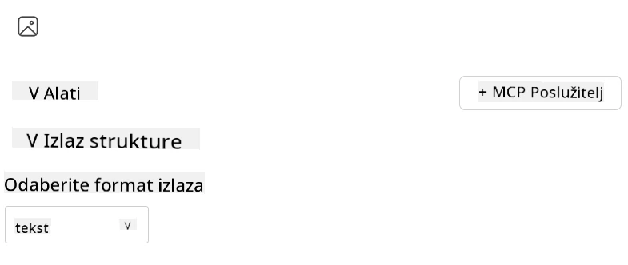
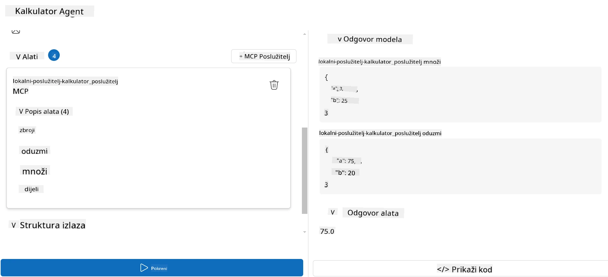

# Korištenje servera s Microsoft Foundry Toolkitom za Visual Studio Code

Kada gradite AI agenta, nije riječ samo o generiranju pametnih odgovora; također je važno omogućiti agentu sposobnost djelovanja. Tu dolazi u igru Model Context Protocol (MCP). MCP olakšava agentima pristup vanjskim alatima i uslugama na dosljedan način. Zamislite to kao povezivanje vašeg agenta u alatni set koji on *zaista* može koristiti.

Recimo da povežete agenta na MCP server kalkulatora. Odjednom, vaš agent može izvoditi matematičke operacije samo primanjem upita poput "Koliko je 47 puta 89?" — bez potrebe za tvrdo kodiranom logikom ili izradom prilagođenih API-ja.

## Pregled

Ova lekcija obuhvaća kako povezati kalkulator MCP server sa agentom koristeći
[Microsoft Foundry Toolkit za Visual Studio Code](https://aka.ms/AIToolkit),
omogućujući vašem agentu izvođenje matematičkih operacija kroz prirodni jezik.

Microsoft Foundry Toolkit pojednostavljuje razvoj i testiranje generativnih
AI aplikacija s lokalnim i u oblaku hostiranim modelima.

*Napomena*: Toolkit trenutno podržava Python i TypeScript MCP predloške.

## Ciljevi učenja

Na kraju ove lekcije, moći ćete:

- Koristiti MCP server s Microsoft Foundry Toolkitom.
- Konfigurirati postavke agenta kako biste mu omogućili pronalazak i korištenje alata koje nudi MCP server.
- Koristiti MCP alate putem prirodnog jezika.

## Pristup

Evo kako trebamo pristupiti ovom zadatku na visokoj razini:

- Kreirati agenta i definirati njegov sistemski prompt.
- Kreirati MCP server s alatima za kalkulator.
- Povezati Agent Builder s MCP serverom.
- Testirati pozivanje alata agenta putem prirodnog jezika.

Odlično, sada kada razumijemo tijek, konfigurirajmo AI agenta da koristi vanjske alate preko MCP-a, povećavajući njegove sposobnosti!

## Preduvjeti

- [Visual Studio Code](https://code.visualstudio.com/)
- [Microsoft Foundry Toolkit za Visual Studio Code](https://aka.ms/AIToolkit)

## Vježba: Korištenje servera

> [!WARNING]
> Napomena za korisnike macOS-a. Trenutno istražujemo problem koji utječe na instalaciju ovisnosti na macOS-u. Stoga korisnici macOS-a trenutno neće moći završiti ovaj vodič. Ažurirat ćemo upute čim bude dostupan popravak. Hvala na strpljenju i razumijevanju!

U ovoj vježbi ćete izgraditi, pokrenuti i poboljšati AI agenta s alatima s
MCP servera unutar Visual Studio Code-a koristeći Microsoft Foundry Toolkit.

### -0- Priprema, dodavanje Microsoft Foundry GPT-5.1 implementacije

Kreirajte Microsoft Foundry resurs, implementirajte **GPT-5.1** i dodajte implementaciju
u **Moje modele**. Pregledajte
[raspored povlačenja modela](https://learn.microsoft.com/azure/foundry/openai/concepts/model-retirement-schedule)
prilikom odabira implementacije.

1. Otvorite **Microsoft Foundry Toolkit** s **Trake aktivnosti**.
1. U odjeljku **Katalog** odaberite **Modele** da otvorite **Katalog modela**. Odabir **Modela** otvara **Katalog modela** u novom kartici uređivača.
1. Povežite svoj Microsoft Foundry projekt i odaberite svoju **GPT-5.1** implementaciju.
1. Kliknite **+ Dodaj** za dodavanje implementacije na popis **Moji modeli**.
1. Na **Traci aktivnosti** potvrdite da se implementacija pojavljuje na popisu.

### -1- Kreiranje agenta

**Agent (Prompt) Builder** omogućuje vam kreiranje i prilagodbu AI agenata po vašem izboru. U ovom dijelu ćete stvoriti novog agenta i dodijeliti model koji će pokretati razgovor.

1. Otvorite **Microsoft Foundry Toolkit** s **Trake aktivnosti**.
1. U odjeljku **Alati** odaberite **Agent (Prompt) Builder**. Odabir **Agent (Prompt) Builder** otvara ga u novom kartici uređivača.
1. Kliknite gumb **+ Novi agent**. Ekstenzija će pokrenuti čarobnjak za postavljanje putem **Command Palette**.
1. Unesite naziv **Calculator Agent** i pritisnite **Enter**.
1. U **Agent (Prompt) Builder** odaberite vašu **GPT-5.1** Foundry implementaciju.

### -2- Kreiranje sistemskog prompta za agenta

Nakon što je agent postavljen, vrijeme je definirati njegovu osobnost i svrhu. U ovom dijelu ćete koristiti značajku **Generiraj sistemski prompt** kako biste opisali namjeravano ponašanje agenta – u ovom slučaju kalkulatorskog agenta – i omogućiti modelu da napiše sistemski prompt za vas.

1. U odjeljku **Promptovi** kliknite gumb **Generiraj sistemski prompt**. Ovaj gumb otvara builder prompta koji koristi AI za generiranje sistemskog prompta za agenta.
1. U prozoru **Generiraj prompt** unesite sljedeće: `You are a helpful and efficient math assistant. When given a problem involving basic arithmetic, you respond with the correct result.`
1. Kliknite gumb **Generiraj**. Obavijest će se pojaviti u donjem desnom kutu potvrđujući da se sistemski prompt generira. Kada je generiranje prompta završeno, prompt će se pojaviti u polju **Sistemski prompt** u **Agent (Prompt) Builderu**.
1. Pregledajte **Sistemski prompt** i po potrebi izmijenite.

### -3- Kreiranje MCP servera

Sad kad ste definirali sistemski prompt agenta – koji usmjerava njegovo ponašanje i odgovore – vrijeme je opremiti agenta praktičnim sposobnostima. U ovom dijelu ćete stvoriti kalkulatorski MCP server s alatima za izvođenje zbrajanja, oduzimanja, množenja i dijeljenja. Ovaj server će omogućiti vašem agentu da izvodi matematičke operacije u stvarnom vremenu kao odgovor na upite prirodnim jezikom.



Microsoft Foundry Toolkit uključuje predloške za izradu MCP servera. Koristit ćemo
Python predložak za kalkulatorski MCP server.

*Napomena*: Toolkit trenutno podržava Python i TypeScript MCP predloške.

1. U odjeljku **Alati** u **Agent (Prompt) Builderu**, kliknite gumb **+ MCP Server**. Ekstenzija će pokrenuti čarobnjak za postavljanje putem **Command Palette**.
1. Odaberite **+ Dodaj server**.
1. Odaberite **Kreiraj novi MCP server**.
1. Odaberite **python-weather** kao predložak.
1. Odaberite **Zadani direktorij** za spremanje MCP server predloška.
1. Unesite sljedeći naziv servera: **Calculator**
1. Otvorit će se novi prozor Visual Studio Code-a. Odaberite **Da, vjerujem autorima**.
1. Koristeći terminal (**Terminal** > **Novi terminal**), kreirajte virtualno okruženje: `python -m venv .venv`
1. Koristeći terminal, aktivirajte virtualno okruženje:
    1. Windows - `.venv\Scripts\activate`
    1. macOS/Linux - `source .venv/bin/activate`
1. Koristeći terminal, instalirajte ovisnosti: `pip install -e .[dev]`
1. U prikazu **Explorer** na **Traci aktivnosti**, proširite direktorij **src** i odaberite **server.py** za otvaranje datoteke u uređivaču.
1. Zamijenite kod u datoteci **server.py** sa sljedećim i spremite:

    ```python
    """
    Sample MCP Calculator Server implementation in Python.

    
    This module demonstrates how to create a simple MCP server with calculator tools
    that can perform basic arithmetic operations (add, subtract, multiply, divide).
    """
    
    from mcp.server.fastmcp import FastMCP
    
    server = FastMCP("calculator")
    
    @server.tool()
    def add(a: float, b: float) -> float:
        """Add two numbers together and return the result."""
        return a + b
    
    @server.tool()
    def subtract(a: float, b: float) -> float:
        """Subtract b from a and return the result."""
        return a - b
    
    @server.tool()
    def multiply(a: float, b: float) -> float:
        """Multiply two numbers together and return the result."""
        return a * b
    
    @server.tool()
    def divide(a: float, b: float) -> float:
        """
        Divide a by b and return the result.
        
        Raises:
            ValueError: If b is zero
        """
        if b == 0:
            raise ValueError("Cannot divide by zero")
        return a / b
    ```

### -4- Pokretanje agenta s kalkulatorskim MCP serverom

Sada kada agent ima alate, vrijeme je da ih iskoristite! U ovom dijelu ćete dodavati upite agentu kako biste testirali i potvrdili koristi li agent odgovarajući alat s kalkulatorskog MCP servera.



Pokrenut ćete kalkulatorski MCP server na svom lokalnom razvojnome računalu putem **Agent Buildera** kao MCP klijenta.

1. Pritisnite `F5` za pokretanje otklanjanja pogrešaka na MCP serveru. **Agent (Prompt) Builder** otvara se u novom kartici uređivača. Status servera vidljiv je u terminalu.
1. U polje **Korisnički prompt** u **Agent (Prompt) Builderu**, unesite sljedeći upit: `I bought 3 items priced at $25 each, and then used a $20 discount. How much did I pay?`
1. Kliknite gumb **Pokreni** za generiranje odgovora agenta.
1. Pregledajte izlaz agenta. Model bi trebao zaključiti da ste platili **55 $**.
1. Evo pregleda što bi se trebalo dogoditi:
    - Agent odabire alate **multiply** i **subtract** kako bi pomogao u računanju.
    - Odgovarajuće vrijednosti `a` i `b` dodjeljuju se za alat **multiply**.
    - Odgovarajuće vrijednosti `a` i `b` dodjeljuju se za alat **subtract**.
    - Odgovori svakog alata prikazuju se u pripadajućem polju **Odgovor alata**.
    - Završni rezultat modela prikazan je u konačnom **Odgovoru modela**.
1. Pošaljite dodatne upite za daljnje testiranje agenta. Možete izmijeniti postojeći upit u polju **Korisnički prompt** klikom u polje i zamjenom upita.
1. Kad završite testiranje agenta, možete zaustaviti server putem **terminala** pritiskom na **CTRL/CMD+C** za izlazak.

## Zadatak

Pokušajte dodati dodatni ulaz za alat u datoteku **server.py** (npr. izračunati kvadratni korijen broja). Pošaljite dodatne upite za koje bi agent morao iskoristiti novi alat (ili postojeće alate). Obavezno ponovo pokrenite server da bi se učitali novododani alati.

## Rješenje

[Rješenje](./solution/README.md)

## Ključni zaključci

Zaključci iz ovog poglavlja su sljedeći:

- Microsoft Foundry Toolkit može koristiti MCP servere i njihove alate.
- Možete dodavati nove alate MCP serverima, šireći sposobnosti agenta za ispunjavanje novih zahtjeva.
- Microsoft Foundry Toolkit uključuje MCP predloške servera za izradu prilagođenih alata.

## Dodatni resursi

- [Dokumentacija Microsoft Foundry Toolkita](https://aka.ms/AIToolkit/doc)

## Što dalje
- Sljedeće: [Testiranje i otklanjanje pogrešaka](../08-testing/README.md)

---

<!-- CO-OP TRANSLATOR DISCLAIMER START -->
**Napomena**:
Ovaj dokument je preveden korištenjem AI prevoditeljskog servisa [Co-op Translator](https://github.com/Azure/co-op-translator). Iako težimo točnosti, imajte na umu da automatski prijevodi mogu sadržavati greške ili netočnosti. Izvorni dokument na izvornom jeziku treba smatrati autoritativnim izvorom. Za važne informacije preporuča se profesionalni ljudski prijevod. Nismo odgovorni za bilo kakva nesporazumevanja ili pogrešne interpretacije koje proizlaze iz korištenja ovog prijevoda.
<!-- CO-OP TRANSLATOR DISCLAIMER END -->