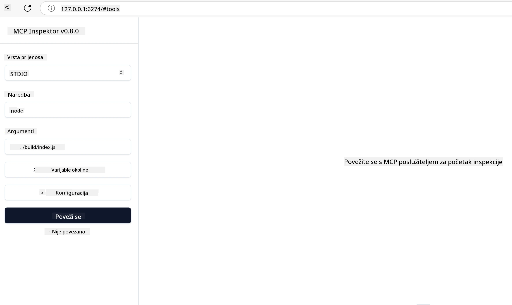

## Testiranje i otklanjanje pogrešaka

Prije nego što započnete testiranje vašeg MCP servera, važno je razumjeti dostupne alate i najbolje prakse za otklanjanje pogrešaka. Učinkovito testiranje osigurava da se vaš server ponaša kako se očekuje i pomaže vam da brzo identificirate i riješite probleme. Sljedeći odjeljak opisuje preporučene pristupe za validaciju vaše MCP implementacije.

## Pregled

Ova lekcija obuhvaća kako odabrati pravi pristup testiranju i najučinkovitiji alat za testiranje.

## Ciljevi učenja

Do kraja ove lekcije moći ćete:

- Opisati različite pristupe testiranju.
- Koristiti različite alate za učinkovito testiranje vašeg koda.


## Testiranje MCP servera

MCP pruža alate koji će vam pomoći u testiranju i otklanjanju pogrešaka vaših servera:

- **MCP Inspector**: Alat za komandnu liniju koji se može pokrenuti i kao CLI alat i kao vizualni alat.
- **Ručno testiranje**: Možete koristiti alat poput curl za pokretanje web zahtjeva, ali bilo koji alat sposoban za HTTP će biti dovoljan.
- **Jedinično testiranje**: Moguće je koristiti vaš omiljeni okvir za testiranje za testiranje značajki kako servera tako i klijenta.

### Korištenje MCP Inspectora

Opisali smo upotrebu ovog alata u prijašnjim lekcijama, ali hajde da ga malo općenito predstavimo. To je alat izgrađen u Node.js i možete ga koristiti tako da pozovete izvršnu datoteku `npx` koja će privremeno preuzeti i instalirati sam alat te se očistiti kada završi s obradom vašeg zahtjeva.

[MCP Inspector](https://github.com/modelcontextprotocol/inspector) vam pomaže:

- **Otkrivanje mogućnosti servera**: Automatski otkriva dostupne resurse, alate i prompte
- **Testiranje izvršenja alata**: Isprobajte različite parametre i vidite odgovore u stvarnom vremenu
- **Pregled metapodataka servera**: Pregledajte informacije o serveru, sheme i konfiguracije

Tipično pokretanje alata izgleda ovako:

```bash
npx @modelcontextprotocol/inspector node build/index.js
```

Gornja naredba pokreće MCP i njegov vizualni sučelje te otvara lokalno web sučelje u vašem pregledniku. Možete očekivati da vidite nadzornu ploču koja prikazuje vaše registrirane MCP servere, njihove dostupne alate, resurse i prompte. Sučelje vam omogućuje interaktivno testiranje izvršenja alata, pregled metapodataka servera i gledanje odgovora u stvarnom vremenu, što olakšava validaciju i otklanjanje pogrešaka u implementacijama vašeg MCP servera.

Evo kako to može izgledati: 

Također možete pokrenuti ovaj alat u CLI načinu rada, u kojem slučaju dodajete atribut `--cli`. Evo primjera pokretanja alata u "CLI" načinu koji ispisuje sve alate na serveru:

```sh
npx @modelcontextprotocol/inspector --cli node build/index.js --method tools/list
```

### Ručno testiranje

Osim pokretanja Inspectora za testiranje mogućnosti servera, sličan pristup je pokretanje klijenta sposoban za korištenje HTTP-a, primjerice curl.

Pomoću curl-a možete testirati MCP servere izravno koristeći HTTP zahtjeve:

```bash
# Example: Test server metadata
curl http://localhost:3000/v1/metadata

# Example: Execute a tool
curl -X POST http://localhost:3000/v1/tools/execute \
  -H "Content-Type: application/json" \
  -d '{"name": "calculator", "parameters": {"expression": "2+2"}}'
```

Kao što vidite iz gornje upotrebe curl-a, koristite POST zahtjev za pozivanje alata s uporabom payloada koji se sastoji od imena alata i njegovih parametara. Koristite pristup koji vam najviše odgovara. CLI alati općenito su brži za korištenje i pogodni za skriptiranje, što može biti korisno u CI/CD okruženju.

### Jedinično testiranje

Kreirajte jedinične testove za vaše alate i resurse kako biste osigurali da rade kako se očekuje. Evo primjera koda za testiranje.

```python
import pytest

from mcp.server.fastmcp import FastMCP
from mcp.shared.memory import (
    create_connected_server_and_client_session as create_session,
)

# Mark the whole module for async tests
pytestmark = pytest.mark.anyio


async def test_list_tools_cursor_parameter():
    """Test that the cursor parameter is accepted for list_tools.

    Note: FastMCP doesn't currently implement pagination, so this test
    only verifies that the cursor parameter is accepted by the client.
    """

 server = FastMCP("test")

    # Create a couple of test tools
    @server.tool(name="test_tool_1")
    async def test_tool_1() -> str:
        """First test tool"""
        return "Result 1"

    @server.tool(name="test_tool_2")
    async def test_tool_2() -> str:
        """Second test tool"""
        return "Result 2"

    async with create_session(server._mcp_server) as client_session:
        # Test without cursor parameter (omitted)
        result1 = await client_session.list_tools()
        assert len(result1.tools) == 2

        # Test with cursor=None
        result2 = await client_session.list_tools(cursor=None)
        assert len(result2.tools) == 2

        # Test with cursor as string
        result3 = await client_session.list_tools(cursor="some_cursor_value")
        assert len(result3.tools) == 2

        # Test with empty string cursor
        result4 = await client_session.list_tools(cursor="")
        assert len(result4.tools) == 2
    
```

Prethodni kod radi sljedeće:

- Koristi pytest okvir koji vam omogućuje kreiranje testova kao funkcija i korištenje assert izjava.
- Kreira MCP Server sa dva različita alata.
- Koristi `assert` izjavu za provjeru ispunjenosti određenih uvjeta.

Pogledajte [cijelu datoteku ovdje](https://github.com/modelcontextprotocol/python-sdk/blob/main/tests/client/test_list_methods_cursor.py)

Na temelju navedene datoteke, možete testirati vlastiti server kako biste osigurali da su mogućnosti stvorene kako treba.

Svi glavni SDK imaju slične sekcije za testiranje pa ih možete prilagoditi svom odabranom runtime-u.

## Primjeri 

- [Java Kalkulator](../samples/java/calculator/README.md)
- [.NET Kalkulator](../../../../03-GettingStarted/samples/csharp)
- [JavaScript Kalkulator](../samples/javascript/README.md)
- [TypeScript Kalkulator](../samples/typescript/README.md)
- [Python Kalkulator](../../../../03-GettingStarted/samples/python) 

## Dodatni resursi

- [Python SDK](https://github.com/modelcontextprotocol/python-sdk)

## Što slijedi

- Sljedeće: [Implementacija](../09-deployment/README.md)

---

<!-- CO-OP TRANSLATOR DISCLAIMER START -->
**Napomena**:
Ovaj dokument je preveden korištenjem AI prevoditeljskog servisa [Co-op Translator](https://github.com/Azure/co-op-translator). Iako težimo točnosti, imajte na umu da automatski prijevodi mogu sadržavati greške ili netočnosti. Izvorni dokument na izvornom jeziku treba smatrati autoritativnim izvorom. Za važne informacije preporuča se profesionalni ljudski prijevod. Nismo odgovorni za bilo kakva nesporazumevanja ili pogrešne interpretacije koje proizlaze iz korištenja ovog prijevoda.
<!-- CO-OP TRANSLATOR DISCLAIMER END -->