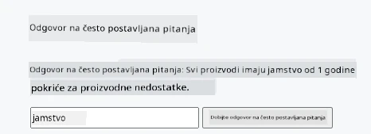
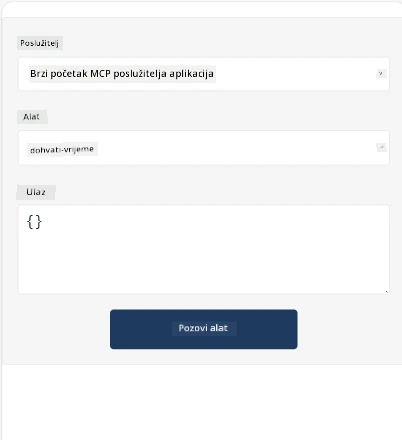
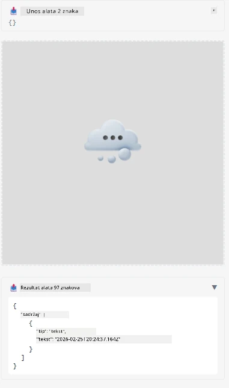

Evo primjera koji pokazuje MCP App

## Instaliraj

1. Navigirajte do mape *mcp-app*
1. Pokrenite `npm install`, to bi trebalo instalirati ovisnosti za frontend i backend

Provjerite kompajlira li backend pokretanjem:

```sh
npx tsc --noEmit
```

Ne bi trebalo biti nikakvog outputa ako je sve u redu.

## Pokreni backend

> Ovo zahtijeva malo dodatnog posla ako koristite Windows stroj jer MCP Apps rješenje koristi `concurrently` biblioteku za pokretanje za koju trebate pronaći zamjenu. Evo problematičnog retka u *package.json* na MCP App:

```json
"start": "concurrently \"cross-env NODE_ENV=development INPUT=mcp-app.html vite build --watch\" \"tsx watch main.ts\""
```

Ova aplikacija ima dva dijela, backend dio i host dio.

Pokrenite backend pozivom:

```sh
npm start
```

Ovo bi trebalo pokrenuti backend na `http://localhost:3001/mcp`.

> Napomena, ako ste u Codespace-u, možda ćete morati postaviti vidljivost porta na javnu. Provjerite možete li doći do endpointa u pregledniku preko https://<name of Codespace>.app.github.dev/mcp

## Opcija -1 Testirajte aplikaciju u Visual Studio Code

Za testiranje rješenja u Visual Studio Code, učinite sljedeće:

- Dodajte unos servera u `mcp.json` ovako:

    ```json
    {
        "servers": {
            "my-mcp-server-7178eca7": {
                "url": "http://localhost:3001/mcp",
                "type": "http"
            }
        },
        "inputs": []
    }
    ```

1. Kliknite gumb "start" u *mcp.json*
1. Provjerite je li otvoren chat prozor i upišite `get-faq`, trebali biste vidjeti rezultat ovako:

    

## Opcija -2- Testirajte aplikaciju s hostom

Repo <https://github.com/modelcontextprotocol/ext-apps> sadrži nekoliko različitih hostova koje možete koristiti za testiranje vaših MVP aplikacija.

Ovdje ćemo vam predstaviti dvije različite opcije:

### Lokalno računalo

- Nakon što ste klonirali repo, navigirajte do *ext-apps*.

- Instalirajte ovisnosti

   ```sh
   npm install
   ```

- U zasebnom terminal prozoru, navigirajte do *ext-apps/examples/basic-host*

    > ako ste u Codespace-u, trebate navigirati do serve.ts i redak 27 te zamijeniti http://localhost:3001/mcp vašim Codespace URL-om za backend, primjerice https://psychic-xylophone-657rpjgvxpc5g64-3001.app.github.dev/mcp

- Pokrenite host:

    ```sh
    npm start
    ```

    Ovo bi trebalo povezati host s backendom i trebali biste vidjeti aplikaciju kako radi ovako:

    

### Codespace

Potreban je malo dodatni posao da bi Codespace okruženje funkcioniralo. Za korištenje hosta kroz Codespace:

- Pogledajte direktorij *ext-apps* i navigirajte do *examples/basic-host*.
- Pokrenite `npm install` za instalaciju ovisnosti
- Pokrenite `npm start` za pokretanje hosta.

## Testirajte aplikaciju

Isprobajte aplikaciju na sljedeći način:

- Odaberite gumb "Call Tool" i trebali biste vidjeti rezultate ovako:

    

Super, sve radi.

---

<!-- CO-OP TRANSLATOR DISCLAIMER START -->
**Napomena**:
Ovaj dokument je preveden korištenjem AI prevoditeljskog servisa [Co-op Translator](https://github.com/Azure/co-op-translator). Iako težimo točnosti, imajte na umu da automatski prijevodi mogu sadržavati greške ili netočnosti. Izvorni dokument na izvornom jeziku treba smatrati autoritativnim izvorom. Za važne informacije preporuča se profesionalni ljudski prijevod. Nismo odgovorni za bilo kakva nesporazumevanja ili pogrešne interpretacije koje proizlaze iz korištenja ovog prijevoda.
<!-- CO-OP TRANSLATOR DISCLAIMER END -->