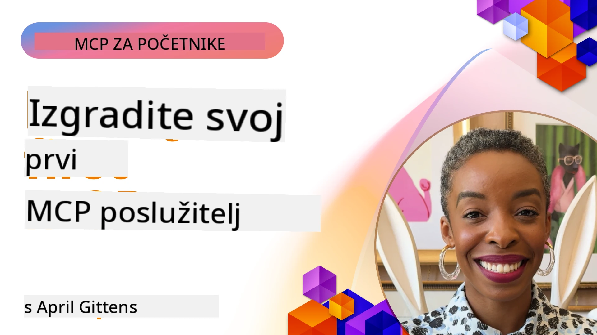

## Početak  

_(Kliknite na sliku iznad za prikaz videa ove lekcije)_

Ovaj odjeljak sastoji se od nekoliko lekcija:

- **1 Vaš prvi poslužitelj**, u ovoj prvoj lekciji naučit ćete kako stvoriti svoj prvi poslužitelj i pregledati ga alatom inspektora, vrijednim načinom testiranja i otklanjanja pogrešaka na vašem poslužitelju, [na lekciju](01-first-server/README.md)

- **2 Klijent**, u ovoj lekciji naučit ćete kako napisati klijenta koji se može povezati s vašim poslužiteljem, [na lekciju](02-client/README.md)

- **3 Klijent s LLM-om**, još bolji način pisanja klijenta je dodavanjem LLM-a kako bi mogao "pregovarati" s vašim poslužiteljem što treba raditi, [na lekciju](03-llm-client/README.md)

- **4 Korištenje načina rada GitHub Copilot Agent poslužitelja u Visual Studio Code-u**. Ovdje pogledamo pokretanje našeg MCP poslužitelja iz Visual Studio Code-a, [na lekciju](04-vscode/README.md)

- **5 stdio Transport poslužitelj** stdio transport je preporučeni standard za lokalnu komunikaciju MCP poslužitelja i klijenta, pružajući sigurnu komunikaciju temeljenu na podprocesima s ugrađenom izolacijom procesa [na lekciju](05-stdio-server/README.md)

- **6 HTTP Streaming s MCP-om (Streamable HTTP)**. Naučite o standardnom
	udaljenom transportu u [MCP specifikaciji 2026-07-28](https://modelcontextprotocol.io/specification/2026-07-28/basic/transports/streamable-http),
	plus naslijeđenoj implementaciji temeljenoj na sesijama zadržanoj u lekciji.
	[na lekciju](06-http-streaming/README.md)

- **7 Korištenje Microsoft Foundry Toolkit-a za Visual Studio Code** za konzumiranje i testiranje vaših MCP klijenata i poslužitelja [u ovoj lekciji](07-aitk/README.md)

- **8 Testiranje**. Ovdje ćemo se posebno usredotočiti na to kako možemo testirati naš poslužitelj i klijenta na različite načine, [na lekciju](08-testing/README.md)

- **9 Implementacija**. Ova poglavlje će pogledati različite načine implementacije vaših MCP rješenja, [na lekciju](09-deployment/README.md)

- **10 Napredno korištenje poslužitelja**. Ovo poglavlje pokriva napredno korištenje poslužitelja, [na lekciju](./10-advanced/README.md)

- **11 Autentifikacija**. Ovo poglavlje pokriva kako dodati jednostavnu autentifikaciju, od osnovne autentifikacije do korištenja JWT-a i RBAC-a. Preporuča se započeti ovdje, a zatim pogledati Napredne teme u Poglavlju 5 i izvršiti dodatno ojačanje sigurnosti putem preporuka iz Poglavlja 2, [na lekciju](./11-simple-auth/README.md)

- **12 MCP domaćini**. Konfigurirajte i koristite popularne MCP klijente domaćina uključujući Claude Desktop, Cursor, Cline i Windsurf. Naučite tipove transporta i otklanjanje poteškoća, [na lekciju](./12-mcp-hosts/README.md)

- **13 MCP Inspektor**. Otklonite pogreške i testirajte svoje MCP poslužitelje interaktivno koristeći alat MCP Inspektor. Naučite otklanjati poteškoće s alatima, resursima i porukama protokola, [na lekciju](./13-mcp-inspector/README.md)

- **14 Uzorkovanje**. Naučite naslijeđenu primitivu uzorkovanja za `2025-11-25` i
	kako migrirati nove dizajne na izravnu integraciju s LLM pružateljima. Uzorkovanje je
	zastarjelo u MCP `2026-07-28`. [na lekciju](./14-sampling/README.md)

- **15 MCP aplikacije**. Izgradite MCP poslužitelje koji također odgovaraju s uputama za korisničko sučelje, [na lekciju](./15-mcp-apps/README.md)

Protokol konteksta modela (MCP) je otvoreni protokol koji standardizira kako aplikacije pružaju kontekst LLM-ovima. Razmislite o MCP-u kao o USB-C priključku za AI aplikacije - pruža standardizirani način povezivanja AI modela s različitim izvorima podataka i alatima.

## Ciljevi učenja

Do kraja ove lekcije moći ćete:

- Postaviti razvojna okruženja za MCP u C#, Javi, Pythonu, TypeScriptu i JavaScriptu
- Izgraditi i implementirati osnovne MCP poslužitelje s prilagođenim značajkama (resursi, upiti i alati)
- Izraditi aplikacije domaćine koje se povezuju s MCP poslužiteljima
- Testirati i otklanjati pogreške MCP implementacija
- Razumjeti uobičajene izazove postavljanja i njihova rješenja
- Povezati vaše MCP implementacije s popularnim LLM servisima

## Postavljanje vašeg MCP okruženja

Prije nego što počnete raditi s MCP-om, važno je pripremiti razvojno okruženje i razumjeti osnovni tijek rada. Ovaj odjeljak će vas voditi kroz početne korake postavljanja kako biste osigurali glatki početak s MCP-om.

### Preduvjeti

Prije nego što započnete razvoj MCP-a, osigurajte da imate:

- **Razvojno okruženje**: Za vaš odabrani jezik (C#, Java, Python, TypeScript ili JavaScript)
- **IDE/Uređivač**: Visual Studio, Visual Studio Code, IntelliJ, Eclipse, PyCharm ili bilo koji moderan uređivač koda
- **Upravitelji paketa**: NuGet, Maven/Gradle, pip ili npm/yarn
- **API ključevi**: Za bilo koje AI servise koje planirate koristiti u vašim aplikacijama domaćinima

### Službeni SDK-ovi

U nadolazećim poglavljima ćete vidjeti rješenja izrađena koristeći Python, TypeScript,
Javu i .NET. Evo službenih SDK-ova.

Podrška SDK-a za MCP `2026-07-28` se uvodi neovisno za svaki jezik.
Prije pokretanja primjera, provjerite njegovu verziju paketa i napomene izdanja SDK-a
za podržane revizije protokola. Pogledajte
[službeni popis SDK-ova](https://modelcontextprotocol.io/docs/sdk):
- [C# SDK](https://github.com/modelcontextprotocol/csharp-sdk) - Održava se u suradnji s Microsoftom
- [Java SDK](https://github.com/modelcontextprotocol/java-sdk) - Održava se u suradnji sa Spring AI
- [TypeScript SDK](https://github.com/modelcontextprotocol/typescript-sdk) - Službena implementacija u TypeScriptu
- [Python SDK](https://github.com/modelcontextprotocol/python-sdk) - Službena Python implementacija (FastMCP)
- [Kotlin SDK](https://github.com/modelcontextprotocol/kotlin-sdk) - Službena Kotlin implementacija
- [Swift SDK](https://github.com/modelcontextprotocol/swift-sdk) - Održava se u suradnji s Loopwork AI
- [Rust SDK](https://github.com/modelcontextprotocol/rust-sdk) - Službena Rust implementacija
- [Go SDK](https://github.com/modelcontextprotocol/go-sdk) - Službena Go implementacija

## Ključne spoznaje

- Postavljanje MCP razvojnih okruženja je jednostavno uz SDK-ove specifične za jezik
- Izgradnja MCP poslužitelja uključuje kreiranje i registriranje alata s jasnim shemama
- MCP klijenti se povezuju s poslužiteljima i modelima kako bi iskoristili proširene mogućnosti
- Testiranje i otklanjanje pogrešaka su ključni za pouzdane MCP implementacije
- Opcije implementacije variraju od lokalnog razvoja do rješenja u oblaku

## Vježbanje

Imamo skup primjera koji dopunjuje vježbe koje ćete vidjeti u svim poglavljima ovog odjeljka. Osim toga, svako poglavlje ima vlastite vježbe i zadatke

- [Java Kalkulator](./samples/java/calculator/README.md)
- [.NET Kalkulator](../../../03-GettingStarted/samples/csharp)
- [JavaScript Kalkulator](./samples/javascript/README.md)
- [TypeScript Kalkulator](./samples/typescript/README.md)
- [Python Kalkulator](../../../03-GettingStarted/samples/python)

## Dodatni resursi

- [Izgradnja agenata koristeći Model Context Protocol na Azure-u](https://learn.microsoft.com/azure/developer/ai/intro-agents-mcp)
- [Udaljeni MCP s Azure Container Apps (Node.js/TypeScript/JavaScript)](https://learn.microsoft.com/samples/azure-samples/mcp-container-ts/mcp-container-ts/)
- [.NET OpenAI MCP Agent](https://learn.microsoft.com/samples/azure-samples/openai-mcp-agent-dotnet/openai-mcp-agent-dotnet/)

## Što slijedi

Započnite s prvom lekcijom: [Izrada vašeg prvog MCP poslužitelja](01-first-server/README.md)

Nakon završetka ovog modula, nastavite na: [Modul 4: Praktična provedba](../04-PracticalImplementation/README.md)

---

<!-- CO-OP TRANSLATOR DISCLAIMER START -->
**Napomena**:
Ovaj dokument je preveden korištenjem AI prevoditeljskog servisa [Co-op Translator](https://github.com/Azure/co-op-translator). Iako težimo točnosti, imajte na umu da automatski prijevodi mogu sadržavati greške ili netočnosti. Izvorni dokument na izvornom jeziku treba smatrati autoritativnim izvorom. Za važne informacije preporuča se profesionalni ljudski prijevod. Nismo odgovorni za bilo kakva nesporazumevanja ili pogrešne interpretacije koje proizlaze iz korištenja ovog prijevoda.
<!-- CO-OP TRANSLATOR DISCLAIMER END -->