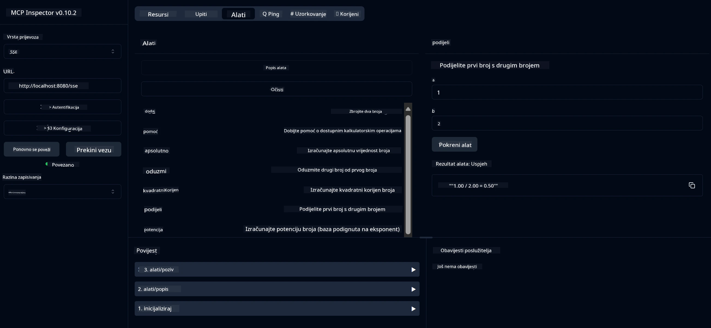

# Osnovna kalkulator MCP usluga

> [!NOTE]
> Ovaj primjer koristi naslijeđeni HTTP+SSE transport i cilja SDK kompatibilan
> s MCP `2025-11-25`. Novi udaljeni poslužitelji trebaju koristiti `2026-07-28` Streamable
> HTTP podršku.

Ova usluga pruža osnovne operacije kalkulatora putem Model Context Protocol (MCP) koristeći Spring Boot s WebFlux transportom. Dizajnirana je kao jednostavan primjer za početnike koji uče o MCP implementacijama.

Za više informacija, pogledajte referentnu dokumentaciju [MCP Server Boot Starter](https://docs.spring.io/spring-ai/reference/api/mcp/mcp-server-boot-starter-docs.html).

## Pregled

Usluga prikazuje:
- Podršku za SSE (Server-Sent Events)
- Automatsku registraciju alata koristeći Spring AI-jev `@Tool` anotaciju
- Osnovne funkcije kalkulatora:
  - Zbrajanje, oduzimanje, množenje, dijeljenje
  - Izračun potencije i korijena
  - Modulus (ostatak) i apsolutna vrijednost
  - Funkcija pomoći za opise operacija

## Značajke

Ova kalkulator usluga nudi sljedeće mogućnosti:

1. **Osnovne aritmetičke operacije**:
   - Zbrajanje dva broja
   - Oduzimanje jednog broja od drugog
   - Množenje dva broja
   - Dijeljenje jednog broja s drugim (s provjerom dijeljenja s nulom)

2. **Napredne operacije**:
   - Izračun potencije (podizanje baze na eksponent)
   - Izračun korijena (s provjerom negativnog broja)
   - Izračun modula (ostatka)
   - Izračun apsolutne vrijednosti

3. **Sustav pomoći**:
   - Ugrađena funkcija pomoći koja objašnjava sve dostupne operacije

## Korištenje usluge

Usluga izlaže sljedeće API krajnje točke putem MCP protokola:

- `add(a, b)`: Zbrajanje dva broja
- `subtract(a, b)`: Oduzimanje drugog broja od prvog
- `multiply(a, b)`: Množenje dva broja
- `divide(a, b)`: Dijeljenje prvog broja s drugim (s provjerom nulom)
- `power(base, exponent)`: Izračun potencije broja
- `squareRoot(number)`: Izračun korijena (s provjerom negativnog broja)
- `modulus(a, b)`: Izračun ostatka pri dijeljenju
- `absolute(number)`: Izračun apsolutne vrijednosti
- `help()`: Dobivanje informacija o dostupnim operacijama

## Testni klijent

Jednostavan testni klijent uključen je u `com.microsoft.mcp.sample.client` paket. `SampleCalculatorClient` klasa demonstrira dostupne operacije kalkulator usluge.

## Korištenje LangChain4j klijenta

Projekt uključuje LangChain4j primjer klijenta u
`com.microsoft.mcp.sample.client.LangChain4jClient` koji pokazuje kako
integrirati kalkulator uslugu s Microsoft Foundry modelom.

### Preduvjeti

1. Kreirajte Microsoft Foundry resurs i implementirajte aktivni model poput
   `gpt-5.1`.
2. Postavite model endpoint, API ključ i naziv implementacije:

   ```bash
   export AZURE_OPENAI_ENDPOINT="https://<resource-name>.openai.azure.com"
   export AZURE_OPENAI_API_KEY="<api-key>"
   export AZURE_OPENAI_DEPLOYMENT="gpt-5.1"
   ```

3. Provjerite
   [raspored umirovljenja modela Microsoft Foundry](https://learn.microsoft.com/azure/foundry/openai/concepts/model-retirement-schedule)
   prije odabira implementacije.
4. Osigurajte da kalkulator poslužitelj radi na `localhost:8080`.

### Pokretanje LangChain4j klijenta

Ovaj primjer demonstrira:
- Povezivanje s kalkulator MCP poslužiteljem preko SSE transporta
- Korištenje LangChain4j za kreiranje chat bota koji koristi kalkulator operacije
- Integraciju s implementiranim Microsoft Foundry modelom

Klijent šalje sljedeće uzorke upita za demonstraciju funkcionalnosti:
1. Izračunavanje zbroja dva broja
2. Pronalaženje korijena broja
3. Dobivanje pomoći o dostupnim kalkulator operacijama

Pokrenite primjer i provjerite ispis na konzoli da vidite kako AI model koristi kalkulator alate za odgovaranje na upite.

### Konfiguracija Microsoft Foundry modela

LangChain4j klijent koristi Azure OpenAI v1-kompatibilni endpoint izložen od
Microsoft Foundry:

```java
String endpoint = System.getenv("AZURE_OPENAI_ENDPOINT");
ChatLanguageModel model = OpenAiOfficialChatModel.builder()
   .baseUrl(endpoint.replaceAll("/+$", "") + "/openai/v1/")
   .apiKey(System.getenv("AZURE_OPENAI_API_KEY"))
   .isAzure(true)
   .modelName(System.getenv().getOrDefault("AZURE_OPENAI_DEPLOYMENT", "gpt-5.1"))
    .timeout(Duration.ofSeconds(60))
    .build();
```

`AZURE_OPENAI_DEPLOYMENT` mora odgovarati imenu dodijeljenom prilikom implementacije modela,
što može biti različito od temeljnog imena modela.

## Ovisnosti

Projekt zahtijeva sljedeće ključne ovisnosti:

```xml
<!-- For MCP Server -->
<dependency>
    <groupId>org.springframework.ai</groupId>
    <artifactId>spring-ai-starter-mcp-server-webflux</artifactId>
</dependency>

<!-- For LangChain4j integration -->
<dependency>
    <groupId>dev.langchain4j</groupId>
    <artifactId>langchain4j-mcp</artifactId>
    <version>${langchain4j.version}</version>
</dependency>

<!-- For Microsoft Foundry's OpenAI-compatible endpoint -->
<dependency>
    <groupId>dev.langchain4j</groupId>
   <artifactId>langchain4j-open-ai-official</artifactId>
    <version>${langchain4j.version}</version>
</dependency>
```

## Izgradnja projekta

Izgradite projekt koristeći Maven:
```bash
./mvnw clean install -DskipTests
```

## Pokretanje poslužitelja

### Korištenje Jave

```bash
java -jar target/calculator-server-0.0.1-SNAPSHOT.jar
```

### Korištenje MCP Inspektora

MCP Inspektor je koristan alat za interakciju s MCP uslugama. Za korištenje s ovom kalkulator uslugom:

1. **Instalirajte i pokrenite MCP Inspektor** u novom terminal prozoru:
   ```bash
   npx @modelcontextprotocol/inspector
   ```

2. **Pristupite web UI-u** klikom na URL prikazan u aplikaciji (obično http://localhost:6274)

3. **Konfigurirajte vezu**:
   - Postavite tip transporta na "SSE"
   - Postavite URL na SSE endpoint vašeg pokrenutog poslužitelja: `http://localhost:8080/sse`
   - Kliknite "Connect"

4. **Koristite alate**:
   - Kliknite "List Tools" za prikaz dostupnih kalkulator operacija
   - Odaberite alat i kliknite "Run Tool" za izvođenje operacije



### Korištenje Dockera

Projekt uključuje Dockerfile za kontejnersku implementaciju:

1. **Izgradite Docker sliku**:
   ```bash
   docker build -t calculator-mcp-service .
   ```

2. **Pokrenite Docker kontejner**:
   ```bash
   docker run -p 8080:8080 calculator-mcp-service
   ```

Ovo će:
- Izgraditi višestepenu Docker sliku s Maven 3.9.9 i Eclipse Temurin 24 JDK
- Kreirati optimiziranu sliku kontejnera
- Izložiti uslugu na portu 8080
- Pokrenuti MCP kalkulator uslugu unutar kontejnera

Usluga može biti dostupna na `http://localhost:8080` kad je kontejner pokrenut.

## Rješavanje problema

### Česti problemi s povezivanjem modela

1. **Greške autentikacije**: Potvrdite da `AZURE_OPENAI_API_KEY` pripada
   resursu identificiranom s `AZURE_OPENAI_ENDPOINT`.
2. **Nije pronađena implementacija**: Potvrdite da `AZURE_OPENAI_DEPLOYMENT` točno odgovara
   nazivu implementacije u Microsoft Foundry.
3. **Ograničenje brzine (rate limiting)**: Pregledajte kvotu implementacije i pokušajte ponovno nakon razdoblja
   koje vraća usluga.

Za dodatnu pomoć, pogledajte
[LangChain4j dokumentaciju](https://github.com/langchain4j/langchain4j) i
[Microsoft Foundry dokumentaciju](https://learn.microsoft.com/azure/ai-foundry/).

---

<!-- CO-OP TRANSLATOR DISCLAIMER START -->
**Napomena**:
Ovaj dokument je preveden korištenjem AI prevoditeljskog servisa [Co-op Translator](https://github.com/Azure/co-op-translator). Iako težimo točnosti, imajte na umu da automatski prijevodi mogu sadržavati greške ili netočnosti. Izvorni dokument na izvornom jeziku treba smatrati autoritativnim izvorom. Za važne informacije preporuča se profesionalni ljudski prijevod. Nismo odgovorni za bilo kakva nesporazumevanja ili pogrešne interpretacije koje proizlaze iz korištenja ovog prijevoda.
<!-- CO-OP TRANSLATOR DISCLAIMER END -->