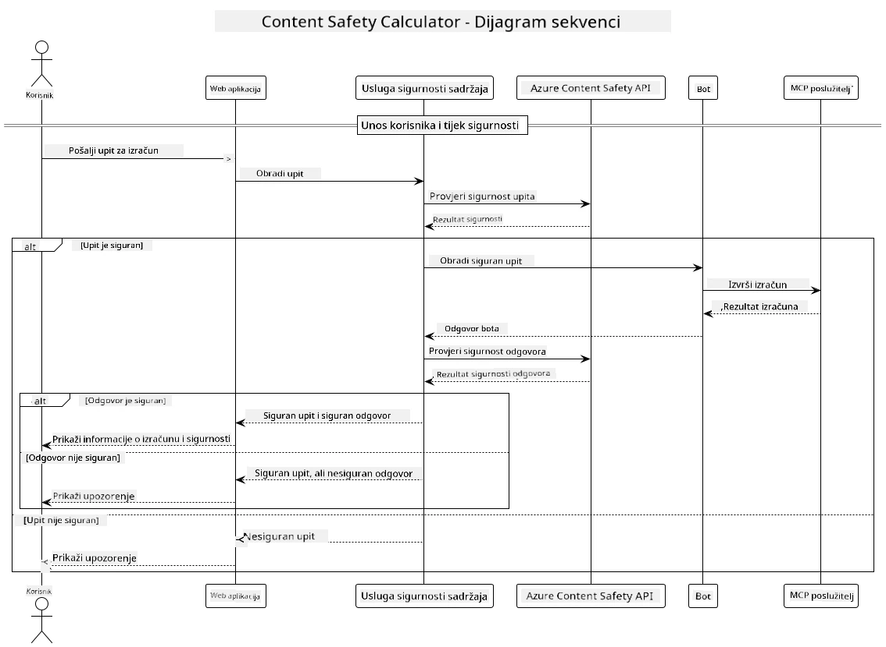

## Arhitektura Sustava

Ovaj projekt demonstrira web aplikaciju koja koristi provjeru sigurnosti sadržaja prije slanja korisničkih upita kalkulatoru putem Model Context Protocol (MCP).



### Kako To Radi

1. **Korisnički Unos**: Korisnik unosi upit za izračun u web sučelju
2. **Provjera sigurnosti sadržaja (Unos)**: Upit analizira Azure Content Safety API
3. **Odluka o sigurnosti (Unos)**:
   - Ako je sadržaj siguran (težina < 2 u svim kategorijama), nastavlja se prema kalkulatoru
   - Ako je sadržaj označen kao potencijalno štetan, proces se zaustavlja i vraća upozorenje
4. **Integracija kalkulatora**: Siguran sadržaj obrađuje LangChain4j, koji komunicira s MCP kalkulatorskim poslužiteljem
5. **Provjera sigurnosti sadržaja (Izlaz)**: Odgovor bota analizira Azure Content Safety API
6. **Odluka o sigurnosti (Izlaz)**:
   - Ako je odgovor bota siguran, prikazuje se korisniku
   - Ako je odgovor bota označen kao potencijalno štetan, zamjenjuje se upozorenjem
7. **Odgovor**: Rezultati (ako su sigurni) prikazuju se korisniku zajedno s obje analize sigurnosti

## Korištenje Model Context Protocol (MCP) s Kalkulatorskim Uslugama

Ovaj projekt demonstrira kako koristiti Model Context Protocol (MCP) za pozivanje kalkulatorskih MCP usluga iz LangChain4j. Implementacija koristi lokalni MCP poslužitelj koji radi na portu 8080 za pružanje kalkulatorskih operacija.

### Postavljanje Azure Content Safety Usluge

Prije korištenja značajki sigurnosti sadržaja, potrebno je stvoriti Azure Content Safety resurs:

1. Prijavite se na [Azure Portal](https://portal.azure.com)
2. Kliknite "Create a resource" i potražite "Content Safety"
3. Odaberite "Content Safety" i kliknite "Create"
4. Unesite jedinstveno ime za svoj resurs
5. Odaberite pretplatu i grupu resursa (ili napravite novu)
6. Odaberite podržanu regiju (provjerite [Region availability](https://azure.microsoft.com/en-us/global-infrastructure/services/?products=cognitive-services) za detalje)
7. Odaberite odgovarajući cjenovni razred
8. Kliknite "Create" za postavljanje resursa
9. Nakon završetka postavljanja, kliknite "Go to resource"
10. U lijevom izborniku, pod "Resource Management", odaberite "Keys and Endpoint"
11. Kopirajte jedan od ključeva i URL krajnje točke za upotrebu u sljedećem koraku

### Konfiguriranje Varijabli Okoliša

Postavite Microsoft Foundry krajnju točku modela, API ključ i ime distribucije:
```sh
export AZURE_OPENAI_ENDPOINT="https://<resource-name>.openai.azure.com"
export AZURE_OPENAI_API_KEY="<api-key>"
export AZURE_OPENAI_DEPLOYMENT="gpt-5.1"
```

Za značajke sigurnosti sadržaja postavite:
```sh
export CONTENT_SAFETY_ENDPOINT=<your_content_safety_endpoint>
export CONTENT_SAFETY_KEY=<your_content_safety_key>
```

Ove varijable okoliša koristi aplikacija za autentikaciju Azure Content Safety usluge. Ako ove varijable nisu postavljene, aplikacija će koristiti rezervirane vrijednosti za demonstraciju, ali značajke sigurnosti sadržaja neće pravilno funkcionirati.

### Pokretanje MCP Kalkulatorskog Poslužitelja

Prije pokretanja klijenta, potrebno je pokrenuti MCP kalkulatorski poslužitelj u SSE modu na localhost:8080.

## Opis Projekta

Ovaj projekt demonstrira integraciju Model Context Protocol (MCP) s LangChain4j za pozivanje kalkulatorskih usluga. Ključne značajke uključuju:

- Korištenje MCP za povezivanje s kalkulatorskom uslugom za osnovne matematičke operacije
- Dvostruka provjera sigurnosti sadržaja na korisničkim upitima i odgovorima bota
- Integracija s implementiranim Microsoft Foundry modelom putem LangChain4j
- Korištenje Server-Sent Events (SSE) za MCP prijenos

## Integracija Sigurnosti Sadržaja

Projekt uključuje sveobuhvatne značajke sigurnosti sadržaja kako bi osigurao da su i korisnički unosi i sustavni odgovori slobodni od štetnog sadržaja:

1. **Provjera unosa**: Svi korisnički upiti se analiziraju na kategorije štetnog sadržaja kao što su govor mržnje, nasilje, samoozljeđivanje i seksualni sadržaj prije obrade.

2. **Provjera izlaza**: Čak i kod korištenja potencijalno necenzuriranih modela, sustav provjerava sve generirane odgovore istim filtrima za sigurnost sadržaja prije nego ih prikaže korisniku.

Ovaj dvostruki pristup osigurava da sustav ostane siguran bez obzira na korišteni AI model, štiteći korisnike od štetnih unosa i potencijalno problematičnih AI generiranih izlaza.

## Web Klijent

Aplikacija uključuje korisnički prijateljsko web sučelje koje omogućava korisnicima interakciju sa sustavom Content Safety Calculator:

### Značajke Web Sučelja

- Jednostavan, intuitivan obrazac za unos upita za izračun
- Dvostruka provjera sigurnosti sadržaja (unos i izlaz)
- Povratne informacije u stvarnom vremenu o sigurnosti upita i odgovora
- Sigurnosni indikatori u bojama za lakše razumijevanje
- Čist, responzivan dizajn koji radi na različitim uređajima
- Primjeri sigurnih upita za vođenje korisnika

### Korištenje Web Klijenta

1. Pokrenite aplikaciju:
   ```sh
   mvn spring-boot:run
   ```

2. Otvorite svoj preglednik i navigirajte na `http://localhost:8087`

3. Unesite upit za izračun u predviđeno tekstualno polje (npr. "Izračunajte zbroj 24.5 i 17.3")

4. Kliknite "Submit" za obradu vašeg zahtjeva

5. Pogledajte rezultate koji će uključivati:
   - Analizu sigurnosti sadržaja vašeg upita
   - Izračunati rezultat (ako je upit bio siguran)
   - Analizu sigurnosti sadržaja odgovora bota
   - Bilo kakva sigurnosna upozorenja ako je unos ili izlaz označen

Web klijent automatski upravlja oba procesa provjere sigurnosti sadržaja, osiguravajući da su sve interakcije sigurne i prikladne bez obzira na korišteni AI model.

---

<!-- CO-OP TRANSLATOR DISCLAIMER START -->
**Napomena**:
Ovaj dokument je preveden korištenjem AI prevoditeljskog servisa [Co-op Translator](https://github.com/Azure/co-op-translator). Iako težimo točnosti, imajte na umu da automatski prijevodi mogu sadržavati greške ili netočnosti. Izvorni dokument na izvornom jeziku treba smatrati autoritativnim izvorom. Za važne informacije preporuča se profesionalni ljudski prijevod. Nismo odgovorni za bilo kakva nesporazumevanja ili pogrešne interpretacije koje proizlaze iz korištenja ovog prijevoda.
<!-- CO-OP TRANSLATOR DISCLAIMER END -->