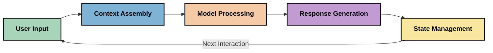
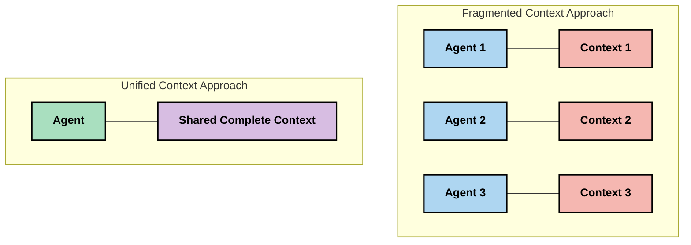
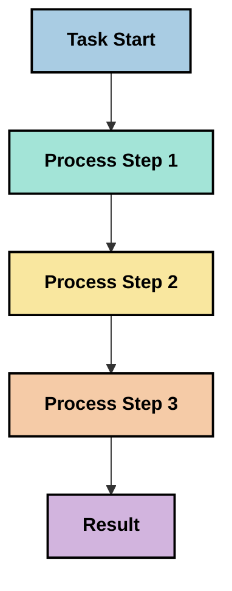
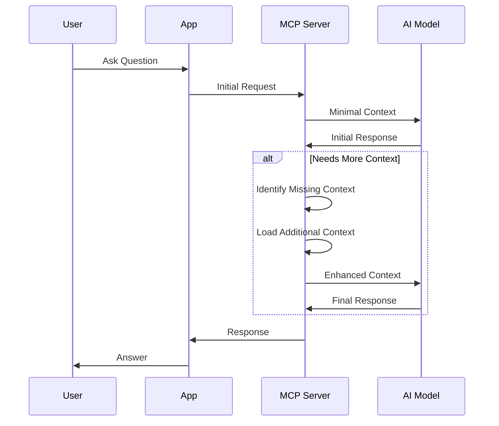
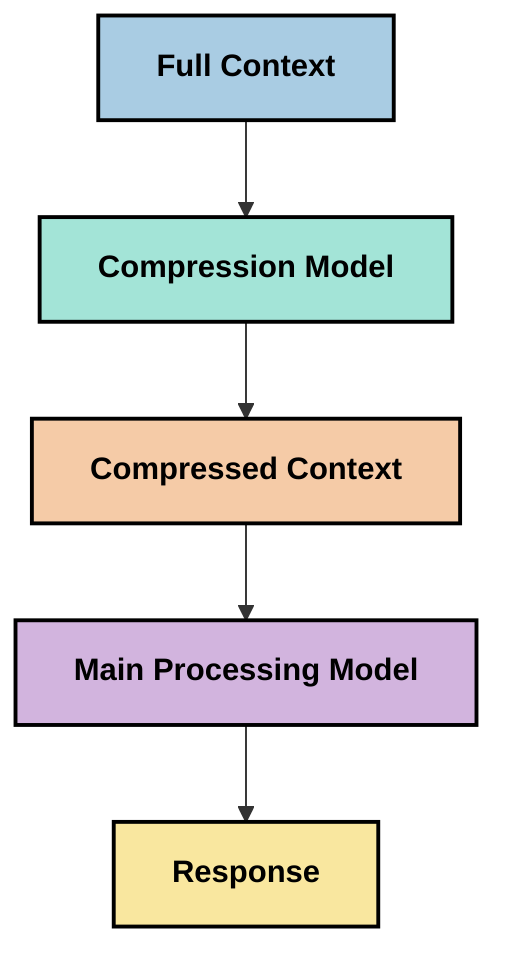
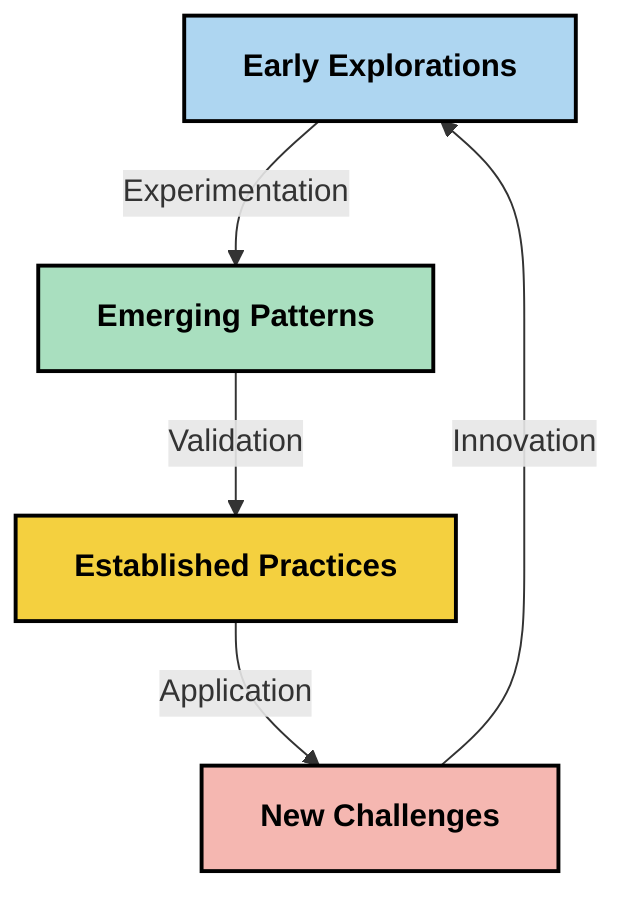

# Inženjering konteksta: Novi pojam u MCP ekosustavu

## Pregled

Inženjering konteksta je novi pojam u području umjetne inteligencije koji istražuje kako se informacije strukturiraju, prenose i održavaju tijekom interakcija između klijenata i AI usluga. Kako ekosustav Model Context Protocol (MCP) napreduje, razumijevanje učinkovite uprave kontekstom postaje sve važnije. Ova modul uvodi pojam inženjeringa konteksta i istražuje njegove potencijalne primjene u MCP implementacijama.

## Ciljevi učenja

Do kraja ovog modula, moći ćete:

- Razumjeti novi pojam inženjeringa konteksta i njegovu potencijalnu ulogu u MCP aplikacijama
- Identificirati ključne izazove u upravljanju kontekstom koje MCP protokol adresira
- Istražiti tehnike za poboljšanje performansi modela kroz bolje rukovanje kontekstom
- Razmotriti pristupe za mjerenje i evaluaciju učinkovitosti konteksta
- Primijeniti ove nove koncepte za poboljšanje AI iskustava kroz MCP okvir

## Uvod u inženjering konteksta

Inženjering konteksta je novi pojam fokusiran na namjerno dizajniranje i upravljanje protokom informacija između korisnika, aplikacija i AI modela. Za razliku od etabliranih područja poput inženjeringa prompta, inženjering konteksta još se definira od strane praktičara dok rješavaju jedinstvene izazove pružanja modelima umjetne inteligencije ispravnih informacija u pravo vrijeme.

Kako su se veliki jezični modeli (LLM) razvijali, važnost konteksta postala je sve očitija. Kvaliteta, relevantnost i struktura konteksta koji pružamo izravno utječu na izlaze modela. Inženjering konteksta istražuje ovaj odnos i nastoji razviti principe za učinkovito upravljanje kontekstom.

> "Godine 2025., modeli su iznimno inteligentni. Ali čak ni najpametniji čovjek neće moći učinkovito obavljati svoj posao bez konteksta onoga što se od njega traži... 'Inženjering konteksta' je sljedeća razina inženjeringa prompta. Radi se o automatskom upravljanju u dinamičkom sustavu." — Walden Yan, Cognition AI

Inženjering konteksta može obuhvaćati:

1. **Izbor konteksta**: Određivanje koje su informacije relevantne za zadani zadatak
2. **Strukturiranje konteksta**: Organiziranje informacija za maksimalno razumijevanje modela
3. **Dostava konteksta**: Optimizacija kako i kada se informacije šalju modelima
4. **Održavanje konteksta**: Upravljanje stanjem i evolucijom konteksta tijekom vremena
5. **Evaluacija konteksta**: Mjerenje i poboljšanje učinkovitosti konteksta

Ova područja usredotočenosti posebno su relevantna za MCP ekosustav, koji pruža standardizirani način za aplikacije da pruže kontekst LLM-ovima.


## Perspektiva putovanja konteksta

Jedan način za vizualizaciju inženjeringa konteksta je praćenje puta kojim informacije prolaze kroz MCP sustav:



### Ključne faze u putovanju konteksta:

1. **Unos korisnika**: Sirove informacije od korisnika (tekst, slike, dokumenti)
2. **Sastavljanje konteksta**: Kombinirajući unos korisnika s kontekstom sustava, poviješću razgovora i drugim dohvaćenim informacijama
3. **Obrada modela**: AI model obrađuje sastavljeni kontekst
4. **Generiranje odgovora**: Model proizvodi izlaze na temelju danog konteksta
5. **Upravljanje stanjem**: Sustav ažurira svoj interni status temeljem interakcije

Ova perspektiva ističe dinamičnu prirodu konteksta u AI sustavima i postavlja važna pitanja o tome kako najbolje upravljati informacijama u svakoj fazi.

## Izlazeći principi u inženjeringu konteksta

Kako se područje inženjeringa konteksta oblikuje, neki rani principi počinju se pojavljivati od strane praktičara. Ovi principi mogu pomoći u informiranju izbora implementacija MCP-a:

### Princip 1: Dijelite kontekst u potpunosti

Krokontekst treba biti u potpunosti podijeljen između svih komponenti sustava, umjesto da bude fragmentiran preko više agenata ili procesa. Kada je kontekst distribuiran, odluke donošene u jednom dijelu sustava mogu biti u sukobu s onima u drugom dijelu.



U MCP aplikacijama, ovo sugerira dizajniranje sustava u kojima kontekst neometano teče cijelim procesom, umjesto da bude podijeljen na dijelove.

### Princip 2: Prepoznajte da akcije sadrže implicitne odluke

Svaka akcija koju model poduzima utjelovljuje implicitne odluke o tome kako interpretirati kontekst. Kada više komponenti djeluje na različitim kontekstima, ove implicitne odluke mogu biti u sukobu, što vodi do nekonzistentnih ishoda.

Ovaj princip ima važne implikacije za MCP aplikacije:
- Preferirajte linearno procesiranje složenih zadataka umjesto paralelnog izvršavanja s fragmentiranim kontekstom
- Osigurajte da svi točke odlučivanja imaju pristup istoj kontekstualnoj informaciji
- Dizajnirajte sustave gdje kasniji koraci mogu vidjeti cjelokupni kontekst ranijih odluka

### Princip 3: Uravnotežite dubinu konteksta s ograničenjima prozora

Kako razgovori i procesi rastu dulje, kontekstualni prozori na kraju prelijevaju. Učinkovit inženjering konteksta istražuje pristupe za upravljanje tom napetošću između sveobuhvatnog konteksta i tehničkih ograničenja.

Mogući pristupi koji se istražuju uključuju:
- Kompresiju konteksta koja održava ključne informacije uz smanjenje korištenja tokena
- Postupno učitavanje konteksta na temelju relevantnosti za trenutne potrebe
- Sažimanje prethodnih interakcija uz očuvanje ključnih odluka i činjenica

## Izazovi konteksta i dizajn MCP protokola

Model Context Protocol (MCP) dizajniran je uz svijest o jedinstvenim izazovima upravljanja kontekstom. Razumijevanje tih izazova pomaže objasniti ključne aspekte dizajna MCP protokola:


### Izazov 1: Ograničenja kontekstualnog prozora
Većina AI modela ima fiksne veličine kontekstualnih prozora, što ograničava koliko informacija mogu obraditi odjednom.

**Odgovor dizajna MCP-a:**
- Protokol podržava strukturirani, na resursima bazirani kontekst koji se može učinkovito referencirati
- Resursi se mogu stranicirati i učitavati postupno

### Izazov 2: Određivanje relevantnosti
Određivanje koje su informacije najvažnije za uključiti u kontekst je teško.

**Odgovor dizajna MCP-a:**
- Fleksibilni alati omogućuju dinamično dohvaćanje informacija prema potrebi
- Strukturirani upiti omogućuju dosljednu organizaciju konteksta

### Izazov 3: Očuvanje konteksta
Upravljanje stanjem kroz interakcije zahtijeva pažljivo praćenje konteksta.

**Odgovor dizajna MCP-a:**
- Standardizirano upravljanje sesijama
- Jasno definirani obrasci interakcije za evoluciju konteksta

### Izazov 4: Više-modalni kontekst
Različite vrste podataka (tekst, slike, strukturirani podaci) zahtijevaju različito rukovanje.

**Odgovor dizajna MCP-a:**
- Dizajn protokola prilagođen različitim tipovima sadržaja
- Standardizirana reprezentacija više-modalnih informacija

### Izazov 5: Sigurnost i privatnost
Kontekst često sadrži osjetljive informacije koje se moraju zaštititi.

**Odgovor dizajna MCP-a:**
- Jasne granice između odgovornosti klijenta i servera
- Lokalne opcije obrade za minimiziranje izloženosti podataka

Razumijevanje ovih izazova i kako ih MCP rješava pruža temelj za istraživanje naprednijih tehnika inženjeringa konteksta.

## Izlazeći pristupi inženjeringa konteksta

Kako se područje inženjeringa konteksta razvija, pojavljuju se nekoliko obećavajućih pristupa. Oni predstavljaju trenutna razmišljanja, a ne uspostavljene najbolje prakse, i vjerojatno će evoluirati kako stječemo više iskustva s MCP implementacijama.

### 1. Linearna obrada jednim tokom

Za razliku od višestrukih agentnih arhitektura koje distribuiraju kontekst, neki praktičari otkrivaju da linearna obrada jednim tokom daje dosljednije rezultate. To je u skladu s principom održavanja jedinstvenog konteksta.



Iako se ovaj pristup može činiti manje učinkovitim od paralelnog procesiranja, često daje koherentnije i pouzdanije rezultate jer svaki korak gradi na potpunom razumijevanju ranijih odluka.

### 2. Dijeljenje i prioritetizacija konteksta

Razbijanje velikih konteksta u upravljive dijelove i prioritetizacija onoga što je najvažnije.

```python
# Conceptual Example: Context Chunking and Prioritization
def process_with_chunked_context(documents, query):
    # 1. Break documents into smaller chunks
    chunks = chunk_documents(documents)
    
    # 2. Calculate relevance scores for each chunk
    scored_chunks = [(chunk, calculate_relevance(chunk, query)) for chunk in chunks]
    
    # 3. Sort chunks by relevance score
    sorted_chunks = sorted(scored_chunks, key=lambda x: x[1], reverse=True)
    
    # 4. Use the most relevant chunks as context
    context = create_context_from_chunks([chunk for chunk, score in sorted_chunks[:5]])
    
    # 5. Process with the prioritized context
    return generate_response(context, query)
```

Koncept gore ilustrira kako bismo mogli razbiti velike dokumente na upravljive dijelove i odabrati samo najrelevantnije dijelove za kontekst. Ovaj pristup može pomoći u radu unutar ograničenja kontekstualnog prozora, a istovremeno iskoristiti velike baze znanja.

### 3. Postupno učitavanje konteksta

Učitavanje konteksta postupno po potrebi, a ne odjednom.



Postupno učitavanje konteksta započinje s minimalnim kontekstom i širi se samo kad je potrebno. Ovo može znatno smanjiti korištenje tokena za jednostavne upite dok istovremeno održava sposobnost za složena pitanja.

### 4. Kompresija i sažimanje konteksta

Smanjenje veličine konteksta uz očuvanje bitnih informacija.



Kompresija konteksta fokusira se na:
- Uklanjanje redundantnih informacija
- Sažimanje opsežnog sadržaja
- Izvlačenje ključnih činjenica i detalja
- Očuvanje kritičnih elemenata konteksta
- Optimizaciju za učinkovitost tokena

Ovaj pristup može biti posebno vrijedan za održavanje dugih razgovora unutar kontekstualnih prozora ili za učinkovitu obradu velikih dokumenata. Neki praktičari koriste specijalizirane modele posebno za kompresiju konteksta i sažimanje povijesti razgovora.


## Razmatranja istraživačkog inženjeringa konteksta

Dok istražujemo novo područje inženjeringa konteksta, nekoliko razmatranja vrijedi imati na umu prilikom rada s MCP implementacijama. Ovo nisu propisane najbolje prakse nego područja istraživanja koja mogu donijeti poboljšanja u vašem specifičnom slučaju korištenja.

### Razmotrite svoje ciljeve konteksta

Prije implementacije složenih rješenja za upravljanje kontekstom, jasno izrazite što želite postići:
- Koje specifične informacije model treba za uspjeh?
- Koje su informacije ključne, a koje dopunske?
- Koja su vaša ograničenja u performansama (latencija, ograničenja tokena, troškovi)?

### Istražite slojevite pristupe kontekstu

Neki praktičari pronalaze uspjeh s kontekstom aranžiranim u konceptualne slojeve:
- **Temeljni sloj**: Ključne informacije koje model uvijek treba
- **Situacijski sloj**: Kontekst specifičan za trenutnu interakciju
- **Potporni sloj**: Dodatne informacije koje mogu biti korisne
- **Rezervni sloj**: Informacije dostupne samo po potrebi

### Istražite strategije dohvaćanja

Učinkovitost vašeg konteksta često ovisi o načinu na koji dohvaćate informacije:
- Semantičko pretraživanje i ugradnje za pronalaženje konceptualno relevantnih informacija
- Pretraživanje po ključnim riječima za specifične faktografske detalje
- Hibridni pristupi koji kombiniraju više metoda dohvaćanja
- Filtriranje metapodataka za suženje opsega prema kategorijama, datumima ili izvorima

### Eksperimentirajte s koherencijom konteksta

Struktura i protok vašeg konteksta mogu utjecati na razumijevanje modela:
- Grupiranje povezanih informacija zajedno
- Korištenje dosljednog oblikovanja i organizacije
- Održavanje logičnog ili kronološkog redoslijeda gdje je primjereno
- Izbjegavanje kontradiktornih informacija

### Procijenite kompromise višestrukih agentnih arhitektura

Iako su višestruke agentske arhitekture popularne u mnogim AI okvirima, one dolaze s značajnim izazovima za upravljanje kontekstom:
- Fragmentacija konteksta može dovesti do nekonzistentnih odluka među agentima
- Paralelna obrada može uvoditi sukobe koje je teško riješiti
- Overhead komunikacije među agentima može poništiti dobitke u performansama
- Potrebno je složeno upravljanje stanjem za održavanje koherence

U mnogim slučajevima, pristup s jednim agentom koji obuhvaća cjelokupno upravljanje kontekstom može dati pouzdanije rezultate nego više specijaliziranih agenata s fragmentiranim kontekstom.

### Razvijte metode evaluacije

Za poboljšanje inženjeringa konteksta tijekom vremena, razmotrite kako ćete mjeriti uspjeh:
- A/B testiranje različitih struktura konteksta
- Praćenje korištenja tokena i vremena odgovora
- Praćenje zadovoljstva korisnika i stope dovršetka zadataka
- Analiza kada i zašto strategije konteksta ne uspijevaju

Ova razmatranja predstavljaju aktivna područja istraživanja u prostoru inženjeringa konteksta. Kako područje sazrijeva, vjerojatno će se pojaviti jasniji obrasci i prakse.

## Mjerenje učinkovitosti konteksta: Razvijajući okvir

Kako se inženjering konteksta pojavljuje kao pojam, praktičari počinju istraživati kako bismo mogli mjeriti njegovu učinkovitost. Još ne postoji uspostavljeni okvir, ali razni metrički pristupi razmatraju se koji bi mogli pomoći u vođenju budućeg rada.

### Potencijalne dimenzije mjerenja


#### 1. Razmatranja učinkovite ulaznosti

- **Omjer konteksta i odgovora**: Koliko je konteksta potrebno u odnosu na veličinu odgovora?
- **Iskorištenje tokena**: Koji postotak danih tokena konteksta utječe na odgovor?
- **Smanjenje konteksta**: Koliko učinkovito možemo komprimirati sirove informacije?

#### 2. Razmatranja performansi

- **Utjecaj na latenciju**: Kako upravljanje kontekstom utječe na vrijeme odgovora?
- **Ekonomija tokena**: Optimiziramo li korištenje tokena učinkovito?
- **Preciznost dohvaćanja**: Koliko je relevantna dohvaćena informacija?
- **Korištenje resursa**: Koji su zahtjevi za računalne resurse?

#### 3. Razmatranja kvalitete

- **Relevantnost odgovora**: Koliko dobro odgovor zadovoljava upit?
- **Činjenična točnost**: Poboljšava li upravljanje kontekstom faktografsku točnost?
- **Dosljednost**: Jesu li odgovori dosljedni za slične upite?
- **Stopa halucinacija**: Smanjuje li bolji kontekst ishitrene odgovore modela?

#### 4. Razmatranja korisničkog iskustva

- **Stopa daljnjih upita**: Koliko često korisnici trebaju pojašnjenja?
- **Dovršenost zadatka**: Ostvaruju li korisnici svoje ciljeve?
- **Pokazatelji zadovoljstva**: Kako korisnici ocjenjuju svoje iskustvo?

### Istraživački pristupi mjerenju

Kada eksperimentirate s inženjeringom konteksta u MCP implementacijama, razmotrite ove istraživačke pristupe:

1. **Usporedbe s temeljnim linijama**: Uspostavite referentu vrijednost sa jednostavnim pristupima kontekstu prije testiranja složenijih metoda

2. **Postupne promjene**: Mijenjajte jedan aspekt upravljanja kontekstom ujedno da biste izolirali njegove učinke

3. **Evaluacija usmjerena na korisnika**: Kombinirajte kvantitativne metrike s kvalitativnim povratnim informacijama korisnika

4. **Analiza neuspjeha**: Istražite slučajeve gdje strategije konteksta ne uspijevaju kako biste razumjeli potencijalna poboljšanja

5. **Višedimenzionalna procjena**: Razmotrite kompromise između učinkovitosti, kvalitete i korisničkog iskustva

Ovaj eksperimentalni, višestruki pristup mjerenju usklađuje se s rastućom prirodom inženjeringa konteksta.

## Završne misli

Inženjering konteksta je novo područje istraživanja koje bi moglo postati središnje za učinkovite MCP aplikacije. Pažljivim razmatranjem kako informacije prolaze kroz vaš sustav, možete potencijalno stvoriti AI iskustva koja su učinkovitija, točnija i vrijednija korisnicima.

Te tehnike i pristupi opisani u ovom modulu predstavljaju rane ideje u ovom prostoru, a ne utvrđene prakse. Inženjering konteksta može se razviti u jasniju disciplinu kako se AI sposobnosti razvijaju i naše razumijevanje produbljuje. Za sada čini se da je kombinacija eksperimentiranja i pažljivog mjerenja najproduktivniji pristup.

## Potencijalni budući smjerovi

Područje inženjeringa konteksta još je u ranim fazama, ali pojavljuju se nekoliko obećavajućih smjerova:

- Principi inženjeringa konteksta mogli bi znatno utjecati na performanse modela, učinkovitost, korisničko iskustvo i pouzdanost
- Linearni pristupi s cjelovitim upravljanjem kontekstom mogli bi nadmašiti višestruke agentske arhitekture u mnogim slučajevima korištenja
- Specijalizirani modeli za kompresiju konteksta mogli bi postati standardni dijelovi AI cjevovoda
- Napetost između potpune pokrivenosti konteksta i ograničenja tokena vjerojatno će potaknuti inovacije u rukovanju kontekstom
- Kako modeli postaju sposobniji za učinkovitu ljudsku komunikaciju, prava višestruka suradnja agenata može postati izvedivija
- MCP implementacije mogli bi se razviti kako bi standardizirali obrasce upravljanja kontekstom koji proizlaze iz trenutačnih eksperimenata



## Resursi

### Službeni MCP resursi
- [Model Context Protocol Website](https://modelcontextprotocol.io/)
- [Model Context Protocol Specification](https://github.com/modelcontextprotocol/modelcontextprotocol)
- [MCP Dokumentacija](https://modelcontextprotocol.io/docs)
- [MCP C# SDK](https://github.com/modelcontextprotocol/csharp-sdk)
- [MCP Python SDK](https://github.com/modelcontextprotocol/python-sdk)
- [MCP TypeScript SDK](https://github.com/modelcontextprotocol/typescript-sdk)
- [MCP Inspektor](https://github.com/modelcontextprotocol/inspector) - Alat za vizualno testiranje MCP servera

### Članci o inženjerstvu konteksta
- [Ne gradite višestruke agente: Principi inženjerstva konteksta](https://cognition.ai/blog/dont-build-multi-agents) - Uvidi Walden Yana o principima inženjerstva konteksta
- [Praktični vodič za izgradnju agenata](https://cdn.openai.com/business-guides-and-resources/a-practical-guide-to-building-agents.pdf) - OpenAI vodič za učinkoviti dizajn agenata
- [Izgradnja učinkovitih agenata](https://www.anthropic.com/engineering/building-effective-agents) - Anthropicov pristup razvoju agenata

### Povezana istraživanja
- [Dinamičko poboljšanje dohvaćanja za velike jezične modele](https://arxiv.org/abs/2310.01487) - Istraživanje o dinamičkim pristupima dohvaćanju
- [Izgubljeni u sredini: Kako jezični modeli koriste dugi kontekst](https://arxiv.org/abs/2307.03172) - Važno istraživanje o obrascima obrade konteksta
- [Hijerarhijska generacija slika uvjetovana tekstom s CLIP latentima](https://arxiv.org/abs/2204.06125) - DALL-E 2 rad s uvidima o strukturiranju konteksta
- [Istraživanje uloge konteksta u arhitekturama velikih jezičnih modela](https://aclanthology.org/2023.findings-emnlp.124/) - Nedavno istraživanje o rukovanju kontekstom
- [Višestruka suradnja agenata: Pregled](https://arxiv.org/abs/2304.03442) - Istraživanje o sustavima višestrukih agenata i njihovim izazovima

### Dodatni resursi
- [Tehnike optimizacije kontekstnog prozora](https://learn.microsoft.com/en-us/azure/ai-services/openai/concepts/context-window)
- [Napredne RAG tehnike](https://www.microsoft.com/en-us/research/blog/retrieval-augmented-generation-rag-and-frontier-models/)
- [Dokumentacija Semantic Kernel](https://github.com/microsoft/semantic-kernel)
- [Microsoft Foundry Toolkit za Visual Studio Code](https://github.com/microsoft/vscode-ai-toolkit)

## Što slijedi

- [5.15 MCP Prilagođeni transport](../mcp-transport/README.md)

---

<!-- CO-OP TRANSLATOR DISCLAIMER START -->
**Napomena**:
Ovaj dokument je preveden korištenjem AI prevoditeljskog servisa [Co-op Translator](https://github.com/Azure/co-op-translator). Iako težimo točnosti, imajte na umu da automatski prijevodi mogu sadržavati greške ili netočnosti. Izvorni dokument na izvornom jeziku treba smatrati autoritativnim izvorom. Za važne informacije preporuča se profesionalni ljudski prijevod. Nismo odgovorni za bilo kakva nesporazumevanja ili pogrešne interpretacije koje proizlaze iz korištenja ovog prijevoda.
<!-- CO-OP TRANSLATOR DISCLAIMER END -->