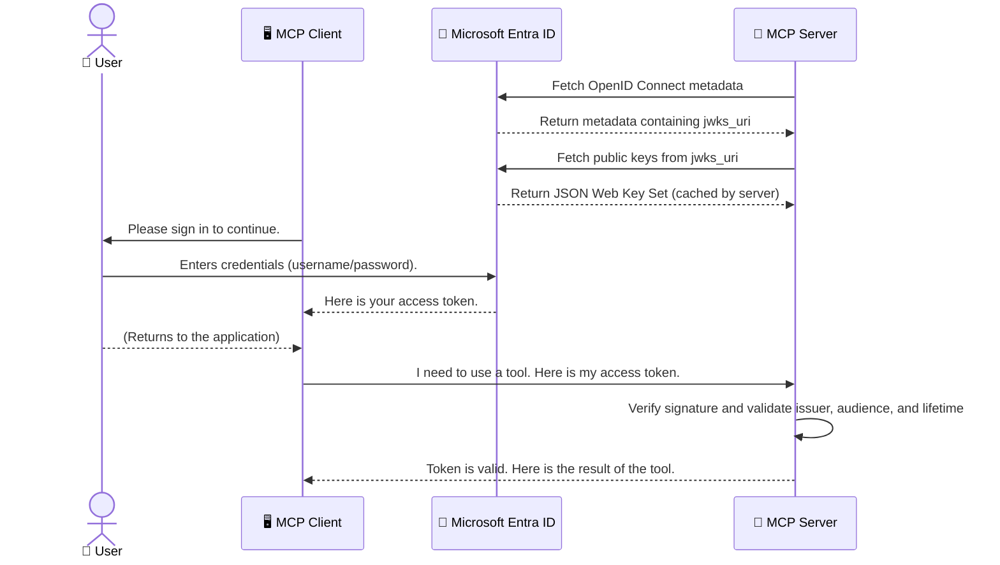

# Osiguravanje AI radnih tokova: Entra ID autentikacija za Model Context Protocol servere

> [!NOTE]
> Daljinski kod servera u ovom je poglavlju zaštićen za naslijeđene `/sse` i `/message`
> krajnje točke i cilja MCP `2025-11-25`. Zadržite njegove prakse provjere identiteta i tokena,
> ali za nove implementacije koristite Streamable HTTP prijenos kompatibilan s `2026-07-28`.


## Uvod
Osiguravanje vašeg Model Context Protocol (MCP) servera jednako je važno kao zaključavanje ulaznih vrata vaše kuće. Ostaviti MCP server otvorenim omogućuje neovlašten pristup vašim alatima i podacima, što može dovesti do sigurnosnih propusta. Microsoft Entra ID pruža robusno rješenje za upravljanje identitetima i pristupom temeljeno na oblaku, pomažući vam osigurati da samo ovlašteni korisnici i aplikacije mogu komunicirati s vašim MCP serverom. U ovom dijelu naučit ćete kako zaštititi svoje AI radne tokove koristeći Entra ID autentikaciju.

## Ciljevi učenja
Do kraja ovog dijela moći ćete:

- Razumjeti važnost osiguravanja MCP servera.
- Objasniti osnove Microsoft Entra ID i OAuth 2.0 autentikacije.
- Prepoznati razliku između javnih i povjerljivih klijenata.
- Implementirati Entra ID autentikaciju u scenarijima lokalnih (javni klijent) i udaljenih (povjerljivi klijent) MCP servera.
- Primijeniti najbolje sigurnosne prakse pri razvoju AI radnih tokova.

## Sigurnost i MCP

Baš kao što ne biste ostavili ulazna vrata kuće otključana, tako ni ne biste trebali ostaviti MCP server otvoren svima za pristup. Osiguranje AI radnih tokova ključno je za izgradnju robustnih, pouzdanih i sigurnih aplikacija. Ovo poglavlje će vas upoznati s korištenjem Microsoft Entra ID za osiguranje MCP servera, jamčeći da samo ovlašteni korisnici i aplikacije mogu koristiti vaše alate i podatke.

## Zašto sigurnost ima važnost za MCP servere

Zamislite da vaš MCP server ima alat koji može slati e-poštu ili pristupati bazi podataka kupaca. Nesiguran server značio bi da bilo tko može potencijalno koristiti taj alat, što bi moglo dovesti do neovlaštenog pristupa podacima, neželjene pošte ili drugih zlonamjernih aktivnosti.

Primjenom autentikacije osiguravate da se svaki zahtjev prema vašem serveru provjerava, potvrđujući identitet korisnika ili aplikacije koja šalje zahtjev. To je prvi i najvažniji korak u osiguravanju AI radnih tokova.

## Uvod u Microsoft Entra ID

[**Microsoft Entra ID**](https://adoption.microsoft.com/microsoft-security/entra/) je usluga upravljanja identitetima i pristupom u oblaku. Zamislite ga kao univerzalnog sigurnosnog čuvara za vaše aplikacije. On rukuje složenim procesom provjere korisničkih identiteta (autentikacija) i određivanja što smiju raditi (autorizacija).

Korištenjem Entra ID-a možete:

- Omogućiti sigurno prijavljivanje korisnicima.
- Zaštititi API-je i usluge.
- Centralizirano upravljati politikama pristupa.

Za MCP servere, Entra ID pruža robusno i široko pouzdano rješenje za upravljanje pristupom mogućnostima vašeg servera.

---

## Razumijevanje čarolije: Kako Entra ID autentikacija funkcionira

Entra ID koristi otvorene standarde kao što je **OAuth 2.0** za obradu autentikacije. Iako detalji mogu biti složeni, osnovni koncept je jednostavan i može se razumjeti putem analogije.

### Blagi uvod u OAuth 2.0: Ključ od parkirališta

Zamislite OAuth 2.0 kao uslugu čuvara za vaš automobil. Kad stignete u restoran, ne dajete čuvaru vaš glavni ključ. Umjesto toga, dajete **ključ od parkirališta** s ograničenim ovlastima—može upaliti auto i zaključati vrata, ali ne može otvoriti prtljažnik ili pretinac.

U ovoj analogiji:

- **Vi** ste **Korisnik**.
- **Vaš auto** je **MCP server** s vrijednim alatima i podacima.
- **Čuvar** je **Microsoft Entra ID**.
- **Parkirni službenik** je **MCP klijent** (aplikacija koja pokušava pristupiti serveru).
- **Ključ od parkirališta** je **Access Token**.

Access token je siguran tekstualni niz koji MCP klijent prima od Entra ID nakon vaše prijave. Klijent zatim taj token predaje MCP serveru sa svakim zahtjevom. Server može provjeriti token kako bi potvrdio da je zahtjev legitiman i da klijent ima potrebne ovlasti, sve bez ikad rukovanja vašim stvarnim vjerodajnicama (kao što je lozinka).

### Proces autentikacije

Evo kako taj proces funkcionira u praksi:



MCP server ne poziva Entra ID za potvrdu svakog access tokena. On
kriptografski provjerava JWT potpis s Entra ID keširanim javnim ključem
i validira tvrdnje tokena, uključujući izdavača, publiku i trajanje valjanosti.
Server čita `jwks_uri` iz OpenID Connect metapodataka, preuzima javne
ključeve s te URI i periodično ih osvježava radi rotacije ključeva. Koristite
podržanu biblioteku za validaciju tokena umjesto da implementirate ovu logiku
sami. Za detalje pogledajte
[Validate tokens in the Microsoft identity platform](https://learn.microsoft.com/entra/identity-platform/access-tokens#validate-tokens).

### Uvod u Microsoft Authentication Library (MSAL)

Prije nego pređemo na kod, važno je predstaviti ključnu komponentu koju ćete vidjeti u primjerima: **Microsoft Authentication Library (MSAL)**.

MSAL je biblioteka koju je razvio Microsoft i koja znatno olakšava programerima postupak autentikacije. Umjesto da sami pišete sav složeni kod za rukovanje sigurnosnim tokenima, upravljanje prijavama i osvježavanjem sesija, MSAL obavlja taj težak dio posla.

Korištenje biblioteke poput MSAL jako se preporučuje jer:

- **Sigurna je:** Provodi industrijske standarde i najbolje sigurnosne prakse, smanjujući rizik od ranjivosti u vašem kodu.
- **Pojednostavljuje razvoj:** Apstrahira složenost OAuth 2.0 i OpenID Connect protokola, dopuštajući vam dodavanje robusne autentikacije u aplikaciju s tek nekoliko redaka koda.
- **Održava se:** Microsoft aktivno održava i ažurira MSAL kako bi odgovorio na nove sigurnosne prijetnje i promjene platforme.

MSAL podržava širok spektar jezika i razvojnih okvira, uključujući .NET, JavaScript/TypeScript, Python, Java, Go i mobilne platforme poput iOS i Android. To znači da možete koristiti iste konzistentne obrasce autentikacije kroz cijeli svoj tehnološki sloj.

Za više informacija o MSAL-u, možete pogledati službenu [MSAL preglednu dokumentaciju](https://learn.microsoft.com/entra/identity-platform/msal-overview).

---

## Osiguravanje vašeg MCP servera s Entra ID: Korak po korak vodič

Sad ćemo proći kroz kako osigurati lokalni MCP server (koji komunicira preko `stdio`) koristeći Entra ID. Ovaj primjer koristi **javni klijent**, što je prikladno za aplikacije koje se izvode na korisničkom računalu, poput desktop aplikacije ili lokalnog razvojnog servera.

### Scenarij 1: Osiguravanje lokalnog MCP servera (s javnim klijentom)

U ovom scenariju gledat ćemo MCP server koji radi lokalno, komunicira preko `stdio` i koristi Entra ID za autentikaciju korisnika prije dopuštanja pristupa njegovim alatima. Server će imati jedan alat koji dohvaća korisničke podatke iz Microsoft Graph API-ja.

#### 1. Postavljanje aplikacije u Entra ID

Prije pisanja koda, trebate registrirati svoju aplikaciju u Microsoft Entra ID. To Entra ID-u govori o vašoj aplikaciji i daje joj dopuštenje za korištenje usluge autentikacije.

1. Idite na **[Microsoft Entra portal](https://entra.microsoft.com/)**.
2. Otvorite **App registrations** i kliknite **New registration**.
3. Dajte svojoj aplikaciji ime (npr. "Moj lokalni MCP server").
4. Za **Supported account types**, odaberite **Accounts in this organizational directory only**.
5. Možete ostaviti **Redirect URI** praznim za ovaj primjer.
6. Kliknite **Register**.

Nakon registracije, zabilježite **Application (client) ID** i **Directory (tenant) ID**. Trebat će vam u kodu.

#### 2. Kod: Pregled

Pogledajmo ključne dijelove koda koji obrađuju autentikaciju. Cijeli kod za ovaj primjer dostupan je u mapi [Entra ID - Local - WAM](https://github.com/Azure-Samples/mcp-auth-servers/tree/main/src/entra-id-local-wam) u [mcp-auth-servers GitHub spremištu](https://github.com/Azure-Samples/mcp-auth-servers).

**`AuthenticationService.cs`**

Ova klasa je zadužena za interakciju s Entra ID-om.

- **`CreateAsync`**: Ova metoda inicijalizira `PublicClientApplication` iz MSAL (Microsoft Authentication Library). Konfigurirana je s identifikatorom vaše aplikacije `clientId` i direktorijem `tenantId`.
- **`WithBroker`**: Omogućuje korištenje brokera (kao što je Windows Web Account Manager), koji pruža sigurnije i neprimjetno jednokratno prijavljivanje.
- **`AcquireTokenAsync`**: Ovo je glavna metoda. Prvo pokušava tiho dobiti token (korisnik se neće morati ponovo prijavljivati ako već ima valjanu sesiju). Ako se tihi token ne može dobiti, pojavit će se interaktivni zahtjev za prijavom korisnika.

```csharp
// Simplified for clarity
public static async Task<AuthenticationService> CreateAsync(ILogger<AuthenticationService> logger)
{
    var msalClient = PublicClientApplicationBuilder
        .Create(_clientId) // Your Application (client) ID
        .WithAuthority(AadAuthorityAudience.AzureAdMyOrg)
        .WithTenantId(_tenantId) // Your Directory (tenant) ID
        .WithBroker(new BrokerOptions(BrokerOptions.OperatingSystems.Windows))
        .Build();

    // ... cache registration ...

    return new AuthenticationService(logger, msalClient);
}

public async Task<string> AcquireTokenAsync()
{
    try
    {
        // Try silent authentication first
        var accounts = await _msalClient.GetAccountsAsync();
        var account = accounts.FirstOrDefault();

        AuthenticationResult? result = null;

        if (account != null)
        {
            result = await _msalClient.AcquireTokenSilent(_scopes, account).ExecuteAsync();
        }
        else
        {
            // If no account, or silent fails, go interactive
            result = await _msalClient.AcquireTokenInteractive(_scopes).ExecuteAsync();
        }

        return result.AccessToken;
    }
    catch (Exception ex)
    {
        _logger.LogError(ex, "An error occurred while acquiring the token.");
        throw; // Optionally rethrow the exception for higher-level handling
    }
}
```

**`Program.cs`**

Ovdje se postavlja MCP server i integrira usluga autentikacije.

- **`AddSingleton<AuthenticationService>`**: Registrira `AuthenticationService` u kontejner za injekciju ovisnosti, da ga mogu koristiti drugi dijelovi aplikacije (poput našeg alata).
- **`GetUserDetailsFromGraph` alat**: Ovaj alat zahtijeva instancu `AuthenticationService`. Prije bilo kakvog rada, poziva `authService.AcquireTokenAsync()` za dobivanje valjanog access tokena. Ako je autentikacija uspješna, koristi token za poziv Microsoft Graph API-ja i dohvaća detalje korisnika.

```csharp
// Simplified for clarity
[McpServerTool(Name = "GetUserDetailsFromGraph")]
public static async Task<string> GetUserDetailsFromGraph(
    AuthenticationService authService)
{
    try
    {
        // This will trigger the authentication flow
        var accessToken = await authService.AcquireTokenAsync();

        // Use the token to create a GraphServiceClient
        var graphClient = new GraphServiceClient(
            new BaseBearerTokenAuthenticationProvider(new TokenProvider(authService)));

        var user = await graphClient.Me.GetAsync();

        return System.Text.Json.JsonSerializer.Serialize(user);
    }
    catch (Exception ex)
    {
        return $"Error: {ex.Message}";
    }
}
```

#### 3. Kako sve funkcionira zajedno

1. Kad MCP klijent pokuša koristiti `GetUserDetailsFromGraph` alat, alat prvo poziva `AcquireTokenAsync`.
2. `AcquireTokenAsync` aktivira MSAL biblioteku da provjeri valjani token.
3. Ako token nije pronađen, MSAL putem brokera zatražit će od korisnika da se prijavi sa svojim Entra ID računom.
4. Nakon prijave, Entra ID izdaje access token.
5. Alat prima token i koristi ga za siguran poziv Microsoft Graph API-ja.
6. Detalji korisnika vraćaju se MCP klijentu.

Ovaj proces osigurava da samo autentificirani korisnici mogu koristiti alat, učinkovito štiteći vaš lokalni MCP server.

### Scenarij 2: Osiguravanje udaljenog MCP servera (s povjerljivim klijentom)

Kad vaš MCP server radi na udaljenom računalu (poput cloud servera) i komunicira preko protokola poput HTTP Streaminga, sigurnosni zahtjevi su drugačiji. U tom slučaju koristite **povjerljivog klijenta** i **Authorization Code Flow**. Ovo je sigurnija metoda jer se tajne aplikacije nikada ne izlažu pregledniku.

Ovaj primjer koristi TypeScript MCP server koji koristi Express.js za rukovanje HTTP zahtjevima.

#### 1. Postavljanje aplikacije u Entra ID

Postavljanje u Entra ID slično je javnom klijentu, ali s jednom ključnom razlikom: morate stvoriti **tajnu klijenta**.

1. Idite na **[Microsoft Entra portal](https://entra.microsoft.com/)**.
2. U registraciji aplikacije otvorite karticu **Certificates & secrets**.
3. Kliknite **New client secret**, upišite opis i kliknite **Add**.
4. **Važno:** Odmah kopirajte vrijednost tajne. Nećete je moći ponovno vidjeti.
5. Također morate konfigurirati **Redirect URI**. Idite na karticu **Authentication**, kliknite **Add a platform**, odaberite **Web**, i unesite redirect URI za vašu aplikaciju (npr. `http://localhost:3001/auth/callback`).

> **⚠️ Važna sigurnosna napomena:** Za produkcijske aplikacije Microsoft snažno preporučuje korištenje metoda autentikacije bez tajni kao što su **Managed Identity** ili **Workload Identity Federation** umjesto tajni klijenta. Tajne klijenta predstavljaju sigurnosne rizike jer mogu biti izložene ili kompromitirane. Managed identity pruža sigurniji pristup uklanjanjem potrebe za pohranom vjerodajnica u vašem kodu ili konfiguraciji.
>
> Za više informacija o managed identity i njihovoj implementaciji pogledajte [Managed identities for Azure resources overview](https://learn.microsoft.com/entra/identity/managed-identities-azure-resources/overview).

#### 2. Kod: Pregled

Ovaj primjer koristi pristup temeljen na sesijama. Kad se korisnik autentificira, server pohranjuje access token i refresh token u sesiju i daje korisniku session token. Taj session token se zatim koristi za daljnje zahtjeve. Cijeli kod za ovaj primjer dostupan je u mapi [Entra ID - Confidential client](https://github.com/Azure-Samples/mcp-auth-servers/tree/main/src/entra-id-cca-session) u [mcp-auth-servers GitHub spremištu](https://github.com/Azure-Samples/mcp-auth-servers).

**`Server.ts`**

Ova datoteka postavlja Express server i MCP transportni sloj.

- **`requireBearerAuth`**: Ovo je middleware koji štiti `/sse` i `/message` krajnje točke. Provjerava postoje li valjani bearer tokeni u zaglavlju `Authorization` zahtjeva.
- **`EntraIdServerAuthProvider`**: Ova prilagođena klasa implementira `McpServerAuthorizationProvider` sučelje. Odgovorna je za rukovanje OAuth 2.0 tijekovima.
- **`/auth/callback`**: Ova krajnja točka obrađuje preusmjeravanje s Entra ID nakon autentikacije korisnika. Mijenja authorization code za access token i refresh token.

```typescript
// Simplified for clarity
const app = express();
const { server } = createServer();
const provider = new EntraIdServerAuthProvider();

// Protect the SSE endpoint
app.get("/sse", requireBearerAuth({
  provider,
  requiredScopes: ["User.Read"]
}), async (req, res) => {
  // ... connect to the transport ...
});

// Protect the message endpoint
app.post("/message", requireBearerAuth({
  provider,
  requiredScopes: ["User.Read"]
}), async (req, res) => {
  // ... handle the message ...
});

// Handle the OAuth 2.0 callback
app.get("/auth/callback", (req, res) => {
  provider.handleCallback(req.query.code, req.query.state)
    .then(result => {
      // ... handle success or failure ...
    });
});
```

**`Tools.ts`**

Ova datoteka definira alate koje MCP poslužitelj pruža. `getUserDetails` alat je sličan onom iz prethodnog primjera, ali pristupni token dobiva iz sesije.

```typescript
// Simplified for clarity
server.setRequestHandler(CallToolRequestSchema, async (request) => {
  const { name } = request.params;
  const context = request.params?.context as { token?: string } | undefined;
  const sessionToken = context?.token;

  if (name === ToolName.GET_USER_DETAILS) {
    if (!sessionToken) {
      throw new AuthenticationError("Authentication token is missing or invalid. Ensure the token is provided in the request context.");
    }

    // Get the Entra ID token from the session store
    const tokenData = tokenStore.getToken(sessionToken);
    const entraIdToken = tokenData.accessToken;

    const graphClient = Client.init({
      authProvider: (done) => {
        done(null, entraIdToken);
      }
    });

    const user = await graphClient.api('/me').get();

    // ... return user details ...
  }
});
```

**`auth/EntraIdServerAuthProvider.ts`**

Ova klasa obrađuje logiku za:

- Preusmjeravanje korisnika na Entra ID stranicu za prijavu.
- Zamjenu autorizacijskog koda za pristupni token.
- Pohranu tokena u `tokenStore`.
- Osvježavanje pristupnog tokena kada istekne.

#### 3. Kako sve to zajedno funkcionira

1. Kad korisnik prvi put pokuša povezati se na MCP poslužitelj, `requireBearerAuth` middleware će provjeriti nema li valjanu sesiju i preusmjeriti ga na Entra ID stranicu za prijavu.
2. Korisnik se prijavi sa svojim Entra ID računom.
3. Entra ID preusmjerava korisnika natrag na `/auth/callback` endpoint s autorizacijskim kodom.
4. Poslužitelj zamjenjuje kod za pristupni token i token za osvježavanje, pohranjuje ih i stvara sesijski token koji se šalje klijentu.
5. Klijent sada može koristiti ovaj sesijski token u zaglavlju `Authorization` za sve buduće zahtjeve prema MCP poslužitelju.
6. Kada se pozove alat `getUserDetails`, on koristi sesijski token za dohvat Entra ID pristupnog tokena, a zatim koristi taj token za poziv Microsoft Graph API-ja.

Ovaj tijek je složeniji od tijeka javnog klijenta, ali je neophodan za internetom dostupne endpointove. Budući da su udaljeni MCP poslužitelji dostupni preko javnog interneta, potrebne su jače sigurnosne mjere za zaštitu od neovlaštenog pristupa i potencijalnih napada.


## Najbolje sigurnosne prakse

- **Uvijek koristite HTTPS**: Šifrirajte komunikaciju između klijenta i poslužitelja kako biste zaštitili tokene od presretanja.
- **Implementirajte kontrolu pristupa temeljenu na ulogama (RBAC)**: Nemojte samo provjeravati *je li* korisnik autentificiran; provjerite *što* smije raditi. U Entra ID-u možete definirati uloge i provjeravati ih u svom MCP poslužitelju.
- **Nadzor i revizija**: Zabilježite sve događaje autentifikacije da biste mogli otkriti i odgovoriti na sumnjive aktivnosti.
- **Rukovanje ograničenjem brzine i zagušenjima**: Microsoft Graph i drugi API-ji primjenjuju ograničenje brzine da spriječe zloupotrebu. Implementirajte eksponencijalni povratak i logiku ponovnih pokušaja u svom MCP poslužitelju kako biste elegantno rukovali HTTP 429 (Previše zahtjeva) odgovorima. Razmislite o predmemoriranju često korištenih podataka za smanjenje API poziva.
- **Sigurna pohrana tokena**: Sigurno pohranjujte pristupne i osvježavajuće tokene. Za lokalne aplikacije koristite sigurnosne mehanizme sustava. Za poslužiteljske aplikacije razmislite o korištenju šifrirane pohrane ili sigurnih usluga upravljanja ključevima poput Azure Key Vault.
- **Rukovanje istekom tokena**: Pristupni tokeni imaju ograničen životni vijek. Implementirajte automatsko osvježavanje tokena koristeći osvježavajuće tokene za neometano korisničko iskustvo bez potrebe za ponovnom autentifikacijom.
- **Razmislite o korištenju Azure API Managementa**: Dok implementacija sigurnosti izravno u vaš MCP poslužitelj pruža detaljnu kontrolu, API gatewayi poput Azure API Managementa mogu automatski rukovati mnogim sigurnosnim pitanjima, uključujući autentifikaciju, autorizaciju, ograničenje brzine i nadzor. Oni pružaju centralizirani sigurnosni sloj između vaših klijenata i MCP poslužitelja. Za više detalja o korištenju API gatewaya s MCP-om pogledajte naš [Azure API Management Your Auth Gateway For MCP Servers](https://techcommunity.microsoft.com/blog/integrationsonazureblog/azure-api-management-your-auth-gateway-for-mcp-servers/4402690).


## Ključni zaključci

- Osiguravanje vašeg MCP poslužitelja ključno je za zaštitu podataka i alata.
- Microsoft Entra ID pruža robusno i skalabilno rješenje za autentifikaciju i autorizaciju.
- Koristite **javnoga klijenta** za lokalne aplikacije i **povjerljivog klijenta** za udaljene poslužitelje.
- **Authorization Code Flow** je najsigurnija opcija za web aplikacije.


## Vježba

1. Razmislite o MCP poslužitelju koji biste mogli izgraditi. Hoće li to biti lokalni poslužitelj ili udaljeni poslužitelj?
2. Na temelju vašeg odgovora, biste li koristili javnog ili povjerljivog klijenta?
3. Koju bi dozvolu vaš MCP poslužitelj tražio za izvođenje radnji preko Microsoft Grapha?


## Praktične vježbe

### Vježba 1: Registracija aplikacije u Entra ID
Idite na Microsoft Entra portal.
Registrirajte novu aplikaciju za svoj MCP poslužitelj.
Zabilježite ID aplikacije (klijenta) i ID direktorija (tenant).

### Vježba 2: Osiguravanje lokalnog MCP poslužitelja (Javni klijent)
- Slijedite kodni primjer za integraciju MSAL (Microsoft Authentication Library) za korisničku autentifikaciju.
- Testirajte tijek autentifikacije pozivom alata MCP-a koji dohvaća korisničke podatke iz Microsoft Grapha.

### Vježba 3: Osiguravanje udaljenog MCP poslužitelja (Povjerljivi klijent)
- Registrirajte povjerljivog klijenta u Entra ID i kreirajte klijentsku tajnu.
- Konfigurirajte svoj Express.js MCP poslužitelj da koristi Authorization Code Flow.
- Testirajte zaštićene endpointove i potvrdite pristup temeljen na tokenima.

### Vježba 4: Primjena najboljih sigurnosnih praksi
- Omogućite HTTPS za svoj lokalni ili udaljeni poslužitelj.
- Implementirajte kontrolu pristupa temeljenu na ulogama (RBAC) u logici poslužitelja.
- Dodajte rukovanje istekom tokena i sigurnu pohranu tokena.

## Resursi

1. **MSAL Pregled dokumentacije**  
   Naučite kako Microsoft Authentication Library (MSAL) omogućuje sigurnu akviziciju tokena na različitim platformama:  
   [MSAL Overview on Microsoft Learn](https://learn.microsoft.com/en-gb/entra/msal/overview)

2. **Azure-Samples/mcp-auth-servers GitHub repozitorij**  
   Referentne implementacije MCP poslužitelja koje pokazuju tokove autentifikacije:  
   [Azure-Samples/mcp-auth-servers on GitHub](https://github.com/Azure-Samples/mcp-auth-servers)

3. **Pregled upravljanih identiteta za Azure resurse**  
   Razumite kako ukloniti tajne korištenjem sustavskih ili korisnički dodijeljenih upravljanih identiteta:  
   [Managed Identities Overview on Microsoft Learn](https://learn.microsoft.com/en-us/entra/identity/managed-identities-azure-resources/)

4. **Azure API Management: Vaš Auth Gateway za MCP poslužitelje**  
   Detaljno o korištenju APIM kao sigurnog OAuth2 gateway-a za MCP poslužitelje:  
   [Azure API Management Your Auth Gateway For MCP Servers](https://techcommunity.microsoft.com/blog/integrationsonazureblog/azure-api-management-your-auth-gateway-for-mcp-servers/4402690)

5. **Referenca dozvola za Microsoft Graph**  
   Sveobuhvatan popis delegiranih i aplikacijskih dozvola za Microsoft Graph:  
   [Microsoft Graph Permissions Reference](https://learn.microsoft.com/zh-tw/graph/permissions-reference)


## Ishodi učenja
Nakon dovršetka ovog dijela, moći ćete:

- Objasniti zašto je autentifikacija ključna za MCP poslužitelje i AI tijekove rada.
- Postaviti i konfigurirati Entra ID autentifikaciju za lokalne i udaljene MCP poslužiteljske scenarije.
- Odabrati odgovarajući tip klijenta (javni ili povjerljivi) ovisno o implementaciji vašeg poslužitelja.
- Provoditi sigurne prakse programiranja, uključujući pohranu tokena i autorizaciju temeljenu na ulogama.
- Sigurno štititi svoj MCP poslužitelj i njegove alate od neovlaštenog pristupa.

## Što slijedi

- [5.13 Model Context Protocol (MCP) Integracija s Microsoft Foundry](../mcp-foundry-agent-integration/README.md)

---

<!-- CO-OP TRANSLATOR DISCLAIMER START -->
**Napomena**:
Ovaj dokument je preveden korištenjem AI prevoditeljskog servisa [Co-op Translator](https://github.com/Azure/co-op-translator). Iako težimo točnosti, imajte na umu da automatski prijevodi mogu sadržavati greške ili netočnosti. Izvorni dokument na izvornom jeziku treba smatrati autoritativnim izvorom. Za važne informacije preporuča se profesionalni ljudski prijevod. Nismo odgovorni za bilo kakva nesporazumevanja ili pogrešne interpretacije koje proizlaze iz korištenja ovog prijevoda.
<!-- CO-OP TRANSLATOR DISCLAIMER END -->