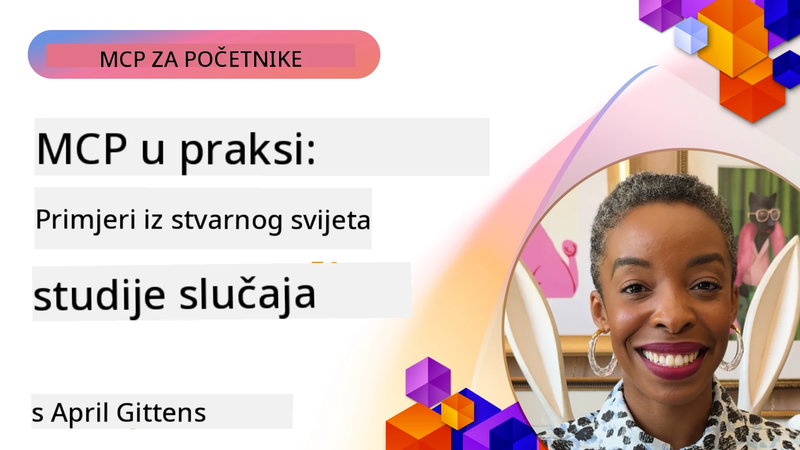

# MCP u praksi: Studije slučaja iz stvarnog svijeta

_(Kliknite gornju sliku za pregled videa ove lekcije)_

Protokol model konteksta (MCP) mijenja način na koji AI aplikacije komuniciraju s podacima, alatima i uslugama. Ovaj odjeljak prikazuje studije slučaja iz stvarnog svijeta koje demonstriraju praktične primjene MCP-a u raznim poslovnim scenarijima.

## Pregled

Ovaj odjeljak prikazuje konkretne primjere implementacija MCP-a, ističući kako organizacije koriste ovaj protokol za rješavanje složenih poslovnih izazova. Analizom ovih studija slučaja dobit ćete uvid u svestranost, skalabilnost i praktične koristi MCP-a u stvarnim scenarijima.

## Ključni ciljevi učenja

Istraživanjem ovih studija slučaja naučit ćete:

- Razumjeti kako se MCP može primijeniti za rješavanje specifičnih poslovnih problema
- Upoznati različite obrasce integracije i arhitektonske pristupe
- Prepoznati najbolje prakse za implementaciju MCP-a u poslovnim okruženjima
- Dobiti uvid u izazove i rješenja pronađena u stvarnim implementacijama
- Identificirati prilike za primjenu sličnih obrazaca u vlastitim projektima

## Istaknute studije slučaja

### 1. [Azure AI Travel Agents – Referentna implementacija](./travelagentsample.md)

Ova studija slučaja proučava cjelovito referentno rješenje Microsofta koje demonstrira kako izgraditi višestruke agente za planiranje putovanja podržanih umjetnom inteligencijom koristeći MCP, Azure OpenAI i Azure AI Search. Projekt prikazuje:

- Orkestraciju više agenata putem MCP-a
- Integraciju podataka poduzeća s Azure AI Search
- Sigurnu, skalabilnu arhitekturu koristeći Azure usluge
- Proširive alate s ponovljivo upotrebljivim MCP komponentama
- Konverzacijsko korisničko iskustvo pogonjeno Azure OpenAI-jem

Detalji arhitekture i implementacije pružaju dragocjene uvide u izgradnju složenih višestrukih sustava s MCP-om kao slojem koordinacije.

### 2. [Ažuriranje stavki u Azure DevOps-u pomoću podataka s YouTube-a](./UpdateADOItemsFromYT.md)

Ova studija slučaja prikazuje praktičnu primjenu MCP-a za automatizaciju radnih procesa. Pokazuje kako se MCP alati mogu koristiti za:

- Ekstrahiranje podataka s online platformi (YouTube)
- Ažuriranje radnih stavki u Azure DevOps sustavima
- Kreiranje ponovljivih automatiziranih tijekova rada
- Integraciju podataka između različitih sustava

Ovaj primjer ilustrira kako čak i relativno jednostavne implementacije MCP-a mogu značajno povećati učinkovitost automatiziranjem rutinskih zadataka i poboljšanjem konzistencije podataka među sustavima.

### 3. [Preuzimanje dokumentacije u stvarnom vremenu s MCP-om](./docs-mcp/README.md)

Ova studija slučaja vodi vas kroz povezivanje Python konzolnog klijenta s Model Context Protocol (MCP) serverom za dohvaćanje i zapisivanje kontekstualno osviještene Microsoft dokumentacije u stvarnom vremenu. Naučit ćete kako:

- Povezati se s MCP serverom koristeći Python klijent i službeni MCP SDK
- Upotrijebiti streaming HTTP klijente za učinkovito dohvaćanje podataka u stvarnom vremenu
- Pozvati dokumentacijske alate na serveru i odgovor zapisivati izravno u konzolu
- Integrirati ažuriranu Microsoft dokumentaciju u svoj tijek rada bez napuštanja terminala

Poglavlje uključuje praktični zadatak, minimalni radni primjer koda i poveznice na dodatne resurse za dublje učenje. Pogledajte cjeloviti vodič i kod u povezanoj lekciji kako biste razumjeli kako MCP može transformirati pristup dokumentaciji i produktivnost programera u konzolnim okruženjima.

### 4. [Interaktivni generator plana učenja putem web aplikacije s MCP-om](./docs-mcp/README.md)

Ova studija slučaja prikazuje kako izgraditi interaktivnu web aplikaciju koristeći Chainlit i Model Context Protocol (MCP) za generiranje personaliziranih planova učenja za bilo koju temu. Korisnici mogu odabrati predmet (npr. "AI-900 certifikat") i trajanje učenja (npr. 8 tjedana), a aplikacija pruža tjedni pregled preporučenog sadržaja. Chainlit omogućuje konverzacijsko chat sučelje, čineći iskustvo zanimljivim i prilagodljivim.

- Konverzacijska web aplikacija potpomognuta Chainlit-om
- Korisnički definirani upiti za temu i trajanje
- Preporuke sadržaja tjedan po tjedan koristeći MCP
- Odgovori u stvarnom vremenu, prilagodljivi u chat sučelju

Projekt ilustrira kako se konverzacijska umjetna inteligencija i MCP mogu kombinirati za stvaranje dinamičnih, korisnički vođenih obrazovnih alata u modernom web okruženju.

### 5. [Dokumentacija unutar uređivača s MCP serverom u VS Code-u](./docs-mcp/README.md)

Ova studija slučaja pokazuje kako možete dovesti Microsoft Learn dokumentaciju izravno u svoje VS Code okruženje koristeći MCP server – nema potrebe za prelaskom na preglednik! Vidjet ćete kako:

- Odmah pretraživati i čitati dokumentaciju unutar VS Code-a koristeći MCP panel ili komandnu paletu
- Referencirati dokumentaciju i umetati poveznice izravno u README ili markdown datoteke kolegija
- Koristiti GitHub Copilot i MCP zajedno za neprimjetne, AI-potpomognute radne tijekove dokumentacije i koda
- Provjeravati i poboljšavati svoju dokumentaciju s povratnim informacijama u stvarnom vremenu i točnošću iz Microsofta
- Integrirati MCP s GitHub radnim tokovima za kontinuiranu validaciju dokumentacije

Implementacija uključuje:

- Primjer konfiguracije `.vscode/mcp.json` za jednostavno postavljanje
- Vodiče kroz iskustvo unutar uređivača temeljene na snimkama zaslona
- Savjete za kombiniranje Copilota i MCP-a za maksimalnu produktivnost

Ovaj scenarij je idealan za autore kolegija, pisce dokumentacije i programere koji žele ostati fokusirani unutar uređivača dok rade s dokumentima, Copilotom i alatima za validaciju – sve potpomognuto MCP-om.

### 6. [Kreiranje APIM MCP servera](./apimsample.md)

Ova studija slučaja pruža detaljni vodič korak po korak kako stvoriti MCP server koristeći Azure API Management (APIM). Obuhvaća:

- Postavljanje MCP servera u Azure API Management
- Izlaganje API operacija kao MCP alata
- Konfiguriranje pravila za ograničavanje brzine i sigurnost
- Testiranje MCP servera korištenjem Visual Studio Code-a i GitHub Copilota

Ovaj primjer ilustrira kako iskoristiti mogućnosti Azurea za stvaranje robusnog MCP servera koji se može koristiti u različitim aplikacijama, unapređujući integraciju AI sustava s poslovnim API-jima.

### 7. [GitHub MCP registar — ubrzanje agentne integracije](https://github.com/mcp)

Ova studija slučaja proučava kako GitHub MCP registar, lansiran u rujnu 2025., rješava kritični izazov u AI ekosustavu: fragmentirano pronalaženje i implementaciju Model Context Protocol (MCP) servera.

#### Pregled
**MCP registar** rješava rastući problem raspršenih MCP servera po repozitorijima i registrima, što je prije usporavalo i otežavalo integraciju. Ovi serveri omogućuju AI agentima interakciju s vanjskim sustavima poput API-ja, baza podataka i izvora dokumentacije.

#### Definicija problema
Programeri koji grade agentne tijekove rada suočavali su se s nekoliko izazova:
- **Loša dostupnost** MCP servera preko različitih platformi
- **Ponavljajuća pitanja o postavljanju** raspršena po forumima i dokumentaciji
- **Sigurnosni rizici** iz neprovjerenih i nepouzdanih izvora
- **Nedostatak standardizacije** u kvaliteti i kompatibilnosti servera

#### Arhitektura rješenja
GitHub MCP registar centralizira povjerene MCP servere s ključnim značajkama:
- **Instalacija jednim klikom** integrirana putem VS Code za pojednostavljeno postavljanje
- **Sortiranje prema važnosti** po broju zvjezdica, aktivnosti i potvrdi zajednice
- **Izravna integracija** s GitHub Copilotom i ostalim alatima kompatibilnim s MCP-om
- **Model otvorenog doprinosa** koji omogućuje doprinos kako zajednici, tako i poslovnim partnerima

#### Poslovni utjecaj
Registar je donio mjerljive poboljšanja:
- **Brži početak rada** za programere koristeći alate poput Microsoft Learn MCP servera, koji streama službenu dokumentaciju izravno agentima
- **Poboljšanu produktivnost** putem specijaliziranih servera poput `github-mcp-server`, omogućujući prirodnojezičnu GitHub automatizaciju (kreiranje PR-a, ponovna pokretanja CI-a, skeniranje koda)
- **Jače povjerenje u ekosustav** kroz kurirane popise i transparentne standarde konfiguracije

#### Strateška vrijednost
Za praktičare specijalizirane za upravljanje životnim ciklusom agenata i reproducibilnim tijekovima rada, MCP registar pruža:
- **Modularne mogućnosti implementacije agenata** sa standardiziranim komponentama
- **Evaluacijske pipeline podržane registrima** za konzistentno testiranje i validaciju
- **Međualatnu interoperabilnost** koja omogućuje besprijekornu integraciju između različitih AI platformi

Ova studija slučaja dokazuje da MCP registar nije samo direktorij—on je temeljna platforma za skalabilnu, stvarnu implementaciju modela i deploy agentnih sustava.

### 8. [Objavljivanje na društvenim mrežama putem agenta](./publora-social-publishing.md)

Ova studija slučaja prikazuje **daljinski MCP server sposoban za pisanje** — čiji alati izvršavaju nepovratne radnje u ime korisnika — koristeći objavljivanje na društvenim mrežama kao primjer u radu. Agent smišlja objavu, čovjek je odobrava, a server je raspoređuje na mrežama.

Zanimljiv dio su dizajnerska ograničenja koja objavljivanje nameće, a koja vrijede za svaki server koji piše, a ne samo čita:

- **Otkrivena dostupnost, autentificirano izvršavanje** — `tools/list` odgovara bez vjerodajnica kako bi registri i klijenti mogli introspektirati, dok svaki `tools/call` zahtijeva token i u suprotnom vraća `401` s `WWW-Authenticate` zaglavljem
- **OAuth registracija bez koraka izvan propusnice** — dinamička registracija klijenta danas, s dokumentima meta podataka o Client ID-ju kao smjerom prema kojem teži specifikacija `2026-07-28`
- **Bilješke o alatima** (`readOnlyHint`, `destructiveHint`, `idempotentHint`) koje klijenti koriste za odlučivanje o potvrdi — nagovještaji umjesto nametanja, nešto što katalog direktorija sada očekuje u procesu pregleda
- **Neizmišljivi identifikatori**, tako da izmišljena vrijednost glasno padne umjesto da djeluje na izgledno pristojnoj vrijednosti
- **Ključevi idempotencije na alatima za kreiranje objava**, tako da ponovno pokušavanje od strane izvršenja agenta ne rezultira duplikatom objave
- **Cilj bez učinka opisan u shemi alata** koji vježba cijeli put pisanja, a ne objavljuje ništa, za recenzente i CI

Poglavlje završava kratkim kontrolnim popisom koji možete primijeniti na server koji gradite.

## Zaključak

Ove osam sveobuhvatnih studija slučaja demonstriraju izvanrednu svestranost i praktične primjene Model Context Protocola u različitim stvarnim scenarijima. Od složenih sustava za planiranje putovanja s više agenata i upravljanja poslovnim API-jima do pojednostavljenih tijekova rada za dokumentaciju i revolucionarni GitHub MCP registar, ovi primjeri pokazuju kako MCP pruža standardizirani, skalabilni način povezivanja AI sustava s alatima, podacima i uslugama potrebnim za pružanje izvrsnih vrijednosti.

Studije slučaja obuhvaćaju više dimenzija implementacije MCP-a:
- **Integracija u poduzeću**: Azure API Management i Azure DevOps automatizacija
- **Orkestracija više agenata**: planiranje putovanja s koordiniranim AI agentima
- **Produktivnost programera**: integracija s VS Code-om i pristup dokumentaciji u stvarnom vremenu
- **Razvoj ekosustava**: GitHub MCP registar kao temeljna platforma
- **Obrazovne primjene**: interaktivni generatori planova učenja i konverzacijska sučelja

Istraživanjem ovih implementacija dobivate ključne uvide u:
- **Arhitektonske obrasce** za različite razmjere i slučajeve upotrebe
- **Strategije implementacije** koje uravnotežuju funkcionalnost i održivost
- **Sigurnosne i skalabilne** aspekte za produkcijska rješenja
- **Najbolje prakse** za razvoj MCP servera i integraciju klijenata
- **Razmišljanje o ekosustavu** za izgradnju međusobno povezanih AI-pogonjenih rješenja

Ovi primjeri zajednički pokazuju da MCP nije samo teoretski okvir već zreo, produkcijski spreman protokol koji omogućuje praktična rješenja za složene poslovne izazove. Bilo da gradite jednostavne alate za automatizaciju ili sofisticirane višestruke agentske sustave, obrasci i pristupi prikazani ovdje pružaju čvrstu osnovu za vlastite MCP projekte.

## Dodatni resursi

- [GitHub spremište Azure AI Travel Agents](https://github.com/Azure-Samples/azure-ai-travel-agents)
- [Azure DevOps MCP alat](https://github.com/microsoft/azure-devops-mcp)
- [Playwright MCP alat](https://github.com/microsoft/playwright-mcp)
- [Microsoft Docs MCP server](https://github.com/MicrosoftDocs/mcp)
- [GitHub MCP registar — ubrzanje agentne integracije](https://github.com/mcp)
- [Primjeri MCP zajednice](https://github.com/microsoft/mcp)

## Što slijedi

- Prethodno: [Modul 8: Najbolje prakse](../08-BestPractices/README.md)
- Sljedeće: [Modul 10: Optimizacija AI tijekova rada: Izgradnja MCP servera s Microsoft Foundry Toolkit](../10-StreamliningAIWorkflowsBuildingAnMCPServerWithAIToolkit/README.md)

---

<!-- CO-OP TRANSLATOR DISCLAIMER START -->
**Napomena**:
Ovaj dokument je preveden korištenjem AI prevoditeljskog servisa [Co-op Translator](https://github.com/Azure/co-op-translator). Iako težimo točnosti, imajte na umu da automatski prijevodi mogu sadržavati greške ili netočnosti. Izvorni dokument na izvornom jeziku treba smatrati autoritativnim izvorom. Za važne informacije preporuča se profesionalni ljudski prijevod. Nismo odgovorni za bilo kakva nesporazumevanja ili pogrešne interpretacije koje proizlaze iz korištenja ovog prijevoda.
<!-- CO-OP TRANSLATOR DISCLAIMER END -->