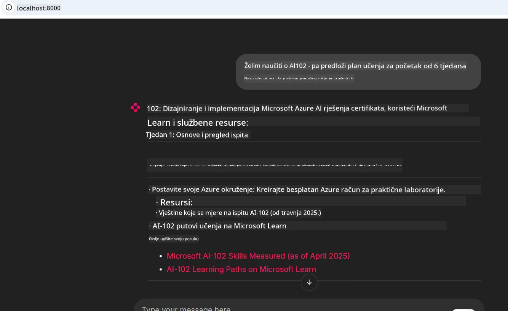
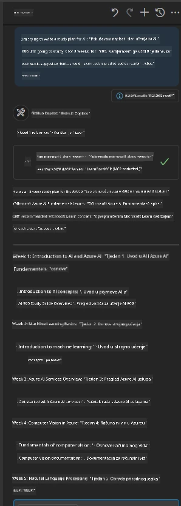

# Studija slučaja: Povezivanje na Microsoft Learn Docs MCP server iz klijentske aplikacije

Jeste li se ikada našli kako istovremeno koristite stranice s dokumentacijom, Stack Overflow i bezbroj kartica pretraživača, dok pokušavate riješiti problem u svom kodu? Možda držite drugi monitor samo za dokumentaciju ili stalno alt-tabate između svog IDE-a i preglednika. Zar ne bi bilo bolje da možete donijeti dokumentaciju izravno u svoj radni tok — integriranu u svoje aplikacije, IDE ili čak vlastite prilagođene alate? U ovoj studiji slučaja istražit ćemo kako to napraviti tako što ćemo se izravno povezati na Microsoft Learn Docs MCP server iz vlastite klijentske aplikacije.

## Pregled

Moderni razvoj nije samo pisanje koda — radi se o pronalaženju pravih informacija u pravo vrijeme. Dokumentacija je posvuda, ali rijetko tamo gdje vam je najpotrebnija: unutar vaših alata i radnih tokova. Integriranjem dohvaćanja dokumentacije izravno u vaše aplikacije možete uštedjeti vrijeme, smanjiti mijenjanje konteksta i povećati produktivnost. U ovom dijelu pokazat ćemo vam kako povezati klijenta s Microsoft Learn Docs MCP serverom kako biste mogli pristupiti dokumentaciji u stvarnom vremenu i poznatog konteksta bez napuštanja aplikacije.

Proći ćemo kroz proces uspostavljanja veze, slanja zahtjeva i učinkovito rukovanje streaming odgovorima. Ovaj pristup ne samo da pojednostavljuje vaš radni tok, već otvara vrata izgradnji pametnijih i korisnijih razvojnih alata.

## Ciljevi učenja

Zašto ovo radimo? Zato što su najbolja korisnička iskustva ona koja uklanjaju prepreke. Zamislite svijet u kojem vaš uređivač koda, chatbot ili web aplikacija mogu odmah odgovoriti na vaša pitanja o dokumentaciji koristeći najnoviji sadržaj s Microsoft Learta. Na kraju ovog poglavlja znat ćete kako:

- Razumjeti osnove komunikacije MCP server-klijent za dokumentaciju
- Implementirati konzolnu ili web aplikaciju za povezivanje na Microsoft Learn Docs MCP server
- Koristiti streaming HTTP klijente za dohvaćanje dokumentacije u stvarnom vremenu
- Zabilježiti i protumačiti odgovore za dokumentaciju u svojoj aplikaciji

Vidjet ćete kako vam ove vještine pomažu izgraditi alate koji nisu samo reaktivni, već i zaista interaktivni i svjesni konteksta.

## Scenarij 1 - Dohvaćanje dokumentacije u stvarnom vremenu s MCP-om

U ovom scenariju pokazat ćemo vam kako povezati klijenta na Microsoft Learn Docs MCP server kako biste mogli pristupiti dokumentaciji u stvarnom vremenu i poznatog konteksta bez napuštanja aplikacije.

Stavimo ovo u praksu. Vaš zadatak je napisati aplikaciju koja se povezuje na Microsoft Learn Docs MCP server, poziva `microsoft_docs_search` alat i bilježi streaming odgovor na konzolu.

### Zašto ovaj pristup?
Zato što je to temelj za izgradnju naprednijih integracija—bilo da želite pokretati chatbota, proširenje IDE-a ili web nadzornu ploču.

Kod i upute za ovaj scenarij nalaze se u mapi [`solution`](./solution/README.md) unutar ove studije slučaja. Koraci će vas voditi kroz postavljanje veze:
- Upotrijebite službeni MCP SDK i streamable HTTP klijent za povezivanje
- Pozovite `microsoft_docs_search` alat s parametrima upita za dohvat dokumentacije
- Implementirajte ispravno zapisivanje i rukovanje pogreškama
- Kreirajte interaktivno konzolno sučelje za korisnike kako bi mogli unositi više upita za pretraživanje

Ovaj scenarij pokazuje kako:
- Povezati se na Docs MCP server
- Poslati upit
- Parsirati i ispisati rezultate

Evo kako bi mogao izgledati pokretanje rješenja:

```
Prompt> What is Azure Key Vault?
Answer> Azure Key Vault is a cloud service for securely storing and accessing secrets. ...
```

U nastavku je minimalni primjer rješenja. Cijeli kod i detalji dostupni su u mapi rješenja.

<details>
<summary>Python</summary>

```python
import asyncio
from mcp.client.streamable_http import streamablehttp_client
from mcp import ClientSession

async def main():
    async with streamablehttp_client("https://learn.microsoft.com/api/mcp") as (read_stream, write_stream, _):
        async with ClientSession(read_stream, write_stream) as session:
            await session.initialize()
            result = await session.call_tool("microsoft_docs_search", {"query": "Azure Functions best practices"})
            print(result.content)

if __name__ == "__main__":
    asyncio.run(main())
```

- Za potpunu implementaciju i zapisivanje, pogledajte [`scenario1.py`](../../../../09-CaseStudy/docs-mcp/solution/python/scenario1.py).
- Za upute o instalaciji i upotrebi, pogledajte datoteku [`README.md`](./solution/python/README.md) u istoj mapi.
</details>


## Scenarij 2 - Interaktivna web aplikacija za generiranje plana učenja s MCP-om

U ovom scenariju naučit ćete kako integrirati Docs MCP u web razvojni projekt. Cilj je omogućiti korisnicima pretraživanje Microsoft Learn dokumentacije izravno s web sučelja, čineći dokumentaciju trenutno dostupnom unutar vaše aplikacije ili web stranice.

Vidjet ćete kako:
- Postaviti web aplikaciju
- Povezati se na Docs MCP server
- Obraditi unos korisnika i prikazati rezultate

Evo kako bi mogao izgledati rad rješenja:

```
User> I want to learn about AI102 - so suggest the roadmap to get it started from learn for 6 weeks

Assistant> Here’s a detailed 6-week roadmap to start your preparation for the AI-102: Designing and Implementing a Microsoft Azure AI Solution certification, using official Microsoft resources and focusing on exam skills areas:

---
## Week 1: Introduction & Fundamentals
- **Understand the Exam**: Review the [AI-102 exam skills outline](https://learn.microsoft.com/en-us/credentials/certifications/exams/ai-102/).
- **Set up Azure**: Sign up for a free Azure account if you don't have one.
- **Learning Path**: [Introduction to Azure AI services](https://learn.microsoft.com/en-us/training/modules/intro-to-azure-ai/)
- **Focus**: Get familiar with Azure portal, AI capabilities, and necessary tools.

....more weeks of the roadmap...

Let me know if you want module-specific recommendations or need more customized weekly tasks!
```

U nastavku je minimalni primjer rješenja. Cijeli kod i detalji dostupni su u mapi rješenja.



<details>
<summary>Python (Chainlit)</summary>

Chainlit je okvir za izgradnju konverzacijskih AI web aplikacija. Omogućuje lako stvaranje interaktivnih chatbotova i asistenata koji mogu pozivati MCP alate i prikazivati rezultate u stvarnom vremenu. Idealan je za brzu prototipizaciju i korisnička sučelja.

```python
import chainlit as cl
import requests

MCP_URL = "https://learn.microsoft.com/api/mcp"

@cl.on_message
def handle_message(message):
    query = {"question": message}
    response = requests.post(MCP_URL, json=query)
    if response.ok:
        result = response.json()
        cl.Message(content=result.get("answer", "No answer found.")).send()
    else:
        cl.Message(content="Error: " + response.text).send()
```

- Za potpunu implementaciju, pogledajte [`scenario2.py`](../../../../09-CaseStudy/docs-mcp/solution/python/scenario2.py).
- Za upute o postavljanju i pokretanju, pogledajte [`README.md`](./solution/python/README.md).
</details>


## Scenarij 3: Dokumentacija u uređivaču s MCP serverom u VS Codeu

Ako želite imati Microsoft Learn Docs izravno unutar VS Codea (umjesto da mijenjate kartice preglednika), možete koristiti MCP server u svom uređivaču. Ovo vam omogućuje:
- Pretraživanje i čitanje dokumenatcije u VS Codeu bez napuštanja radnog okruženja.
- Referenciranje dokumentacije i umetanje poveznica izravno u README ili datoteke tečaja.
- Kombiniranje GitHub Copilota i MCP-a za besprijekoran, AI-pogonjen radni tijek dokumentacije.

**Vidjet ćete kako:**
- Dodati valjani `.vscode/mcp.json` datoteku u korijen svog radnog prostora (vidi primjer dolje).
- Otvoriti MCP panel ili koristiti paletu naredbi u VS Codeu za pretraživanje i umetanje dokumentacije.
- Izravno referencirati dokumentaciju u svojim markdown datotekama dok radite.
- Kombinirati ovaj radni tijek s GitHub Copilotom za još veću produktivnost.

Evo primjera kako postaviti MCP server u VS Codeu:

```json
{
  "servers": {
    "LearnDocsMCP": {
      "url": "https://learn.microsoft.com/api/mcp"
    }
  }
}
```

</details>

> Za detaljan vodič sa snimkama zaslona i korak-po-korak uputama, pogledajte [`README.md`](./solution/scenario3/README.md).



Ovaj pristup je idealan za one koji izrađuju tehničke tečajeve, pišu dokumentaciju ili razvijaju kod s čestim potrebama za referencama.

## Ključne spoznaje

Integracija dokumentacije izravno u vaše alate nije samo pogodnost — to je revolucionarna promjena za produktivnost. Povezujući se na Microsoft Learn Docs MCP server iz svog klijenta možete:

- Eliminirati mijenjanje konteksta između koda i dokumentacije
- Dohvatiti ažuriranu, kontekstualno svjesnu dokumentaciju u stvarnom vremenu
- Izgraditi pametnije, interaktivnije razvojne alate

Ove vještine pomoći će vam stvoriti rješenja koja nisu samo učinkovita, već i ugodna za korištenje.

## Dodatni izvori

Za produbljivanje razumijevanja, istražite ove službene izvore:

- [Microsoft Learn Docs MCP Server (GitHub)](https://github.com/MicrosoftDocs/mcp)
- [Početak rada s Azure MCP Serverom (mcp-python)](https://learn.microsoft.com/en-us/azure/developer/azure-mcp-server/get-started#create-the-python-app)
- [Što je Azure MCP Server?](https://learn.microsoft.com/en-us/azure/developer/azure-mcp-server/)
- [Uvod u Model Context Protocol (MCP)](https://modelcontextprotocol.io/introduction)
- [Dodavanje dodataka s MCP servera (Python)](https://learn.microsoft.com/en-us/semantic-kernel/concepts/plugins/adding-mcp-plugins)

## Što dalje

- Natrag na: [Pregled studija slučaja](../README.md)
- Nastavi na: [Modul 10: Optimizacija AI radnih tokova pomoću Microsoft Foundry Toolkita](../../10-StreamliningAIWorkflowsBuildingAnMCPServerWithAIToolkit/README.md)

---

<!-- CO-OP TRANSLATOR DISCLAIMER START -->
**Napomena**:
Ovaj dokument je preveden korištenjem AI prevoditeljskog servisa [Co-op Translator](https://github.com/Azure/co-op-translator). Iako težimo točnosti, imajte na umu da automatski prijevodi mogu sadržavati greške ili netočnosti. Izvorni dokument na izvornom jeziku treba smatrati autoritativnim izvorom. Za važne informacije preporuča se profesionalni ljudski prijevod. Nismo odgovorni za bilo kakva nesporazumevanja ili pogrešne interpretacije koje proizlaze iz korištenja ovog prijevoda.
<!-- CO-OP TRANSLATOR DISCLAIMER END -->