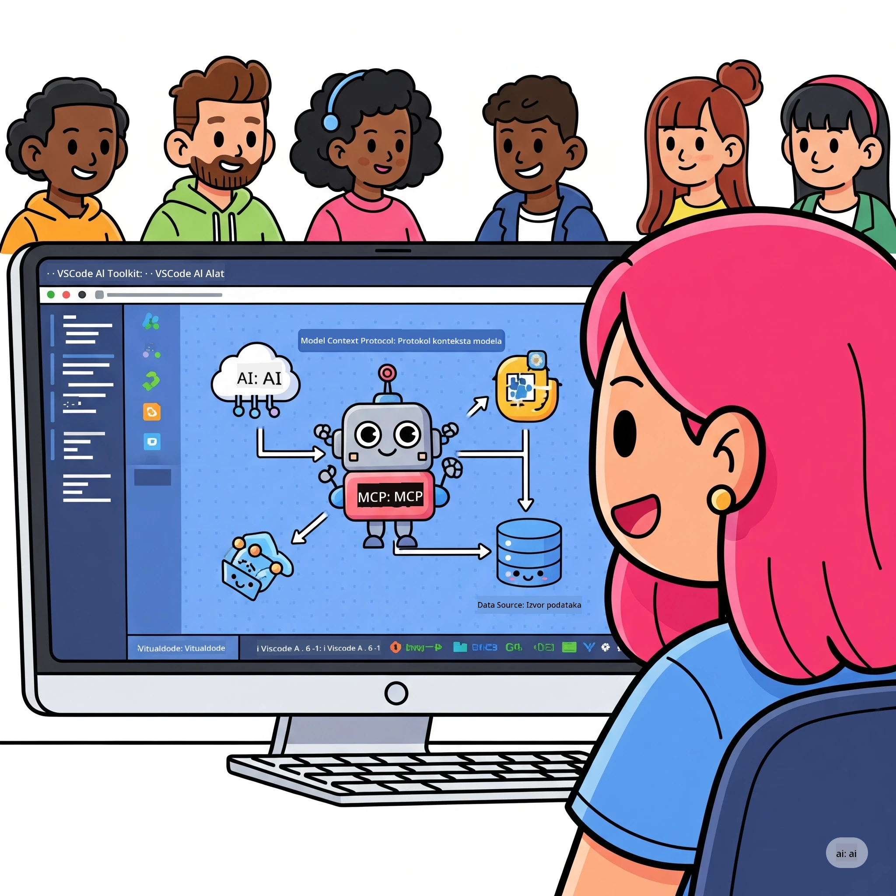
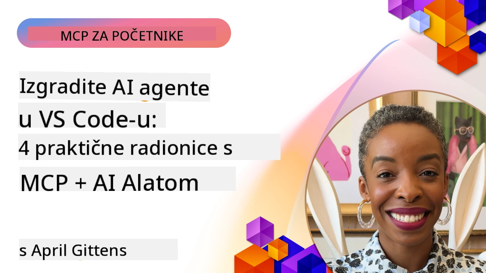

# Optimizacija AI radnih tokova: Izrada MCP poslužitelja s Microsoft Foundry Toolkit

## 🎯 Pregled

_(Kliknite sliku iznad za prikaz videozapisa ove lekcije)_

Dobrodošli u **Radionicu Model Context Protocol (MCP)**! Ova sveobuhvatna radionica s praktičnim primjenama spaja dvije vrhunske tehnologije za revoluciju u razvoju AI aplikacija:

> **Napomena o kompatibilnosti:** kod radionice je izrađen i testiran s MCP
> `2025-11-25`, kao što pokazuje značka iznad. Koristite
> [trenutnu specifikaciju `2026-07-28`](https://modelcontextprotocol.io/specification/2026-07-28/)
> za nove implementacije protokola i pregledajte bilješke o izdanju SDK-a prije
> migracije radionica.

- **🔗 Model Context Protocol (MCP)**: Otvoreni standard za besprijekornu integraciju AI alata
- **🛠️ Microsoft Foundry Toolkit proširenje za VS Code**: Moćno Microsoftovo proširenje za razvoj AI-ja

### 🎓 Što ćete naučiti

Do kraja ove radionice, ovladat ćete izgradnjom inteligentnih aplikacija koje povezuju AI modele s alatima i uslugama iz stvarnog svijeta. Od automatiziranog testiranja do prilagođenih API integracija, steći ćete praktične vještine za rješavanje složenih poslovnih izazova.

## 🏗️ Tehnološki paket

### 🔌 Model Context Protocol (MCP)

MCP je **"USB-C za AI"** - univerzalni standard koji povezuje AI modele s eksternim alatima i izvorima podataka.

**✨ Ključne značajke:**

- 🔄 **Standardizirana integracija**: Univerzalno sučelje za veze AI-alata
- 🏛️ **Fleksibilna arhitektura**: Lokalni i udaljeni poslužitelji putem stdio/SSE transporta
- 🧰 **Bogati ekosustav**: Alati, upiti i resursi u jednom protokolu
- 🔒 **Spreman za poduzeća**: Ugrađena sigurnost i pouzdanost

**🎯 Zašto je MCP važan:**
Kao što je USB-C eliminirao kaos s kablovima, MCP uklanja složenost AI integracija. Jedan protokol, beskrajne mogućnosti.

### 🤖 Microsoft Foundry Toolkit proširenje za VS Code

Microsoftovo vodeće proširenje za razvoj AI-ja koje pretvara VS Code u AI moćnu platformu.

**🚀 Najvažnije značajke:**

- 📦 **Katalog modela**: Pristup modelima s Azure AI, GitHub, Hugging Face, Ollama
- ⚡ **Lokalno izvođenje**: ONNX-optimizirano izvođenje na CPU/GPU/NPU
- 🏗️ **Agent Builder**: Vizualni razvoj AI agenata s MCP integracijom
- 🎭 **Višestruki modalitet**: Podrška za tekst, vid i strukturirane izlaze

**💡 Prednosti razvoja:**

- Implementacija modela bez konfiguracije
- Vizualno dizajniranje upita
- Okruženje za testiranje u stvarnom vremenu
- Besprijekorna MCP poslužiteljska integracija

## 📚 Put učenja

### [🚀 Modul 1: Osnove Microsoft Foundry Toolkita](./lab1/README.md)

**Trajanje**: 15 minuta

- 🛠️ Instalirajte i konfigurirajte Microsoft Foundry Toolkit za VS Code
- 🗂️ Istražite Katalog modela (100+ modela s GitHub, ONNX, OpenAI, Anthropic, Google)
- 🎮 Ovladavanje Interaktivnim okruženjem za testiranje modela u stvarnom vremenu
- 🤖 Izgradite svog prvog AI agenta s Agent Builderom
- 📊 Procijenite performanse modela s ugrađenim metrima (F1, relevantnost, sličnost, koherencija)
- ⚡ Naučite o serijskoj obradi i podršci za višemodalitet

**🎯 Ishod učenja**: Izradite funkcionalnog AI agenta s opsežnim razumijevanjem mogućnosti Microsoft Foundry Toolkita

### [🌐 Modul 2: MCP s osnovama Microsoft Foundry Toolkita](./lab2/README.md)

**Trajanje**: 20 minuta

- 🧠 Ovladavanje arhitekturom i konceptima Model Context Protocol (MCP)
- 🌐 Istražite Microsoftov MCP poslužiteljski ekosustav
- 🤖 Izgradite agenta za automatizaciju preglednika koristeći Playwright MCP poslužitelj
- 🔧 Integrirajte MCP poslužitelje s Microsoft Foundry Toolkit Agent Builderom
- 📊 Konfigurirajte i testirajte MCP alate unutar svojih agenata
- 🚀 Izvezite i implementirajte agente pokretane MCP-om za produkcijsko korištenje

**🎯 Ishod učenja**: Implementirajte AI agenta pojačanog vanjskim alatima putem MCP-a

### [🔧 Modul 3: Napredni MCP razvoj s Microsoft Foundry Toolkit](./lab3/README.md)

**Trajanje**: 20 minuta

- 💻 Izrada prilagođenih MCP poslužitelja pomoću Microsoft Foundry Toolkita
- 🐍 Konfigurirajte i koristite najnoviji MCP Python SDK (v1.9.3)
- 🔍 Postavite i koristite MCP Inspector za ispravljanje pogrešaka
- 🛠️ Izgradite Weather MCP Server s profesionalnim tijekovima ispravljanja pogrešaka
- 🧪 Ispravljajte MCP poslužitelje u okruženjima Agent Builder i Inspector

**🎯 Ishod učenja**: Razvijajte i otklanjajte pogreške prilagođenih MCP poslužitelja s modernim alatima

### [🐙 Modul 4: Praktični MCP razvoj - Prilagođeni GitHub Clone poslužitelj](./lab4/README.md)

**Trajanje**: 30 minuta

- 🏗️ Izradite stvarni GitHub Clone MCP Server za razvojne tijekove rada
- 🔄 Implementirajte pametno kloniranje repozitorija s validacijom i upravljanjem pogreškama
- 📁 Kreirajte inteligentno upravljanje direktorijima i integraciju s VS Code
- 🤖 Koristite GitHub Copilot Agent Mode s prilagođenim MCP alatima
- 🛡️ Primijenite pouzdanost spremnu za produkciju i kompatibilnost na različitim platformama

**🎯 Ishod učenja**: Implementirajte produkcijski spreman MCP poslužitelj koji optimizira stvarne razvojne procese

## 💡 Primjene u stvarnom svijetu i utjecaj

### 🏢 Primjeri za poduzeća

#### 🔄 Automatizacija DevOps-a

Transformirajte svoj razvojni tijek rada inteligentnom automatizacijom:

- **Pametno upravljanje repozitorijima**: AI-pokretani pregled i odluke o spajanju koda
- **Inteligentni CI/CD**: Automatizirana optimizacija pipeline-a na temelju promjena koda
- **Triage problema**: Automatska klasifikacija i dodjela grešaka

#### 🧪 Revolucija u osiguranju kvalitete

Podignite testiranje pomoću AI automatizacije:

- **Inteligentno generiranje testova**: Automatsko stvaranje sveobuhvatnih testnih skupova
- **Vizualno regresijsko testiranje**: AI-pokretano otkrivanje promjena UI-a
- **Praćenje performansi**: Proaktivno otkrivanje i rješavanje problema

#### 📊 Inteligencija podatkovnog toka

Izgradite pametnije tijekove obrade podataka:

- **Adaptivni ETL procesi**: Samooptimizirajuće transformacije podataka
- **Otkrivanje anomalija**: Nadzor kvalitete podataka u stvarnom vremenu
- **Inteligentno usmjeravanje**: Pametno upravljanje protokom podataka

#### 🎧 Poboljšanje korisničkog iskustva

Stvorite izvanredne interakcije s korisnicima:

- **Podrška osviještena o kontekstu**: AI agenti s pristupom povijesti korisnika
- **Proaktivno rješavanje problema**: Prediktivna korisnička služba
- **Integracija na više kanala**: Jedinstveno AI iskustvo preko platformi

## 🛠️ Preduvjeti i postavljanje

### 💻 Zahtjevi sustava

| Komponenta | Zahtjev | Napomene |
|-----------|-------------|-------|
| **Operativni sustav** | Windows 10+, macOS 10.15+, Linux | Bilo koji moderni OS |
| **Visual Studio Code** | Najnovija stabilna verzija | Potrebno za Microsoft Foundry Toolkit |
| **Node.js** | v18.0+ i npm | Za razvoj MCP poslužitelja |
| **Python** | 3.10+ | Neobavezno za Python MCP poslužitelje |
| **Memorija** | minimalno 8GB RAM-a | Preporučeno 16GB za lokalne modele |

### 🔧 Razvojno okruženje

#### Preporučena VS Code proširenja

- **Microsoft Foundry Toolkit** (ms-windows-ai-studio.windows-ai-studio)
- **Python** (ms-python.python)
- **Python Debugger** (ms-python.debugpy)
- **GitHub Copilot** (GitHub.copilot) - Opcionalno, ali korisno

#### Dodatni alati

- **uv**: Moderni Python upravitelj paketima
- **MCP Inspector**: Vizualni alat za ispravljanje pogrešaka MCP poslužitelja
- **Playwright**: Za primjere automatizacije weba

## 🎖️ Ishodi učenja i put certifikata

### 🏆 Popis za pregled vještina

Završetkom ove radionice, postat ćete stručnjak u:

#### 🎯 Temeljne kompetencije

- [ ] **Ovladavanje MCP protokolom**: Duboko razumijevanje arhitekture i obrazaca implementacije
- [ ] **Vještina rada s Microsoft Foundry Toolkitom**: Ekspertno korištenje za brzi razvoj
- [ ] **Razvoj prilagođenih poslužitelja**: Izgradnja, implementacija i održavanje MCP poslužitelja za produkciju
- [ ] **Izvrsnost u integraciji alata**: Besprijekorna povezanost AI-ja s postojećim razvojnim procesima
- [ ] **Primjena vještina za rješavanje problema**: Primjena naučenih znanja na stvarne poslovne izazove

#### 🔧 Tehničke vještine

- [ ] Postavljanje i konfiguracija Microsoft Foundry Toolkita u VS Code
- [ ] Dizajn i implementacija prilagođenih MCP poslužitelja
- [ ] Integracija Microsoft Foundry modela s MCP arhitekturom
- [ ] Izgradnja automatiziranih testnih tijekova s Playwrightom
- [ ] Implementacija AI agenata za produkcijsko korištenje
- [ ] Ispravljanje i optimizacija performansi MCP poslužitelja

#### 🚀 Napredne mogućnosti

- [ ] Arhitektura AI integracija na razini poduzeća
- [ ] Implementacija najboljih sigurnosnih praksi za AI aplikacije
- [ ] Dizajn skalabilnih MCP poslužiteljskih arhitektura
- [ ] Izrada prilagođenih lanaca alata za specifične domene
- [ ] Mentoriranje drugih u AI-nativnom razvoju

## 📖 Dodatni resursi

- [MCP specifikacija (2026-07-28)](https://modelcontextprotocol.io/specification/2026-07-28/)
- [Microsoft Foundry Toolkit GitHub repozitorij](https://github.com/microsoft/vscode-ai-toolkit)
- [Zbirka uzoraka MCP poslužitelja](https://github.com/modelcontextprotocol/servers)
- [Vodič najboljih praksi](https://modelcontextprotocol.io/docs/best-practices)
- [OWASP MCP Top 10](https://microsoft.github.io/mcp-azure-security-guide/mcp/) - Najbolje sigurnosne prakse

---

**🚀 Spremni za revoluciju u vašem AI razvojnom tijeku?**

Izgradimo zajedno budućnost inteligentnih aplikacija s MCP-om i Microsoft Foundry Toolkitom!

## Što slijedi

Nastavite na: [Modul 11: MCP Server Hands-On Labs](../11-MCPServerHandsOnLabs/README.md)

---

<!-- CO-OP TRANSLATOR DISCLAIMER START -->
**Napomena**:
Ovaj dokument je preveden korištenjem AI prevoditeljskog servisa [Co-op Translator](https://github.com/Azure/co-op-translator). Iako težimo točnosti, imajte na umu da automatski prijevodi mogu sadržavati greške ili netočnosti. Izvorni dokument na izvornom jeziku treba smatrati autoritativnim izvorom. Za važne informacije preporuča se profesionalni ljudski prijevod. Nismo odgovorni za bilo kakva nesporazumevanja ili pogrešne interpretacije koje proizlaze iz korištenja ovog prijevoda.
<!-- CO-OP TRANSLATOR DISCLAIMER END -->