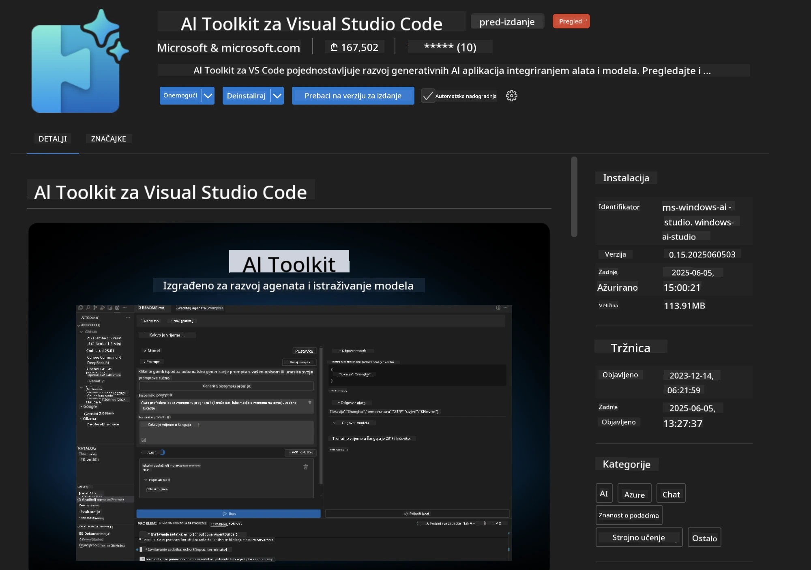
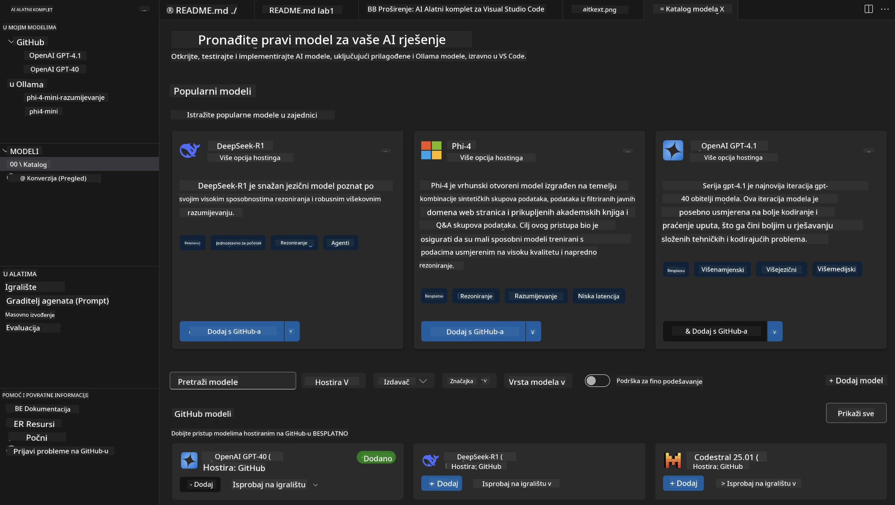
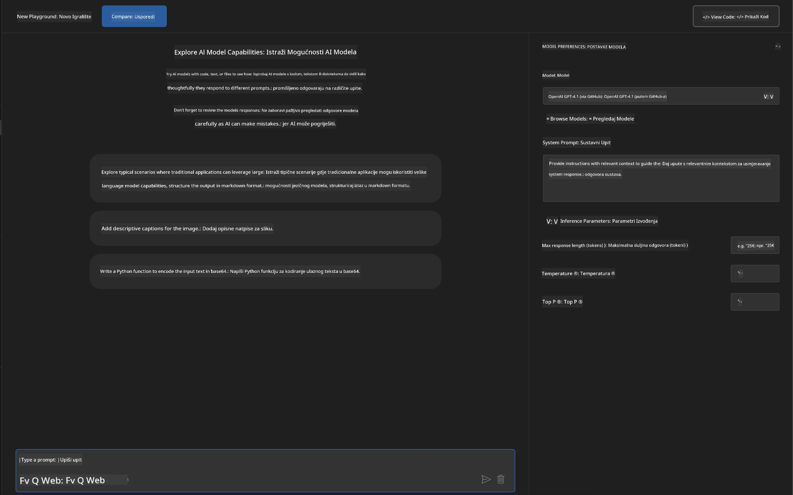
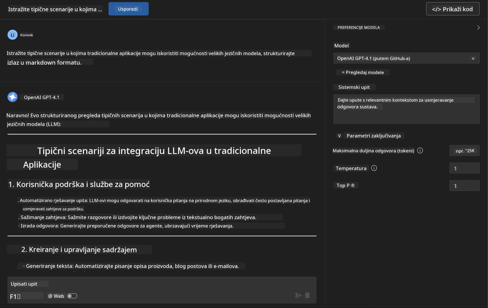
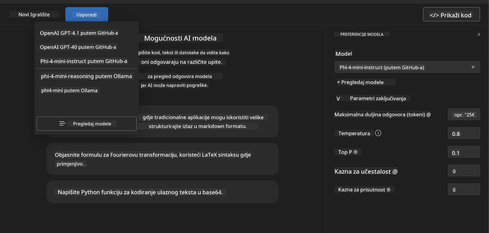
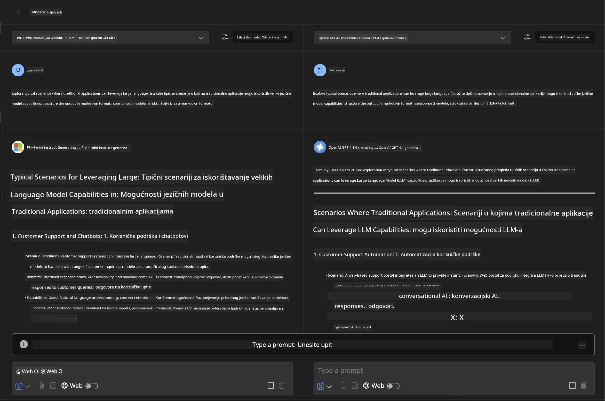
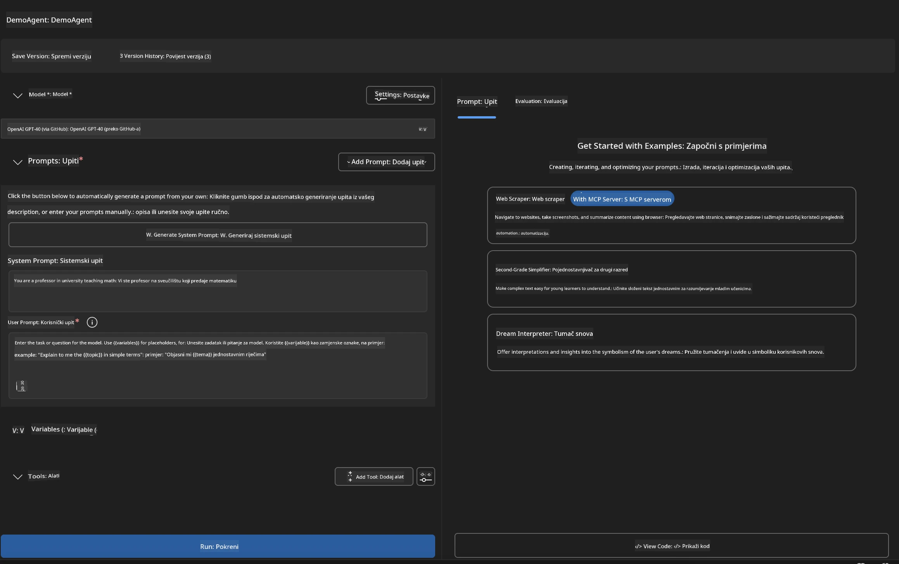
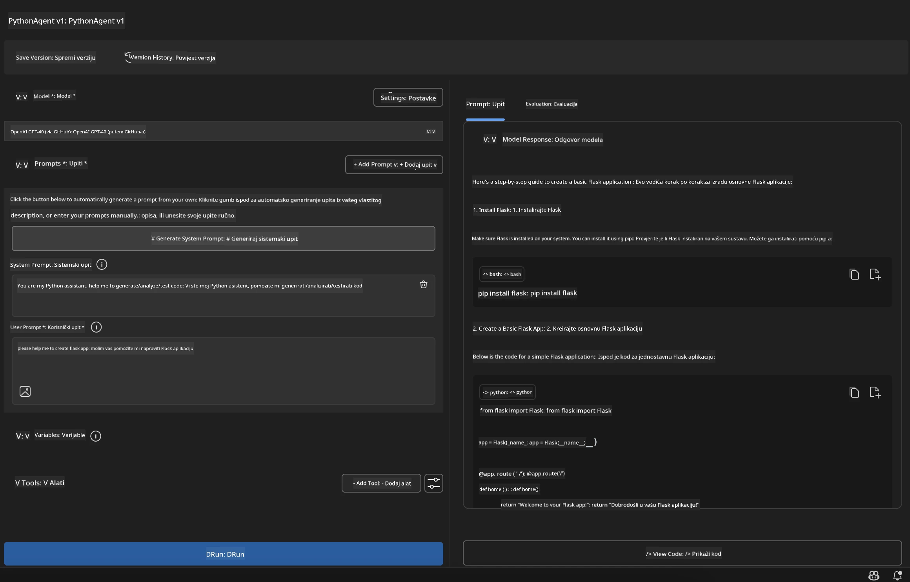

# 🚀 Modul 1: Osnove Microsoft Foundry Toolkit-a

[]()
[]()
[]()

## 📋 Ciljevi učenja

Do kraja ovog modula moći ćete:
- ✅ Instalirati i konfigurirati Microsoft Foundry Toolkit ekstenziju za VS Code
- ✅ Kretati se kroz Katalog modela i razumjeti različite izvore modela
- ✅ Koristiti Playground za testiranje i eksperimentiranje s modelima
- ✅ Kreirati prilagođene AI agente pomoću Agent Builder-a
- ✅ Uspoređivati izvedbu modela kod različitih pružatelja usluga
- ✅ Primijeniti najbolje prakse za prompt inženjering

## 🧠 Uvod u Microsoft Foundry Toolkit

**Microsoft Foundry Toolkit ekstenzija za VS Code** je glavna Microsoftova ekstenzija koja pretvara VS Code u sveobuhvatno razvojno okruženje za AI. Povezuje AI istraživanja s praktičnim razvojem aplikacija, čineći generativnu AI dostupnom programerima svih razina.

### 🌟 Ključne značajke

| Značajka | Opis | Primjena |
|---------|-------------|----------|
| **🗂️ Katalog modela** | Pristup preko 100 modela s GitHub-a, ONNX-a, OpenAI, Anthropic, Google-a | Otkriće i odabir modela |
| **🔌 Podrška za BYOM** | Integrirajte vlastite modele (lokalne/udaljene) | Prilagođeni razvoj modela |
| **🎮 Interaktivni Playground** | Testiranje modela u stvarnom vremenu s chat sučeljem | Brzi prototipovi i testiranja |
| **📎 Podrška za više modaliteta** | Rukovanje tekstom, slikama i privitcima | Kompleksne AI aplikacije |
| **⚡ Serijsko procesiranje** | Izvršavanje više promptova istovremeno | Učinkoviti workflowi testiranja |
| **📊 Evaluacija modela** | Ugrađene metrike (F1, relevantnost, sličnost, koherentnost) | Procjena izvedbe |

### 🎯 Zašto je Microsoft Foundry Toolkit važan

- **🚀 Ubrzani razvoj**: Od ideje do prototipa u minutama
- **🔄 Jedinstveni workflow**: Jedno sučelje za više AI pružatelja
- **🧪 Jednostavno eksperimentiranje**: Uspoređujte modele bez složenih postavki
- **📈 Pripremljen za produkciju**: Besprijekoran prijelaz iz prototipa u proizvodnju

## 🛠️ Preduvjeti i postavljanje

### 📦 Instalirajte Microsoft Foundry Toolkit ekstenziju

**Korak 1: Pristupite Marketplace-u ekstenzija**
1. Otvorite Visual Studio Code
2. Idite na prikaz ekstenzija (`Ctrl+Shift+X` ili `Cmd+Shift+X`)
3. Potražite "Microsoft Foundry Toolkit"

**Korak 2: Odaberite Verziju**
- **🟢 Verzija za izdavanje**: Preporučeno za produkciju
- **🔶 Pred-izdanje**: Rani pristup najnovijim značajkama

**Korak 3: Instalirajte i aktivirajte**



### ✅ Provjerite sljedeće
- [ ] Ikona Microsoft Foundry Toolkit pojavljuje se u bočnoj traci VS Code-a
- [ ] Ekstenzija je omogućena i aktivirana
- [ ] Nema pogrešaka prilikom instalacije u izlaznom panelu

## 🧪 Praktični zadatak 1: Istraživanje Microsoft Foundry modela

**🎯 Cilj**: Savladati Katalog modela i testirati svoj prvi AI model

### 📊 Korak 1: Kretanje kroz Katalog modela

Katalog modela je vaš ulaz u AI ekosustav. Okuplja modele od različitih pružatelja, olakšavajući pronalazak i usporedbu opcija.

**🔍 Vodič za navigaciju:**

Kliknite na **MODELS - Catalog** u bočnoj traci Microsoft Foundry Toolkita



**💡 Korisni savjet**: Potražite modele s određenim sposobnostima koje odgovaraju vašem slučaju (npr. generiranje koda, kreativno pisanje, analiza).

> [!NOTE]
> GitHub modeli su ukinuti 30. srpnja 2026. Koristite Microsoft Foundry model
> implementaciju i autentifikaciju putem Microsoft Entra ID-a ili Azure API ključa.

### 🚀 Korak 2: Dodajte i konfigurirajte svoj prvi model

**Strategija odabira modela:**
- **GPT-5.1**: Preporučeni model opće namjene za korištenje alata i rezoniranje
- **Phi-4-mini**: Lagani model za brze odgovore na jednostavne zadatke

**🔧 Proces konfiguracije:**
1. Odaberite **OpenAI GPT-5.1** iz kataloga
2. Kliknite **Add to My Models** - time se model registrira za korištenje
3. Odaberite **Try in Playground** za pokretanje testnog okruženja
4. Pričekajte inicijalizaciju modela (prvi put može potrajati)



**⚙️ Razumijevanje parametara modela:**
- **Temperature**: Kontrolira kreativnost (0 = deterministički, 1 = kreativan)
- **Max Tokens**: Maksimalna duljina odgovora
- **Top-p**: Nucleus uzorkovanje za raznolikost odgovora

### 🎯 Korak 3: Savladajte sučelje Playgounda

Playground je vaš laboratorij za AI eksperimente. Evo kako maksimalno iskoristiti njegov potencijal:

**🎨 Najbolje prakse u prompt inženjeringu:**
1. **Budite specifični**: Jasne, detaljne upute daju bolje rezultate
2. **Dajte kontekst**: Uključite relevantne pozadinske informacije
3. **Koristite primjere**: Pokažite modelu što želite s primjerima
4. **Iterirajte**: Doradite promptove na temelju prvih rezultata

**🧪 Scenariji testiranja:**
```markdown
# Example 1: Code Generation
"Write a Python function that calculates the factorial of a number using recursion. Include error handling and docstrings."

# Example 2: Creative Writing
"Write a professional email to a client explaining a project delay, maintaining a positive tone while being transparent about challenges."

# Example 3: Data Analysis
"Analyze this sales data and provide insights: [paste your data]. Focus on trends, anomalies, and actionable recommendations."
```



### 🏆 Izazov: Usporedba izvedbe modela

**🎯 Cilj**: Usporedite različite modele koristeći jednake promptove kako biste razumjeli njihove prednosti

**📋 Upute:**
1. Dodajte **Phi-4-mini** u svoj radni prostor
2. Koristite isti prompt za GPT-5.1 i Phi-4-mini



3. Usporedite kvalitetu, brzinu i točnost odgovora
4. Zabilježite svoje rezultate u odjeljak za rezultate



**💡 Ključna saznanja za otkriti:**
- Kada koristiti LLM nasuprot SLM
- Kompromisi između cijene i izvedbe
- Specijalizirane sposobnosti različitih modela

## 🤖 Praktični zadatak 2: Izgradnja prilagođenih agenata pomoću Agent Builder-a

**🎯 Cilj**: Kreirati specijalizirane AI agente prilagođene za određene zadatke i workflow-e

### 🏗️ Korak 1: Razumijevanje Agent Builder-a

Agent Builder je mjesto gdje Microsoft Foundry Toolkit doista dolazi do izražaja. Omogućuje kreiranje AI asistenata za specifične namjene koji kombiniraju moć velikih jezičnih modela s prilagođenim uputama, specifičnim parametrima i specijaliziranim znanjem.

**🧠 Komponente arhitekture agenta:**
- **Osnovni model**: Temeljni LLM (GPT-5.1, Phi i sl.)
- **Sistemski prompt**: Definira osobnost i ponašanje agenta
- **Parametri**: Fino podešene postavke za optimalnu izvedbu
- **Integracija alata**: Povezivanje s vanjskim API-jima i MCP servisima
- **Memorija**: Kontekst razgovora i trajanje sesije



### ⚙️ Korak 2: Dubinska konfiguracija agenta

**🎨 Kreiranje učinkovitih sistemskih promptova:**
```markdown
# Template Structure:
## Role Definition
You are a [specific role] with expertise in [domain].

## Capabilities
- List specific abilities
- Define scope of knowledge
- Clarify limitations

## Behavior Guidelines
- Response style (formal, casual, technical)
- Output format preferences
- Error handling approach

## Examples
Provide 2-3 examples of ideal interactions
```

*Naravno, možete koristiti i Generate System Prompt za pomoć AI-ja u generiranju i optimizaciji promptova*

**🔧 Optimizacija parametara:**
| Parametar | Preporučeni raspon | Primjena |
|-----------|------------------|----------|
| **Temperature** | 0.1-0.3 | Tehnički/činjenični odgovori |
| **Temperature** | 0.7-0.9 | Kreativni/mozakolomski zadaci |
| **Max Tokens** | 500-1000 | Sažeti odgovori |
| **Max Tokens** | 2000-4000 | Detaljna objašnjenja |

### 🐍 Korak 3: Praktični zadatak - Python programski agent

**🎯 Zadatak**: Kreirati specijaliziranog Python asistenta za kodiranje

**📋 Koraci konfiguracije:**

1. **Odabir modela**: Odaberite **Claude 3.5 Sonnet** (izvrsno za kod)

2. **Dizajn sistemskog prompta**:
```markdown
# Python Programming Expert Agent

## Role
You are a senior Python developer with 10+ years of experience. You excel at writing clean, efficient, and well-documented Python code.

## Capabilities
- Write production-ready Python code
- Debug complex issues
- Explain code concepts clearly
- Suggest best practices and optimizations
- Provide complete working examples

## Response Format
- Always include docstrings
- Add inline comments for complex logic
- Suggest testing approaches
- Mention relevant libraries when applicable

## Code Quality Standards
- Follow PEP 8 style guidelines
- Use type hints where appropriate
- Handle exceptions gracefully
- Write readable, maintainable code
```

3. **Konfiguracija parametara**:
   - Temperature: 0.2 (za dosljedan, pouzdan kod)
   - Max Tokens: 2000 (detaljna objašnjenja)
   - Top-p: 0.9 (uravnotežena kreativnost)



### 🧪 Korak 4: Testiranje vašeg Python agenta

**Scenariji testiranja:**
1. **Osnovna funkcija**: "Napravi funkciju za pronalaženje prostih brojeva"
2. **Složen algoritam**: "Implementiraj binarno stablo pretraživanja s metodama umetanja, brisanja i pretraživanja"
3. **Stvarni problem**: "Napravi web scraper koji upravlja ograničenjem brzine i ponovnim pokušajima"
4. **Debugging**: "Ispravi ovaj kod [zalijepi buggy kod]"

**🏆 Kriteriji uspjeha:**
- ✅ Kod radi bez pogrešaka
- ✅ Uključena je odgovarajuća dokumentacija
- ✅ Slijedi najbolje prakse za Python
- ✅ Pruža jasna objašnjenja
- ✅ Predlaže poboljšanja

## 🎓 Zaključak Modula 1 i sljedeći koraci

### 📊 Provjera znanja

Testirajte svoje razumijevanje:
- [ ] Možete li objasniti razliku između modela u katalogu?
- [ ] Jeste li uspješno kreirali i testirali prilagođenog agenta?
- [ ] Razumijete li kako optimizirati parametre za različite primjene?
- [ ] Možete li dizajnirati učinkovite sistemske promptove?

### 📚 Dodatni izvori

- **Microsoft Foundry Toolkit dokumentacija**: [Službena Microsoft dokumentacija](https://github.com/microsoft/vscode-ai-toolkit)
- **Vodič za prompt inženjering**: [Najbolje prakse](https://platform.openai.com/docs/guides/prompt-engineering)
- **Modeli u Microsoft Foundry Toolkit-u**: [Modeli u razvoju](https://github.com/microsoft/vscode-ai-toolkit/blob/main/doc/models.md)

**🎉 Čestitamo!** Savladali ste osnove Microsoft Foundry Toolkit-a i spremni ste za izgradnju naprednijih AI aplikacija!

### 🔜 Nastavite na sljedeći modul

Spremni za naprednije mogućnosti? Nastavite na **[Modul 2: MCP s Microsoft Foundry Toolkit osnovama](../lab2/README.md)** gdje ćete naučiti kako:
- Povezati svoje agente s vanjskim alatima koristeći Model Context Protocol (MCP)
- Izgraditi agente za automatizaciju preglednika s Playwright-om
- Integrirati MCP servere s vašim Microsoft Foundry Toolkit agentima
- Supernapajati svoje agente vanjskim podacima i sposobnostima

---

<!-- CO-OP TRANSLATOR DISCLAIMER START -->
**Napomena**:
Ovaj dokument je preveden korištenjem AI prevoditeljskog servisa [Co-op Translator](https://github.com/Azure/co-op-translator). Iako težimo točnosti, imajte na umu da automatski prijevodi mogu sadržavati greške ili netočnosti. Izvorni dokument na izvornom jeziku treba smatrati autoritativnim izvorom. Za važne informacije preporuča se profesionalni ljudski prijevod. Nismo odgovorni za bilo kakva nesporazumevanja ili pogrešne interpretacije koje proizlaze iz korištenja ovog prijevoda.
<!-- CO-OP TRANSLATOR DISCLAIMER END -->