# 🌐 Modul 2: MCP s osnovama Microsoft Foundry Toolkita


## 📋 Ciljevi učenja

Do kraja ovog modula moći ćete:

- ✅ Razumjeti arhitekturu i prednosti Model Context Protocola (MCP)
- ✅ Istražiti Microsoftov MCP poslužiteljski ekosustav
- ✅ Integrirati MCP poslužitelje s Microsoft Foundry Toolkit Agent Builderom
- ✅ Izgraditi funkcionalnog agenta za automatizaciju preglednika koristeći Playwright MCP
- ✅ Konfigurirati i testirati MCP alate unutar svojih agenata
- ✅ Izvoziti i implementirati agente pokretane MCP-om za produkcijsku upotrebu

## 🎯 Nadogradnja na Modul 1

U Modulu 1 savladali smo osnove Microsoft Foundry Toolkita i kreirali naš
prvi Python agent. Sada ćemo **supernapuniti** vaše agente povezivanjem s
vanjskim alatima i uslugama kroz revolucionarni
**Model Context Protocol (MCP)**.

Razmislite o tome kao o nadogradnji s običnog kalkulatora na puni računalni sustav. Vaši AI
agenti će dobiti mogućnosti:

- 🌐 Pregledavati i komunicirati s web stranicama
- 📁 Pristupati i upravljati datotekama
- 🔧 Integrirati se s poslovnim sustavima
- 📊 Obraditi podatke u stvarnom vremenu iz API-ja

## 🧠 Razumijevanje Model Context Protocola (MCP)

### 🔍 Što je MCP?

Model Context Protocol (MCP) je **"USB-C za AI aplikacije"**: otvoreni
standard koji povezuje velike jezične modele (LLM) s vanjskim alatima, izvorima podataka
i uslugama. Kao što USB-C pruža jedan univerzalni priključak, MCP
smanjuje složenost AI integracija putem jednog standardiziranog protokola.

### 🎯 Problem koji MCP rješava

**Prije MCP-a:**

- 🔧 Prilagođene integracije za svaki alat
- 🔄 Zaključavanje na dobavljača sa vlasničkim rješenjima  
- 🔒 Sigurnosne ranjivosti zbog ad-hoc veza
- ⏱️ Mjeseci razvoja za osnovne integracije

**S MCP-om:**

- ⚡ Plug-and-play integracija alata
- 🔄 Arhitektura neovisna o dobavljaču
- 🛡️ Ugrađene najbolje sigurnosne prakse
- 🚀 Dodavanje novih mogućnosti za minute

### 🏗️ Duboki pogled u MCP arhitekturu

MCP se temelji na **klijent-poslužitelj arhitekturi** koja stvara siguran i skalabilan ekosustav:

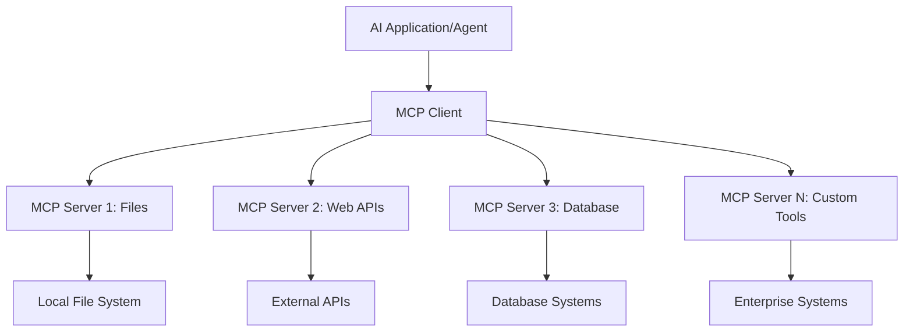

**🔧 Glavne komponente:**

| Komponenta | Uloga | Primjeri |
| --------- | ---- | -------- |
| **MCP domaćini** | Koriste MCP usluge | VS Code, Foundry Toolkit |
| **MCP klijenti** | Rukovode protokolskim vezama | Ugrađeni u domaćine |
| **MCP poslužitelji** | Pružaju mogućnosti | Playwright, Files, Azure, GitHub |
| **Sloj transporta** | Povezuje klijente i poslužitelje | stdio, HTTP, WebSockets |

## 🏢 Microsoftov MCP poslužiteljski ekosustav

Microsoft predvodi MCP ekosustav s obimnim paketom
enterprise razine poslužitelja koji zadovoljavaju stvarne poslovne potrebe.

### 🌟 Istaknuti Microsoft MCP poslužitelji

#### 1. ☁️ Azure MCP poslužitelj

**🔗 Repozitorij**: [azure/azure-mcp](https://github.com/azure/azure-mcp)
**🎯 Svrha**: Sveobuhvatno upravljanje Azure resursima s AI integracijom

**✨ Ključne značajke:**

- Deklarativno pružanje infrastrukture
- Praćenje resursa u stvarnom vremenu
- Preporuke za optimizaciju troškova
- Provjera usklađenosti sa sigurnosnim pravilima

**🚀 Primjeri upotrebe:**

- Infrastruktura kao kod uz AI podršku
- Automatsko skaliranje resursa
- Optimizacija cloud troškova
- Automatizacija DevOps tijekova rada

#### 2. 📊 Microsoft Dataverse MCP

**📚 Dokumentacija**: [Microsoft Dataverse integracija](https://go.microsoft.com/fwlink/?linkid=2320176)
**🎯 Svrha**: Sučelje prirodnog jezika za poslovne podatke

**✨ Ključne značajke:**

- Upiti baze podataka na prirodnom jeziku
- Razumijevanje poslovnog konteksta
- Prilagođeni predlošci upita
- Upravljanje podacima na razini poduzeća

**🚀 Primjeri upotrebe:**

- Izvještavanje o poslovnoj inteligenciji
- Analiza korisničkih podataka
- Uvidi u prodajni tok
- Upiti usklađenosti podataka

#### 3. 🌐 Playwright MCP poslužitelj

**🔗 Repozitorij**: [microsoft/playwright-mcp](https://github.com/microsoft/playwright-mcp)
**🎯 Svrha**: Automatizacija preglednika i mogućnosti interakcije s webom

**✨ Ključne značajke:**

- Automatizacija na više preglednika (Chrome, Firefox, Safari)
- Inteligentno otkrivanje elemenata
- Generiranje screenshotova i PDF-ova
- Praćenje mrežnog prometa

**🚀 Primjeri upotrebe:**

- Automatizirani testni tijekovi rada
- Web scraping i ekstrakcija podataka
- Praćenje UI/UX-a
- Automatizacija konkurentske analize

#### 4. 📁 Files MCP poslužitelj

**🔗 Repozitorij**: [microsoft/files-mcp-server](https://github.com/microsoft/files-mcp-server)
**🎯 Svrha**: Inteligentne operacije nad datotečnim sustavom

**✨ Ključne značajke:**

- Deklarativno upravljanje datotekama
- Sinkronizacija sadržaja
- Integracija kontrole verzija
- Ekstrakcija metapodataka

**🚀 Primjeri upotrebe:**

- Upravljanje dokumentacijom
- Organizacija repozitorija koda
- Tijekovi rada za objavljivanje sadržaja
- Upravljanje datotekama u podatkovnim tokovima

#### 5. 📝 MarkItDown MCP poslužitelj

**🔗 Repozitorij**: [microsoft/markitdown](https://github.com/microsoft/markitdown)
**🎯 Svrha**: Napredna obrada i manipulacija Markdownom

**✨ Ključne značajke:**

- Bogato parsiranje Markdowna
- Konverzija formata (MD ↔ HTML ↔ PDF)
- Analiza strukture sadržaja
- Obrada predložaka

**🚀 Primjeri upotrebe:**

- Tijekovi rada tehničke dokumentacije
- Sustavi za upravljanje sadržajem
- Generiranje izvještaja
- Automatizacija baze znanja

#### 6. 📈 Clarity MCP poslužitelj

**📦 Paket**: [@microsoft/clarity-mcp-server](https://www.npmjs.com/package/@microsoft/clarity-mcp-server)
**🎯 Svrha**: Web analitika i uvidi u ponašanje korisnika

**✨ Ključne značajke:**

- Analiza podataka toplinske karte (heatmap)
- Snimanje korisničkih sesija
- Metrike izvedbe
- Analiza konverzijskog toka

**🚀 Primjeri upotrebe:**

- Optimizacija web stranica
- Istraživanje korisničkog iskustva
- A/B testiranje
- Poslovne inteligencijske nadzorne ploče

### 🌍 Ekosustav zajednice

Osim Microsoftovih poslužitelja, MCP ekosustav uključuje:

- **🐙 GitHub MCP**: Upravljanje repozitorijima i analiza koda
- **🗄️ Database MCPs**: Integracije s PostgreSQL, MySQL, MongoDB
- **☁️ Cloud Provider MCPs**: Alati za AWS, GCP, Digital Ocean
- **📧 Communication MCPs**: Integracije Slacka, Teamsa, E-pošte

## 🛠️ Praktični laboratorij: Izgradnja agenta za automatizaciju preglednika

**🎯 Cilj projekta**: Kreirati inteligentnog agenta za automatizaciju preglednika koristeći
Playwright MCP poslužitelj koji može navigirati web stranicama, izvlačiti informacije i
obavljati složene mrežne interakcije.

### 🚀 Faza 1: Postavljanje temelja agenta

#### Korak 1: Inicijalizirajte svog agenta

1. **Otvorite Microsoft Foundry Toolkit Agent Builder**
2. **Kreirajte novog agenta** s konfiguracijom:
   - **Ime**: `BrowserAgent`
   - **Model**: Odaberite GPT-5.1. Pogledajte
      [Microsoft Foundry raspored povlačenja modela](https://learn.microsoft.com/azure/foundry/openai/concepts/model-retirement-schedule)
      za trenutne informacije o životnom ciklusu modela.

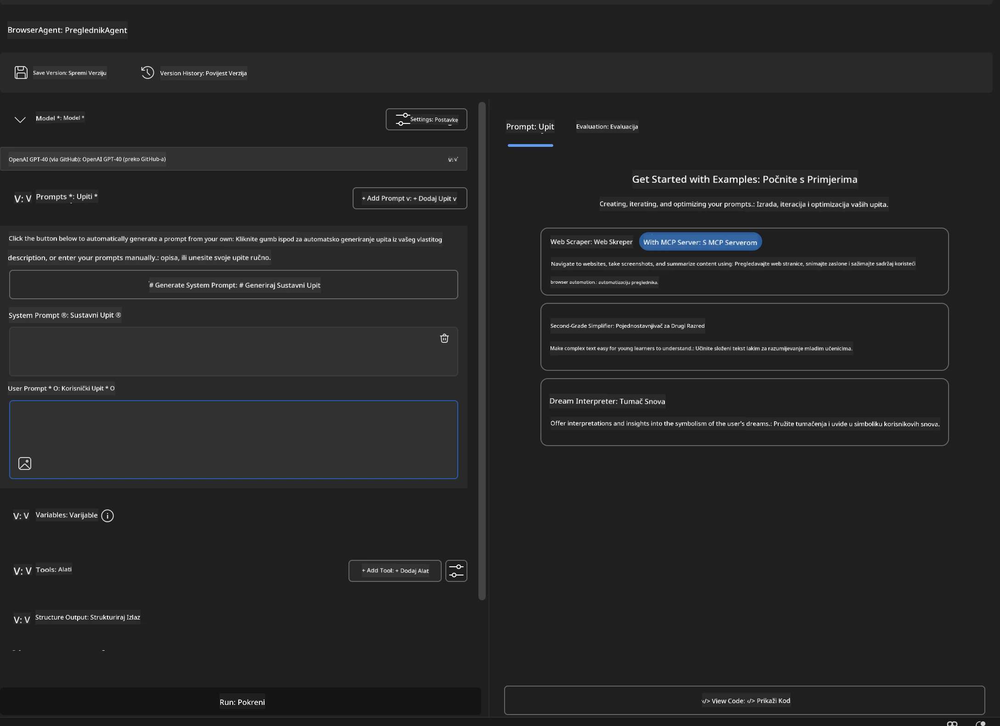

### 🔧 Faza 2: Radni tijek integracije MCP-a

#### Korak 3: Dodajte integraciju MCP poslužitelja

1. **Idite na odjeljak Alati** u Agent Builderu
2. **Kliknite "Dodaj alat"** za otvaranje izbornika integracija
3. **Odaberite "MCP poslužitelj"** iz dostupnih opcija

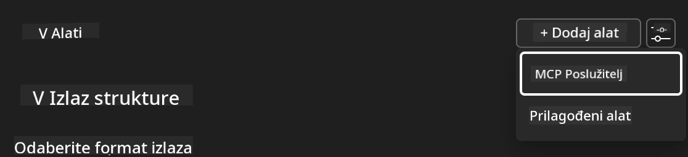

**🔍 Razumijevanje tipova alata:**

- **Ugrađeni alati**: Predkonfigurirane funkcije Microsoft Foundry Toolkita
- **MCP poslužitelji**: Integracije vanjskih usluga
- **Prilagođeni API-ji**: Vaši vlastiti krajnji API-ji
- **Pozivi funkcija**: Izravan pristup funkcijama modela

#### Korak 4: Odabir MCP poslužitelja

1. **Odaberite opciju "MCP poslužitelj"** za nastavak
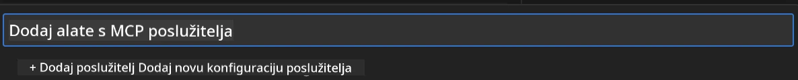

2. **Pregledajte MCP katalog** za dostupne integracije
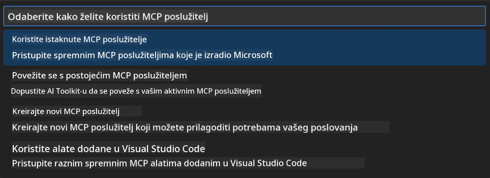

### 🎮 Faza 3: Konfiguracija Playwright MCP-a

#### Korak 5: Odaberite i konfigurirajte Playwright

1. **Kliknite "Koristi istaknute MCP poslužitelje"** za pristup verificiranim Microsoft poslužiteljima
2. **Odaberite "Playwright"** s popisa istaknutih poslužitelja
3. **Prihvatite zadani MCP ID** ili prilagodite za svoje okruženje

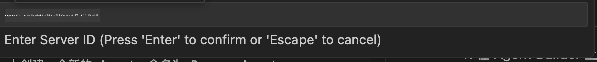

#### Korak 6: Omogućite Playwright funkcionalnosti

**🔑 Ključni korak**: Odaberite **SVE** dostupne Playwright metode za maksimalnu funkcionalnost

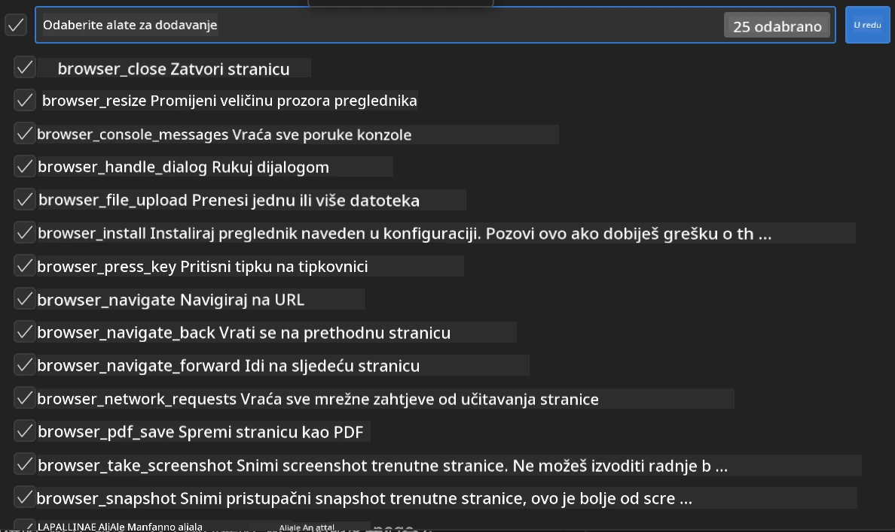

**🛠️ Osnovni Playwright alati:**

- **Navigacija**: `goto`, `goBack`, `goForward`, `reload`
- **Interakcija**: `click`, `fill`, `press`, `hover`, `drag`
- **Ekstrakcija**: `textContent`, `innerHTML`, `getAttribute`
- **Validacija**: `isVisible`, `isEnabled`, `waitForSelector`
- **Snimanje**: `screenshot`, `pdf`, `video`
- **Mreža**: `setExtraHTTPHeaders`, `route`, `waitForResponse`

#### Korak 7: Provjerite uspjeh integracije

**✅ Pokazatelji uspjeha:**

- Svi alati su vidljivi u sučelju Agent Buildera
- Nema poruka o greškama u integracijskom panelu
- Status Playwright poslužitelja prikazuje "Povezano"

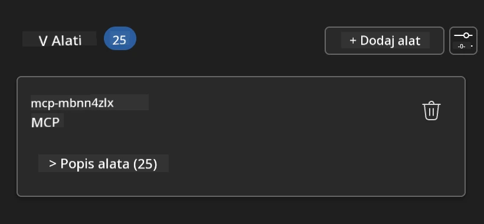

**🔧 Rješavanje uobičajenih problema:**

- **Veza nije uspjela**: Provjerite internetsku vezu i postavke vatrozida
- **Nedostaju alati**: Provjerite jesu li sve funkcionalnosti odabrane tijekom postavljanja
- **Greške dopuštenja**: Provjerite ima li VS Code potrebne sistemske dozvole

### 🎯 Faza 4: Napredno dizajniranje promptova

#### Korak 8: Dizajnirajte inteligentne sustavne promptove

Kreirajte sofisticirane promptove koji koriste pune mogućnosti Playwrighta:

```markdown
# Web Automation Expert System Prompt

## Core Identity
You are an advanced web automation specialist with deep expertise in browser
automation, web scraping, and user experience analysis. You have access to
Playwright tools for comprehensive browser control.

## Capabilities & Approach
### Navigation Strategy
- Always start with screenshots to understand page layout
- Use semantic selectors (text content, labels) when possible
- Implement wait strategies for dynamic content
- Handle single-page applications (SPAs) effectively

### Error Handling
- Retry failed operations with exponential backoff
- Provide clear error descriptions and solutions
- Suggest alternative approaches when primary methods fail
- Always capture diagnostic screenshots on errors

### Data Extraction
- Extract structured data in JSON format when possible
- Provide confidence scores for extracted information
- Validate data completeness and accuracy
- Handle pagination and infinite scroll scenarios

### Reporting
- Include step-by-step execution logs
- Provide before/after screenshots for verification
- Suggest optimizations and alternative approaches
- Document any limitations or edge cases encountered

## Ethical Guidelines
- Respect robots.txt and rate limiting
- Avoid overloading target servers
- Only extract publicly available information
- Follow website terms of service
```

#### Korak 9: Kreirajte dinamičke korisničke promptove

Dizajnirajte promptove koji demonstriraju različite mogućnosti:

**🌐 Primjer web analize:**

```markdown
Navigate to github.com/kinfey and provide a comprehensive analysis including:
1. Repository structure and organization
2. Recent activity and contribution patterns  
3. Documentation quality assessment
4. Technology stack identification
5. Community engagement metrics
6. Notable projects and their purposes

Include screenshots at key steps and provide actionable insights.
```

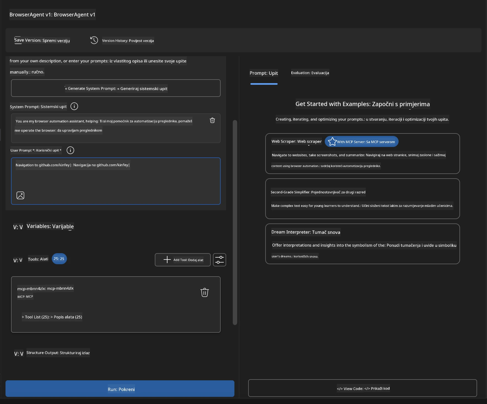

### 🚀 Faza 5: Izvršavanje i testiranje

#### Korak 10: Pokrenite svoju prvu automatizaciju

1. **Kliknite "Pokreni"** za pokretanje sekvence automatizacije
2. **Pratite izvršavanje u stvarnom vremenu**:
   - Otvara se Chrome preglednik automatski
   - Agent navigira do ciljne web stranice
   - Snimke zaslona hvataju svaki glavni korak
   - Rezultati analize dolaze uživo

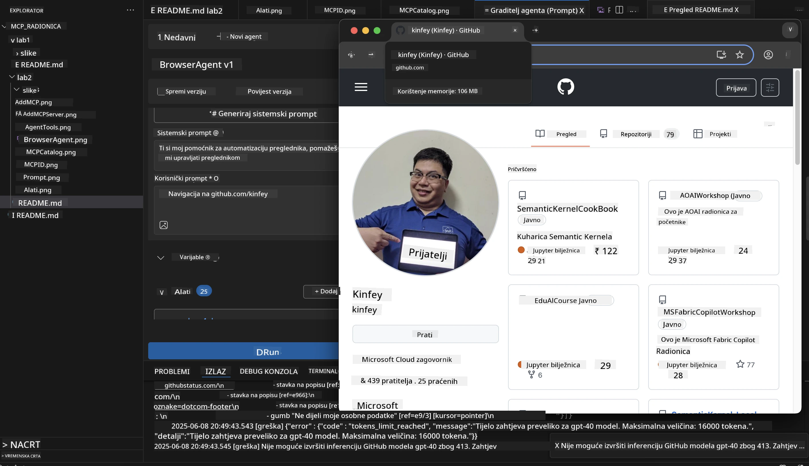

#### Korak 11: Analizirajte rezultate i uvide

Pregledajte sveobuhvatnu analizu u sučelju Agent Buildera:

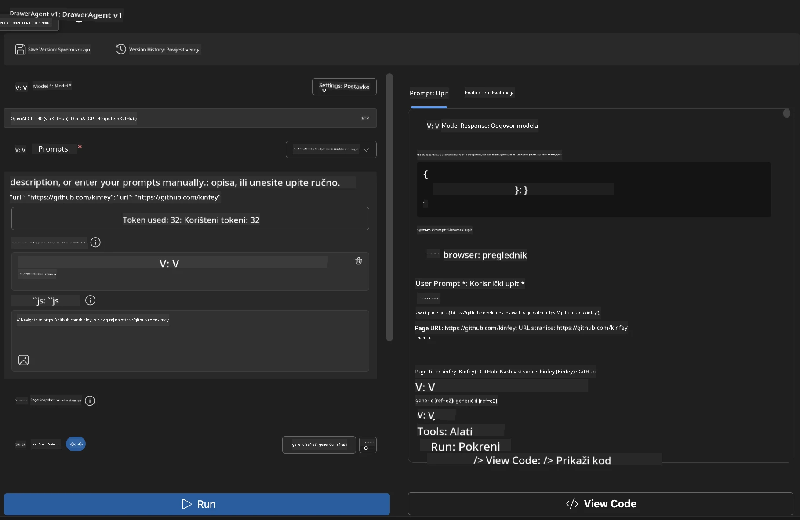

### 🌟 Faza 6: Napredne mogućnosti i implementacija

#### Korak 12: Izvoz i produkcijska implementacija

Agent Builder podržava više opcija implementacije:

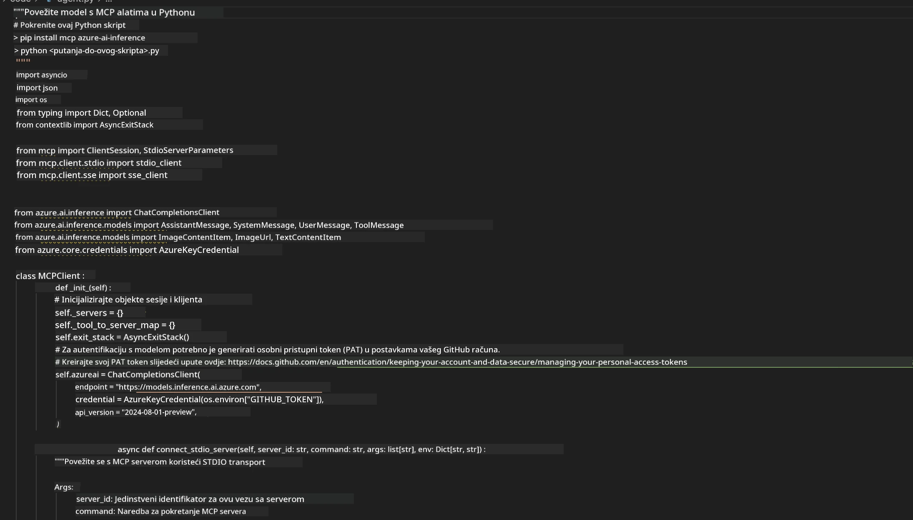

## 🎓 Sažetak modula 2 i sljedeći koraci

### 🏆 Postignuće otključano: Majstor MCP integracije

**✅ Ovladane vještine:**

- [ ] Razumijevanje MCP arhitekture i prednosti
- [ ] Snalaženje u Microsoftovom MCP poslužiteljskom ekosustavu
- [ ] Integracija Playwright MCP-a s Microsoft Foundry Toolkitom
- [ ] Izgradnja sofisticiranih agenata za automatizaciju preglednika
- [ ] Napredno dizajniranje promptova za web automatizaciju

### 📚 Dodatni izvori

- **🔗 MCP specifikacija**: [Službena dokumentacija protokola](https://modelcontextprotocol.io/)
- **🛠️ Playwright API**: [Potpuni referentni vodič](https://playwright.dev/docs/api/class-playwright)
- **🏢 Microsoft MCP poslužitelji**:
   [Vodič za enterprise integraciju](https://github.com/microsoft/mcp-servers)
- **🌍 Primjeri iz zajednice**: [Galerija MCP poslužitelja](https://github.com/modelcontextprotocol/servers)

**🎉 Čestitamo!** Uspješno ste ovladali MCP integracijom i sada
možete izgraditi produkcijski spremne AI agente s mogućnostima vanjskih alata!

### 🔜 Nastavite na sljedeći modul

Spremni ste podići svoje MCP vještine na višu razinu? Nastavite na
**[Modul 3: Napredni razvoj MCP-a s Microsoft Foundry Toolkitom](../lab3/README.md)**
gdje ćete naučiti:

- Kreirati vlastite prilagođene MCP poslužitelje
- Konfigurirati i koristiti najnoviji MCP Python SDK
- Postaviti MCP inspektor za otklanjanje pogrešaka
- Ovladati naprednim radnim tijekovima razvoja MCP poslužitelja
- Izgraditi vremenski MCP poslužitelj ispočetka

---

<!-- CO-OP TRANSLATOR DISCLAIMER START -->
**Napomena**:
Ovaj dokument je preveden korištenjem AI prevoditeljskog servisa [Co-op Translator](https://github.com/Azure/co-op-translator). Iako težimo točnosti, imajte na umu da automatski prijevodi mogu sadržavati greške ili netočnosti. Izvorni dokument na izvornom jeziku treba smatrati autoritativnim izvorom. Za važne informacije preporuča se profesionalni ljudski prijevod. Nismo odgovorni za bilo kakva nesporazumevanja ili pogrešne interpretacije koje proizlaze iz korištenja ovog prijevoda.
<!-- CO-OP TRANSLATOR DISCLAIMER END -->