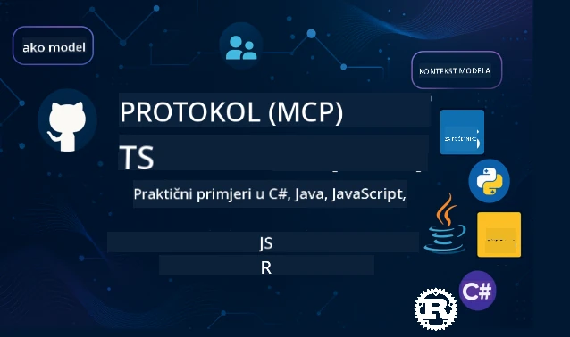

 

[](https://GitHub.com/microsoft/mcp-for-beginners/graphs/contributors)
[](https://GitHub.com/microsoft/mcp-for-beginners/issues)
[](https://GitHub.com/microsoft/mcp-for-beginners/pulls)
[](http://makeapullrequest.com)
[](https://mcptoplist.com/server/mcp.so%2Fmcp-for-beginners%2Fmicrosoft)

[](https://GitHub.com/microsoft/mcp-for-beginners/watchers)
[](https://GitHub.com/microsoft/mcp-for-beginners/fork)
[](https://GitHub.com/microsoft/mcp-for-beginners/stargazers)


[](https://discord.gg/nTYy5BXMWG)

Slijedite ove korake da započnete korištenje ovih resursa:
1. **Forkajte repozitorij**: Kliknite [](https://GitHub.com/microsoft/mcp-for-beginners/fork)
2. **Klonirajte repozitorij**:   `git clone https://github.com/microsoft/mcp-for-beginners.git`
3. **Pridružite se** [](https://discord.gg/nTYy5BXMWG)


### 🌐 Podrška za višestruke jezike

#### Prijevodi održavani s [Co-op Translator](https://github.com/Azure/co-op-translator)

<!-- CO-OP TRANSLATOR LANGUAGES TABLE START -->
[Arabic](../ar/README.md) | [Bengali](../bn/README.md) | [Bulgarian](../bg/README.md) | [Burmese (Myanmar)](../my/README.md) | [Chinese (Simplified)](../zh-CN/README.md) | [Chinese (Traditional, Hong Kong)](../zh-HK/README.md) | [Chinese (Traditional, Macau)](../zh-MO/README.md) | [Chinese (Traditional, Taiwan)](../zh-TW/README.md) | [Croatian](./README.md) | [Czech](../cs/README.md) | [Danish](../da/README.md) | [Dutch](../nl/README.md) | [Estonian](../et/README.md) | [Finnish](../fi/README.md) | [French](../fr/README.md) | [German](../de/README.md) | [Greek](../el/README.md) | [Hebrew](../he/README.md) | [Hindi](../hi/README.md) | [Hungarian](../hu/README.md) | [Indonesian](../id/README.md) | [Italian](../it/README.md) | [Japanese](../ja/README.md) | [Kannada](../kn/README.md) | [Khmer](../km/README.md) | [Korean](../ko/README.md) | [Lithuanian](../lt/README.md) | [Malay](../ms/README.md) | [Malayalam](../ml/README.md) | [Manipuri (Meitei Mayek)](../mni/README.md) | [Marathi](../mr/README.md) | [Nepali](../ne/README.md) | [Nigerian Pidgin](../pcm/README.md) | [Norwegian](../no/README.md) | [Persian (Farsi)](../fa/README.md) | [Polish](../pl/README.md) | [Portuguese (Brazil)](../pt-BR/README.md) | [Portuguese (Portugal)](../pt-PT/README.md) | [Punjabi (Gurmukhi)](../pa/README.md) | [Romanian](../ro/README.md) | [Russian](../ru/README.md) | [Serbian (Cyrillic)](../sr/README.md) | [Slovak](../sk/README.md) | [Slovenian](../sl/README.md) | [Spanish](../es/README.md) | [Swahili](../sw/README.md) | [Swedish](../sv/README.md) | [Tagalog (Filipino)](../tl/README.md) | [Tamil](../ta/README.md) | [Telugu](../te/README.md) | [Thai](../th/README.md) | [Turkish](../tr/README.md) | [Ukrainian](../uk/README.md) | [Urdu](../ur/README.md) | [Vietnamese](../vi/README.md)

> **Preferirate lokalno kloniranje?**
>
> Ovaj repozitorij uključuje prijevode na više od 50 jezika što znatno povećava veličinu preuzimanja. Da biste klonirali bez prijevoda, upotrijebite sparse checkout:
>
> **Bash / macOS / Linux:**
> ```bash
> git clone --filter=blob:none --sparse https://github.com/microsoft/mcp-for-beginners.git
> cd mcp-for-beginners
> git sparse-checkout set --no-cone '/*' '!translations' '!translated_images'
> ```
>
> **CMD (Windows):**
> ```cmd
> git clone --filter=blob:none --sparse https://github.com/microsoft/mcp-for-beginners.git
> cd mcp-for-beginners
> git sparse-checkout set --no-cone "/*" "!translations" "!translated_images"
> ```
>
> Ovo vam pruža sve što vam treba za dovršetak tečaja s puno bržim preuzimanjem.
<!-- CO-OP TRANSLATOR LANGUAGES TABLE END -->

# 🚀 Kurikulum Model Context Protocol (MCP) za početnike

## **Naučite MCP s praktičnim primjerima koda u C#, Java, JavaScript, Rust, Python i TypeScript**

## 🧠 Pregled kurikuluma Model Context Protocol
Dobrodošli na svoje putovanje u Model Context Protocol! Ako ste se ikada pitali kako AI aplikacije komuniciraju s različitim alatima i uslugama, upravo ćete otkriti elegantno rješenje koje transformira način na koji developeri grade inteligentne sustave.

Zamislite MCP kao univerzalnog prevoditelja za AI aplikacije – baš kao što USB priključci omogućuju povezivanje bilo kojeg uređaja s vašim računalom, MCP omogućuje AI modelima povezivanje s bilo kojim alatom ili uslugom na standardizirani način. Bilo da gradite prvi chatbot ili radite na složenim AI tokovima rada, razumijevanje MCP-a dat će vam moć stvaranja sposobnijih i fleksibilnijih aplikacija.

Ovaj kurikulum je dizajniran s pažnjom i strpljenjem za vaše učenje. Počet ćemo s jednostavnim konceptima koje već razumijete i postupno ćemo graditi vaše znanje kroz praktične vježbe u vašem omiljenom programskom jeziku. Svaki korak sadrži jasna objašnjenja, praktične primjere i mnogo poticaja.

Do kraja ovog putovanja, imat ćete samopouzdanje za izgradnju vlastitih MCP servera, integraciju s popularnim AI platformama i razumijevanje kako ova tehnologija preoblikuje budućnost razvoja AI-a. Započnimo ovu uzbudljivu avanturu zajedno!

### Službena dokumentacija i specifikacije

Trenutna revizija protokola je **MCP Specification 2026-07-28**. MCP
specifikacija koristi verzioniranje temeljeno na datumu (format YYYY-MM-DD) kako bi kompatibilnost
protokola bila jasna.

> **Napomena o verziji:** ovaj kurikulum podučava trenutne `2026-07-28`
> koncepte, uključujući bezdržavne zahtjeve, Extensions okvir, i
> ukidanje Roots, Sampling i Logging. Neki praktični primjeri su još uvijek
> eksplicitno verzionirani na `2025-11-25` dok se SDK podrška ne nadoknadi. Pogledajte
> [Što se promijenilo u MCP: Specifikacija 2026-07-28](./01-CoreConcepts/mcp-2026-07-28.md)
> za promjene i uputstva za migraciju.

Ovi resursi postaju vrijedniji kako vaše razumijevanje raste, ali ne osjećajte pritisak da pročitate sve odmah. Počnite s područjima koja vas najviše zanimaju!
- 📘 [MCP Dokumentacija](https://modelcontextprotocol.io/) – Ovo je vaš glavni izvor za korak-po-korak tutorijale i korisničke vodiče. Dokumentacija je napisana s početnicima na umu, pružajući jasne primjere koje možete pratiti vlastitim tempom.
- 📜 [MCP Specifikacija](https://modelcontextprotocol.io/specification/2026-07-28) – Smatrajte ovo sveobuhvatnim referentnim priručnikom. Kako radite kroz kurikulum, često ćete se vraćati ovdje da potražite specifične detalje i istražite napredne značajke.
- 📜 [MCP Verzije Specifikacije](https://modelcontextprotocol.io/specification/versioning) – Sadrži informacije o povijesti verzija protokola i kako MCP koristi verzioniranje temeljeno na datumu (format YYYY-MM-DD).
- 🧑‍💻 [MCP GitHub Repozitorij](https://github.com/modelcontextprotocol) – Ovdje ćete naći SDK-ove, alate i primjere koda na više programskih jezika. To je poput riznice praktičnih primjera i spremnih komponenti.
- 🌐 [MCP Zajednica](https://github.com/orgs/modelcontextprotocol/discussions) – Pridružite se ostalim učenicima i iskusnim developerima u raspravama o MCP-u. To je podržavajuća zajednica gdje su pitanja dobrodošla, a znanje se slobodno dijeli.
  
## Ciljevi učenja

Do kraja ovog kurikuluma, osjećat ćete se samopouzdano i uzbuđeno zbog svojih novih sposobnosti. Evo što ćete postići:

• **Razumjeti osnove MCP-a**: Shvatit ćete što je Model Context Protocol i zašto revolucionira način na koji AI aplikacije surađuju, koristeći analogije i primjere koji imaju smisla.

• **Izgraditi svoj prvi MCP server**: Kreirat ćete radni MCP server u svom preferiranom programskom jeziku, počevši s jednostavnim primjerima i postupno razvijajući svoje vještine.

• **Povezati AI modele s pravim alatima**: Naučit ćete kako premostiti jaz između AI modela i stvarnih usluga, dajući vašim aplikacijama moćne nove mogućnosti.

• **Implementirati najbolje sigurnosne prakse**: Razumjet ćete kako održavati sigurnost vaših MCP implementacija, štiteći i vaše aplikacije i vaše korisnike.

• **Implementirati uz samopouzdanje**: Znate kako svoje MCP projekte prevesti iz razvoja u produkciju, s praktičnim strategijama implementacije koje rade u stvarnom svijetu.

• **Pridružiti se MCP zajednici**: Postat ćete dio rastuće zajednice developera koji oblikuju budućnost razvoja AI aplikacija. 

## Osnovne pozadine

Prije nego što zaronimo u MCP specifičnosti, pobrinimo se da ste ugodni s nekim osnovnim konceptima. Ne brinite ako niste stručnjak u tim područjima – objasnit ćemo vam sve što trebate znati tijekom procesa!

### Razumijevanje protokola (osnova)

Zamislite protokol kao pravila za razgovor. Kad zovete prijatelja, oboje znate reći "bok" kad se javite, izmjenjujete riječi i kažete "doviđenja" kad završite. Računalni programi trebaju slična pravila da bi učinkovito komunicirali.

MCP je protokol – skup dogovorenih pravila koja pomažu AI modelima i aplikacijama da vode produktivne "razgovore" s alatima i uslugama. Kao što pravila razgovora čine ljudsku komunikaciju glađom, MCP čini komunikaciju AI aplikacija mnogo pouzdanijom i snažnijom.

### Odnosi klijent-server (kako programi rade zajedno)

Već svakodnevno koristite odnose klijent-server! Kada koristite web preglednik (klijent) za posjet web stranici, povezujete se s web serverom koji vam šalje sadržaj stranice. Preglednik zna kako zatražiti informacije, a server zna kako odgovoriti.

U MCP-u imamo sličan odnos: AI modeli djeluju kao klijenti koji traže informacije ili radnje, dok MCP serveri pružaju te mogućnosti. To je poput korisnog asistenta (servera) kojeg AI može zamoliti da obavi određene zadatke.

### Zašto je standardizacija važna (činjenje stvari kompatibilnim)

Zamislite da svaki proizvođač automobila koristi drugačiji oblik crpki za gorivo – trebali biste zaseban adapter za svaki automobil! Standardizacija znači dogovoriti zajedničke pristupe kako bi stvari radile zajedno bez problema.

MCP pruža ovu standardizaciju za AI aplikacije. Umjesto da svaki AI model treba poseban kod za rad sa svakim alatom, MCP stvara univerzalni način njihove komunikacije. To znači da developeri mogu izgraditi alate jednom i da oni rade s mnogim različitim AI sustavima.

## 🧭 Pregled vašeg puta učenja

Vaše MCP putovanje pažljivo je strukturirano da postupno gradi vaše samopouzdanje i vještine. Svaka faza uvodi nove koncepte dok učvršćuje ono što ste već naučili.

### 🌱 Faza osnove: Razumijevanje osnova (moduli 0-2)

Ovo je početak vaše avanture! Uvest ćemo vas u MCP koncepte koristeći poznate analogije i jednostavne primjere. Razumjet ćete što je MCP, zašto postoji i kako se uklapa u širi svijet AI razvoja.

• **Modul 0 - Uvod u MCP**: Počet ćemo istraživanjem što je MCP i zašto je toliko važan za moderne AI aplikacije. Vidjet ćete stvarne primjere MCP u radu i shvatiti kako rješava uobičajene probleme s kojima se developeri suočavaju.

• **Modul 1 - Objašnjeni osnovni koncepti**: Naučit ćete ključne gradivne blokove MCP-a. Koristit ćemo mnogo analogija i vizualnih primjera kako bismo osigurali da vam ti koncepti budu prirodni i razumljivi.

• **Modul 2 - Sigurnost u MCP-u**: Sigurnost možda zvuči zastrašujuće, ali pokazat ćemo vam kako MCP uključuje ugrađene sigurnosne značajke i naučit ćemo vas najboljim praksama koje štite vaše aplikacije od samog početka.

### 🔨 Faza izgradnje: Stvaranje vaših prvih implementacija (modul 3)

Sad počinje pravi užitak! Dobit ćete praktično iskustvo izgradnje stvarnih MCP servera i klijenata. Ne brinite – počet ćemo jednostavno i vodit ćemo vas kroz svaki korak.

Ovaj modul uključuje više praktičnih vodiča koji vam omogućuju vježbanje u vašem preferiranom programskom jeziku. Kreirat ćete svoj prvi poslužitelj, izgraditi klijenta za povezivanje s njim, pa čak i integrirati se s popularnim alatima za razvoj poput VS Codea.

Svaki vodič uključuje kompletne primjere koda, savjete za rješavanje problema i objašnjenja zašto donosimo određene dizajnerske odluke. Do kraja ove faze imat ćete funkcionalne implementacije MCP-a na koje možete biti ponosni!

### 🚀 Faza rasta: Napredni koncepti i primjena u stvarnom svijetu (moduli 4-5)

Nakon što ste svladali osnove, spremni ste istražiti sofisticiranije značajke MCP-a. Obradit ćemo praktične strategije implementacije, tehnike ispravljanja pogrešaka i napredne teme poput integracije multimedijalne umjetne inteligencije.

Također ćete naučiti kako skalirati svoje implementacije MCP-a za produkcijsku upotrebu i integrirati ih s platformama u oblaku poput Azurea. Ovi moduli pripremaju vas za izgradnju MCP rješenja koja mogu podnijeti zahtjeve stvarnog svijeta.

### 🌟 Faza stručnosti: Zajednica i specijalizacija (moduli 6-11)

Završna faza usredotočuje se na pridruživanje MCP zajednici i specijalizaciju u područjima koja vas najviše zanimaju. Naučit ćete kako doprinijeti open-source MCP projektima, implementirati napredne obrasce autentifikacije i izgraditi sveobuhvatna rješenja integrirana s bazama podataka.

Modul 11 zaslužuje posebno spominjanje - to je kompletan put učenja kroz 13 praktičnih laboratorijskih vježbi koji vas uči kako izgraditi proizvodno spremne MCP poslužitelje s integracijom PostgreSQL-a. To je poput završnog projekta koji povezuje sve što ste naučili!

### 📚 Cijela struktura kurikuluma

| Modul | Tema | Opis | Link |
|--------|-------|-------------|------|
| **Moduli 0-3: Osnove** | | | |
| 00 | Uvod u MCP | Pregled Model Context Protocola i njegov značaj u AI cjevovodima | [Pročitajte više](./00-Introduction/README.md) |
| 01 | Objašnjeni osnovni koncepti | Dubinska analiza osnovnih MCP pojmova | [Pročitajte više](./01-CoreConcepts/README.md) |
| 1.1 | Što se promijenilo u MCP-u (2026-07-28) | Stateless protokol, okvir za proširenja i ukidanje značajki u trenutnoj specifikaciji | [Vodič](./01-CoreConcepts/mcp-2026-07-28.md) |
| 02 | Sigurnost u MCP-u | Sigurnosne prijetnje i najbolje prakse | [Pročitajte više](./02-Security/README.md) |
| 2.1 | CIMD i DCR autorizacija | Usporedba preferirane CIMD registracije s zastarjelim DCR padom koristeći zaštićeni MCP poslužitelj | [Primjer](./02-Security/samples/cimd-dcr-auth/README.md) |
| 03 | Početak rada s MCP-om | Postavljanje okruženja, osnovni poslužitelji/klijenti, integracija | [Pročitajte više](./03-GettingStarted/README.md) |
| **Modul 3: Izgradnja vašeg prvog poslužitelja i klijenta** | | | |
| 3.1 | Prvi poslužitelj | Kreirajte svoj prvi MCP poslužitelj | [Vodič](./03-GettingStarted/01-first-server/README.md) |
| 3.2 | Prvi klijent | Razvijte osnovni MCP klijent | [Vodič](./03-GettingStarted/02-client/README.md) |
| 3.3 | Klijent s LLM-om | Integrirajte velike jezične modele | [Vodič](./03-GettingStarted/03-llm-client/README.md) |
| 3.4 | Integracija s VS Codeom | Koristite MCP poslužitelje u VS Codeu | [Vodič](./03-GettingStarted/04-vscode/README.md) |
| 3.5 | stdio poslužitelj | Kreirajte poslužitelje koristeći stdio transport | [Vodič](./03-GettingStarted/05-stdio-server/README.md) |
| 3.6 | HTTP streaming | Implementirajte HTTP streaming u MCP-u | [Vodič](./03-GettingStarted/06-http-streaming/README.md) |
| 3.7 | Microsoft Foundry Toolkit | Koristite Microsoft Foundry Toolkit s MCP-om | [Vodič](./03-GettingStarted/07-aitk/README.md) |
| 3.8 | Testiranje | Testirajte svoju MCP implementaciju poslužitelja | [Vodič](./03-GettingStarted/08-testing/README.md) |
| 3.9 | Raspored | Implementirajte MCP poslužitelje u produkciji | [Vodič](./03-GettingStarted/09-deployment/README.md) |
| 3.10 | Napredno korištenje poslužitelja | Koristite napredne poslužitelje za napredniju upotrebu značajki i poboljšanu arhitekturu | [Vodič](./03-GettingStarted/10-advanced/README.md) |
| 3.11 | Jednostavna autentifikacija | Poglavlje koje vam prikazuje autentifikaciju od početka i RBAC | [Vodič](./03-GettingStarted/11-simple-auth/README.md) |
| 3.12 | MCP domaćini | Konfiguriranje Claude Desktopa, Cursor, Cline i drugih MCP domaćina | [Vodič](./03-GettingStarted/12-mcp-hosts/README.md) |
| 3.13 | MCP Inspektor | Ispravljanje pogrešaka i testiranje MCP poslužitelja s alatom Inspektor | [Vodič](./03-GettingStarted/13-mcp-inspector/README.md) |
| 3.14 | Uzorkovanje | Koristite uzorkovanje za suradnju s klijentom | [Vodič](./03-GettingStarted/14-sampling/README.md) |
| 3.15 | MCP aplikacije | Izgradite MCP aplikacije | [Vodič](./03-GettingStarted/15-mcp-apps/README.md) |
| **Moduli 4-5: Praktično i napredno** | | | |
| 04 | Praktična implementacija | SDK-ovi, ispravljanje pogrešaka, testiranje, ponovljivo predloške za upite | [Pročitajte više](./04-PracticalImplementation/README.md) |
| 4.1 | Paginacija | Rukovanje velikim skupinama rezultata s paginacijom na bazi kursora | [Vodič](./04-PracticalImplementation/pagination/README.md) |
| 05 | Napredne teme u MCP-u | Multimodalna AI, skaliranje, upotreba u poduzeću | [Pročitajte više](./05-AdvancedTopics/README.md) |
| 5.1 | Integracija Azurea | MCP integracija s Azureom | [Vodič](./05-AdvancedTopics/mcp-integration/README.md) |
| 5.2 | Multimodalnost | Rad s više modaliteta | [Vodič](./05-AdvancedTopics/mcp-multi-modality/README.md) |
| 5.3 | OAuth2 demo | Implementacija OAuth2 autentifikacije | [Vodič](./05-AdvancedTopics/mcp-oauth2-demo/README.md) |
| 5.4 | Root konteksti | Razumijevanje i implementacija root konteksta | [Vodič](./05-AdvancedTopics/mcp-root-contexts/README.md) |
| 5.5 | Usmjeravanje | MCP strategije usmjeravanja | [Vodič](./05-AdvancedTopics/mcp-routing/README.md) |
| 5.6 | Uzorkovanje | Tehnike uzorkovanja u MCP-u | [Vodič](./05-AdvancedTopics/mcp-sampling/README.md) |
| 5.7 | Skaliranje | Skaliranje MCP implementacija | [Vodič](./05-AdvancedTopics/mcp-scaling/README.md) |
| 5.8 | Sigurnost | Napredne sigurnosne razmatranja | [Vodič](./05-AdvancedTopics/mcp-security/README.md) |
| 5.9 | Web pretraživanje | Implementacija mogućnosti web pretraživanja | [Vodič](./05-AdvancedTopics/web-search-mcp/README.md) |
| 5.10 | Streaming u stvarnom vremenu | Izgradnja funkcionalnosti streaminga u stvarnom vremenu | [Vodič](./05-AdvancedTopics/mcp-realtimestreaming/README.md) |
| 5.11 | Pretraživanje u stvarnom vremenu | Implementacija pretraživanja u stvarnom vremenu | [Vodič](./05-AdvancedTopics/mcp-realtimesearch/README.md) |
| 5.12 | Autentifikacija Entra ID-a | Autentifikacija s Microsoft Entra ID-om | [Vodič](./05-AdvancedTopics/mcp-security-entra/README.md) |
| 5.13 | Integracija Foundry | Integracija s Microsoft Foundryjem | [Vodič](./05-AdvancedTopics/mcp-foundry-agent-integration/README.md) |
| 5.14 | Inženjerstvo konteksta | Tehnike za učinkovito inženjerstvo konteksta | [Vodič](./05-AdvancedTopics/mcp-contextengineering/README.md) |
| 5.15 | Prilagođeni prijenos MCP-a | Implementacije prilagođenog prijenosa | [Vodič](./05-AdvancedTopics/mcp-transport/README.md) |
| 5.16 | Značajke protokola | Obavijesti o napretku, otkazivanje, predlošci resursa | [Vodič](./05-AdvancedTopics/mcp-protocol-features/README.md) |
| 5.17 | Protivničko višeslojno rezoniranje | Dva agenta raspravljaju suprotne strane koristeći zajedničke MCP alate, ocjenjuje ih agent sudac | [Vodič](./05-AdvancedTopics/mcp-adversarial-agents/README.md) |
| **Moduli 6-10: Zajednica i najbolje prakse** | | | |
| 06 | Doprinosi zajednici | Kako pridonijeti MCP ekosustavu | [Vodič](./06-CommunityContributions/README.md) |
| 07 | Uvidi iz rane primjene | Priče o implementaciji u stvarnom svijetu | [Vodič](./07-LessonsfromEarlyAdoption/README.md) |
| 08 | Najbolje prakse za MCP | Performanse, otpornost na pogreške, otpornost sustava | [Vodič](./08-BestPractices/README.md) |
| 09 | MCP studije slučaja | Praktični primjeri implementacije | [Vodič](./09-CaseStudy/README.md) |
| 10 | Radionica | Izrada MCP poslužitelja s Microsoft Foundry Toolkit | [Laboratorij](./10-StreamliningAIWorkflowsBuildingAnMCPServerWithAIToolkit/README.md) |
| **Modul 11: MCP poslužitelj praktični laboratorij** | | | |
| 11 | Integracija MCP baze podataka | Sveobuhvatan put učenja kroz 13 laboratorijskih vježbi za integraciju PostgreSQL-a | [Laboratoriji](./11-MCPServerHandsOnLabs/README.md) |
| 11.1 | Uvod | Pregled MCP-a s integracijom baze podataka i slučaj upotrebe maloprodajne analitike | [Laboratorij 00](./11-MCPServerHandsOnLabs/00-Introduction/README.md) |
| 11.2 | Osnovna arhitektura | Razumijevanje arhitekture MCP poslužitelja, slojeva baze podataka i sigurnosnih obrazaca | [Laboratorij 01](./11-MCPServerHandsOnLabs/01-Architecture/README.md) |
| 11.3 | Sigurnost i višekorisnička podrška | Sigurnost na razini redaka, autentifikacija i pristup podacima za više korisnika | [Laboratorij 02](./11-MCPServerHandsOnLabs/02-Security/README.md) |
| 11.4 | Postavljanje okruženja | Postavljanje razvojne okoline, Docker, Azure resursa | [Laboratorij 03](./11-MCPServerHandsOnLabs/03-Setup/README.md) |
| 11.5 | Dizajn baze podataka | Postavljanje PostgreSQL-a, dizajn šeme za maloprodaju i primjeri podataka | [Laboratorij 04](./11-MCPServerHandsOnLabs/04-Database/README.md) |
| 11.6 | Implementacija MCP poslužitelja | Izgradnja FastMCP poslužitelja s integracijom baze podataka | [Laboratorij 05](./11-MCPServerHandsOnLabs/05-MCP-Server/README.md) |
| 11.7 | Razvoj alata | Izrada alata za upite baze podataka i introspekcija šeme | [Laboratorij 06](./11-MCPServerHandsOnLabs/06-Tools/README.md) |
| 11.8 | Semantičko pretraživanje | Implementacija vektorskih ugradnji s Azure OpenAI i pgvector | [Laboratorij 07](./11-MCPServerHandsOnLabs/07-Semantic-Search/README.md) |
| 11.9 | Testiranje i ispravljanje pogrešaka | Strategije testiranja, alati za ispravljanje pogrešaka i pristupi validaciji | [Laboratorij 08](./11-MCPServerHandsOnLabs/08-Testing/README.md) |
| 11.10 | Integracija s VS Codeom | Konfiguriranje integracije MCP-a u VS Code i korištenje AI chat funkcionalnosti | [Laboratorij 09](./11-MCPServerHandsOnLabs/09-VS-Code/README.md) |
| 11.11 | Strategije raspoređivanja | Raspoređivanje pomoću Dockera, Azure Container Apps i razmatranja skaliranja | [Laboratorij 10](./11-MCPServerHandsOnLabs/10-Deployment/README.md) |
| 11.12 | Praćenje | Application Insights, zapisivanje, praćenje performansi | [Laboratorij 11](./11-MCPServerHandsOnLabs/11-Monitoring/README.md) |
| 11.13 | Najbolje prakse | Optimizacija performansi, jačanje sigurnosti i savjeti za produkciju | [Laboratorij 12](./11-MCPServerHandsOnLabs/12-Best-Practices/README.md) |
| **Modul 12: Alati za MCP** | | | |
| 12.1 | Alati | Upotreba MCP-a u aplikaciji Copilot | [Vodič](./12-tooling/README.md) |

### 💻 Primjeri kodova projekata

Jedan od najuzbudljivijih dijelova učenja MCP-a je postupni razvoj vaših vještina kodiranja. Dizajnirali smo naše primjere koda da počinju jednostavno i postaju sve sofisticiraniji kako se vaše razumijevanje produbljuje. Ovako uvodimo koncepte - s kodom koji je jednostavan za razumjeti, ali pokazuje prave MCP principe, shvatit ćete ne samo što taj kod radi, već i zašto je strukturiran na taj način i kako se uklapa u veće MCP aplikacije.

#### Osnovni uzorci MCP kalkulatora

| Jezik | Opis | Link |
|----------|-------------|------|
| C# | Primjer MCP poslužitelja | [Vidi kod](./03-GettingStarted/samples/csharp/README.md) |
| Java | MCP kalkulator | [Vidi kod](./03-GettingStarted/samples/java/calculator/README.md) |
| JavaScript | MCP demo | [Vidi kod](./03-GettingStarted/samples/javascript/README.md) |
| Python | MCP poslužitelj | [Vidi kod](../../03-GettingStarted/samples/python/mcp_calculator_server.py) |
| TypeScript | MCP primjer | [Vidi kod](./03-GettingStarted/samples/typescript/README.md) |
| Rust | MCP primjer | [Vidi kod](./03-GettingStarted/samples/rust/README.md) |

#### Napredne MCP implementacije

| Jezik | Opis | Link |
|----------|-------------|------|
| C# | Napredni primjer | [Vidi kod](./04-PracticalImplementation/samples/csharp/README.md) |
| Java sa Springom | Primjer kontejnerske aplikacije | [Vidi kod](./04-PracticalImplementation/samples/java/containerapp/README.md) |
| JavaScript | Napredni primjer | [Vidi kod](./04-PracticalImplementation/samples/javascript/README.md) |
| Python | Složena implementacija | [Vidi kod](./04-PracticalImplementation/samples/python/README.md) |
| TypeScript | Primjer kontejnera | [Vidi kod](./04-PracticalImplementation/samples/typescript/README.md) |


## 🎯 Preduvjeti za učenje MCP-a

Da biste maksimalno iskoristili ovaj kurikulum, trebali biste imati:

- Osnovno znanje programiranja u barem jednom od sljedećih jezika: C#, Java, JavaScript, Python ili TypeScript
- Razumijevanje modela klijent-poslužitelj i API-ja
- Poznavanje REST i HTTP koncepata
- (Opcionalno) Pozadina u konceptima AI/ML-a

- Sudjelovanje u našim zajedničkim raspravama za podršku

## 📚 Vodič za učenje i resursi

Ovo spremište uključuje nekoliko resursa koji će vam pomoći navigirati i učinkovito učiti:

### Vodič za učenje

Dostupan je sveobuhvatan [Vodič za učenje](./study_guide.md) koji će vam pomoći da učinkovito navigirate ovim spremištem. Ova vizualna mapa kurikuluma pokazuje kako su sve teme povezane i pruža smjernice o tome kako učinkovito koristiti uzorke projekata. Posebno je koristan ako ste vizualni učenik koji voli vidjeti širu sliku.

Vodič uključuje:
- Vizualna karta kurikuluma koja prikazuje sve obrađene teme
- Detaljna raščlamba svakog dijela spremišta
- Upute o tome kako koristiti uzorke projekata
- Preporučeni putovi učenja za različite razine vještina
- Dodatni resursi koji nadopunjuju vaše iskustvo učenja

### Dnevnici promjena

Održavamo detaljni [Dnevnik promjena](./changelog.md) koji prati sve značajne izmjene u materijalima kurikuluma, kako biste uvijek bili u toku s najnovijim poboljšanjima i dodacima.
- Dodavanje novog sadržaja
- Strukturne promjene
- Poboljšanja funkcionalnosti
- Ažuriranja dokumentacije

## 🛠️ Kako učinkovito koristiti ovaj kurikulum

Svaka lekcija u ovom vodiču uključuje:

1. Jasna objašnjenja MCP koncepata  
2. Primjere koda uživo u više jezika  
3. Vježbe za izgradnju pravih MCP aplikacija  
4. Dodatne resurse za napredne učenike

## 🎓 Vaše MCP putovanje počinje

Čestitamo! Upravo ste napravili prvi korak u uzbudljivom putovanju koje će proširiti vaše programske sposobnosti i povezati vas s najnovijim dostignućima u razvoju AI-ja.

### Što ste već postigli

Čitanjem ovog uvoda već ste započeli graditi svoju osnovu znanja o MCP-u. Razumijete što je MCP, zašto je važan i kako će vam ovaj kurikulum pomoći na vašem putu učenja. To je značajan uspjeh i početak vaše stručnosti u ovoj važnoj tehnologiji.

### Avantura koja je pred vama

Kako napredujete kroz module, imajte na umu da je svaki stručnjak nekad bio početnik. Koncepti koji sada djeluju složeno postat će prirodni kako ih budete vježbali i primjenjivali. Svaki mali korak gradi moćne sposobnosti koje će vam služiti kroz cijelu razvojnu karijeru.

### Vaša mreža podrške

Pridružujete se zajednici učenika i stručnjaka koji su strastveni oko MCP-a i koji rado pomažu drugima da uspiju. Bilo da zapnete na nekom izazovu u kodiranju ili želite podijeliti neki proboj, zajednica je tu da podrži vaše putovanje.

Ako zapnete ili imate pitanja o izradi AI aplikacija, pridružite se ostalim učenicima i iskusnim programerima u raspravama o MCP-u. To je poticajna zajednica gdje su pitanja dobrodošla i znanje se slobodno dijeli.

[](https://discord.gg/nTYy5BXMWG)

Ako imate povratne informacije o proizvodu ili pronađete pogreške tijekom izrade, posjetite:

[](https://aka.ms/foundry/forum)

### Spremni za početak?

Vaša MCP avantura počinje sada! Započnite s Modulom 0 kako biste zaronili u svoja prva praktična MCP iskustva ili istražite primjere projekata da vidite što ćete graditi. Zapamtite - svaki stručnjak počeo je točno tamo gdje ste vi sada, a s strpljenjem i praksom bit ćete zadivljeni onim što možete postići.

Dobrodošli u svijet razvoja Model Context Protocola. Izgradimo nešto sjajno zajedno!

## 🤝 Sudjelovanje u zajednici učenja

Ovaj kurikulum postaje bolji s doprinosima učenika poput vas! Bilo da ispravljate tipfeler, predlažete jasnije objašnjenje ili dodajete novi primjer, vaši doprinosi pomažu drugim početnicima da uspiju.

Zahvaljujemo Microsoft Valued Professional [Shivam Goyal](https://www.linkedin.com/in/shivam2003/) na doprinosu uzoraka koda.

Proces doprinosa je osmišljen da bude ugodan i podržavajući. Većina doprinosa zahtijeva Contributor License Agreement (CLA), ali automatizirani alati će vas glatko provesti kroz postupak.

## 📜 Učenje otvorenog koda

Cijeli ovaj kurikulum dostupan je pod MIT [LICENCOM](../../LICENSE), što znači da ga možete slobodno koristiti, mijenjati i dijeliti. To podržava našu misiju da znanje o MCP-u učinimo dostupnim programerima svugdje.
## 🤝 Smjernice za doprinose

Ovaj projekt prima doprinose i prijedloge. Većina doprinosa zahtijeva da pristanete na
Contributor License Agreement (CLA) kojim izjavljujete da imate pravo i doista dajete
prava na korištenje vašeg doprinosa nama. Za detalje posjetite <https://cla.opensource.microsoft.com>.

Kad pošaljete pull request, CLA bot će automatski odrediti trebate li dostaviti
CLA i označiti PR na odgovarajući način (npr. status provjera, komentar). Jednostavno slijedite upute
koje pruža bot. To ćete trebati napraviti samo jednom za sve repozitorije koji koriste naš CLA.

Ovaj projekt usvojio je [Microsoft Open Source Code of Conduct](https://opensource.microsoft.com/codeofconduct/).
Za više informacija pogledajte [Code of Conduct FAQ](https://opensource.microsoft.com/codeofconduct/faq/) ili
kontaktirajte [opencode@microsoft.com](mailto:opencode@microsoft.com) za dodatna pitanja ili komentare.

---

*Spremni za početak svog MCP putovanja? Započnite s [Module 00 - Uvod u MCP](./00-Introduction/README.md) i napravite prve korake u svijetu razvoja Model Context Protocola!*


## 🎒 Ostali tečajevi
Naš tim proizvodi i druge tečajeve! Pogledajte:

<!-- CO-OP TRANSLATOR OTHER COURSES START -->
### LangChain
[](https://aka.ms/langchain4j-for-beginners)
[](https://aka.ms/langchainjs-for-beginners?WT.mc_id=m365-94501-dwahlin)
[](https://github.com/microsoft/langchain-for-beginners?WT.mc_id=m365-94501-dwahlin)
---

### Azure / Edge / MCP / Agent
[](https://github.com/microsoft/AZD-for-beginners?WT.mc_id=academic-105485-koreyst)
[](https://github.com/microsoft/edgeai-for-beginners?WT.mc_id=academic-105485-koreyst)
[](https://github.com/microsoft/mcp-for-beginners?WT.mc_id=academic-105485-koreyst)
[](https://github.com/microsoft/ai-agents-for-beginners?WT.mc_id=academic-105485-koreyst)

---
 
### Serija Generativnog AI-ja
[](https://github.com/microsoft/generative-ai-for-beginners?WT.mc_id=academic-105485-koreyst)
[-9333EA?style=for-the-badge&labelColor=E5E7EB&color=9333EA)](https://github.com/microsoft/Generative-AI-for-beginners-dotnet?WT.mc_id=academic-105485-koreyst)
[-C084FC?style=for-the-badge&labelColor=E5E7EB&color=C084FC)](https://github.com/microsoft/generative-ai-for-beginners-java?WT.mc_id=academic-105485-koreyst)
[-E879F9?style=for-the-badge&labelColor=E5E7EB&color=E879F9)](https://github.com/microsoft/generative-ai-with-javascript?WT.mc_id=academic-105485-koreyst)

---
 
### Osnovno učenje
[](https://aka.ms/ml-beginners?WT.mc_id=academic-105485-koreyst)
[](https://aka.ms/datascience-beginners?WT.mc_id=academic-105485-koreyst)
[](https://aka.ms/ai-beginners?WT.mc_id=academic-105485-koreyst)
[](https://github.com/microsoft/Security-101?WT.mc_id=academic-96948-sayoung)
[](https://aka.ms/webdev-beginners?WT.mc_id=academic-105485-koreyst)
[](https://aka.ms/iot-beginners?WT.mc_id=academic-105485-koreyst)
[](https://github.com/microsoft/xr-development-for-beginners?WT.mc_id=academic-105485-koreyst)

---
 
### Serija Copilot
[](https://aka.ms/GitHubCopilotAI?WT.mc_id=academic-105485-koreyst)
[](https://github.com/microsoft/mastering-github-copilot-for-dotnet-csharp-developers?WT.mc_id=academic-105485-koreyst)
[](https://github.com/microsoft/CopilotAdventures?WT.mc_id=academic-105485-koreyst)
<!-- CO-OP TRANSLATOR OTHER COURSES END -->

---

<!-- CO-OP TRANSLATOR DISCLAIMER START -->
**Napomena**:
Ovaj dokument je preveden korištenjem AI prevoditeljskog servisa [Co-op Translator](https://github.com/Azure/co-op-translator). Iako težimo točnosti, imajte na umu da automatski prijevodi mogu sadržavati greške ili netočnosti. Izvorni dokument na izvornom jeziku treba smatrati autoritativnim izvorom. Za važne informacije preporuča se profesionalni ljudski prijevod. Nismo odgovorni za bilo kakva nesporazumevanja ili pogrešne interpretacije koje proizlaze iz korištenja ovog prijevoda.
<!-- CO-OP TRANSLATOR DISCLAIMER END -->