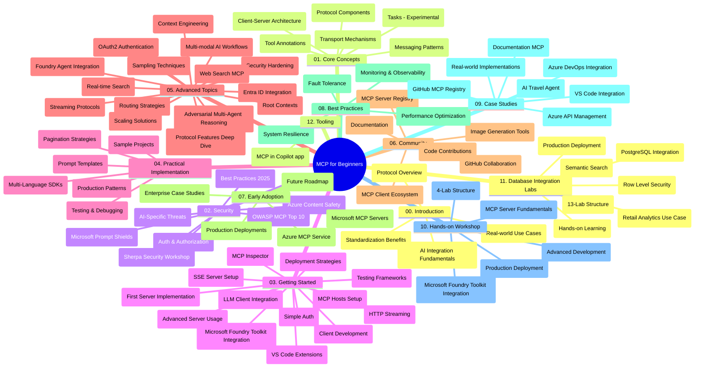

# Protokol Model Context (MCP) za početnike - Studijski vodič

Ovaj studijski vodič pruža pregled strukture spremišta i sadržaja za kurikulum "Protokol Model Context (MCP) za početnike". Koristite ovaj vodič za učinkovitu navigaciju spremištem i maksimalno iskorištavanje dostupnih resursa.

## Pregled spremišta

Protokol Model Context (MCP) standardizirani je okvir za interakcije između AI modela i klijentskih aplikacija. Izvorno stvoren od strane Anthropic-a, MCP sada održava šira MCP zajednica putem službene GitHub organizacije. Ovo spremište pruža sveobuhvatan kurikulum s praktičnim primjerima koda u C#, Javi, JavaScriptu, Pythonu i TypeScriptu, namijenjen AI programerima, sistemskim arhitektima i softverskim inženjerima.

## Vizualna karta kurikuluma

## Struktura spremišta

Spremište je organizirano u dvanaest glavnih dijelova, od kojih se svaki fokusira na različite aspekte MCP-a:

1. **Uvod (00-Introduction/)**
   - Pregled Protokola Model Context
   - Zašto je standardizacija važna u AI procesima
   - Praktični primjeri i koristi

2. **Osnovni pojmovi (01-CoreConcepts/)**
   - Klijent-server arhitektura
   - Ključne komponente protokola
   - Obrasci razmjene poruka u MCP-u
   - Trenutna specifikacija: [Što se promijenilo u MCP-u: Specifikacija 2026-07-28](./01-CoreConcepts/mcp-2026-07-28.md) — jezgra protokola bez stanja, okvir ekstenzija i ukidanja Roots/Sampling/Logging

3. **Sigurnost (02-Security/)**
   - Sigurnosne prijetnje u sustavima baziranim na MCP-u
   - Najbolje prakse za osiguranje implementacija
   - Strategije autentifikacije i autorizacije
   - Praktični [primjer autorizacije CIMD i DCR](./02-Security/samples/cimd-dcr-auth/README.md)
   - **Sveobuhvatna sigurnosna dokumentacija**:
     - Najbolje prakse MCP sigurnosti
     - Vodič za implementaciju sadržajne sigurnosti Azure
     - MCP sigurnosne kontrole i tehnike
     - Brzi referentni vodič najboljih praksi MCP-a
   - **Ključne sigurnosne teme**:
     - Napadi ubrizgavanja promptova i trovanja alata
     - Otuđenje sesije i problemi zbunjene punomoći
     - Pogreške u prosljeđivanju tokena
     - Pretjerane dozvole i kontrola pristupa
     - Sigurnost lanca opskrbe za AI komponente
     - Integracija Microsoft Prompt Shields

4. **Početak rada (03-GettingStarted/)**
   - Postavljanje i konfiguracija okruženja
   - Kreiranje osnovnih MCP servera i klijenata
   - Integracija s postojećim aplikacijama
   - Uključuje odjeljke za:
     - Prvu implementaciju servera
     - Razvoj klijenta
     - Integraciju LLM klijenta
     - Integraciju s VS Code
     - Server-Sent Events (SSE) server
     - Naprednu upotrebu servera
     - HTTP streaming
    - Integraciju Microsoft Foundry Toolkit-a
     - Strategije testiranja
     - Smjernice za implementaciju

5. **Praktična implementacija (04-PracticalImplementation/)**
   - Korištenje SDK-ova u različitim programskim jezicima
   - Tehnike za ispravljanje pogrešaka, testiranje i validaciju
   - Izrada ponovo upotrebljivih predložaka promptova i tijekova rada
   - Primjeri projekata s implementacijama

6. **Napredne teme (05-AdvancedTopics/)**
   - Tehnike inženjeringa konteksta
   - Integracija Foundry agenta
   - Višedimenzionalni AI tijekovi rada
   - Demo primjeri OAuth2 autentifikacije
   - Mogućnosti pretraživanja u stvarnom vremenu
   - Streaming u stvarnom vremenu
   - Implementacija root konteksta
   - Strategije usmjerenja (rutiranja)
   - Tehnike uzorkovanja
   - Pristupi skaliranju
   - Sigurnosni aspekti
   - Integracija Entra ID sigurnosti
   - Integracija web pretraživanja
   - Suprotstavljeni višestruki agencijski rezoniranje (obrasci debate)

7. **Zajednički doprinosi (06-CommunityContributions/)**
   - Kako doprinositi kodu i dokumentaciji
   - Suradnja putem GitHub-a
   - Poboljšanja i povratne informacije potpomognute zajednicom
   - Korištenje različitih MCP klijenata (Claude Desktop, Cline, VSCode)
   - Rad s popularnim MCP serverima uključujući generaciju slika

8. **Lekcije iz ranog usvajanja (07-LessonsfromEarlyAdoption/)**
   - Implementacije iz stvarnog svijeta i priče o uspjehu
   - Izgradnja i postavljanje rješenja baziranih na MCP-u
   - Trendovi i buduća mapa puta
   - **Vodič za Microsoft MCP servere**: Sveobuhvatni vodič za 10 Microsoft MCP servera spremnih za produkciju uključujući:
     - Microsoft Learn Docs MCP server
     - Azure MCP server (15+ specijaliziranih konektora)
     - GitHub MCP server
     - Azure DevOps MCP server
     - MarkItDown MCP server
     - SQL Server MCP server
     - Playwright MCP server
     - Dev Box MCP server
     - Microsoft Foundry MCP server
     - Microsoft 365 Agents Toolkit MCP server

9. **Najbolje prakse (08-BestPractices/)**
   - Podešavanje i optimizacija performansi
   - Dizajniranje otpornih MCP sustava
   - Strategije testiranja i otpornosti

10. **Studije slučaja (09-CaseStudy/)**
    - **Sedam sveobuhvatnih studija slučaja** koje pokazuju svestranost MCP-a kroz različite scenarije:
    - **Azure AI turistički agenti**: Višeagentna orkestracija sa Azure OpenAI i AI pretraživanjem
    - **Azure DevOps integracija**: Automatizacija procesa tijeka rada s YouTube podacima
    - **Preuzimanje dokumentacije u stvarnom vremenu**: Python konzolni klijent s streaming HTTP-om
    - **Interaktivni generator studijskog plana**: Chainlit web aplikacija s konverzacijski AI-em
    - **Dokumentacija unutar editora**: Integracija s VS Code i GitHub Copilot tijekovi rada
    - **Azure API upravljanje**: Integracija enterprise API-ja s kreiranjem MCP servera
    - **GitHub MCP registar**: Razvoj ekosustava i platforma za agentsku integraciju
    - Primjeri implementacije koji pokrivaju enterprise integracije, razvojnu produktivnost i razvoj ekosustava

11. **Radionica uživo (10-StreamliningAIWorkflowsBuildingAnMCPServerWithAIToolkit/)**
    - Sveobuhvatna radionica uživo koja kombinira MCP s Microsoft Foundry Toolkit-om
    - Izgradnja inteligentnih aplikacija koje povezuju AI modele sa stvarnim alatima
    - Praktični moduli koji pokrivaju osnove, razvoj prilagođenih servera i strategije produkcijskog postavljanja
    - **Struktura radionice**:
      - Radionica 1: Osnove MCP servera
      - Radionica 2: Napredni razvoj MCP servera
      - Radionica 3: Integracija Microsoft Foundry Toolkit-a
      - Radionica 4: Produkcijsko postavljanje i skaliranje
    - Metoda učenja bazirana na radionicama s uputama korak-po-korak

12. **Laboratorijske vježbe integracije MCP servera s bazama podataka (11-MCPServerHandsOnLabs/)**
    - **Sveobuhvatan 13-radionica program učenja** za izradu produkcijski spremnih MCP servera s integracijom PostgreSQL-a
    - **Implementacija analitike u maloprodaji u stvarnom svijetu** koristeći Zava Retail slučaj upotrebe
    - **Obrasci razine poduzeća** uključujući sigurnost na razini reda (RLS), semantičko pretraživanje i višekorisnički pristup podacima
    - **Potpuna struktura radionica**:
      - **Radionice 00-03: Osnove** - Uvod, arhitektura, sigurnost, postavljanje okruženja
      - **Radionice 04-06: Izgradnja MCP servera** - Dizajn baze podataka, implementacija MCP servera, razvoj alata
      - **Radionice 07-09: Napredne značajke** - Semantičko pretraživanje, testiranje i otklanjanje grešaka, integracija s VS Code
      - **Radionice 10-12: Produkcija i najbolje prakse** - Postavljanje, praćenje, optimizacija
    - **Obuhvaćene tehnologije**: FastMCP framework, PostgreSQL, Azure OpenAI, Azure Container Apps, Application Insights
    - **Rezultati učenja**: Produkcijski spremni MCP serveri, obrasci integracije baza, AI-pokretana analitika, sigurnost na razini poduzeća

13. **Alati (12-tooling/)**
    - Naučite kako koristiti MCP u aplikaciji Copilot i drugim alatima

## Dodatni resursi

Spremište uključuje prateće resurse:

- **Mapa slika**: Sadrži dijagrame i ilustracije korištene kroz kurikulum
- **Prijevodi**: Podrška za više jezika s automatiziranim prijevodima dokumentacije
- **Službeni MCP resursi**:
  - [MCP dokumentacija](https://modelcontextprotocol.io/)
  - [MCP specifikacija](https://modelcontextprotocol.io/specification/2026-07-28/)
  - [MCP GitHub spremište](https://github.com/modelcontextprotocol)

## Kako koristiti ovo spremište

1. **Sekvencijalno učenje**: Pratite poglavlja redom (00 do 11) za strukturirano učenje.
2. **Usmjerenost na programski jezik**: Ako ste zainteresirani za određeni programski jezik, istražite direktorije primjera za implementacije u željenom jeziku.
3. **Praktična implementacija**: Započnite s odjeljkom "Početak rada" za postavljanje okruženja i izradu prvog MCP servera i klijenta.
4. **Napredno istraživanje**: Kad se upoznate s osnovama, zaronite u napredne teme za proširenje znanja.
5. **Angažman zajednice**: Pridružite se MCP zajednici putem GitHub diskusija i Discord kanala kako biste se povezali s ekspertima i kolegama programerima.

## MCP klijenti i alati

Kurikulum pokriva razne MCP klijente i alate:

1. **Službeni klijenti**:
   - Visual Studio Code
   - MCP u Visual Studio Code-u
   - Claude Desktop
   - Claude u VSCode-u
   - Claude API

2. **Zajednički klijenti**:
   - Cline (terminal-baziran)
   - Cursor (uređivač koda)
   - ChatMCP
   - Windsurf

3. **Alati za upravljanje MCP-om**:
   - MCP CLI
   - MCP Manager
   - MCP Linker
   - MCP Router

## Popularni MCP serveri

Spremište predstavlja razne MCP servere, uključujući:

1. **Službeni Microsoft MCP serveri**:
   - Microsoft Learn Docs MCP server
   - Azure MCP server (15+ specijaliziranih konektora)
   - GitHub MCP server
   - Azure DevOps MCP server
   - MarkItDown MCP server
   - SQL Server MCP server
   - Playwright MCP server
   - Dev Box MCP server
   - Microsoft Foundry MCP server
   - Microsoft 365 Agents Toolkit MCP server

2. **Službeni referentni serveri**:
   - Filesystem
   - Fetch
   - Memory
   - Sequential Thinking

3. **Generiranje slika**:
   - Azure OpenAI DALL-E 3
   - Stable Diffusion WebUI
   - Replicate

4. **Alati za razvoj**:
   - Git MCP
   - Terminal Control
   - Code Assistant

5. **Specijalizirani serveri**:
   - Salesforce
   - Microsoft Teams
   - Jira & Confluence

## Doprinos

Ovo spremište pozdravlja doprinose iz zajednice. Pogledajte odjeljak Zajednički doprinosi za upute kako učinkovito doprinijeti MCP ekosustavu.

----

*Ovaj studijski vodič zadnji je put ažuriran 9. rujna 2026. Odražava MCP
Specifikaciju `2026-07-28`, trenutačnu reviziju protokola. Neki praktični
primjeri ostaju eksplicitno verzionirani na `2025-11-25` dok njihovi SDK-ovi i alati
usvajaju API-je protokola bez stanja.*

---

<!-- CO-OP TRANSLATOR DISCLAIMER START -->
**Napomena**:
Ovaj dokument je preveden korištenjem AI prevoditeljskog servisa [Co-op Translator](https://github.com/Azure/co-op-translator). Iako težimo točnosti, imajte na umu da automatski prijevodi mogu sadržavati greške ili netočnosti. Izvorni dokument na izvornom jeziku treba smatrati autoritativnim izvorom. Za važne informacije preporuča se profesionalni ljudski prijevod. Nismo odgovorni za bilo kakva nesporazumevanja ili pogrešne interpretacije koje proizlaze iz korištenja ovog prijevoda.
<!-- CO-OP TRANSLATOR DISCLAIMER END -->