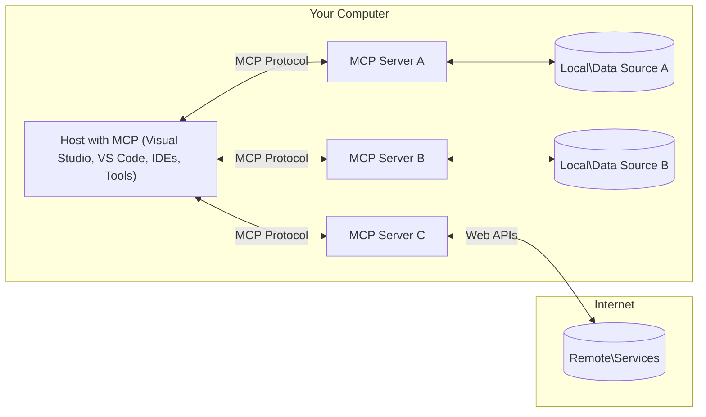

# Konsep Inti MCP: Menguasai Model Context Protocol untuk Integrasi AI

[](https://youtu.be/earDzWGtE84)

_(Klik gambar di atas untuk melihat video pelajaran ini)_

[Model Context Protocol (MCP)](https://github.com/modelcontextprotocol) adalah kerangka kerja standar yang kuat yang mengoptimalkan komunikasi antara Large Language Models (LLM) dan alat eksternal, aplikasi, serta sumber data.
Panduan ini akan membimbing Anda melalui konsep inti MCP. Anda akan mempelajari arsitektur klien-server, komponen penting, mekanisme komunikasi, dan praktik terbaik implementasi.

- **Kontrol dan Persetujuan Pengguna**: Host harus dengan jelas menunjukkan data dan alat apa yang diekspos oleh server, memungkinkan pengguna menolak operasi, dan memperoleh konfirmasi eksplisit untuk tindakan yang sensitif atau berdampak besar. MCP tidak memerlukan dialog konfirmasi sebelum setiap pemanggilan alat.


- **Perlindungan Privasi Data**: Data pengguna hanya diekspos dengan persetujuan eksplisit dan harus dilindungi oleh kontrol akses yang kuat sepanjang siklus interaksi. Implementasi harus mencegah transmisi data tanpa izin dan menjaga batasan privasi yang ketat.

- **Keamanan Eksekusi Alat**: Host harus membuat pemanggilan alat terlihat dan memungkinkan manusia untuk menolaknya. Operasi sensitif harus menunjukkan input alat dan dampaknya sebelum eksekusi, dengan batas keamanan untuk mencegah tindakan yang tidak disengaja atau berbahaya.


- **Keamanan Transportasi**: Koneksi jarak jauh harus menggunakan HTTPS dan model otorisasi MCP. Server stdio lokal bergantung pada isolasi proses, konfigurasi terpercaya, dan penanganan kredensial warisan yang aman.


#### Panduan Implementasi:

- **Manajemen Izin**: Terapkan sistem izin yang rinci yang memungkinkan pengguna mengontrol server, alat, dan sumber daya mana yang dapat diakses
- **Autentikasi & Otorisasi**: Gunakan metode autentikasi aman (OAuth, API key) dengan manajemen token dan masa berlaku yang tepat  
- **Validasi Input**: Validasi semua parameter dan input data sesuai skema yang telah ditentukan untuk mencegah serangan injeksi
- **Audit Log**: Pelihara log lengkap dari semua operasi untuk pemantauan keamanan dan kepatuhan

## Ikhtisar

Pelajaran ini mengeksplorasi arsitektur dan komponen dasar yang menyusun ekosistem Model Context Protocol (MCP). Anda akan mempelajari arsitektur klien-server, komponen utama, dan mekanisme komunikasi yang menggerakkan interaksi MCP.

## Tujuan Pembelajaran Utama

Pada akhir pelajaran ini, Anda akan:

- Memahami arsitektur klien-server MCP.
- Mengidentifikasi peran dan tanggung jawab Host, Klien, dan Server.
- Menganalisis fitur inti yang membuat MCP menjadi lapisan integrasi yang fleksibel.
- Mempelajari bagaimana informasi mengalir dalam ekosistem MCP.
- Mendapatkan wawasan praktis melalui contoh kode dalam .NET, Java, Python, dan JavaScript.

## Arsitektur MCP: Pandangan Mendalam

Ekosistem MCP dibangun berdasarkan model klien-server. Struktur modular ini memungkinkan aplikasi AI untuk berinteraksi dengan alat, basis data, API, dan sumber daya kontekstual secara efisien. Mari kita uraikan arsitektur ini ke dalam komponen inti.

Pada dasarnya, MCP mengikuti arsitektur klien-server di mana aplikasi host dapat terhubung ke beberapa server:



- **Host MCP**: Program seperti VSCode, Claude Desktop, IDE, atau alat AI yang ingin mengakses data melalui MCP
- **Klien MCP**: Komponen protokol yang mempertahankan satu hubungan logis dengan server; permintaan MCP `2026-07-28` tidak bergantung pada koneksi atau sesi yang persisten


- **Server MCP**: Program ringan yang masing-masing mengekspos kemampuan spesifik melalui Model Context Protocol yang standar
- **Sumber Data Lokal**: File, basis data, dan layanan komputer Anda yang dapat diakses dengan aman oleh server MCP
- **Layanan Jarak Jauh**: Sistem eksternal yang tersedia melalui internet yang dapat dihubungkan oleh server MCP melalui API.

Protokol MCP adalah standar yang berkembang menggunakan versi berdasarkan tanggal (format YYYY-MM-DD). Versi protokol saat ini adalah **2026-07-28**. Lihat [spesifikasi protokol 2026-07-28](https://modelcontextprotocol.io/specification/2026-07-28/).


> **Rilis saat ini:** MCP `2026-07-28` membuat protokol tanpa status pada
> lapisan transport dengan menghapus jabat tangan `initialize` dan ID sesi tingkat protokol.
> Ini juga memformalkan kerangka Extensions dan menghentikan
> Roots, Sampling, dan Logging demi pola yang lebih baru. Lihat
> [Apa yang Berubah di MCP: Spesifikasi 2026-07-28](./mcp-2026-07-28.md)
> untuk detail lengkap dan panduan migrasi. Contoh yang secara eksplisit menargetkan
> `2025-11-25` dipertahankan sebagai pelajaran kompatibilitas warisan.

### 1. Host

Dalam Model Context Protocol (MCP), **Host** adalah aplikasi AI yang berfungsi sebagai antarmuka utama dimana pengguna berinteraksi dengan protokol. Host mengoordinasikan dan mengelola koneksi ke banyak server MCP dengan membuat klien MCP yang didedikasikan untuk setiap koneksi server. Contoh Host meliputi:

- **Aplikasi AI**: Claude Desktop, Visual Studio Code, Claude Code
- **Lingkungan Pengembangan**: IDE dan editor kode dengan integrasi MCP  
- **Aplikasi Kustom**: Agen AI dan alat yang dibangun khusus

**Host** adalah aplikasi yang mengoordinasikan interaksi model AI. Mereka:

- **Mengatur Model AI**: Menjalankan atau berinteraksi dengan LLM untuk menghasilkan respons dan mengoordinasikan alur kerja AI
- **Mengelola Hubungan Klien**: Membuat dan mengelola satu klien MCP untuk setiap server MCP
  yang digunakan host
- **Mengendalikan Antarmuka Pengguna**: Menangani alur percakapan, interaksi pengguna, dan penyajian respons  
- **Menegakkan Keamanan**: Mengontrol izin, batasan keamanan, dan autentikasi
- **Menangani Persetujuan Pengguna**: Mengelola persetujuan pengguna untuk berbagi data dan eksekusi alat


### 2. Klien

**Klien** adalah komponen protokol yang dibuat oleh host untuk server MCP tertentu. Ini adalah hubungan logis satu-satu, bukan persyaratan untuk
server. Ini adalah hubungan logis satu-ke-satu, bukan persyaratan untuk sebuah
koneksi jaringan yang persisten. Dalam MCP `2026-07-28`, setiap permintaan bersifat
mandiri dan dapat ditangani oleh instance server mana pun.

**Klien** adalah komponen penghubung dalam aplikasi host. Mereka:

- **Komunikasi Protokol**: Mengirim permintaan JSON-RPC 2.0 ke server dengan prompt dan instruksi
- **Penemuan Kapabilitas**: Menggunakan `server/discover` untuk mempelajari versi protokol yang didukung,
  kapabilitas, dan ekstensi server
- **Eksekusi Alat**: Mengelola permintaan eksekusi alat dari model dan memproses tanggapan
- **Pembaruan Waktu Nyata**: Menangani notifikasi dan pembaruan waktu nyata dari server
- **Pemrosesan Tanggapan**: Memproses dan memformat tanggapan server untuk ditampilkan kepada pengguna

### 3. Server

**Server** adalah program yang menyediakan konteks, alat, dan kapabilitas kepada klien MCP. Mereka dapat dijalankan secara lokal (pada mesin yang sama dengan Host) atau jarak jauh (di platform eksternal), dan bertanggung jawab untuk menangani permintaan klien serta memberikan tanggapan terstruktur. Server menampilkan fungsi spesifik melalui Model Context Protocol yang distandarisasi.

**Server** adalah layanan yang menyediakan konteks dan kapabilitas. Mereka:

- **Registrasi Fitur**: Mendaftarkan dan menampilkan primitif yang tersedia (sumber daya, prompt, alat) kepada klien
- **Pemrosesan Permintaan**: Menerima dan mengeksekusi panggilan alat, permintaan sumber daya, dan permintaan prompt dari klien
- **Penyediaan Konteks**: Memberikan informasi dan data kontekstual untuk meningkatkan tanggapan model
- **Manajemen Status**: Memelihara status aplikasi dengan penangan eksplisit yang diteruskan
  dalam permintaan bila diperlukan; MCP `2026-07-28` tidak memiliki sesi pada tingkat protokol
- **Notifikasi Waktu Nyata**: Mengirim notifikasi tentang perubahan kapabilitas dan pembaruan ke klien yang terhubung

Server dapat dikembangkan oleh siapa saja untuk memperluas kapabilitas model dengan fungsi khusus, dan mereka mendukung skenario penyebaran lokal maupun jarak jauh.

### 4. Primitif Server

Server dalam Model Context Protocol (MCP) menyediakan tiga **primitif** inti yang mendefinisikan blok bangunan dasar untuk interaksi kaya antara klien, host, dan model bahasa. Primitif ini menentukan jenis informasi kontekstual dan tindakan yang tersedia melalui protokol.

Server MCP dapat menampilkan kombinasi dari tiga primitif inti berikut:

#### Sumber Daya 

**Sumber Daya** adalah sumber data yang menyediakan informasi kontekstual bagi aplikasi AI. Mereka mewakili konten statis atau dinamis yang dapat meningkatkan pemahaman dan pengambilan keputusan model:

- **Data Kontekstual**: Informasi terstruktur dan konteks untuk konsumsi model AI
- **Basis Pengetahuan**: Repositori dokumen, artikel, manual, dan makalah penelitian
- **Sumber Data Lokal**: File, basis data, dan informasi sistem lokal  
- **Data Eksternal**: Tanggapan API, layanan web, dan data sistem jarak jauh
- **Konten Dinamis**: Data waktu nyata yang diperbarui berdasarkan kondisi eksternal

Sumber daya diidentifikasi oleh URI dan mendukung penemuan melalui metode `resources/list` serta pengambilan melalui metode `resources/read`:

```text
file://documents/project-spec.md
database://production/users/schema
api://weather/current
```

#### Prompt

**Prompt** adalah templat yang dapat digunakan ulang yang membantu menyusun interaksi dengan model bahasa. Mereka menyediakan pola interaksi standar dan alur kerja yang ditemplatkan:

- **Interaksi Berbasis Templat**: Pesan dan pembuka percakapan yang telah disusun sebelumnya
- **Templat Alur Kerja**: Urutan standar untuk tugas dan interaksi umum
- **Contoh Few-shot**: Templat berbasis contoh untuk instruksi model
- **Prompt Sistem**: Prompt dasar yang mendefinisikan perilaku dan konteks model
- **Templat Dinamis**: Prompt parameterisasi yang menyesuaikan dengan konteks spesifik

Prompt mendukung substitusi variabel dan dapat ditemukan melalui metode `prompts/list` serta diambil dengan metode `prompts/get`:

```markdown
Generate a {{task_type}} for {{product}} targeting {{audience}} with the following requirements: {{requirements}}
```

#### Alat

**Alat** adalah fungsi yang dapat dieksekusi yang dapat dipanggil model AI untuk melakukan tindakan spesifik. Mereka mewakili "kata kerja" dari ekosistem MCP, memungkinkan model berinteraksi dengan sistem eksternal:

- **Fungsi yang Dapat Dieksekusi**: Operasi diskrit yang dapat dipanggil model dengan parameter spesifik
- **Integrasi Sistem Eksternal**: Panggilan API, kueri basis data, operasi file, perhitungan
- **Identitas Unik**: Setiap alat memiliki nama, deskripsi, dan skema parameter yang khas
- **I/O Terstruktur**: Alat menerima parameter yang tervalidasi dan mengembalikan tanggapan terstruktur dan bertipe
- **Kapabilitas Tindakan**: Memungkinkan model melakukan tindakan nyata dan mengambil data langsung

Alat didefinisikan dengan JSON Schema untuk validasi parameter dan ditemukan melalui `tools/list` serta dijalankan lewat `tools/call`. Alat juga dapat menyertakan **ikon** sebagai metadata tambahan untuk penyajian UI yang lebih baik.

**Anotasi Alat**: Alat mendukung anotasi perilaku (misalnya, `readOnlyHint`, `destructiveHint`) yang menjelaskan apakah alat bersifat hanya baca atau destruktif, membantu klien membuat keputusan yang tepat tentang eksekusi alat.

Contoh definisi alat:

```typescript
server.tool(
  "search_products", 
  {
    query: z.string().describe("Search query for products"),
    category: z.string().optional().describe("Product category filter"),
    max_results: z.number().default(10).describe("Maximum results to return")
  }, 
  async (params) => {
    // Execute search and return structured results
    return await productService.search(params);
  }
);
```

## Primitif Klien

Dalam Model Context Protocol (MCP), **klien** dapat menampilkan primitif yang memungkinkan server meminta kapabilitas tambahan dari aplikasi host. Primitif sisi klien ini memungkinkan implementasi server yang lebih kaya dan interaktif yang dapat mengakses kapabilitas model AI dan interaksi pengguna.

### Sampling

> **Tidak lagi digunakan di MCP `2026-07-28`:** Sampling tetap tersedia untuk
> kompatibilitas, tapi implementasi baru sebaiknya langsung terintegrasi dengan API penyedia LLM.
> Sampling berpotensi dihapus pada revisi spesifikasi pertama
> yang dirilis pada atau setelah 28 Juli 2027. Lihat
> [Apa yang Berubah di MCP: Spesifikasi 2026-07-28](./mcp-2026-07-28.md).

**Sampling** memungkinkan server untuk meminta penyelesaian model bahasa dari aplikasi AI klien. Primitif ini memungkinkan server mengakses kemampuan LLM tanpa menyematkan ketergantungan model mereka sendiri:

- **Akses Independen Model**: Server dapat meminta penyelesaian tanpa memasukkan SDK LLM atau mengelola akses model
- **AI Inisiasi Oleh Server**: Memungkinkan server secara mandiri menghasilkan konten menggunakan model AI klien
- **Interaksi LLM Rekursif**: Mendukung skenario kompleks di mana server memerlukan bantuan AI untuk pemrosesan
- **Generasi Konten Dinamis**: Memungkinkan server membuat respons kontekstual menggunakan model host
- **Dukungan Pemanggilan Alat**: Server dapat memasukkan parameter `tools` dan `toolChoice` untuk memungkinkan model klien memanggil alat selama sampling

Sampling menggunakan metode `sampling/createMessage`, di mana server meminta
penyelesaian dari klien.

### Roots

> **Kadaluarsa di MCP `2026-07-28`:** Roots tetap tersedia untuk
> kompatibilitas, tetapi implementasi baru harus mengoper direktori atau berkas
> melalui parameter alat, URI sumber daya, atau konfigurasi server. Roots
> berpotensi dihapus pada revisi spesifikasi pertama yang dirilis pada atau setelah
> 28 Juli 2027. Lihat
> [Apa yang Berubah di MCP: Spesifikasi 2026-07-28](./mcp-2026-07-28.md).

**Roots** menyediakan cara standar bagi klien untuk mengidentifikasi lokasi sistem berkas
yang relevan bagi server:

- **Petunjuk Sistem Berkas**: Identifikasi direktori dan berkas yang relevan dengan permintaan
- **Otorisasi Terpisah**: Tidak memberikan akses atau menegakkan batas keamanan
- **Kemampuan per Permintaan**: Klien mengiklankan dukungan Roots dalam metadata permintaan
- **Identifikasi Berbasis URI**: Roots menggunakan URI `file://` untuk mengidentifikasi direktori dan berkas yang dapat diakses

Dalam MCP `2026-07-28`, sebuah server meminta `roots/list` melalui
`InputRequiredResult` saat memproses permintaan klien yang didukung. Klien
mengembalikan roots saat mencoba ulang permintaan asli tersebut.

### Elicitation  

**Elicitation** memungkinkan server meminta informasi tambahan atau konfirmasi dari pengguna melalui antarmuka klien:

- **Permintaan Input Pengguna**: Server dapat meminta informasi tambahan saat diperlukan untuk eksekusi alat
- **Dialog Konfirmasi**: Meminta persetujuan pengguna untuk operasi yang sensitif atau berdampak
- **Alur Kerja Interaktif**: Memungkinkan server membuat interaksi pengguna langkah demi langkah
- **Pengumpulan Parameter Dinamis**: Mengumpulkan parameter yang hilang atau opsional selama eksekusi alat

Elicitation menggunakan metode `elicitation/create` di dalam
`InputRequiredResult` untuk mengumpulkan input pengguna melalui antarmuka klien.

**Elisitasi Mode URL**: Server juga dapat meminta interaksi pengguna berbasis URL, memungkinkan server mengarahkan pengguna ke halaman web eksternal untuk autentikasi, konfirmasi, atau pengisian data.

### Pencatatan

> **Dinonaktifkan di MCP `2026-07-28`:** Pencatatan tetap tersedia untuk
> kompatibilitas, tetapi implementasi baru harus menggunakan `stderr` dengan stdio dan
> OpenTelemetry untuk observabilitas terstruktur. Pencatatan berpotensi dihapus
> dalam revisi spesifikasi pertama yang dirilis pada atau setelah 28 Juli 2027. Lihat
> [Apa yang Berubah di MCP: Spesifikasi 2026-07-28](./mcp-2026-07-28.md).

**Pencatatan** memungkinkan server mengirim pesan log terstruktur ke klien untuk debug, pemantauan, dan visibilitas operasional:

- **Dukungan Debugging**: Memungkinkan server menyediakan log eksekusi detail untuk pemecahan masalah
- **Pemantauan Operasional**: Mengirim pembaruan status dan metrik performa ke klien
- **Pelaporan Kesalahan**: Menyediakan konteks kesalahan dan informasi diagnostik yang rinci
- **Audit Trail**: Membuat log komprehensif dari operasi dan keputusan server

Pesan pencatatan dikirim ke klien untuk memberikan transparansi ke dalam operasi server dan memudahkan debugging.

## Aliran Informasi dalam MCP

Model Context Protocol (MCP) mendefinisikan aliran informasi terstruktur antara host, klien, server, dan model. Memahami aliran ini membantu memperjelas bagaimana permintaan pengguna diproses dan bagaimana alat serta data eksternal diintegrasikan ke dalam respons model.

- **Host Memulai Koneksi**  
  Aplikasi host (seperti IDE atau antarmuka obrolan) membuat koneksi ke server MCP, biasanya melalui STDIO, WebSocket, atau transportasi lain yang didukung.

- **Negosiasi Kapabilitas**  
  Klien (yang tertanam di host) dan server bertukar informasi tentang fitur, alat, sumber daya, dan versi protokol yang didukung. Ini memastikan kedua pihak memahami kapabilitas yang tersedia untuk sesi tersebut.

- **Permintaan Pengguna**  
  Pengguna berinteraksi dengan host (misalnya, memasukkan prompt atau perintah). Host mengumpulkan input ini dan meneruskannya ke klien untuk diproses.

- **Penggunaan Sumber Daya atau Alat**  
  - Klien dapat meminta konteks atau sumber daya tambahan dari server (seperti berkas, entri database, atau artikel basis pengetahuan) untuk memperkaya pemahaman model.
  - Jika model menentukan bahwa sebuah alat diperlukan (misalnya, untuk mengambil data, melakukan perhitungan, atau memanggil API), klien mengirim permintaan pemanggilan alat ke server, dengan menyebutkan nama alat dan parameter.

- **Eksekusi Server**  
  Server menerima permintaan sumber daya atau alat, menjalankan operasi yang diperlukan (seperti menjalankan fungsi, melakukan query database, atau mengambil berkas), dan mengembalikan hasil ke klien dalam format terstruktur.

- **Pembuatan Respons**  
  Klien mengintegrasikan respons server (data sumber daya, keluaran alat, dll.) ke dalam interaksi model yang sedang berlangsung. Model menggunakan informasi ini untuk menghasilkan respons yang komprehensif dan kontekstual.

- **Penyajian Hasil**  
  Host menerima keluaran akhir dari klien dan menyajikannya ke pengguna, sering kali termasuk teks yang dihasilkan model dan hasil dari eksekusi alat atau pencarian sumber daya.

Aliran ini memungkinkan MCP mendukung aplikasi AI canggih, interaktif, dan sadar konteks dengan menghubungkan model ke alat eksternal dan sumber data secara mulus.

## Arsitektur & Lapisan Protokol

MCP terdiri dari dua lapisan arsitektur terpisah yang bekerja sama untuk menyediakan kerangka komunikasi lengkap:

### Lapisan Data

**Lapisan Data** mengimplementasikan protokol MCP inti menggunakan **JSON-RPC 2.0** sebagai dasarnya. Lapisan ini mendefinisikan struktur pesan, semantik, dan pola interaksi:

#### Komponen Inti:

- **Protokol JSON-RPC 2.0**: Semua komunikasi menggunakan format pesan JSON-RPC 2.0 standar untuk pemanggilan metode, respons, dan notifikasi
- **Manajemen Siklus Hidup**: Menangani inisialisasi koneksi, negosiasi kapabilitas, dan terminasi sesi antara klien dan server
- **Primitif Server**: Memungkinkan server menyediakan fungsionalitas inti melalui alat, sumber daya, dan prompt
- **Primitif Klien**: Memungkinkan server meminta sampling dari LLM, mengelicitasi input pengguna, dan mengirim pesan log
- **Notifikasi Real-time**: Mendukung notifikasi asinkron untuk pembaruan dinamis tanpa polling

#### Fitur Utama:

- **Negosiasi Versi Protokol**: Menggunakan penomoran versi berbasis tanggal (YYYY-MM-DD) untuk memastikan kompatibilitas
- **Penemuan Kapabilitas**: Klien dan server bertukar informasi fitur yang didukung selama inisialisasi
- **Sesi Stateful**: Mempertahankan status koneksi di berbagai interaksi untuk kontinuitas konteks

### Lapisan Transportasi

**Lapisan Transportasi** mengelola saluran komunikasi, pembingkaian pesan, dan autentikasi antar partisipan MCP:

#### Mekanisme Transportasi yang Didukung:

1. **Transportasi STDIO**:
   - Menggunakan aliran input/output standar untuk komunikasi proses langsung
   - Optimal untuk proses lokal pada mesin yang sama tanpa overhead jaringan
   - Umum digunakan untuk implementasi server MCP lokal

2. **Transportasi HTTP Streamable**:
   - Menggunakan HTTP POST untuk pesan klien-ke-server  
   - Opsional Server-Sent Events (SSE) untuk streaming server-ke-klien
   - Memungkinkan komunikasi server jarak jauh melalui jaringan
   - Mendukung autentikasi HTTP standar (token bearer, API key, header khusus)
   - MCP merekomendasikan OAuth untuk autentikasi token yang aman

#### Abstraksi Transportasi:

Lapisan transportasi mengabstraksi detail komunikasi dari lapisan data, memungkinkan format pesan JSON-RPC 2.0 yang sama digunakan di semua mekanisme transportasi. Abstraksi ini memungkinkan aplikasi beralih antara server lokal dan jarak jauh dengan mulus.

### Pertimbangan Keamanan

Implementasi MCP harus mematuhi beberapa prinsip keamanan kritis untuk memastikan interaksi yang aman, dapat dipercaya, dan terjaga keamanannya di seluruh operasi protokol:

- **Persetujuan dan Kontrol Pengguna**: Pengguna harus memberikan persetujuan eksplisit sebelum data diakses atau operasi dilakukan. Mereka harus memiliki kontrol jelas atas data yang dibagikan dan tindakan yang diotorisasi, didukung oleh antarmuka pengguna yang intuitif untuk meninjau dan menyetujui aktivitas.

- **Privasi Data**: Data pengguna hanya boleh dibuka dengan persetujuan eksplisit dan harus dilindungi dengan kontrol akses yang sesuai. Implementasi MCP harus melindungi dari transmisi data tanpa izin dan memastikan privasi terjaga selama semua interaksi.

- **Keamanan Alat**: Sebelum memanggil alat apa pun, diperlukan persetujuan eksplisit dari pengguna. Pengguna harus memahami fungsi setiap alat dengan jelas, dan batas keamanan yang kuat harus diterapkan untuk mencegah eksekusi alat yang tidak diinginkan atau tidak aman.

Dengan mengikuti prinsip keamanan ini, MCP memastikan kepercayaan, privasi, dan keselamatan pengguna terjaga di seluruh interaksi protokol sekaligus memungkinkan integrasi AI yang kuat.

## Contoh Kode: Komponen Kunci

Di bawah ini adalah contoh kode dalam beberapa bahasa pemrograman populer yang menggambarkan cara mengimplementasikan komponen server MCP utama dan alat.

### Contoh .NET: Membuat Server MCP Sederhana dengan Alat

Berikut contoh kode .NET praktis yang memperlihatkan cara mengimplementasikan server MCP sederhana dengan alat khusus. Contoh ini menunjukkan cara mendefinisikan dan mendaftarkan alat, menangani permintaan, dan menghubungkan server menggunakan Model Context Protocol.

```csharp
using System;
using System.Threading.Tasks;
using ModelContextProtocol.Server;
using ModelContextProtocol.Server.Transport;
using ModelContextProtocol.Server.Tools;

public class WeatherServer
{
    public static async Task Main(string[] args)
    {
        // Create an MCP server
        var server = new McpServer(
            name: "Weather MCP Server",
            version: "1.0.0"
        );
        
        // Register our custom weather tool
        server.AddTool<string, WeatherData>("weatherTool", 
            description: "Gets current weather for a location",
            execute: async (location) => {
                // Call weather API (simplified)
                var weatherData = await GetWeatherDataAsync(location);
                return weatherData;
            });
        
        // Connect the server using stdio transport
        var transport = new StdioServerTransport();
        await server.ConnectAsync(transport);
        
        Console.WriteLine("Weather MCP Server started");
        
        // Keep the server running until process is terminated
        await Task.Delay(-1);
    }
    
    private static async Task<WeatherData> GetWeatherDataAsync(string location)
    {
        // This would normally call a weather API
        // Simplified for demonstration
        await Task.Delay(100); // Simulate API call
        return new WeatherData { 
            Temperature = 72.5,
            Conditions = "Sunny",
            Location = location
        };
    }
}

public class WeatherData
{
    public double Temperature { get; set; }
    public string Conditions { get; set; }
    public string Location { get; set; }
}
```

### Contoh Java: Komponen Server MCP

Contoh ini memperlihatkan server MCP dan pendaftaran alat yang sama seperti contoh .NET di atas, tetapi diimplementasikan dalam Java.

```java
import io.modelcontextprotocol.server.McpServer;
import io.modelcontextprotocol.server.McpToolDefinition;
import io.modelcontextprotocol.server.transport.StdioServerTransport;
import io.modelcontextprotocol.server.tool.ToolExecutionContext;
import io.modelcontextprotocol.server.tool.ToolResponse;

public class WeatherMcpServer {
    public static void main(String[] args) throws Exception {
        // Create an MCP server
        McpServer server = McpServer.builder()
            .name("Weather MCP Server")
            .version("1.0.0")
            .build();
            
        // Register a weather tool
        server.registerTool(McpToolDefinition.builder("weatherTool")
            .description("Gets current weather for a location")
            .parameter("location", String.class)
            .execute((ToolExecutionContext ctx) -> {
                String location = ctx.getParameter("location", String.class);
                
                // Get weather data (simplified)
                WeatherData data = getWeatherData(location);
                
                // Return formatted response
                return ToolResponse.content(
                    String.format("Temperature: %.1f°F, Conditions: %s, Location: %s", 
                    data.getTemperature(), 
                    data.getConditions(), 
                    data.getLocation())
                );
            })
            .build());
        
        // Connect the server using stdio transport
        try (StdioServerTransport transport = new StdioServerTransport()) {
            server.connect(transport);
            System.out.println("Weather MCP Server started");
            // Keep server running until process is terminated
            Thread.currentThread().join();
        }
    }
    
    private static WeatherData getWeatherData(String location) {
        // Implementation would call a weather API
        // Simplified for example purposes
        return new WeatherData(72.5, "Sunny", location);
    }
}

class WeatherData {
    private double temperature;
    private String conditions;
    private String location;
    
    public WeatherData(double temperature, String conditions, String location) {
        this.temperature = temperature;
        this.conditions = conditions;
        this.location = location;
    }
    
    public double getTemperature() {
        return temperature;
    }
    
    public String getConditions() {
        return conditions;
    }
    
    public String getLocation() {
        return location;
    }
}
```

### Contoh Python: Membangun Server MCP

Contoh ini menggunakan fastmcp, jadi pastikan Anda menginstalnya terlebih dahulu:

```python
pip install fastmcp
```
Contoh Kode:

```python
#!/usr/bin/env python3
import asyncio
from fastmcp import FastMCP
from fastmcp.transports.stdio import serve_stdio

# Create a FastMCP server
mcp = FastMCP(
    name="Weather MCP Server",
    version="1.0.0"
)

@mcp.tool()
def get_weather(location: str) -> dict:
    """Gets current weather for a location."""
    return {
        "temperature": 72.5,
        "conditions": "Sunny",
        "location": location
    }

# Alternative approach using a class
class WeatherTools:
    @mcp.tool()
    def forecast(self, location: str, days: int = 1) -> dict:
        """Gets weather forecast for a location for the specified number of days."""
        return {
            "location": location,
            "forecast": [
                {"day": i+1, "temperature": 70 + i, "conditions": "Partly Cloudy"}
                for i in range(days)
            ]
        }

# Register class tools
weather_tools = WeatherTools()

# Start the server
if __name__ == "__main__":
    asyncio.run(serve_stdio(mcp))
```

### Contoh JavaScript: Membuat Server MCP

Contoh ini menunjukkan pembuatan server MCP dalam JavaScript dan bagaimana mendaftarkan dua alat terkait cuaca.

```javascript
// Using the official Model Context Protocol SDK
import { McpServer } from "@modelcontextprotocol/sdk/server/mcp.js";
import { StdioServerTransport } from "@modelcontextprotocol/sdk/server/stdio.js";
import { z } from "zod"; // For parameter validation

// Create an MCP server
const server = new McpServer({
  name: "Weather MCP Server",
  version: "1.0.0"
});

// Define a weather tool
server.tool(
  "weatherTool",
  {
    location: z.string().describe("The location to get weather for")
  },
  async ({ location }) => {
    // This would normally call a weather API
    // Simplified for demonstration
    const weatherData = await getWeatherData(location);
    
    return {
      content: [
        { 
          type: "text", 
          text: `Temperature: ${weatherData.temperature}°F, Conditions: ${weatherData.conditions}, Location: ${weatherData.location}` 
        }
      ]
    };
  }
);

// Define a forecast tool
server.tool(
  "forecastTool",
  {
    location: z.string(),
    days: z.number().default(3).describe("Number of days for forecast")
  },
  async ({ location, days }) => {
    // This would normally call a weather API
    // Simplified for demonstration
    const forecast = await getForecastData(location, days);
    
    return {
      content: [
        { 
          type: "text", 
          text: `${days}-day forecast for ${location}: ${JSON.stringify(forecast)}` 
        }
      ]
    };
  }
);

// Helper functions
async function getWeatherData(location) {
  // Simulate API call
  return {
    temperature: 72.5,
    conditions: "Sunny",
    location: location
  };
}

async function getForecastData(location, days) {
  // Simulate API call
  return Array.from({ length: days }, (_, i) => ({
    day: i + 1,
    temperature: 70 + Math.floor(Math.random() * 10),
    conditions: i % 2 === 0 ? "Sunny" : "Partly Cloudy"
  }));
}

// Connect the server using stdio transport
const transport = new StdioServerTransport();
server.connect(transport).catch(console.error);

console.log("Weather MCP Server started");
```

Contoh JavaScript ini memperlihatkan cara membuat server MCP menggunakan SDK Model Context Protocol. Ini menunjukkan cara mendaftarkan dua alat bernama `weatherTool` dan `forecastTool` dan membuatnya tersedia untuk klien MCP melalui `StdioServerTransport`.

## Keamanan dan Otorisasi

MCP mencakup beberapa konsep dan mekanisme bawaan untuk mengelola keamanan dan otorisasi sepanjang protokol:

1. **Kontrol Izin Alat**:  
  Klien dapat menentukan alat mana yang boleh digunakan model untuk tiap permintaan atau alur kerja.
  Ini memastikan bahwa hanya alat yang secara eksplisit diotorisasi yang dapat diakses, mengurangi
  risiko operasi yang tidak diinginkan atau tidak aman.

2. **Autentikasi**:  
  Server dapat mengharuskan autentikasi sebelum memberikan akses ke alat, sumber daya, atau operasi sensitif. Ini bisa melibatkan API key, token OAuth, atau skema autentikasi lainnya. Autentikasi yang tepat memastikan hanya klien dan pengguna terpercaya yang dapat memanggil kapabilitas sisi server.

3. **Validasi**:  
  Validasi parameter ditegakkan untuk semua pemanggilan alat. Setiap alat mendefinisikan tipe, format, dan batasan parameter yang diharapkan, dan server memvalidasi permintaan masuk sesuai itu. Ini mencegah input yang salah format atau berbahaya mencapai implementasi alat dan membantu menjaga integritas operasi.

4. **Pembatasan Kecepatan**:  
  Untuk mencegah penyalahgunaan dan memastikan penggunaan sumber daya server yang adil, server MCP dapat
  menerapkan pembatasan kecepatan untuk panggilan alat dan akses sumber daya. Batasan kecepatan dapat
  diterapkan per pengguna, kredensial, operasi, atau secara global.

Dengan menggabungkan mekanisme ini, MCP menyediakan dasar yang aman untuk mengintegrasikan model bahasa dengan alat eksternal dan sumber data, sekaligus memberikan kontrol granular atas akses dan penggunaan bagi pengguna dan pengembang.

## Pesan Protokol & Aliran Komunikasi

Komunikasi MCP menggunakan pesan **JSON-RPC 2.0** terstruktur untuk memfasilitasi interaksi yang jelas dan andal antara host, klien, dan server. Protokol mendefinisikan pola pesan khusus untuk berbagai jenis operasi:

### Tipe Pesan Inti

#### **Metadata Permintaan dan Penemuan**

- **Metadata per permintaan**: Setiap permintaan `2026-07-28` bersifat mandiri dan
  membawa versi protokol, identitas klien, dan kapabilitas klien dalam `_meta`.
- **Permintaan `server/discover`**: Mengambil versi protokol yang didukung, identitas server,
  kapabilitas, dan ekstensi saat klien memerlukannya.
- **Header HTTP Streamable**: Permintaan HTTP mencakup `MCP-Protocol-Version` dan
  `Mcp-Method`; metode yang mengarah ke alat atau sumber daya bernama juga menyertakan
  `Mcp-Name`.

Jabat tangan `initialize`/`initialized` dan ID sesi tingkat protokol adalah
milik revisi protokol sebelumnya dan tidak bagian dari MCP `2026-07-28`.

#### **Pesan Penemuan**
- **Permintaan `tools/list`**: Menemukan alat yang tersedia dari server
- **Permintaan `resources/list`**: Mendaftar sumber daya (sumber data) yang tersedia
- **Permintaan `prompts/list`**: Mengambil template prompt yang tersedia

#### **Pesan Eksekusi**  
- **Permintaan `tools/call`**: Menjalankan alat tertentu dengan parameter yang diberikan
- **Permintaan `resources/read`**: Mengambil konten dari sumber daya tertentu
- **Permintaan `prompts/get`**: Mengambil template prompt dengan parameter opsional

#### **Permintaan Input Sisi Klien**

- **`elicitation/create`**: Server meminta input pengguna melalui antarmuka klien
  saat memproses permintaan klien.
- **`sampling/createMessage`**: Permintaan server yang sudah tidak digunakan untuk penyelesaian LLM.
- **`roots/list`**: Permintaan server yang sudah tidak digunakan untuk akar sistem file klien.

Di bawah `2026-07-28`, permintaan input server-ke-klien menggunakan pola perjalanan bolak-balik multiperjalanan
`InputRequiredResult` daripada mengandalkan sesi yang persisten.

#### **Pesan Notifikasi**
- **`notifications/tools/list_changed`**: Server memberi tahu klien tentang perubahan alat
- **`notifications/resources/list_changed`**: Server memberi tahu klien tentang perubahan sumber daya  
- **`notifications/prompts/list_changed`**: Server memberi tahu klien tentang perubahan prompt

### Struktur Pesan:

Semua pesan MCP mengikuti format JSON-RPC 2.0 dengan:
- **Pesan Permintaan**: Termasuk `id`, `method`, dan opsional `params`
- **Pesan Respons**: Termasuk `id` dan salah satu dari `result` atau `error`  
- **Pesan Notifikasi**: Termasuk `method` dan opsional `params` (tidak ada `id` atau respons yang diharapkan)

Komunikasi terstruktur ini memastikan interaksi yang andal, dapat ditelusuri, dan dapat diperluas mendukung skenario canggih seperti pembaruan waktu nyata, penggabungan alat, dan penanganan kesalahan yang kokoh.

### Ekstensi Tasks

Pada MCP `2026-07-28`, Tasks adalah ekstensi resmi bukan fitur inti eksperimen. Ini menggunakan siklus hidup `tasks/get`, `tasks/update`, dan
`tasks/cancel` yang dirancang ulang; `tasks/list` dihapus. API Tasks eksperimen
`2025-11-25` tidak kompatibel mundur dengan ekstensi ini. Lihat
[Apa yang Berubah di MCP: Spesifikasi 2026-07-28](./mcp-2026-07-28.md).


pelacakan status:


- **Hasil Tertunda**: Memeriksa status tugas dan mengambil hasil saat operasi selesai
- **Pelacakan Status**: Memantau kemajuan tugas melalui status siklus hidup yang didefinisikan
- **Operasi Multi-Langkah**: Mendukung alur kerja kompleks yang melibatkan beberapa interaksi


- **Partisipan**: Ekosistem mencakup host (aplikasi AI), klien (penghubung protokol), dan server (penyedia kapabilitas)
- **Mekanisme Transportasi**: Komunikasi mendukung stdio (lokal) dan Streamable
  HTTP (jarak jauh); `2026-07-28` menghapus stream event GET standalone
- **Primitif Inti**: Server mengekspos alat (fungsi yang dapat dieksekusi), sumber daya (sumber data), dan prompt (template)
- **Primitif Klien**: Elisitasi mendukung input pengguna, sementara Sampling dan
  Roots hanya dipertahankan sebagai fitur kompatibilitas yang sudah tidak digunakan
  Roots hanya dipertahankan sebagai fitur kompatibilitas yang sudah usang
- **Ekstensi**: Ekstensi Tasks resmi menyediakan pembungkus eksekusi tahan lama
  untuk operasi yang berjalan lama
- **Fondasi Protokol**: Dibangun di atas JSON-RPC 2.0 dengan versioning berbasis tanggal
  (saat ini: `2026-07-28`)
- **Kemampuan Waktu Nyata**: Mendukung notifikasi untuk pembaruan dinamis dan sinkronisasi waktu nyata
- **Keamanan Utama**: Persetujuan pengguna yang eksplisit, perlindungan privasi data, dan transportasi aman adalah persyaratan inti

## Latihan

Rancang alat MCP sederhana yang akan berguna di domainmu. Definisikan:
1. Nama alat tersebut
2. Parameter apa yang akan diterimanya
3. Output apa yang akan dikembalikan
4. Bagaimana sebuah model bisa menggunakan alat ini untuk memecahkan masalah pengguna


---

## Selanjutnya

Selanjutnya: [Bab 2: Keamanan](../02-Security/README.md)

Baca [Apa yang Berubah di MCP: Spesifikasi 2026-07-28](./mcp-2026-07-28.md)
untuk panduan migrasi dari `2025-11-25`.

---

<!-- CO-OP TRANSLATOR DISCLAIMER START -->
**Penafian**:
Dokumen ini telah diterjemahkan menggunakan layanan terjemahan AI [Co-op Translator](https://github.com/Azure/co-op-translator). Meskipun kami berupaya untuk mencapai akurasi, harap diketahui bahwa terjemahan otomatis mungkin mengandung kesalahan atau ketidakakuratan. Dokumen asli dalam bahasa aslinya harus dianggap sebagai sumber yang sah. Untuk informasi penting, disarankan menggunakan terjemahan profesional oleh manusia. Kami tidak bertanggung jawab atas kesalahpahaman atau penafsiran yang keliru yang timbul dari penggunaan terjemahan ini.
<!-- CO-OP TRANSLATOR DISCLAIMER END -->