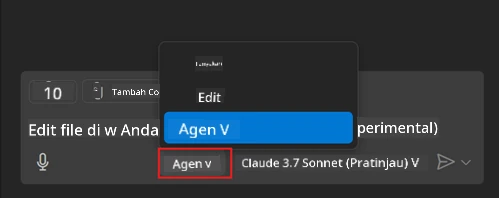
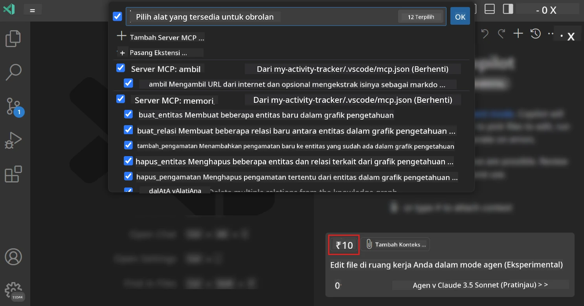
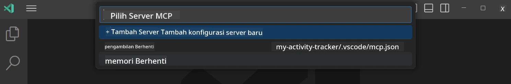
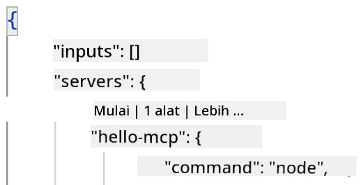
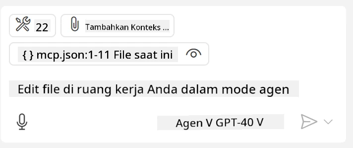
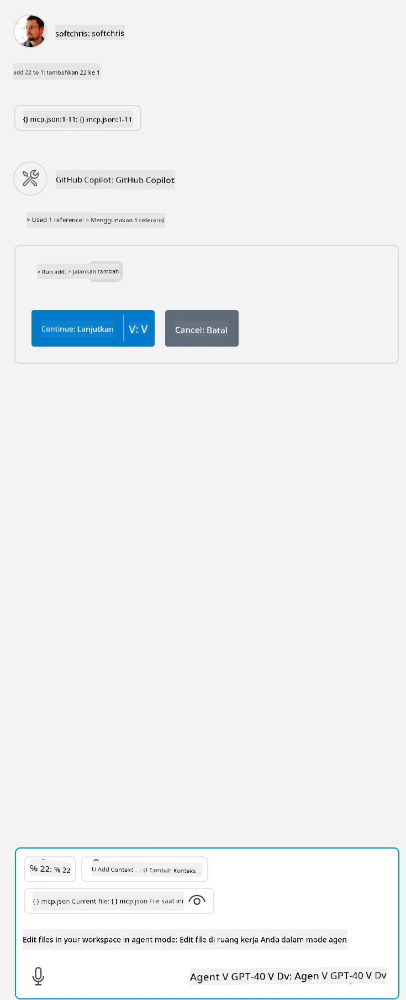

# Mengkonsumsi server dari mode GitHub Copilot Agent

Visual Studio Code dan GitHub Copilot dapat berperan sebagai klien dan mengkonsumsi Server MCP. Mungkin Anda bertanya-tanya kenapa kita ingin melakukan itu? Nah, itu berarti fitur apa pun yang dimiliki Server MCP sekarang bisa digunakan dari dalam IDE Anda. Bayangkan Anda menambahkan misalnya server MCP GitHub, ini akan memungkinkan untuk mengontrol GitHub melalui prompt tanpa harus mengetik perintah spesifik di terminal. Atau bayangkan apa pun secara umum yang dapat meningkatkan pengalaman pengembang Anda semuanya dikontrol dengan bahasa alami. Sekarang Anda mulai melihat keuntungannya bukan?

## Ikhtisar

Pelajaran ini membahas cara menggunakan Visual Studio Code dan mode Agent GitHub Copilot sebagai klien untuk Server MCP Anda.

## Tujuan Pembelajaran

Pada akhir pelajaran ini, Anda akan dapat:

- Mengkonsumsi Server MCP melalui Visual Studio Code.
- Menjalankan kemampuan seperti alat melalui GitHub Copilot.
- Mengonfigurasi Visual Studio Code untuk menemukan dan mengelola Server MCP Anda.

## Cara Penggunaan

Anda dapat mengontrol server MCP Anda dengan dua cara berbeda:

- Antarmuka pengguna, Anda akan melihat bagaimana ini dilakukan nanti di bab ini.
- Terminal, memungkinkan untuk mengontrol hal-hal dari terminal menggunakan eksekutabel `code`:

  Untuk menambahkan server MCP ke profil pengguna Anda, gunakan opsi baris perintah --add-mcp, dan berikan konfigurasi server dalam bentuk JSON {\"name\":\"server-name\",\"command\":...}.

  ```
  code --add-mcp "{\"name\":\"my-server\",\"command\": \"uvx\",\"args\": [\"mcp-server-fetch\"]}"
  ```

### Tangkapan Layar





Mari kita bahas lebih lanjut tentang cara menggunakan antarmuka visual pada bagian berikutnya.

## Pendekatan

Berikut cara kita harus mendekati ini secara garis besar:

- Mengonfigurasi file untuk menemukan Server MCP kita.
- Memulai/Menghubungkan ke server tersebut untuk meminta daftar kemampuannya.
- Menggunakan kemampuan tersebut melalui antarmuka GitHub Copilot Chat.

Baik, sekarang kita mengerti alurnya, mari kita coba gunakan Server MCP melalui Visual Studio Code lewat latihan.

## Latihan: Mengkonsumsi Server

Dalam latihan ini, kita akan mengonfigurasi Visual Studio Code agar dapat menemukan server MCP Anda sehingga bisa digunakan dari antarmuka GitHub Copilot Chat.

### -0- Langkah awal, aktifkan penemuan Server MCP

Anda mungkin perlu mengaktifkan penemuan Server MCP.

1. Buka `File -> Preferences -> Settings` di Visual Studio Code.

1. Cari "MCP" dan aktifkan `chat.mcp.discovery.enabled` di file settings.json.

### -1- Buat file konfigurasi

Mulailah dengan membuat file konfigurasi di root proyek Anda, Anda memerlukan file bernama MCP.json dan tempatkan di folder bernama .vscode. Seharusnya terlihat seperti ini:

```text
.vscode
|-- mcp.json
```

Selanjutnya, mari lihat bagaimana kita menambahkan entri server.

### -2- Konfigurasi server

Tambahkan konten berikut ke *mcp.json*:

```json
{
    "inputs": [],
    "servers": {
       "hello-mcp": {
           "command": "node",
           "args": [
               "build/index.js"
           ]
       }
    }
}
```

Contoh sederhana di atas menunjukkan cara memulai server yang ditulis dengan Node.js, untuk runtime lain gunakan perintah yang tepat untuk memulai server menggunakan `command` dan `args`.

### -3- Mulai server

Sekarang setelah Anda menambahkan entri, mari mulai server:

1. Temukan entri Anda di *mcp.json* dan pastikan Anda menemukan ikon "play":

    

1. Klik ikon "play", Anda harus melihat ikon alat di GitHub Copilot Chat menambah jumlah alat yang tersedia. Jika Anda klik ikon alat tersebut, Anda akan melihat daftar alat terdaftar. Anda bisa centang/hapus centang setiap alat tergantung apakah Anda ingin GitHub Copilot menggunakannya sebagai konteks:

  

1. Untuk menjalankan alat, ketik prompt yang Anda tahu akan cocok dengan deskripsi salah satu alat Anda, misalnya prompt seperti "tambahkan 22 ke 1":

  

  Anda akan melihat respons yang mengatakan 23.

## Tugas

Coba tambahkan entri server ke file *mcp.json* Anda dan pastikan Anda dapat memulai/menghentikan server. Pastikan juga Anda bisa berkomunikasi dengan alat pada server Anda melalui antarmuka GitHub Copilot Chat.

## Solusi

[Solusi](./solution/README.md)

## Poin Penting

Poin penting dari bab ini adalah sebagai berikut:

- Visual Studio Code adalah klien yang hebat yang memungkinkan Anda mengkonsumsi beberapa Server MCP dan alatnya.
- Antarmuka GitHub Copilot Chat adalah cara Anda berinteraksi dengan server.
- Anda dapat meminta pengguna memasukkan input seperti kunci API yang dapat diteruskan ke Server MCP saat mengonfigurasi entri server di file *mcp.json*.

## Contoh

- [Kalkulator Java](../samples/java/calculator/README.md)
- [Kalkulator .NET](../../../../03-GettingStarted/samples/csharp)
- [Kalkulator JavaScript](../samples/javascript/README.md)
- [Kalkulator TypeScript](../samples/typescript/README.md)
- [Kalkulator Python](../../../../03-GettingStarted/samples/python)

## Sumber Daya Tambahan

- [Dokumentasi Visual Studio](https://code.visualstudio.com/docs/copilot/chat/mcp-servers)

## Apa Selanjutnya

- Selanjutnya: [Membuat Server stdio](../05-stdio-server/README.md)

---

<!-- CO-OP TRANSLATOR DISCLAIMER START -->
**Penafian**:
Dokumen ini telah diterjemahkan menggunakan layanan terjemahan AI [Co-op Translator](https://github.com/Azure/co-op-translator). Meskipun kami berupaya untuk mencapai akurasi, harap diketahui bahwa terjemahan otomatis mungkin mengandung kesalahan atau ketidakakuratan. Dokumen asli dalam bahasa aslinya harus dianggap sebagai sumber yang sah. Untuk informasi penting, disarankan menggunakan terjemahan profesional oleh manusia. Kami tidak bertanggung jawab atas kesalahpahaman atau penafsiran yang keliru yang timbul dari penggunaan terjemahan ini.
<!-- CO-OP TRANSLATOR DISCLAIMER END -->