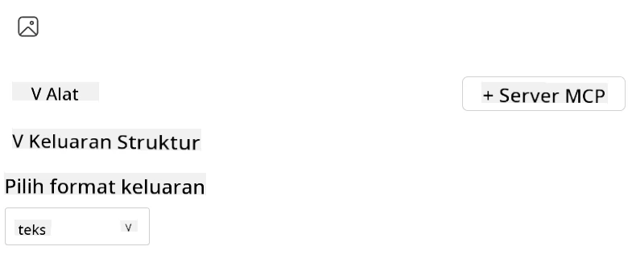
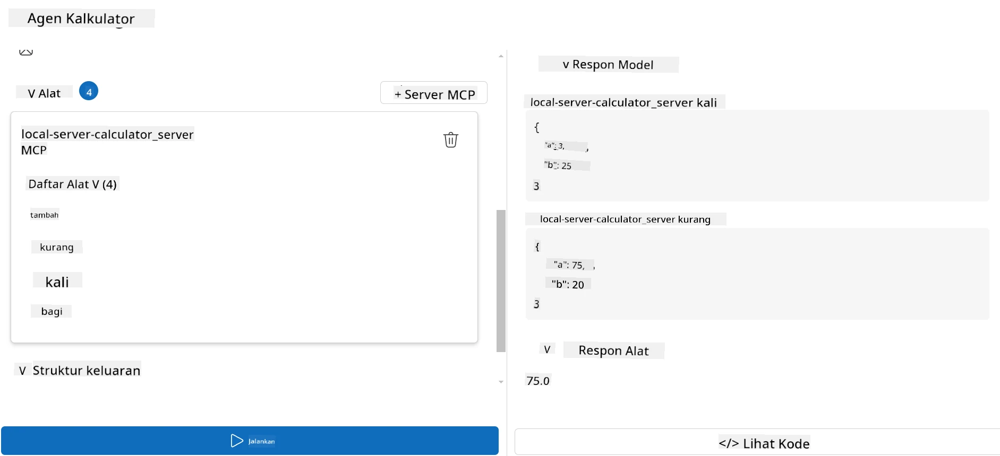

# Mengonsumsi server dengan Microsoft Foundry Toolkit untuk Visual Studio Code

Saat Anda membangun agen AI, bukan hanya soal menghasilkan respons cerdas; tapi juga memberi kemampuan kepada agen Anda untuk mengambil tindakan. Di sinilah Model Context Protocol (MCP) berperan. MCP memudahkan agen untuk mengakses alat dan layanan eksternal dengan cara yang konsisten. Anggap saja seperti memasangkan agen Anda ke kotak peralatan yang benar-benar bisa digunakannya.

Misalnya Anda menghubungkan agen ke server MCP kalkulator Anda. Tiba-tiba, agen Anda dapat melakukan operasi matematika hanya dengan menerima perintah seperti "Berapa 47 kali 89?"—tanpa perlu mengodekan logika secara langsung atau membangun API khusus.

## Ikhtisar

Pelajaran ini membahas cara menghubungkan server MCP kalkulator ke agen dengan
[Microsoft Foundry Toolkit untuk Visual Studio Code](https://aka.ms/AIToolkit),
memungkinkan agen Anda melakukan operasi matematika melalui bahasa alami.

Microsoft Foundry Toolkit mempermudah pengembangan dan pengujian aplikasi
AI generatif dengan model yang dijalankan secara lokal maupun di cloud.

*Catatan*: Toolkit saat ini mendukung template MCP Python dan TypeScript.

## Tujuan Pembelajaran

Pada akhir pelajaran ini, Anda akan dapat:

- Mengonsumsi server MCP dengan Microsoft Foundry Toolkit.
- Mengonfigurasi konfigurasi agen untuk memungkinkan agen menemukan dan menggunakan alat yang disediakan oleh server MCP.
- Memanfaatkan alat MCP melalui bahasa alami.

## Pendekatan

Berikut adalah cara kita perlu mendekati hal ini secara garis besar:

- Membuat agen dan mendefinisikan prompt sistemnya.
- Membuat server MCP dengan alat kalkulator.
- Menghubungkan Agent Builder ke server MCP.
- Menguji pemanggilan alat agen melalui bahasa alami.

Bagus, sekarang kita mengerti alurnya, mari konfigurasikan agen AI untuk memanfaatkan alat eksternal melalui MCP, meningkatkan kemampuannya!

## Prasyarat

- [Visual Studio Code](https://code.visualstudio.com/)
- [Microsoft Foundry Toolkit untuk Visual Studio Code](https://aka.ms/AIToolkit)

## Latihan: Mengonsumsi sebuah server

> [!WARNING]
> Catatan untuk Pengguna macOS. Saat ini kami sedang menyelidiki masalah yang memengaruhi instalasi dependensi di macOS. Akibatnya, pengguna macOS tidak dapat menyelesaikan tutorial ini saat ini. Kami akan memperbarui instruksi secepat perbaikan tersedia. Terima kasih atas kesabaran dan pengertiannya!

Dalam latihan ini, Anda akan membangun, menjalankan, dan meningkatkan agen AI dengan alat dari
server MCP di dalam Visual Studio Code menggunakan Microsoft Foundry Toolkit.

### -0- Langkah awal, tambahkan deployment Microsoft Foundry GPT-5.1

Buat sumber daya Microsoft Foundry, deploy **GPT-5.1**, dan tambahkan deployment
ke **Model Saya**. Tinjau
[jadwal penghapusan model](https://learn.microsoft.com/azure/foundry/openai/concepts/model-retirement-schedule)
saat memilih deployment.

1. Buka **Microsoft Foundry Toolkit** dari **Activity Bar**.
1. Di bagian **Catalog**, pilih **Models** untuk membuka **Model Catalog**. Memilih **Models** membuka **Model Catalog** di tab editor baru.
1. Hubungkan project Microsoft Foundry Anda dan pilih deployment **GPT-5.1** Anda.
1. Klik **+ Add** untuk menambahkan deployment ke daftar **Model Saya**.
1. Di **Activity Bar**, pastikan deployment muncul dalam daftar.

### -1- Membuat agen

**Agent (Prompt) Builder** memungkinkan Anda membuat dan menyesuaikan agen bertenaga AI Anda sendiri. Pada bagian ini, Anda akan membuat agen baru dan menetapkan model untuk menggerakkan percakapan.

1. Buka **Microsoft Foundry Toolkit** dari **Activity Bar**.
1. Di bagian **Tools**, pilih **Agent (Prompt) Builder**. Memilih **Agent (Prompt) Builder** membuka **Agent (Prompt) Builder** di tab editor baru.
1. Klik tombol **+ New Agent**. Ekstensi akan membuka wizard pengaturan lewat **Command Palette**.
1. Masukkan nama **Calculator Agent** dan tekan **Enter**.
1. Di **Agent (Prompt) Builder**, pilih deployment **GPT-5.1** Foundry Anda.

### -2- Membuat prompt sistem untuk agen

Setelah agen terbentuk, saatnya mendefinisikan kepribadian dan tujuannya. Pada bagian ini, Anda akan menggunakan fitur **Generate system prompt** untuk mendeskripsikan perilaku yang diinginkan agen—dalam kasus ini, agen kalkulator—dan membiarkan model menulis prompt sistem untuk Anda.

1. Pada bagian **Prompts**, klik tombol **Generate system prompt**. Tombol ini membuka pembuatan prompt yang menggunakan AI untuk menghasilkan prompt sistem untuk agen.
1. Di jendela **Generate a prompt**, masukkan: `You are a helpful and efficient math assistant. When given a problem involving basic arithmetic, you respond with the correct result.`
1. Klik tombol **Generate**. Notifikasi akan muncul di kanan bawah mengonfirmasi bahwa prompt sistem sedang dibuat. Setelah selesai, prompt akan muncul di kolom **System prompt** pada **Agent (Prompt) Builder**.
1. Tinjau **System prompt** dan ubah jika perlu.

### -3- Membuat server MCP

Sekarang setelah Anda mendefinisikan prompt sistem agen—yang mengarahkan perilaku dan responsnya—saatnya membekali agen dengan kemampuan praktis. Pada bagian ini, Anda akan membuat server MCP kalkulator dengan alat yang dapat menjalankan operasi penjumlahan, pengurangan, perkalian, dan pembagian. Server ini memungkinkan agen Anda melakukan operasi matematika secara real-time sebagai respons terhadap perintah bahasa alami.



Microsoft Foundry Toolkit menyertakan template untuk membuat server MCP. Kami akan
menggunakan template Python untuk server MCP kalkulator.

*Catatan*: Toolkit saat ini mendukung template MCP Python dan TypeScript.

1. Di bagian **Tools** dari **Agent (Prompt) Builder**, klik tombol **+ MCP Server**. Ekstensi akan membuka wizard pengaturan lewat **Command Palette**.
1. Pilih **+ Add Server**.
1. Pilih **Create a New MCP Server**.
1. Pilih **python-weather** sebagai template.
1. Pilih **Default folder** untuk menyimpan template server MCP.
1. Masukkan nama berikut untuk server: **Calculator**
1. Jendela Visual Studio Code baru akan terbuka. Pilih **Yes, I trust the authors**.
1. Menggunakan terminal (**Terminal** > **New Terminal**), buat virtual environment: `python -m venv .venv`
1. Menggunakan terminal, aktifkan virtual environment:
    1. Windows - `.venv\Scripts\activate`
    1. macOS/Linux - `source .venv/bin/activate`
1. Menggunakan terminal, instal dependensi: `pip install -e .[dev]`
1. Di tampilan **Explorer** dari **Activity Bar**, perluas direktori **src** dan pilih **server.py** untuk membuka file di editor.
1. Ganti kode di file **server.py** dengan yang berikut dan simpan:

    ```python
    """
    Sample MCP Calculator Server implementation in Python.

    
    This module demonstrates how to create a simple MCP server with calculator tools
    that can perform basic arithmetic operations (add, subtract, multiply, divide).
    """
    
    from mcp.server.fastmcp import FastMCP
    
    server = FastMCP("calculator")
    
    @server.tool()
    def add(a: float, b: float) -> float:
        """Add two numbers together and return the result."""
        return a + b
    
    @server.tool()
    def subtract(a: float, b: float) -> float:
        """Subtract b from a and return the result."""
        return a - b
    
    @server.tool()
    def multiply(a: float, b: float) -> float:
        """Multiply two numbers together and return the result."""
        return a * b
    
    @server.tool()
    def divide(a: float, b: float) -> float:
        """
        Divide a by b and return the result.
        
        Raises:
            ValueError: If b is zero
        """
        if b == 0:
            raise ValueError("Cannot divide by zero")
        return a / b
    ```

### -4- Menjalankan agen dengan server MCP kalkulator

Sekarang agen Anda sudah memiliki alat, saatnya menggunakannya! Pada bagian ini, Anda akan mengajukan perintah ke agen untuk menguji dan memvalidasi apakah agen memanfaatkan alat yang tepat dari server MCP kalkulator.



Anda akan menjalankan server MCP kalkulator di mesin pengembangan lokal Anda melalui **Agent Builder** sebagai klien MCP.

1. Tekan `F5` untuk mulai melakukan debug server MCP. **Agent (Prompt) Builder** akan terbuka di tab editor baru. Status server terlihat di terminal.
1. Di kolom **User prompt** dari **Agent (Prompt) Builder**, masukkan perintah berikut: `I bought 3 items priced at $25 each, and then used a $20 discount. How much did I pay?`
1. Klik tombol **Run** untuk menghasilkan respons agen.
1. Tinjau keluaran agen. Model seharusnya menyimpulkan bahwa Anda membayar **$55**.
1. Berikut adalah rincian apa yang seharusnya terjadi:
    - Agen memilih alat **multiply** dan **subtract** untuk membantu perhitungan.
    - Nilai `a` dan `b` masing-masing ditetapkan untuk alat **multiply**.
    - Nilai `a` dan `b` masing-masing ditetapkan untuk alat **subtract**.
    - Respons dari setiap alat ditampilkan pada **Tool Response** masing-masing.
    - Keluaran akhir dari model ditampilkan pada **Model Response** akhir.
1. Kirim perintah tambahan untuk menguji agen lebih lanjut. Anda dapat mengubah perintah yang ada di kolom **User prompt** dengan mengklik dan mengganti perintah yang sudah ada.
1. Setelah selesai menguji agen, Anda dapat menghentikan server melalui **terminal** dengan menekan **CTRL/CMD+C** untuk keluar.

## Tugas

Cobalah menambahkan entri alat tambahan ke file **server.py** Anda (misalnya: mengembalikan akar kuadrat dari sebuah angka). Kirim perintah tambahan yang mengharuskan agen menggunakan alat baru Anda (atau alat yang sudah ada). Pastikan untuk memulai ulang server agar alat yang baru ditambahkan dimuat.

## Solusi

[Solusi](./solution/README.md)

## Poin-poin Penting

Poin-poin yang dapat diambil dari bab ini adalah sebagai berikut:

- Microsoft Foundry Toolkit dapat mengonsumsi server MCP dan alat-alatnya.
- Anda dapat menambahkan alat baru ke server MCP, memperluas kemampuan agen untuk memenuhi kebutuhan yang berkembang.
- Microsoft Foundry Toolkit menyertakan template server MCP untuk membuat alat kustom.

## Sumber Daya Tambahan

- [Dokumentasi Microsoft Foundry Toolkit](https://aka.ms/AIToolkit/doc)

## Selanjutnya
- Selanjutnya: [Pengujian & Debugging](../08-testing/README.md)

---

<!-- CO-OP TRANSLATOR DISCLAIMER START -->
**Penafian**:
Dokumen ini telah diterjemahkan menggunakan layanan terjemahan AI [Co-op Translator](https://github.com/Azure/co-op-translator). Meskipun kami berupaya untuk mencapai akurasi, harap diketahui bahwa terjemahan otomatis mungkin mengandung kesalahan atau ketidakakuratan. Dokumen asli dalam bahasa aslinya harus dianggap sebagai sumber yang sah. Untuk informasi penting, disarankan menggunakan terjemahan profesional oleh manusia. Kami tidak bertanggung jawab atas kesalahpahaman atau penafsiran yang keliru yang timbul dari penggunaan terjemahan ini.
<!-- CO-OP TRANSLATOR DISCLAIMER END -->