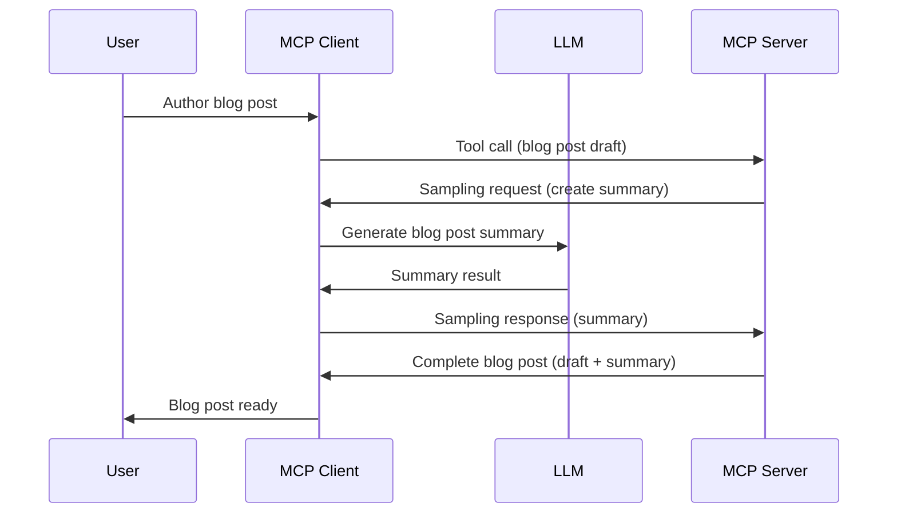

> [!WARNING]
> Sampling sudah tidak digunakan lagi di MCP `2026-07-28`. Pelajaran ini dipertahankan untuk
> implementasi warisan. Server baru harus mengintegrasikan langsung dengan API penyedia LLM.
> 

# Sampling - mendelegasikan fitur ke Klien

> Sampling tetap ada dalam spesifikasi `2026-07-28` untuk kompatibilitas dan
> berpotensi dihapus pada revisi pertama yang dirilis pada atau setelah 28 Juli,
> 2027. Contoh dalam pelajaran ini mungkin menggunakan API SDK yang mengimplementasikan `2025-11-25`.
> Lihat [Apa yang Berubah di MCP: Spesifikasi 2026-07-28](../../01-CoreConcepts/mcp-2026-07-28.md).

Dalam implementasi lama, Sampling memungkinkan server MCP meminta bantuan dari LLM
yang dikelola oleh klien. Untuk implementasi baru, panggil langsung penyedia LLM yang dipilih
oleh klien.

Mari kita jelajahi beberapa kasus penggunaan dan cara membangun solusi yang melibatkan sampling.

## Ikhtisar

Dalam pelajaran ini, kami fokus pada penjelasan kapan dan di mana menggunakan Sampling dan bagaimana mengonfigurasinya.

## Tujuan Pembelajaran

Dalam bab ini, kita akan:

- Menjelaskan apa itu Sampling dan kapan menggunakannya.
- Menunjukkan cara mengonfigurasi Sampling di MCP.
- Memberikan contoh Sampling dalam praktik.

## Apa itu Sampling dan mengapa menggunakannya?

Sampling adalah fitur lanjutan yang bekerja dengan cara berikut:



### Permintaan Sampling

Baik, sekarang kita memiliki pandangan luas tentang sebuah skenario yang kredibel, mari kita bahas permintaan sampling yang dikirim server ke klien. Berikut contoh bagaimana permintaan seperti itu terlihat dalam format JSON-RPC:

```json
{
  "jsonrpc": "2.0",
  "id": 1,
  "method": "sampling/createMessage",
  "params": {
    "messages": [
      {
        "role": "user",
        "content": {
          "type": "text",
          "text": "Create a blog post summary of the following blog post: <BLOG POST>"
        }
      }
    ],
    "modelPreferences": {
      "hints": [
        {
          "name": "gpt-5.1"
        }
      ],
      "intelligencePriority": 0.8,
      "speedPriority": 0.5
    },
    "systemPrompt": "You are a helpful assistant.",
    "maxTokens": 100
  }
}
```

Ada beberapa hal yang perlu diperhatikan:

- Prompt, di bawah content -> text, adalah perintah kita yang merupakan instruksi bagi LLM untuk merangkum konten posting blog.

- **modelPreferences**. Bagian ini hanyalah preferensi, rekomendasi konfigurasi yang digunakan dengan LLM. Pengguna dapat memilih mengikuti rekomendasi ini atau mengubahnya. Dalam kasus ini ada rekomendasi model yang akan digunakan serta prioritas kecepatan dan kecerdasan.
- **systemPrompt**, ini adalah prompt sistem normal yang memberikan LLM Anda kepribadian dan berisi instruksi panduan.
- **maxTokens**, ini adalah properti yang digunakan untuk menyatakan berapa banyak token yang disarankan digunakan untuk tugas ini.

### Respon Sampling

Respon ini adalah apa yang akhirnya dikirim MCP Client kembali ke MCP Server dan merupakan hasil dari klien memanggil LLM, menunggu respon tersebut lalu menyusun pesan ini. Berikut contoh dalam JSON-RPC:

```json
{
  "jsonrpc": "2.0",
  "id": 1,
  "result": {
    "role": "assistant",
    "content": {
      "type": "text",
      "text": "Here's your abstract <ABSTRACT>"
    },
    "model": "gpt-5.1",
    "stopReason": "endTurn"
  }
}
```

Respon tersebut adalah abstrak dari posting blog sebagaimana diminta. Klien
memilih deployment aktif `gpt-5.1` dari preferensi model server;
preferensi model adalah rekomendasi, jadi klien bisa memilih deployment aktif lain
jika diperlukan.

Baik, sekarang kita mengerti alur utama dan tugas berguna untuk "pembuatan posting blog + abstrak", mari kita lihat apa yang perlu kita lakukan agar ini berfungsi.

### Jenis Pesan

Pesan Sampling tidak terbatas pada teks saja tetapi Anda juga bisa mengirim gambar dan audio. Berikut bagaimana JSON-RPC terlihat berbeda:

**Teks**

```json
{
  "type": "text",
  "text": "The message content"
}
```

**Konten gambar**

```json
{
  "type": "image",
  "data": "base64-encoded-image-data",
  "mimeType": "image/jpeg"
}
```

**Konten audio**

```json
{
  "type": "audio",
  "data": "base64-encoded-audio-data",
  "mimeType": "audio/wav"
}
```

> CATATAN: Untuk status saat ini dan panduan migrasi, lihat
> [dokumentasi Sampling yang sudah usang](https://modelcontextprotocol.io/specification/2026-07-28/client/sampling).

## Cara Mengonfigurasi Sampling di Klien

> Catatan: jika Anda hanya membangun server, Anda tidak perlu banyak melakukan di sini.

Di klien, Anda perlu menentukan fitur berikut seperti ini:

```json
{
  "capabilities": {
    "sampling": {}
  }
}
```

Ini kemudian akan diambil saat klien pilihan Anda memulai dengan server.

## Contoh Sampling dalam Praktik - Membuat Posting Blog

Mari kita buat server sampling bersama-sama, kita perlu melakukan hal berikut:

1. Buat sebuah tool di Server.
1. Tool tersebut harus membuat permintaan sampling
1. Tool harus menunggu jawaban permintaan sampling dari klien.
1. Kemudian hasil tool harus dihasilkan.

Mari kita lihat kode langkah demi langkah:

### -1- Buat tool

**python**

```python
@mcp.tool()
async def create_blog(title: str, content: str, ctx: Context[ServerSession, None]) -> str:
    """Create a blog post and generate a summary"""

```

### -2- Buat permintaan sampling

Tambah kode berikut ke tool Anda:

**python**

```python
post = BlogPost(
        id=len(posts) + 1,
        title=title,
        content=content,
        abstract=""
    )

prompt = f"Create an abstract of the following blog post: title: {title} and draft: {content} "

result = await ctx.session.create_message(
        messages=[
            SamplingMessage(
                role="user",
                content=TextContent(type="text", text=prompt),
            )
        ],
        max_tokens=100,
)

```

### -3- Tunggu respon dan kembalikan respon

**python**

```python
post.abstract = result.content.text

posts.append(post)

# return the complete product
return json.dumps({
    "id": post.title,
    "abstract": post.abstract
})
```

### -4- Kode lengkap

**python**

```python
from starlette.applications import Starlette
from starlette.routing import Mount, Host

from mcp.server.fastmcp import Context, FastMCP

from mcp.server.session import ServerSession
from mcp.types import SamplingMessage, TextContent

import json


from uuid import uuid4
from typing import List
from pydantic import BaseModel


mcp = FastMCP("Blog post generator")

# app = FastAPI()

posts = []

class BlogPost(BaseModel):
    id: int
    title: str
    content: str
    abstract: str

posts: List[BlogPost] = []

@mcp.tool()
async def create_blog(title: str, content: str, ctx: Context[ServerSession, None]) -> str:
    """Create a blog post and generate a summary"""

    post = BlogPost(
        id=len(posts) + 1,
        title=title,
        content=content,
        abstract=""
    )

    prompt = f"Create an abstract of the following blog post: title: {title} and draft: {content} "

    result = await ctx.session.create_message(
        messages=[
            SamplingMessage(
                role="user",
                content=TextContent(type="text", text=prompt),
            )
        ],
        max_tokens=100,
    )

    post.abstract = result.content.text

    posts.append(post)

    # return the complete blog post
    return json.dumps({
        "id": post.title,
        "abstract": post.abstract
    })

if __name__ == "__main__":
    print("Starting server...")
    # mcp.run()
    mcp.run(transport="streamable-http")

# run app with: python server.py
```

### -5- Mengujinya di Visual Studio Code

Untuk menguji ini di Visual Studio Code, lakukan hal berikut:

1. Jalankan server di terminal
1. Tambahkan ke *mcp.json* (dan pastikan server berjalan) misalnya seperti ini:

   ```json
   "servers": {
      "blog-server": {
        "type": "http",
        "url": "http://localhost:8000/mcp"
      }
   }
   ```

1. Ketik sebuah prompt:

   ```text
   create a blog post named "Where Python comes from", the content is "Python is actually named after Monty Python Flying Circus"
   ```

1. Izinkan proses sampling terjadi. Kali pertama Anda menguji ini akan muncul dialog tambahan yang harus Anda setujui, kemudian Anda akan melihat dialog normal yang meminta Anda menjalankan tool

1. Periksa hasil. Anda akan melihat hasilnya yang dirender dengan baik di GitHub Copilot Chat tapi Anda juga bisa memeriksa respon JSON mentahnya.

**Bonus**. Perangkat Visual Studio Code mendukung sampling dengan baik. Anda dapat mengonfigurasi akses Sampling pada server yang terpasang dengan cara berikut:

1. Navigasi ke bagian ekstensi.
1. Pilih ikon roda gigi untuk server yang terpasang di bagian "MCP SERVERS - INSTALLED".
1 Pilih "Configure Model Access", di sini Anda dapat memilih model mana yang diizinkan GitHub Copilot gunakan saat melakukan sampling. Anda juga dapat melihat semua permintaan sampling yang terjadi baru-baru ini dengan memilih "Show Sampling requests".

## Tugas

Dalam tugas ini, Anda akan membangun Sampling yang sedikit berbeda yaitu integrasi sampling yang mendukung pembuatan deskripsi produk. Berikut skenarionya:

**Skenario**: Pekerja back office di e-commerce membutuhkan bantuan, karena proses membuat deskripsi produk memakan terlalu banyak waktu. Oleh karena itu, Anda akan membangun solusi dimana Anda dapat memanggil tool "create_product" dengan argumen "title" dan "keywords" dan tool tersebut harus menghasilkan produk lengkap termasuk field "description" yang diisi oleh LLM klien.

TIP: gunakan apa yang Anda pelajari sebelumnya untuk membangun server ini dan tool-nya menggunakan permintaan sampling.

## Solusi

[Solusi](./solution/README.md)

## Intisari

Sampling adalah fitur kuat yang memungkinkan server mendelegasikan tugas ke klien ketika membutuhkan bantuan LLM.

## Selanjutnya

- [Bab 4 - Implementasi praktis](../../04-PracticalImplementation/README.md)

---

<!-- CO-OP TRANSLATOR DISCLAIMER START -->
**Penafian**:
Dokumen ini telah diterjemahkan menggunakan layanan terjemahan AI [Co-op Translator](https://github.com/Azure/co-op-translator). Meskipun kami berupaya untuk mencapai akurasi, harap diketahui bahwa terjemahan otomatis mungkin mengandung kesalahan atau ketidakakuratan. Dokumen asli dalam bahasa aslinya harus dianggap sebagai sumber yang sah. Untuk informasi penting, disarankan menggunakan terjemahan profesional oleh manusia. Kami tidak bertanggung jawab atas kesalahpahaman atau penafsiran yang keliru yang timbul dari penggunaan terjemahan ini.
<!-- CO-OP TRANSLATOR DISCLAIMER END -->