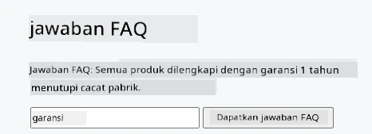
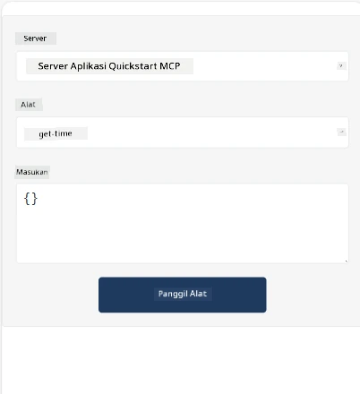
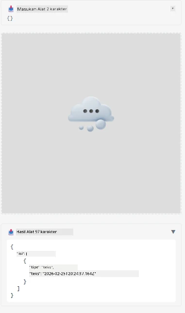

Berikut adalah contoh yang menunjukkan MCP App

## Instalasi 

1. Navigasi ke folder *mcp-app*
1. Jalankan `npm install`, ini akan menginstal dependensi frontend dan backend

Verifikasi backend kompilasi dengan menjalankan:

```sh
npx tsc --noEmit
```

Tidak akan ada output jika semuanya berjalan dengan baik.

## Menjalankan backend

> Ini membutuhkan sedikit pekerjaan ekstra jika Anda menggunakan mesin Windows karena solusi MCP Apps menggunakan perpustakaan `concurrently` untuk dijalankan yang perlu Anda cari penggantinya. Berikut adalah baris yang bermasalah di *package.json* pada MCP App:

```json
"start": "concurrently \"cross-env NODE_ENV=development INPUT=mcp-app.html vite build --watch\" \"tsx watch main.ts\""
```

Aplikasi ini memiliki dua bagian, bagian backend dan bagian host.

Mulai backend dengan memanggil:

```sh
npm start
```

Ini seharusnya memulai backend pada `http://localhost:3001/mcp`. 

> Catatan, jika Anda berada di Codespace, Anda mungkin perlu mengatur visibilitas port menjadi publik. Periksa apakah Anda dapat mengakses endpoint melalui browser melalui https://<name dari Codespace>.app.github.dev/mcp

## Pilihan -1 Uji aplikasi di Visual Studio Code

Untuk menguji solusi di Visual Studio Code, lakukan hal berikut:

- Tambahkan entri server ke `mcp.json` seperti ini:

    ```json
    {
        "servers": {
            "my-mcp-server-7178eca7": {
                "url": "http://localhost:3001/mcp",
                "type": "http"
            }
        },
        "inputs": []
    }
    ```

1. Klik tombol "start" di *mcp.json*
1. Pastikan jendela chat terbuka dan ketik `get-faq`, Anda akan melihat hasil seperti ini:

    

## Pilihan -2- Uji aplikasi dengan host

Repo <https://github.com/modelcontextprotocol/ext-apps> berisi beberapa host berbeda yang dapat Anda gunakan untuk menguji MVP Apps Anda. 

Kami akan menyajikan dua opsi berbeda di sini:

### Mesin lokal

- Navigasi ke *ext-apps* setelah Anda mengkloning repo.

- Instal dependensi

   ```sh
   npm install
   ```

- Di jendela terminal terpisah, navigasi ke *ext-apps/examples/basic-host*

    > jika Anda di Codespace, Anda perlu menavigasi ke serve.ts pada baris 27 dan mengganti http://localhost:3001/mcp dengan URL Codespace Anda untuk backend, misalnya https://psychic-xylophone-657rpjgvxpc5g64-3001.app.github.dev/mcp

- Jalankan host:

    ```sh
    npm start
    ```

    Ini seharusnya menghubungkan host dengan backend dan Anda harus melihat aplikasi berjalan seperti ini:

    

### Codespace

Butuh sedikit kerja ekstra untuk membuat lingkungan Codespace bekerja. Untuk menggunakan host melalui Codespace: 

- Lihat direktori *ext-apps* dan navigasi ke *examples/basic-host*. 
- Jalankan `npm install` untuk menginstal dependensi
- Jalankan `npm start` untuk memulai host.

## Uji aplikasi

Coba aplikasi dengan cara berikut:

- Pilih tombol "Call Tool" dan Anda akan melihat hasil seperti ini:

    

Bagus, semuanya berfungsi.

---

<!-- CO-OP TRANSLATOR DISCLAIMER START -->
**Penafian**:
Dokumen ini telah diterjemahkan menggunakan layanan terjemahan AI [Co-op Translator](https://github.com/Azure/co-op-translator). Meskipun kami berupaya untuk mencapai akurasi, harap diketahui bahwa terjemahan otomatis mungkin mengandung kesalahan atau ketidakakuratan. Dokumen asli dalam bahasa aslinya harus dianggap sebagai sumber yang sah. Untuk informasi penting, disarankan menggunakan terjemahan profesional oleh manusia. Kami tidak bertanggung jawab atas kesalahpahaman atau penafsiran yang keliru yang timbul dari penggunaan terjemahan ini.
<!-- CO-OP TRANSLATOR DISCLAIMER END -->