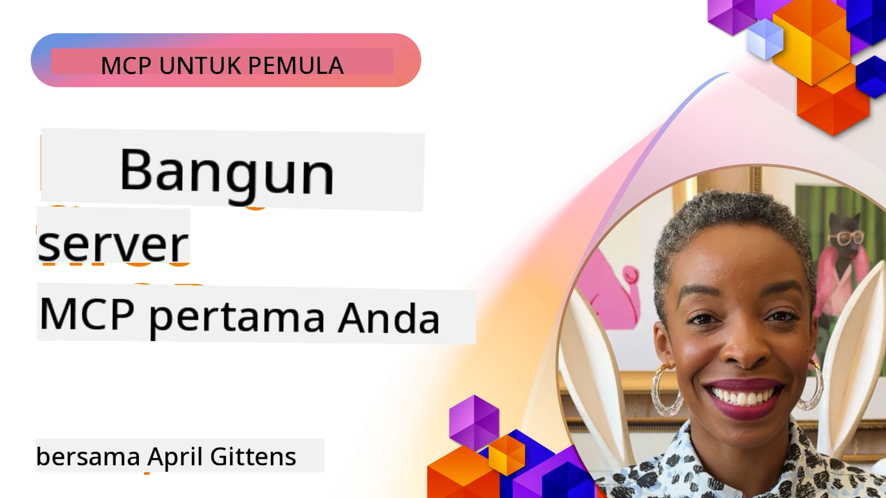

## Memulai  

_(Klik gambar di atas untuk menonton video pelajaran ini)_

Bagian ini terdiri dari beberapa pelajaran:

- **1 Server pertamamu**, dalam pelajaran pertama ini, kamu akan belajar bagaimana membuat server pertamamu dan memeriksanya dengan alat inspector, cara berharga untuk menguji dan men-debug server-mu, [ke pelajaran](01-first-server/README.md)

- **2 Klien**, dalam pelajaran ini, kamu akan belajar bagaimana menulis klien yang dapat terhubung ke server-mu, [ke pelajaran](02-client/README.md)

- **3 Klien dengan LLM**, cara yang lebih baik dalam menulis klien adalah dengan menambahkan LLM supaya dapat "bernegosiasi" dengan server-mu tentang apa yang harus dilakukan, [ke pelajaran](03-llm-client/README.md)

- **4 Menggunakan mode Agen GitHub Copilot server di Visual Studio Code**. Di sini, kita akan melihat menjalankan Server MCP dari dalam Visual Studio Code, [ke pelajaran](04-vscode/README.md)

- **5 Server Transport Stdio** transport stdio adalah standar yang direkomendasikan untuk komunikasi lokal server MCP-ke-klien, menyediakan komunikasi subprocess yang aman dengan isolasi proses bawaan [ke pelajaran](05-stdio-server/README.md)

- **6 Streaming HTTP dengan MCP (HTTP yang dapat di-stream)**. Pelajari tentang
	transport jarak jauh standar dalam [Spesifikasi MCP 2026-07-28](https://modelcontextprotocol.io/specification/2026-07-28/basic/transports/streamable-http),
	plus implementasi berbasis sesi legacy yang dipertahankan dalam pelajaran.
	[ke pelajaran](06-http-streaming/README.md)

- **7 Menggunakan Microsoft Foundry Toolkit untuk Visual Studio Code** untuk mengonsumsi dan menguji klien dan server MCP-mu [dalam pelajaran ini](07-aitk/README.md)

- **8 Pengujian**. Di sini kita akan fokus terutama pada bagaimana kita dapat menguji server dan klien kita dengan berbagai cara, [ke pelajaran](08-testing/README.md)

- **9 Deployment**. Bab ini akan melihat berbagai cara untuk mendeploy solusi MCP-mu, [ke pelajaran](09-deployment/README.md)

- **10 Penggunaan server lanjutan**. Bab ini membahas penggunaan server lanjutan, [ke pelajaran](./10-advanced/README.md)

- **11 Auth**. Bab ini membahas bagaimana menambahkan auth sederhana, dari Basic Auth hingga menggunakan JWT dan RBAC. Kamu dianjurkan untuk memulai di sini dan kemudian melihat Topik Lanjutan di Bab 5 serta melakukan hardening keamanan tambahan melalui rekomendasi di Bab 2, [ke pelajaran](./11-simple-auth/README.md)

- **12 Host MCP**. Konfigurasikan dan gunakan klien host MCP populer termasuk Claude Desktop, Cursor, Cline, dan Windsurf. Pelajari jenis transport dan pemecahan masalah, [ke pelajaran](./12-mcp-hosts/README.md)

- **13 Inspector MCP**. Debug dan uji server MCP-mu secara interaktif menggunakan alat Inspector MCP. Pelajari cara memecahkan masalah alat, sumber daya, dan pesan protokolnya, [ke pelajaran](./13-mcp-inspector/README.md)

- **14 Sampling**. Pelajari primitif Sampling legacy untuk `2025-11-25` dan
	bagaimana migrasi desain baru ke integrasi penyedia LLM langsung. Sampling adalah
	dihapus dalam MCP `2026-07-28`. [ke pelajaran](./14-sampling/README.md)

- **15 Aplikasi MCP**. Bangun Server MCP yang juga membalas dengan instruksi UI, [ke pelajaran](./15-mcp-apps/README.md)

Protokol Konteks Model (MCP) adalah protokol terbuka yang menstandarisasi bagaimana aplikasi menyediakan konteks kepada LLM. Pikirkan MCP seperti port USB-C untuk aplikasi AI — menyediakan cara standar untuk menghubungkan model AI ke berbagai sumber data dan alat.

## Tujuan Pembelajaran

Pada akhir pelajaran ini, kamu akan bisa:

- Menyiapkan lingkungan pengembangan untuk MCP dalam C#, Java, Python, TypeScript, dan JavaScript
- Membangun dan mendeploy server MCP dasar dengan fitur kustom (sumber daya, prompt, dan alat)
- Membuat aplikasi host yang terhubung ke server MCP
- Menguji dan men-debug implementasi MCP
- Memahami tantangan pengaturan umum dan solusinya
- Menghubungkan implementasi MCP-mu ke layanan LLM populer

## Menyiapkan Lingkungan MCP-mu

Sebelum kamu mulai bekerja dengan MCP, penting untuk mempersiapkan lingkungan pengembangan dan memahami alur kerja dasar. Bagian ini akan membimbing kamu melalui langkah-langkah pengaturan awal untuk memastikan permulaan yang lancar dengan MCP.

### Persyaratan Awal

Sebelum mulai mengembangkan MCP, pastikan kamu memiliki:

- **Lingkungan Pengembangan**: Untuk bahasa yang kamu pilih (C#, Java, Python, TypeScript, atau JavaScript)
- **IDE/Editor**: Visual Studio, Visual Studio Code, IntelliJ, Eclipse, PyCharm, atau editor kode modern lain
- **Pengelola Paket**: NuGet, Maven/Gradle, pip, atau npm/yarn
- **Kunci API**: Untuk layanan AI apa pun yang berencana kamu gunakan dalam aplikasi host-mu

### SDK Resmi

Dalam bab-bab mendatang kamu akan melihat solusi dibangun menggunakan Python, TypeScript,
Java, dan .NET. Berikut adalah SDK resmi.

Dukungan SDK untuk MCP `2026-07-28` sedang dirilis secara mandiri berdasarkan bahasa.
Sebelum menjalankan contoh, periksa versi paket dan catatan rilis SDK
untuk revisi protokol yang didukung. Lihat
[daftar SDK resmi](https://modelcontextprotocol.io/docs/sdk):
- [SDK C#](https://github.com/modelcontextprotocol/csharp-sdk) - Dipelihara bekerja sama dengan Microsoft
- [SDK Java](https://github.com/modelcontextprotocol/java-sdk) - Dipelihara bekerja sama dengan Spring AI
- [SDK TypeScript](https://github.com/modelcontextprotocol/typescript-sdk) - Implementasi TypeScript resmi
- [SDK Python](https://github.com/modelcontextprotocol/python-sdk) - Implementasi Python resmi (FastMCP)
- [SDK Kotlin](https://github.com/modelcontextprotocol/kotlin-sdk) - Implementasi Kotlin resmi
- [SDK Swift](https://github.com/modelcontextprotocol/swift-sdk) - Dipelihara bekerja sama dengan Loopwork AI
- [SDK Rust](https://github.com/modelcontextprotocol/rust-sdk) - Implementasi Rust resmi
- [SDK Go](https://github.com/modelcontextprotocol/go-sdk) - Implementasi Go resmi

## Poin-poin Penting

- Menyiapkan lingkungan pengembangan MCP cukup mudah dengan SDK khusus bahasa
- Membangun server MCP melibatkan membuat dan mendaftarkan alat dengan skema yang jelas
- Klien MCP terhubung ke server dan model untuk memanfaatkan kemampuan tambahan
- Pengujian dan debugging penting untuk implementasi MCP yang dapat diandalkan
- Opsi deployment bervariasi dari pengembangan lokal hingga solusi berbasis cloud

## Praktik

Kami mempunyai serangkaian contoh yang melengkapi latihan yang akan kamu lihat di semua bab pada bagian ini. Selain itu setiap bab juga memiliki latihan dan tugas masing-masing

- [Kalkulator Java](./samples/java/calculator/README.md)
- [Kalkulator .NET](../../../03-GettingStarted/samples/csharp)
- [Kalkulator JavaScript](./samples/javascript/README.md)
- [Kalkulator TypeScript](./samples/typescript/README.md)
- [Kalkulator Python](../../../03-GettingStarted/samples/python)

## Sumber Daya Tambahan

- [Bangun Agen menggunakan Model Context Protocol di Azure](https://learn.microsoft.com/azure/developer/ai/intro-agents-mcp)
- [MCP Jarak Jauh dengan Azure Container Apps (Node.js/TypeScript/JavaScript)](https://learn.microsoft.com/samples/azure-samples/mcp-container-ts/mcp-container-ts/)
- [Agen MCP OpenAI .NET](https://learn.microsoft.com/samples/azure-samples/openai-mcp-agent-dotnet/openai-mcp-agent-dotnet/)

## Selanjutnya

Mulai dengan pelajaran pertama: [Membuat Server MCP Pertamamu](01-first-server/README.md)

Setelah menyelesaikan modul ini, lanjutkan ke: [Modul 4: Implementasi Praktis](../04-PracticalImplementation/README.md)

---

<!-- CO-OP TRANSLATOR DISCLAIMER START -->
**Penafian**:
Dokumen ini telah diterjemahkan menggunakan layanan terjemahan AI [Co-op Translator](https://github.com/Azure/co-op-translator). Meskipun kami berupaya untuk mencapai akurasi, harap diketahui bahwa terjemahan otomatis mungkin mengandung kesalahan atau ketidakakuratan. Dokumen asli dalam bahasa aslinya harus dianggap sebagai sumber yang sah. Untuk informasi penting, disarankan menggunakan terjemahan profesional oleh manusia. Kami tidak bertanggung jawab atas kesalahpahaman atau penafsiran yang keliru yang timbul dari penggunaan terjemahan ini.
<!-- CO-OP TRANSLATOR DISCLAIMER END -->