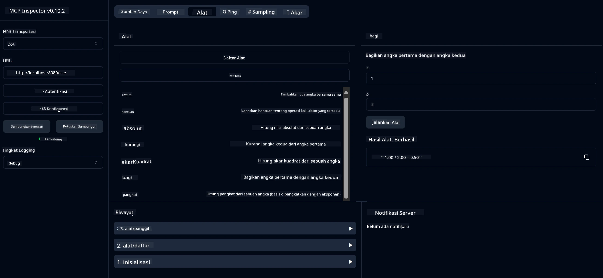

# Layanan Kalkulator Dasar MCP

> [!NOTE]
> Contoh ini menggunakan transport HTTP+SSE warisan dan menargetkan SDK yang kompatibel
> dengan MCP `2025-11-25`. Server jarak jauh baru harus menggunakan dukungan HTTP
> Streamable `2026-07-28`.

Layanan ini menyediakan operasi kalkulator dasar melalui Model Context Protocol (MCP) menggunakan Spring Boot dengan transport WebFlux. Ini dirancang sebagai contoh sederhana untuk pemula yang belajar tentang implementasi MCP.

Untuk informasi lebih lanjut, lihat dokumentasi referensi [MCP Server Boot Starter](https://docs.spring.io/spring-ai/reference/api/mcp/mcp-server-boot-starter-docs.html).

## Ikhtisar

Layanan ini menampilkan:
- Dukungan untuk SSE (Server-Sent Events)
- Registrasi alat otomatis menggunakan anotasi `@Tool` dari Spring AI
- Fungsi kalkulator dasar:
  - Penjumlahan, pengurangan, perkalian, pembagian
  - Perhitungan pangkat dan akar kuadrat
  - Modulus (sisa) dan nilai mutlak
  - Fungsi bantuan untuk deskripsi operasi

## Fitur

Layanan kalkulator ini menawarkan kemampuan berikut:

1. **Operasi Aritmatika Dasar**:
   - Penjumlahan dua angka
   - Pengurangan satu angka dari angka lainnya
   - Perkalian dua angka
   - Pembagian satu angka dengan angka lainnya (dengan pemeriksaan pembagian nol)

2. **Operasi Lanjutan**:
   - Perhitungan pangkat (menaikkan basis ke eksponen)
   - Perhitungan akar kuadrat (dengan pemeriksaan angka negatif)
   - Perhitungan modulus (sisa)
   - Perhitungan nilai mutlak

3. **Sistem Bantuan**:
   - Fungsi bantuan bawaan yang menjelaskan semua operasi yang tersedia

## Menggunakan Layanan

Layanan ini membuka endpoint API berikut melalui protokol MCP:

- `add(a, b)`: Menambahkan dua angka bersama-sama
- `subtract(a, b)`: Mengurangi angka kedua dari angka pertama
- `multiply(a, b)`: Mengalikan dua angka
- `divide(a, b)`: Membagi angka pertama dengan angka kedua (dengan pemeriksaan nol)
- `power(base, exponent)`: Menghitung pangkat sebuah angka
- `squareRoot(number)`: Menghitung akar kuadrat (dengan pemeriksaan angka negatif)
- `modulus(a, b)`: Menghitung sisa pembagian
- `absolute(number)`: Menghitung nilai mutlak
- `help()`: Mendapatkan informasi tentang operasi yang tersedia

## Klien Pengujian

Klien pengujian sederhana disertakan dalam paket `com.microsoft.mcp.sample.client`. Kelas `SampleCalculatorClient` menunjukkan operasi yang tersedia dari layanan kalkulator.

## Menggunakan Klien LangChain4j

Proyek ini menyertakan contoh klien LangChain4j dalam
`com.microsoft.mcp.sample.client.LangChain4jClient` yang menunjukkan cara
mengintegrasikan layanan kalkulator dengan model Microsoft Foundry.

### Persyaratan Awal

1. Buat sumber daya Microsoft Foundry dan deploy model aktif seperti
   `gpt-5.1`.
2. Tetapkan endpoint model, kunci API, dan nama deployment:

   ```bash
   export AZURE_OPENAI_ENDPOINT="https://<resource-name>.openai.azure.com"
   export AZURE_OPENAI_API_KEY="<api-key>"
   export AZURE_OPENAI_DEPLOYMENT="gpt-5.1"
   ```

3. Periksa
   [jadwal pensiun model Microsoft Foundry](https://learn.microsoft.com/azure/foundry/openai/concepts/model-retirement-schedule)
   sebelum memilih deployment.
4. Pastikan server kalkulator berjalan di `localhost:8080`.

### Menjalankan Klien LangChain4j

Contoh ini menunjukkan:
- Menghubungkan ke server kalkulator MCP melalui transport SSE
- Menggunakan LangChain4j untuk membuat bot chat yang memanfaatkan operasi kalkulator
- Integrasi dengan model Microsoft Foundry yang sudah dideploy

Klien mengirimkan kueri contoh berikut untuk mendemonstrasikan fungsionalitas:
1. Menghitung jumlah dua angka
2. Mencari akar kuadrat suatu angka
3. Mendapatkan informasi bantuan tentang operasi kalkulator yang tersedia

Jalankan contoh dan periksa output konsol untuk melihat bagaimana model AI menggunakan alat kalkulator untuk merespons kueri.

### Konfigurasi Model Microsoft Foundry

Klien LangChain4j menggunakan endpoint kompatibel Azure OpenAI v1 yang disediakan oleh
Microsoft Foundry:

```java
String endpoint = System.getenv("AZURE_OPENAI_ENDPOINT");
ChatLanguageModel model = OpenAiOfficialChatModel.builder()
   .baseUrl(endpoint.replaceAll("/+$", "") + "/openai/v1/")
   .apiKey(System.getenv("AZURE_OPENAI_API_KEY"))
   .isAzure(true)
   .modelName(System.getenv().getOrDefault("AZURE_OPENAI_DEPLOYMENT", "gpt-5.1"))
    .timeout(Duration.ofSeconds(60))
    .build();
```

`AZURE_OPENAI_DEPLOYMENT` harus cocok dengan nama yang diberikan saat model
dideploy, yang mungkin berbeda dari nama model dasarnya.

## Dependensi

Proyek ini membutuhkan dependensi utama berikut:

```xml
<!-- For MCP Server -->
<dependency>
    <groupId>org.springframework.ai</groupId>
    <artifactId>spring-ai-starter-mcp-server-webflux</artifactId>
</dependency>

<!-- For LangChain4j integration -->
<dependency>
    <groupId>dev.langchain4j</groupId>
    <artifactId>langchain4j-mcp</artifactId>
    <version>${langchain4j.version}</version>
</dependency>

<!-- For Microsoft Foundry's OpenAI-compatible endpoint -->
<dependency>
    <groupId>dev.langchain4j</groupId>
   <artifactId>langchain4j-open-ai-official</artifactId>
    <version>${langchain4j.version}</version>
</dependency>
```

## Membangun Proyek

Bangun proyek menggunakan Maven:
```bash
./mvnw clean install -DskipTests
```

## Menjalankan Server

### Menggunakan Java

```bash
java -jar target/calculator-server-0.0.1-SNAPSHOT.jar
```

### Menggunakan MCP Inspector

MCP Inspector adalah alat yang berguna untuk berinteraksi dengan layanan MCP. Untuk menggunakannya dengan layanan kalkulator ini:

1. **Instal dan jalankan MCP Inspector** di jendela terminal baru:
   ```bash
   npx @modelcontextprotocol/inspector
   ```

2. **Akses UI web** dengan mengklik URL yang ditampilkan oleh aplikasi (biasanya http://localhost:6274)

3. **Konfigurasikan koneksi**:
   - Atur jenis transport menjadi "SSE"
   - Set URL ke endpoint SSE server yang berjalan: `http://localhost:8080/sse`
   - Klik "Connect"

4. **Gunakan alat**:
   - Klik "List Tools" untuk melihat operasi kalkulator yang tersedia
   - Pilih alat dan klik "Run Tool" untuk menjalankan operasi



### Menggunakan Docker

Proyek ini menyertakan Dockerfile untuk deployment tercontainerisasi:

1. **Bangun image Docker**:
   ```bash
   docker build -t calculator-mcp-service .
   ```

2. **Jalankan container Docker**:
   ```bash
   docker run -p 8080:8080 calculator-mcp-service
   ```

Ini akan:
- Membangun image Docker multi-tahap dengan Maven 3.9.9 dan Eclipse Temurin 24 JDK
- Membuat image container yang dioptimalkan
- Membuka layanan pada port 8080
- Memulai layanan kalkulator MCP dalam container

Anda dapat mengakses layanan pada `http://localhost:8080` setelah container berjalan.

## Pemecahan Masalah

### Masalah Koneksi Model Umum

1. **Kesalahan autentikasi**: Pastikan `AZURE_OPENAI_API_KEY` milik
   sumber daya yang diidentifikasi oleh `AZURE_OPENAI_ENDPOINT`.
2. **Deployment tidak ditemukan**: Pastikan `AZURE_OPENAI_DEPLOYMENT` sesuai persis
   dengan nama deployment di Microsoft Foundry.
3. **Pembatasan laju**: Tinjau kuota deployment dan coba lagi setelah interval
   yang dikembalikan oleh layanan.

Untuk bantuan lebih lanjut, lihat
[dokumentasi LangChain4j](https://github.com/langchain4j/langchain4j) dan
[dokumentasi Microsoft Foundry](https://learn.microsoft.com/azure/ai-foundry/).

---

<!-- CO-OP TRANSLATOR DISCLAIMER START -->
**Penafian**:
Dokumen ini telah diterjemahkan menggunakan layanan terjemahan AI [Co-op Translator](https://github.com/Azure/co-op-translator). Meskipun kami berupaya untuk mencapai akurasi, harap diketahui bahwa terjemahan otomatis mungkin mengandung kesalahan atau ketidakakuratan. Dokumen asli dalam bahasa aslinya harus dianggap sebagai sumber yang sah. Untuk informasi penting, disarankan menggunakan terjemahan profesional oleh manusia. Kami tidak bertanggung jawab atas kesalahpahaman atau penafsiran yang keliru yang timbul dari penggunaan terjemahan ini.
<!-- CO-OP TRANSLATOR DISCLAIMER END -->