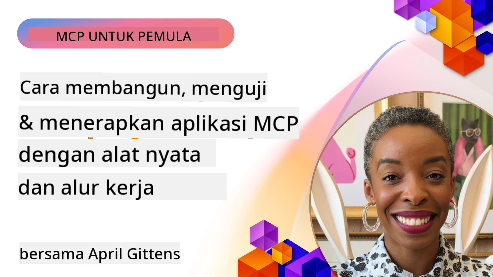
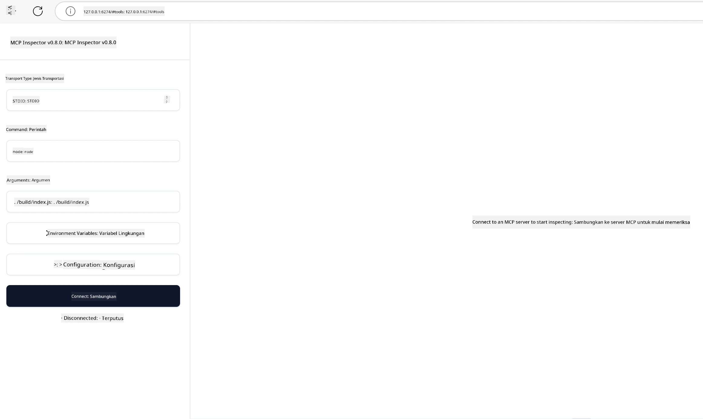

# Implementasi Praktis

[](https://youtu.be/vCN9-mKBDfQ)

_(Klik gambar di atas untuk melihat video pelajaran ini)_

Implementasi praktis adalah tempat di mana kekuatan Model Context Protocol (MCP) menjadi nyata. Walaupun memahami teori dan arsitektur di balik MCP penting, nilai sebenarnya muncul saat Anda menerapkan konsep-konsep ini untuk membangun, menguji, dan menyebarkan solusi yang memecahkan masalah dunia nyata. Bab ini menghubungkan kesenjangan antara pengetahuan konseptual dan pengembangan langsung, membimbing Anda melalui proses menghadirkan aplikasi berbasis MCP ke dalam kehidupan.

Baik Anda mengembangkan asisten pintar, mengintegrasikan AI ke alur kerja bisnis, atau membangun alat kustom untuk pemrosesan data, MCP menyediakan fondasi yang fleksibel. Desainnya yang agnostik bahasa dan SDK resmi untuk bahasa pemrograman populer membuatnya dapat diakses oleh berbagai pengembang. Dengan memanfaatkan SDK ini, Anda dapat dengan cepat membuat prototipe, iterasi, dan skala solusi Anda di berbagai platform dan lingkungan.

Pada bagian berikut, Anda akan menemukan contoh praktis, kode sampel, dan strategi penyebaran yang menunjukkan cara mengimplementasikan MCP dalam C#, Java dengan Spring, TypeScript, JavaScript, dan Python. Anda juga akan belajar bagaimana melakukan debug dan menguji server MCP Anda, mengelola API, dan menyebarkan solusi ke cloud menggunakan Azure. Sumber daya langsung ini dirancang untuk mempercepat pembelajaran Anda dan membantu Anda membangun aplikasi MCP yang kokoh dan siap produksi dengan percaya diri.

## Gambaran Umum

Pelajaran ini berfokus pada aspek praktis implementasi MCP di berbagai bahasa pemrograman. Kita akan menjelajahi cara menggunakan SDK MCP di C#, Java dengan Spring, TypeScript, JavaScript, dan Python untuk membangun aplikasi yang kokoh, melakukan debug dan pengujian server MCP, serta membuat sumber daya, prompt, dan alat yang dapat digunakan kembali.

## Tujuan Pembelajaran

Pada akhir pelajaran ini, Anda akan dapat:

- Mengimplementasikan solusi MCP menggunakan SDK resmi dalam berbagai bahasa pemrograman
- Melakukan debug dan pengujian server MCP secara sistematis
- Membuat dan menggunakan fitur server (Sumber Daya, Prompt, dan Alat)
- Merancang alur kerja MCP yang efektif untuk tugas yang kompleks
- Mengoptimalkan implementasi MCP untuk kinerja dan keandalan

## Sumber Daya SDK Resmi

Model Context Protocol menyediakan SDK resmi untuk berbagai bahasa. Dukungan SDK
untuk MCP `2026-07-28` dirilis secara independen, jadi periksa catatan rilis setiap SDK
dan versi paket contoh sebelum mengasumsikan kompatibilitas protokol. Lihat [daftar SDK resmi](https://modelcontextprotocol.io/docs/sdk):


- [C# SDK](https://github.com/modelcontextprotocol/csharp-sdk)
- [Java dengan Spring SDK](https://github.com/modelcontextprotocol/java-sdk) **Catatan:** membutuhkan dependensi pada [Project Reactor](https://projectreactor.io). (Lihat [isu diskusi 246](https://github.com/orgs/modelcontextprotocol/discussions/246).)
- [TypeScript SDK](https://github.com/modelcontextprotocol/typescript-sdk)
- [Python SDK](https://github.com/modelcontextprotocol/python-sdk)
- [Kotlin SDK](https://github.com/modelcontextprotocol/kotlin-sdk)
- [Go SDK](https://github.com/modelcontextprotocol/go-sdk)

## Bekerja dengan MCP SDK

Bagian ini menyediakan contoh praktis untuk mengimplementasikan MCP dalam berbagai bahasa pemrograman. Anda dapat menemukan contoh kode di direktori `samples` yang diorganisir berdasarkan bahasa.

### Contoh yang Tersedia

Repositori ini mencakup [implementasi contoh](../../../04-PracticalImplementation/samples) dalam bahasa berikut:

- [C#](./samples/csharp/README.md)
- [Java dengan Spring](./samples/java/containerapp/README.md)
- [TypeScript](./samples/typescript/README.md)
- [JavaScript](./samples/javascript/README.md)
- [Python](./samples/python/README.md)

Setiap contoh menunjukkan konsep utama MCP dan pola implementasi untuk bahasa dan ekosistem tertentu.

### Panduan Praktis

Panduan tambahan untuk implementasi praktis MCP:

- [Paging dan Set Hasil Besar](./pagination/README.md) - Menangani paging berbasis kursor untuk alat, sumber daya, dan dataset besar

## Fitur Inti Server

Server MCP dapat mengimplementasikan kombinasi fitur-fitur berikut:

### Sumber Daya

Sumber daya menyediakan konteks dan data untuk digunakan pengguna atau model AI:

- Repositori dokumen
- Basis pengetahuan
- Sumber data terstruktur
- Sistem berkas

### Prompt

Prompt adalah pesan dan alur kerja yang di-template untuk pengguna:

- Template percakapan yang telah ditentukan
- Pola interaksi panduan
- Struktur dialog khusus

### Alat

Alat adalah fungsi-fungsi yang dijalankan oleh model AI:

- Utilitas pemrosesan data
- Integrasi API eksternal
- Kapabilitas komputasi
- Fungsi pencarian

## Implementasi Contoh: Implementasi C#

Repositori resmi SDK C# berisi beberapa implementasi contoh yang menunjukkan berbagai aspek MCP:

- **Klien MCP Dasar**: Contoh sederhana menunjukkan cara membuat klien MCP dan memanggil alat
- **Server MCP Dasar**: Implementasi server minimal dengan registrasi alat dasar
- **Server MCP Lanjutan**: Server lengkap dengan registrasi alat, autentikasi, dan penanganan kesalahan
- **Integrasi ASP.NET**: Contoh-contoh yang menunjukkan integrasi dengan ASP.NET Core
- **Pola Implementasi Alat**: Berbagai pola untuk mengimplementasikan alat dengan tingkat kompleksitas berbeda

SDK MCP C# masih dalam tahap pratinjau dan API dapat berubah. Kami akan terus memperbarui blog ini seiring evolusi SDK.

### Fitur Utama

- [ModelContextProtocol Nuget MCP C#](https://www.nuget.org/packages/ModelContextProtocol)
- Membangun [Server MCP pertama Anda](https://devblogs.microsoft.com/dotnet/build-a-model-context-protocol-mcp-server-in-csharp/).

Untuk contoh implementasi C# lengkap, kunjungi [repositori contoh SDK C# resmi](https://github.com/modelcontextprotocol/csharp-sdk)

## Implementasi contoh: Java dengan Spring

SDK Java dengan Spring menawarkan opsi implementasi MCP yang kuat dengan fitur kelas enterprise.

### Fitur Utama

- Integrasi Spring Framework
- Keamanan tipe yang kuat
- Dukungan pemrograman reaktif
- Penanganan kesalahan yang komprehensif

Untuk contoh implementasi Java dengan Spring lengkap, lihat [contoh Java dengan Spring](samples/java/containerapp/README.md) di direktori contoh.

## Implementasi contoh: JavaScript

SDK JavaScript menyediakan pendekatan ringan dan fleksibel untuk implementasi MCP.

### Fitur Utama

- Dukungan Node.js dan browser
- API berbasis Promise
- Integrasi mudah dengan Express dan framework lain
- Dukungan WebSocket untuk streaming

Untuk contoh implementasi JavaScript lengkap, lihat [contoh JavaScript](samples/javascript/README.md) di direktori contoh.

## Implementasi contoh: Python

SDK Python menawarkan pendekatan Pythonic untuk implementasi MCP dengan integrasi framework ML yang unggul.

### Fitur Utama

- Dukungan async/await dengan asyncio
- Integrasi FastAPI
- Registrasi alat sederhana
- Integrasi native dengan pustaka ML populer

Untuk contoh implementasi Python lengkap, lihat [contoh Python](samples/python/README.md) di direktori contoh.

## Pengelolaan API

Azure API Management adalah solusi tepat untuk mengamankan Server MCP. Ide utamanya adalah menempatkan instance Azure API Management di depan Server MCP Anda dan membiarkannya menangani fitur yang Anda perlukan seperti:

- pembatasan rate
- pengelolaan token
- pemantauan
- penyeimbangan beban
- keamanan

### Contoh Azure

Berikut Contoh Azure yang melakukan hal tersebut, yaitu [membuat Server MCP dan mengamankannya dengan Azure API Management](https://github.com/Azure-Samples/remote-mcp-apim-functions-python).

Lihat bagaimana alur otorisasi bekerja pada gambar di bawah ini:


Pada gambar sebelumnya, terjadi hal-hal berikut:

- Autentikasi/Otorisasi dilakukan menggunakan Microsoft Entra.
- Azure API Management bertindak sebagai gateway dan menggunakan kebijakan untuk mengarahkan dan mengelola lalu lintas.
- Azure Monitor mencatat semua permintaan untuk analisis lebih lanjut.

#### Alur Otorisasi

Mari kita lihat alur otorisasi lebih detail:


#### Spesifikasi Otorisasi MCP

Pelajari lebih lanjut tentang
[spesifikasi Otorisasi MCP](https://modelcontextprotocol.io/specification/2026-07-28/basic/authorization/).

## Deploy Server MCP Jarak Jauh ke Azure

Mari kita lihat apakah kita bisa menerapkan contoh yang telah kami sebutkan sebelumnya:

1. Kloning repositori

    ```bash
    git clone https://github.com/Azure-Samples/remote-mcp-apim-functions-python.git
    cd remote-mcp-apim-functions-python
    ```

1. Daftarkan penyedia sumber daya `Microsoft.App`.

   - Jika menggunakan Azure CLI, jalankan `az provider register --namespace Microsoft.App --wait`.
   - Jika menggunakan Azure PowerShell, jalankan `Register-AzResourceProvider -ProviderNamespace Microsoft.App`. Kemudian jalankan `(Get-AzResourceProvider -ProviderNamespace Microsoft.App).RegistrationState` setelah beberapa saat untuk memeriksa apakah pendaftaran sudah selesai.

1. Jalankan perintah [azd](https://aka.ms/azd) ini untuk menyediakan layanan pengelolaan API, aplikasi fungsi (dengan kode), dan semua sumber daya Azure lain yang diperlukan

    ```shell
    azd up
    ```

    Perintah ini akan menerapkan semua sumber daya cloud di Azure

### Menguji server Anda dengan MCP Inspector

1. Di **jendela terminal baru**, instal dan jalankan MCP Inspector

    ```shell
    npx @modelcontextprotocol/inspector
    ```

    Anda akan melihat antarmuka serupa dengan ini:

    

1. CTRL klik untuk memuat aplikasi web MCP Inspector dari URL yang ditampilkan oleh aplikasi (misalnya [http://127.0.0.1:6274/#resources](http://127.0.0.1:6274/#resources))
1. Atur tipe transport menjadi `SSE`
1. Atur URL ke endpoint SSE API Management yang berjalan yang ditampilkan setelah `azd up` dan **Hubungkan**:

    ```shell
    https://<apim-servicename-from-azd-output>.azure-api.net/mcp/sse
    ```

1. **Daftar Alat**. Klik pada sebuah alat dan **Jalankan Alat**.

Jika semua langkah berhasil, Anda sekarang terhubung ke server MCP dan dapat memanggil sebuah alat.

## Server MCP untuk Azure

[Remote-mcp-functions](https://github.com/Azure-Samples/remote-mcp-functions-dotnet): Sekumpulan repositori ini adalah template quickstart untuk membangun dan menerapkan server MCP (Model Context Protocol) jarak jauh kustom menggunakan Azure Functions dengan Python, C# .NET atau Node/TypeScript.

Contoh-contoh menyediakan solusi lengkap yang memungkinkan pengembang untuk:

- Membangun dan menjalankan secara lokal: Mengembangkan dan debug server MCP di mesin lokal
- Menerapkan ke Azure: Mudah menerapkan ke cloud dengan perintah azd up sederhana
- Terhubung dari klien: Terhubung ke server MCP dari berbagai klien termasuk mode agen Copilot VS Code dan alat MCP Inspector

### Fitur Utama

- Keamanan sejak desain: Server MCP diamankan menggunakan kunci dan HTTPS
- Opsi autentikasi: Mendukung OAuth menggunakan autentikasi bawaan dan/atau API Management
- Isolasi jaringan: Memungkinkan isolasi jaringan menggunakan Azure Virtual Networks (VNET)
- Arsitektur tanpa server: Memanfaatkan Azure Functions untuk eksekusi yang skalabel berbasis event
- Pengembangan lokal: Dukungan pengembangan dan debug lokal yang komprehensif
- Penyebaran sederhana: Proses penyebaran yang disederhanakan ke Azure

Repositori ini mencakup semua file konfigurasi yang diperlukan, kode sumber, dan definisi infrastruktur untuk memulai dengan implementasi server MCP yang siap produksi.

- [Azure Remote MCP Functions Python](https://github.com/Azure-Samples/remote-mcp-functions-python) - Implementasi contoh MCP menggunakan Azure Functions dengan Python

- [Azure Remote MCP Functions .NET](https://github.com/Azure-Samples/remote-mcp-functions-dotnet) - Implementasi contoh MCP menggunakan Azure Functions dengan C# .NET

- [Azure Remote MCP Functions Node/Typescript](https://github.com/Azure-Samples/remote-mcp-functions-typescript) - Implementasi contoh MCP menggunakan Azure Functions dengan Node/TypeScript.

## Hal Penting yang Perlu Diingat

- SDK MCP menyediakan alat spesifik bahasa untuk mengimplementasikan solusi MCP yang tangguh
- Proses debugging dan pengujian sangat penting untuk aplikasi MCP yang andal
- Template prompt yang dapat digunakan ulang memungkinkan interaksi AI yang konsisten
- Alur kerja yang dirancang dengan baik dapat mengorkestrasi tugas kompleks menggunakan berbagai alat
- Implementasi solusi MCP membutuhkan pertimbangan keamanan, kinerja, dan penanganan kesalahan

## Latihan

Rancang alur kerja MCP praktis yang menangani masalah dunia nyata di domain Anda:

1. Identifikasi 3-4 alat yang berguna untuk memecahkan masalah ini
2. Buat diagram alur kerja yang menunjukkan bagaimana alat-alat ini berinteraksi
3. Implementasikan versi dasar dari salah satu alat menggunakan bahasa pilihan Anda
4. Buat template prompt yang membantu model menggunakan alat Anda secara efektif

## Sumber Daya Tambahan

---

## Apa Selanjutnya

Selanjutnya: [Topik Lanjutan](../05-AdvancedTopics/README.md)

---

<!-- CO-OP TRANSLATOR DISCLAIMER START -->
**Penafian**:
Dokumen ini telah diterjemahkan menggunakan layanan terjemahan AI [Co-op Translator](https://github.com/Azure/co-op-translator). Meskipun kami berupaya untuk mencapai akurasi, harap diketahui bahwa terjemahan otomatis mungkin mengandung kesalahan atau ketidakakuratan. Dokumen asli dalam bahasa aslinya harus dianggap sebagai sumber yang sah. Untuk informasi penting, disarankan menggunakan terjemahan profesional oleh manusia. Kami tidak bertanggung jawab atas kesalahpahaman atau penafsiran yang keliru yang timbul dari penggunaan terjemahan ini.
<!-- CO-OP TRANSLATOR DISCLAIMER END -->