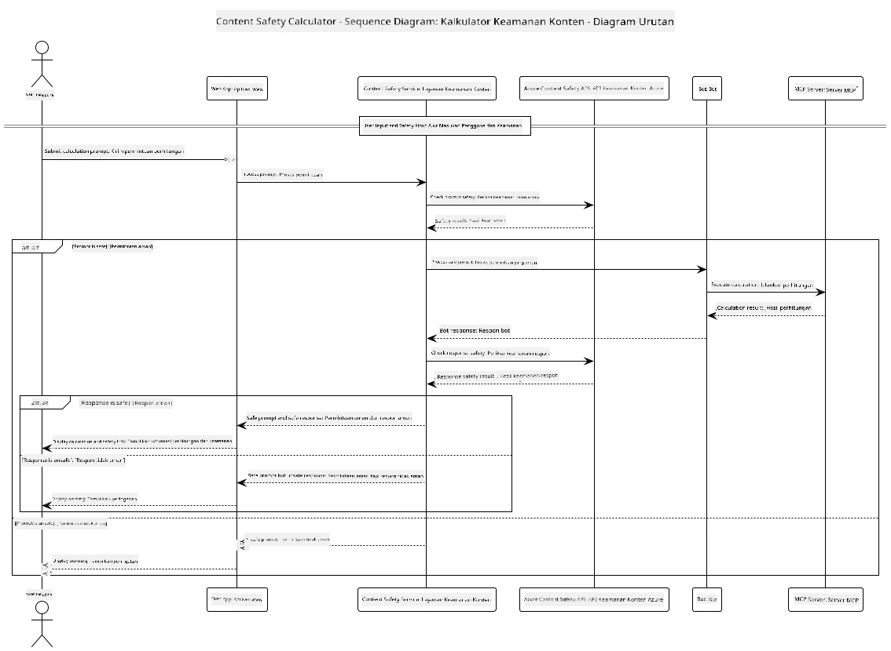

## Arsitektur Sistem

Proyek ini mendemonstrasikan aplikasi web yang menggunakan pemeriksaan keamanan konten sebelum meneruskan prompt pengguna ke layanan kalkulator melalui Model Context Protocol (MCP).



### Cara Kerjanya

1. **Input Pengguna**: Pengguna memasukkan prompt perhitungan di antarmuka web
2. **Penyaringan Keamanan Konten (Input)**: Prompt dianalisis oleh Azure Content Safety API
3. **Keputusan Keamanan (Input)**:
   - Jika konten aman (tingkat keparahan < 2 di semua kategori), lanjut ke kalkulator
   - Jika konten ditandai berpotensi berbahaya, proses dihentikan dan mengembalikan peringatan
4. **Integrasi Kalkulator**: Konten aman diproses oleh LangChain4j, yang berkomunikasi dengan server kalkulator MCP
5. **Penyaringan Keamanan Konten (Output)**: Respon bot dianalisis oleh Azure Content Safety API
6. **Keputusan Keamanan (Output)**:
   - Jika respon bot aman, ditampilkan kepada pengguna
   - Jika respon bot ditandai berpotensi berbahaya, diganti dengan peringatan
7. **Respon**: Hasil (jika aman) ditampilkan kepada pengguna bersama dengan kedua analisis keamanan

## Menggunakan Model Context Protocol (MCP) dengan Layanan Kalkulator

Proyek ini mendemonstrasikan cara menggunakan Model Context Protocol (MCP) untuk memanggil layanan kalkulator MCP dari LangChain4j. Implementasinya menggunakan server MCP lokal yang berjalan di port 8080 untuk menyediakan operasi kalkulator.

### Menyiapkan Layanan Azure Content Safety

Sebelum menggunakan fitur keamanan konten, Anda perlu membuat sumber daya layanan Azure Content Safety:

1. Masuk ke [Azure Portal](https://portal.azure.com)
2. Klik "Create a resource" dan cari "Content Safety"
3. Pilih "Content Safety" dan klik "Create"
4. Masukkan nama unik untuk sumber daya Anda
5. Pilih langganan dan grup sumber daya Anda (atau buat yang baru)
6. Pilih region yang didukung (cek [Ketersediaan Region](https://azure.microsoft.com/en-us/global-infrastructure/services/?products=cognitive-services) untuk detail)
7. Pilih tingkatan harga yang sesuai
8. Klik "Create" untuk menerapkan sumber daya
9. Setelah penerapan selesai, klik "Go to resource"
10. Di panel kiri, di bawah "Resource Management", pilih "Keys and Endpoint"
11. Salin salah satu kunci dan URL endpoint untuk digunakan di langkah berikutnya

### Mengonfigurasi Variabel Lingkungan

Setel endpoint model Microsoft Foundry, kunci API, dan nama deployment:
```sh
export AZURE_OPENAI_ENDPOINT="https://<resource-name>.openai.azure.com"
export AZURE_OPENAI_API_KEY="<api-key>"
export AZURE_OPENAI_DEPLOYMENT="gpt-5.1"
```

Untuk fitur keamanan konten, setel:
```sh
export CONTENT_SAFETY_ENDPOINT=<your_content_safety_endpoint>
export CONTENT_SAFETY_KEY=<your_content_safety_key>
```

Variabel lingkungan ini digunakan oleh aplikasi untuk mengautentikasi dengan layanan Azure Content Safety. Jika variabel ini tidak diatur, aplikasi akan menggunakan nilai placeholder untuk tujuan demonstrasi, tetapi fitur keamanan konten tidak akan berfungsi dengan baik.

### Memulai Server MCP Kalkulator

Sebelum menjalankan klien, Anda perlu memulai server MCP kalkulator dalam mode SSE di localhost:8080.

## Deskripsi Proyek

Proyek ini mendemonstrasikan integrasi Model Context Protocol (MCP) dengan LangChain4j untuk memanggil layanan kalkulator. Fitur utamanya meliputi:

- Menggunakan MCP untuk menghubungkan ke layanan kalkulator untuk operasi matematika dasar
- Pemeriksaan keamanan konten berlapis ganda pada prompt pengguna dan respon bot
- Integrasi dengan model Microsoft Foundry yang telah diterapkan melalui LangChain4j
- Menggunakan Server-Sent Events (SSE) sebagai transport MCP

## Integrasi Keamanan Konten

Proyek ini mencakup fitur keamanan konten yang komprehensif untuk memastikan bahwa input pengguna dan respon sistem bebas dari konten berbahaya:

1. **Penyaringan Input**: Semua prompt pengguna dianalisis untuk kategori konten berbahaya seperti ujaran kebencian, kekerasan, melukai diri sendiri, dan konten seksual sebelum diproses.

2. **Penyaringan Output**: Bahkan saat menggunakan model yang mungkin tidak tersensor, sistem memeriksa semua respon yang dihasilkan melalui filter keamanan konten yang sama sebelum menampilkannya kepada pengguna.

Pendekatan berlapis ganda ini memastikan sistem tetap aman tanpa memandang model AI mana yang digunakan, melindungi pengguna dari input berbahaya dan output yang berpotensi bermasalah dari AI.

## Klien Web

Aplikasi ini mencakup antarmuka web yang ramah pengguna yang memungkinkan pengguna berinteraksi dengan sistem Content Safety Calculator:

### Fitur Antarmuka Web

- Formulir sederhana dan intuitif untuk memasukkan prompt perhitungan
- Validasi keamanan konten berlapis ganda (input dan output)
- Umpan balik waktu nyata tentang keamanan prompt dan respon
- Indikator keamanan berwarna untuk memudahkan interpretasi
- Desain bersih dan responsif yang berfungsi di berbagai perangkat
- Contoh prompt aman sebagai panduan pengguna

### Menggunakan Klien Web

1. Mulai aplikasi:
   ```sh
   mvn spring-boot:run
   ```

2. Buka browser Anda dan navigasikan ke `http://localhost:8087`

3. Masukkan prompt perhitungan di area teks yang disediakan (misalnya, "Hitung jumlah dari 24.5 dan 17.3")

4. Klik "Submit" untuk memproses permintaan Anda

5. Lihat hasilnya, yang akan mencakup:
   - Analisis keamanan konten dari prompt Anda
   - Hasil perhitungan (jika prompt aman)
   - Analisis keamanan konten dari respon bot
   - Peringatan keamanan jika input atau output ditandai

Klien web secara otomatis menangani kedua proses verifikasi keamanan konten, memastikan semua interaksi aman dan sesuai tanpa memandang model AI yang digunakan.

---

<!-- CO-OP TRANSLATOR DISCLAIMER START -->
**Penafian**:
Dokumen ini telah diterjemahkan menggunakan layanan terjemahan AI [Co-op Translator](https://github.com/Azure/co-op-translator). Meskipun kami berupaya untuk mencapai akurasi, harap diketahui bahwa terjemahan otomatis mungkin mengandung kesalahan atau ketidakakuratan. Dokumen asli dalam bahasa aslinya harus dianggap sebagai sumber yang sah. Untuk informasi penting, disarankan menggunakan terjemahan profesional oleh manusia. Kami tidak bertanggung jawab atas kesalahpahaman atau penafsiran yang keliru yang timbul dari penggunaan terjemahan ini.
<!-- CO-OP TRANSLATOR DISCLAIMER END -->