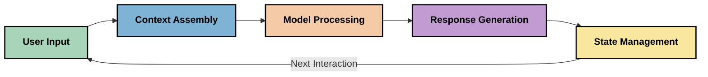
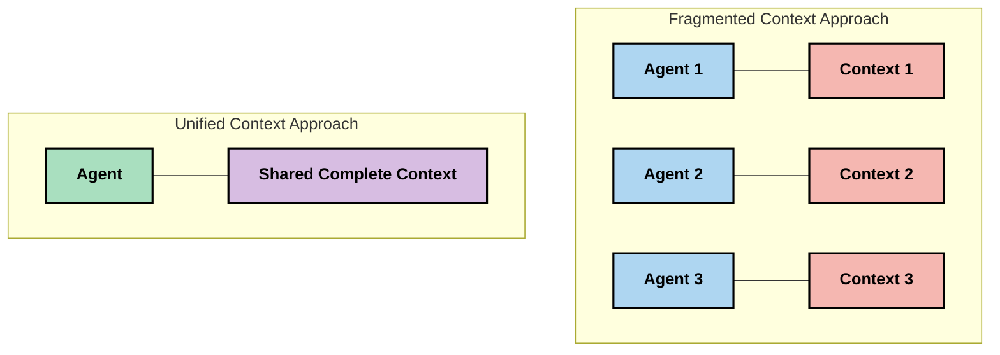
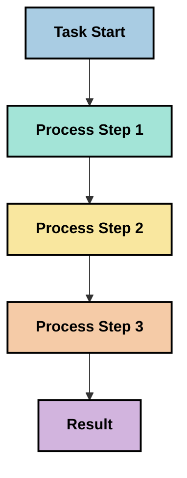
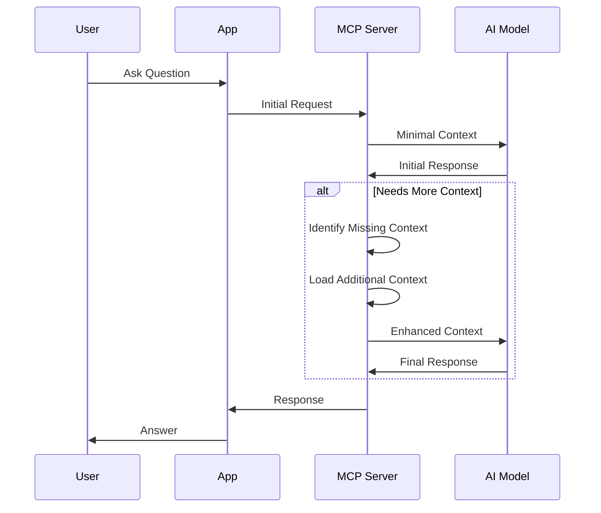
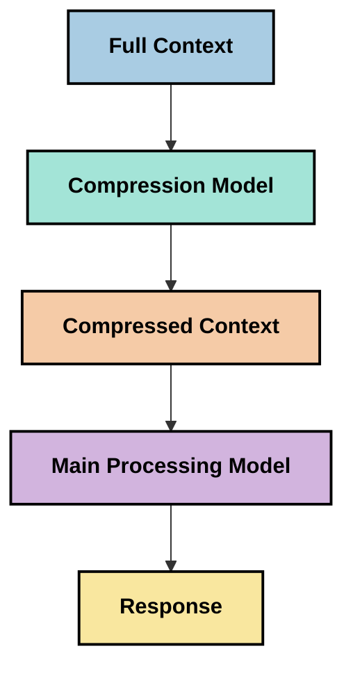
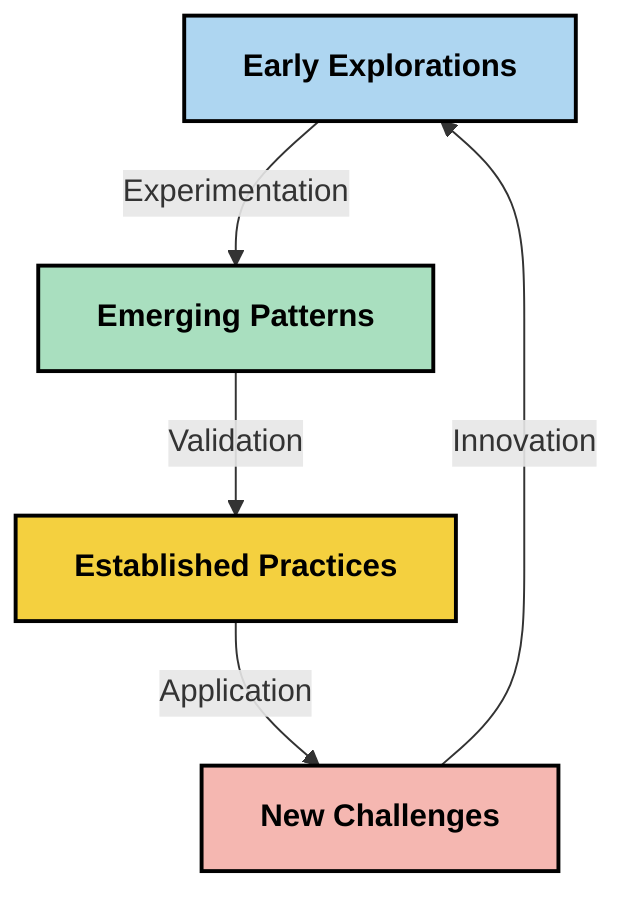

# Rekayasa Konteks: Konsep Muncul dalam Ekosistem MCP

## Ikhtisar

Rekayasa konteks adalah konsep yang muncul di ruang AI yang mengeksplorasi bagaimana informasi disusun, disampaikan, dan dipertahankan selama interaksi antara klien dan layanan AI. Saat ekosistem Model Context Protocol (MCP) berkembang, memahami cara mengelola konteks secara efektif menjadi semakin penting. Modul ini memperkenalkan konsep rekayasa konteks dan mengeksplorasi potensi aplikasinya dalam implementasi MCP.

## Tujuan Pembelajaran

Pada akhir modul ini, Anda akan dapat:

- Memahami konsep rekayasa konteks yang muncul dan perannya yang potensial dalam aplikasi MCP
- Mengidentifikasi tantangan utama dalam manajemen konteks yang ditangani oleh desain protokol MCP
- Mengeksplorasi teknik untuk meningkatkan performa model melalui penanganan konteks yang lebih baik
- Mempertimbangkan pendekatan untuk mengukur dan menilai efektivitas konteks
- Menerapkan konsep-konsep yang muncul ini untuk meningkatkan pengalaman AI melalui kerangka kerja MCP

## Pengenalan Rekayasa Konteks

Rekayasa konteks adalah konsep yang muncul yang berfokus pada desain dan pengelolaan aliran informasi secara sengaja antara pengguna, aplikasi, dan model AI. Berbeda dengan bidang mapan seperti rekayasa prompt, rekayasa konteks masih didefinisikan oleh para praktisi saat mereka bekerja untuk memecahkan tantangan unik dalam menyediakan model AI dengan informasi yang tepat pada waktu yang tepat.

Seiring evolusi model bahasa besar (LLM), pentingnya konteks menjadi semakin jelas. Kualitas, relevansi, dan struktur konteks yang kita berikan secara langsung mempengaruhi keluaran model. Rekayasa konteks mengeksplorasi hubungan ini dan berupaya mengembangkan prinsip untuk manajemen konteks yang efektif.

> "Pada 2025, model-model yang ada sangat cerdas. Tetapi bahkan manusia paling pintar pun tidak akan mampu melakukan pekerjaannya secara efektif tanpa konteks tentang apa yang mereka diminta untuk lakukan... 'Rekayasa konteks' adalah tingkatan berikutnya dari rekayasa prompt. Ini tentang melakukan ini secara otomatis dalam sistem dinamis." — Walden Yan, Cognition AI

Rekayasa konteks mungkin mencakup:

1. **Seleksi Konteks**: Menentukan informasi apa yang relevan untuk tugas tertentu
2. **Strukturisasi Konteks**: Mengorganisir informasi untuk memaksimalkan pemahaman model
3. **Pengiriman Konteks**: Mengoptimalkan cara dan waktu informasi disampaikan kepada model
4. **Pemeliharaan Konteks**: Mengelola status dan perkembangan konteks dari waktu ke waktu
5. **Evaluasi Konteks**: Mengukur dan meningkatkan efektivitas konteks

Fokus area ini sangat relevan dengan ekosistem MCP, yang menyediakan cara standar bagi aplikasi untuk memberikan konteks kepada LLM.


## Perspektif Perjalanan Konteks

Salah satu cara untuk memvisualisasikan rekayasa konteks adalah menelusuri perjalanan informasi melalui sistem MCP:



### Tahapan Kunci dalam Perjalanan Konteks:

1. **Input Pengguna**: Informasi mentah dari pengguna (teks, gambar, dokumen)
2. **Penyusunan Konteks**: Menggabungkan input pengguna dengan konteks sistem, riwayat percakapan, dan informasi lain yang diambil
3. **Pemrosesan Model**: Model AI memproses konteks yang sudah disusun
4. **Pembuatan Respons**: Model menghasilkan keluaran berdasarkan konteks yang diberikan
5. **Manajemen Status**: Sistem memperbarui status internalnya berdasarkan interaksi

Perspektif ini menyoroti sifat dinamis konteks dalam sistem AI dan menimbulkan pertanyaan penting tentang bagaimana caranya mengelola informasi secara terbaik di setiap tahap.

## Prinsip-Prinsip Muncul dalam Rekayasa Konteks

Seiring perkembangan bidang rekayasa konteks, beberapa prinsip awal mulai muncul dari para praktisi. Prinsip-prinsip ini mungkin membantu menginformasikan pilihan implementasi MCP:

### Prinsip 1: Bagikan Konteks Secara Lengkap

Konteks harus dibagikan secara lengkap antara semua komponen sistem daripada terfragmentasi di banyak agen atau proses. Ketika konteks didistribusikan, keputusan yang diambil di satu bagian sistem mungkin bertentangan dengan yang diambil di bagian lain.



Dalam aplikasi MCP, ini menunjukkan desain sistem di mana konteks mengalir mulus melalui seluruh alur proses daripada dipartisi.

### Prinsip 2: Sadari Bahwa Tindakan Membawa Keputusan Implisit

Setiap tindakan yang diambil model mengandung keputusan implisit tentang bagaimana menafsirkan konteks. Ketika banyak komponen bertindak pada konteks yang berbeda, keputusan implisit ini dapat bertentangan, menghasilkan hasil yang tidak konsisten.

Prinsip ini memiliki implikasi penting untuk aplikasi MCP:
- Utamakan pemrosesan linier tugas kompleks dibandingkan eksekusi paralel dengan konteks terfragmentasi
- Pastikan semua titik keputusan memiliki akses ke informasi kontekstual yang sama
- Rancang sistem di mana langkah-langkah berikutnya dapat melihat konteks penuh dari keputusan sebelumnya

### Prinsip 3: Seimbangkan Kedalaman Konteks dengan Batasan Jendela

Saat percakapan dan proses bertambah panjang, jendela konteks akhirnya penuh. Rekayasa konteks yang efektif mengeksplorasi pendekatan untuk mengelola ketegangan antara konteks yang komprehensif dan batasan teknis.

Pendekatan yang mungkin dieksplorasi meliputi:
- Kompresi konteks yang mempertahankan informasi penting sambil mengurangi penggunaan token
- Pemuatan progresif konteks berdasarkan relevansi dengan kebutuhan saat ini
- Merangkum interaksi sebelumnya sambil mempertahankan keputusan dan fakta utama

## Tantangan Konteks dan Desain Protokol MCP

Model Context Protocol (MCP) dirancang dengan kesadaran akan tantangan unik dalam manajemen konteks. Memahami tantangan ini membantu menjelaskan aspek kunci dari desain protokol MCP:


### Tantangan 1: Batasan Jendela Konteks
Sebagian besar model AI memiliki ukuran jendela konteks tetap, membatasi jumlah informasi yang bisa mereka proses sekaligus.

**Tanggapan Desain MCP:** 
- Protokol mendukung konteks berbasis sumber daya yang terstruktur sehingga dapat dirujuk secara efisien
- Sumber daya dapat dipaginasi dan dimuat secara progresif

### Tantangan 2: Penentuan Relevansi
Menentukan informasi mana yang paling relevan untuk dimasukkan ke dalam konteks sulit dilakukan.

**Tanggapan Desain MCP:**
- Alat yang fleksibel memungkinkan pengambilan informasi secara dinamis berdasarkan kebutuhan
- Prompt terstruktur memungkinkan pengorganisasian konteks yang konsisten

### Tantangan 3: Persistensi Konteks
Mengelola status sepanjang interaksi membutuhkan pelacakan konteks yang cermat.

**Tanggapan Desain MCP:**
- Manajemen sesi yang terstandarisasi
- Pola interaksi yang jelas untuk evolusi konteks

### Tantangan 4: Konteks Multi-Modal
Jenis data berbeda (teks, gambar, data terstruktur) memerlukan penanganan berbeda.

**Tanggapan Desain MCP:**
- Desain protokol mengakomodasi berbagai jenis konten
- Representasi standar dari informasi multi-modal

### Tantangan 5: Keamanan dan Privasi
Konteks sering mengandung informasi sensitif yang harus dilindungi.

**Tanggapan Desain MCP:**
- Batas yang jelas antara tanggung jawab klien dan server
- Opsi pemrosesan lokal untuk meminimalkan eksposur data

Memahami tantangan ini dan bagaimana MCP mengatasinya menyediakan dasar untuk mengeksplorasi teknik rekayasa konteks yang lebih maju.

## Pendekatan Muncul dalam Rekayasa Konteks

Saat bidang rekayasa konteks berkembang, beberapa pendekatan menjanjikan mulai muncul. Ini mewakili pemikiran saat ini daripada praktik terbaik yang mapan, dan kemungkinan akan berkembang seiring kita mendapatkan lebih banyak pengalaman dengan implementasi MCP.

### 1. Pemrosesan Linier Single-Threaded

Berbeda dengan arsitektur multi-agen yang mendistribusikan konteks, beberapa praktisi menemukan bahwa pemrosesan linier single-threaded menghasilkan hasil yang lebih konsisten. Ini sejalan dengan prinsip mempertahankan konteks yang terpadu.



Walaupun pendekatan ini mungkin tampak kurang efisien dibandingkan pemrosesan paralel, ini sering menghasilkan hasil yang lebih koheren dan dapat diandalkan karena setiap langkah dibangun berdasarkan pemahaman lengkap dari keputusan sebelumnya.

### 2. Pemecahan dan Prioritisasi Potongan Konteks

Memecah konteks besar menjadi bagian-bagian yang dapat dikelola dan memprioritaskan yang paling penting.

```python
# Conceptual Example: Context Chunking and Prioritization
def process_with_chunked_context(documents, query):
    # 1. Break documents into smaller chunks
    chunks = chunk_documents(documents)
    
    # 2. Calculate relevance scores for each chunk
    scored_chunks = [(chunk, calculate_relevance(chunk, query)) for chunk in chunks]
    
    # 3. Sort chunks by relevance score
    sorted_chunks = sorted(scored_chunks, key=lambda x: x[1], reverse=True)
    
    # 4. Use the most relevant chunks as context
    context = create_context_from_chunks([chunk for chunk, score in sorted_chunks[:5]])
    
    # 5. Process with the prioritized context
    return generate_response(context, query)
```

Konsep di atas menggambarkan bagaimana kita bisa memecah dokumen besar menjadi bagian yang mudah diatur dan memilih hanya bagian yang paling relevan untuk konteks. Pendekatan ini dapat membantu bekerja dalam batasan jendela konteks sambil memanfaatkan basis pengetahuan besar.

### 3. Pemuatan Konteks Progresif

Memuat konteks secara progresif sesuai kebutuhan daripada sekaligus.



Pemuatan konteks progresif dimulai dengan konteks minimal dan diperluas hanya saat diperlukan. Ini dapat secara signifikan mengurangi penggunaan token untuk kueri sederhana sambil mempertahankan kemampuan untuk menangani pertanyaan kompleks.

### 4. Kompresi dan Ringkasan Konteks

Mengurangi ukuran konteks sambil mempertahankan informasi penting.



Kompresi konteks berfokus pada:
- Menghilangkan informasi yang berlebihan
- Merangkum konten yang panjang
- Mengekstrak fakta dan detail kunci
- Mempertahankan elemen konteks yang kritis
- Mengoptimalkan efisiensi token

Pendekatan ini sangat berharga untuk mempertahankan percakapan panjang dalam jendela konteks atau untuk memproses dokumen besar secara efisien. Beberapa praktisi menggunakan model khusus untuk kompresi konteks dan ringkasan riwayat percakapan.


## Pertimbangan Eksploratif dalam Rekayasa Konteks

Saat mengeksplorasi bidang rekayasa konteks yang muncul, beberapa pertimbangan layak diingat saat bekerja dengan implementasi MCP. Ini bukan praktik terbaik yang bersifat preskriptif tetapi area eksplorasi yang dapat memberikan perbaikan dalam kasus penggunaan spesifik Anda.

### Pertimbangkan Tujuan Konteks Anda

Sebelum menerapkan solusi manajemen konteks yang kompleks, nyatakan dengan jelas apa yang Anda coba capai:
- Informasi spesifik apa yang model butuhkan untuk berhasil?
- Informasi mana yang esensial dibandingkan yang tambahan?
- Apa batas performa Anda (latensi, batas token, biaya)?

### Eksplorasi Pendekatan Konteks Berlapis

Beberapa praktisi menemukan keberhasilan dengan konteks yang disusun dalam lapisan konseptual:
- **Lapisan Inti**: Informasi penting yang selalu dibutuhkan model
- **Lapisan Situasional**: Konteks spesifik untuk interaksi saat ini
- **Lapisan Pendukung**: Informasi tambahan yang mungkin berguna
- **Lapisan Cadangan**: Informasi yang diakses hanya saat dibutuhkan

### Selidiki Strategi Pengambilan

Efektivitas konteks Anda sering tergantung pada cara Anda mengambil informasi:
- Pencarian semantik dan embedding untuk menemukan informasi yang relevan secara konseptual
- Pencarian berbasis kata kunci untuk detail fakta spesifik
- Pendekatan hybrid yang menggabungkan beberapa metode pengambilan
- Penyaringan metadata untuk mempersempit cakupan berdasarkan kategori, tanggal, atau sumber

### Bereksperimen dengan Koherensi Konteks

Struktur dan alur konteks Anda dapat memengaruhi pemahaman model:
- Mengelompokkan informasi terkait bersama-sama
- Menggunakan format dan organisasi yang konsisten
- Mempertahankan urutan logis atau kronologis bila sesuai
- Menghindari informasi yang bertentangan

### Timbang Keuntungan dan Kerugian Arsitektur Multi-Agen

Meski arsitektur multi-agen populer dalam banyak kerangka AI, mereka memiliki tantangan signifikan dalam manajemen konteks:
- Fragmentasi konteks dapat menyebabkan keputusan yang tidak konsisten antar agen
- Pemrosesan paralel dapat memperkenalkan konflik yang sulit didamaikan
- Overhead komunikasi antara agen dapat mengimbangi keuntungan performa
- Manajemen status yang kompleks diperlukan untuk mempertahankan koherensi

Dalam banyak kasus, pendekatan agen tunggal dengan manajemen konteks komprehensif mungkin menghasilkan hasil yang lebih dapat diandalkan dibandingkan banyak agen khusus dengan konteks terfragmentasi.

### Kembangkan Metode Evaluasi

Untuk meningkatkan rekayasa konteks dari waktu ke waktu, pertimbangkan bagaimana Anda akan mengukur keberhasilan:
- Pengujian A/B pada berbagai struktur konteks
- Memantau penggunaan token dan waktu respons
- Melacak kepuasan pengguna dan tingkat penyelesaian tugas
- Menganalisis kapan dan mengapa strategi konteks gagal

Pertimbangan ini merupakan area eksplorasi aktif dalam ruang rekayasa konteks. Seiring bidang ini matang, pola dan praktik yang lebih pasti kemungkinan akan muncul.

## Mengukur Efektivitas Konteks: Kerangka yang Berkembang

Saat rekayasa konteks muncul sebagai konsep, para praktisi mulai mengeksplorasi bagaimana kita bisa mengukur efektivitasnya. Belum ada kerangka kerja yang mapan, tetapi berbagai metrik sedang dipertimbangkan untuk memandu pekerjaan di masa depan.

### Dimensi Pengukuran Potensial


#### 1. Pertimbangan Efisiensi Input

- **Rasio Konteks-ke-Respons**: Berapa banyak konteks yang dibutuhkan relatif terhadap ukuran respons?
- **Pemanfaatan Token**: Berapa persentase token konteks yang memengaruhi respons?
- **Pengurangan Konteks**: Seberapa efektif kita dapat mengompres informasi mentah?

#### 2. Pertimbangan Performa

- **Dampak Latensi**: Bagaimana manajemen konteks memengaruhi waktu respons?
- **Ekonomi Token**: Apakah kita mengoptimalkan penggunaan token secara efektif?
- **Presisi Pengambilan**: Seberapa relevan informasi yang diambil?
- **Pemanfaatan Sumber Daya**: Sumber daya komputasi apa yang diperlukan?

#### 3. Pertimbangan Kualitas

- **Relevansi Respons**: Seberapa baik respons menangani pertanyaan?
- **Akurasi Faktual**: Apakah manajemen konteks meningkatkan kebenaran faktual?
- **Konsistensi**: Apakah respons konsisten pada pertanyaan serupa?
- **Tingkat Halusinasi**: Apakah konteks yang lebih baik mengurangi halusinasi model?

#### 4. Pertimbangan Pengalaman Pengguna

- **Tingkat Tindak Lanjut**: Seberapa sering pengguna membutuhkan klarifikasi?
- **Penyelesaian Tugas**: Apakah pengguna berhasil mencapai tujuan mereka?
- **Indikator Kepuasan**: Bagaimana pengguna menilai pengalaman mereka?

### Pendekatan Eksploratif untuk Pengukuran

Saat bereksperimen dengan rekayasa konteks dalam implementasi MCP, pertimbangkan pendekatan eksploratif berikut:

1. **Perbandingan Dasar**: Tetapkan dasar menggunakan pendekatan konteks sederhana sebelum menguji metode yang lebih canggih

2. **Perubahan Bertahap**: Ubah satu aspek manajemen konteks sekaligus untuk mengisolasi efeknya

3. **Evaluasi Berpusat pada Pengguna**: Gabungkan metrik kuantitatif dengan umpan balik kualitatif pengguna

4. **Analisis Kegagalan**: Teliti kasus di mana strategi konteks gagal untuk memahami potensi perbaikan

5. **Penilaian Multi-Dimensi**: Pertimbangkan trade-off antara efisiensi, kualitas, dan pengalaman pengguna

Pendekatan eksperimental dan multifaset untuk pengukuran ini sejalan dengan sifat rekayasa konteks yang sedang berkembang.

## Pemikiran Penutup

Rekayasa konteks adalah bidang eksplorasi yang muncul yang mungkin menjadi pusat untuk aplikasi MCP yang efektif. Dengan mempertimbangkan secara cermat bagaimana informasi mengalir melalui sistem Anda, Anda dapat berpotensi menciptakan pengalaman AI yang lebih efisien, akurat, dan bernilai bagi pengguna.

Teknik dan pendekatan yang dijabarkan dalam modul ini mewakili pemikiran awal di bidang ini, bukan praktik yang mapan. Rekayasa konteks mungkin berkembang menjadi disiplin yang lebih terdefinisi seiring kemampuan AI berkembang dan pemahaman kita mendalam. Untuk saat ini, eksperimen dikombinasikan dengan pengukuran cermat tampaknya menjadi pendekatan paling produktif.

## Arah Masa Depan Potensial

Bidang rekayasa konteks masih dalam tahap awal, tetapi beberapa arah menjanjikan mulai muncul:

- Prinsip rekayasa konteks dapat berdampak signifikan pada performa model, efisiensi, pengalaman pengguna, dan keandalan
- Pendekatan single-threaded dengan manajemen konteks komprehensif mungkin mengungguli arsitektur multi-agen untuk banyak kasus penggunaan
- Model kompresi konteks khusus mungkin menjadi komponen standar dalam pipeline AI
- Ketegangan antara kelengkapan konteks dan batasan token kemungkinan akan mendorong inovasi dalam penanganan konteks
- Saat model menjadi lebih mampu berkomunikasi secara efisien seperti manusia, kolaborasi multi-agen sejati mungkin menjadi lebih layak
- Implementasi MCP mungkin berkembang untuk menstandarisasi pola manajemen konteks yang muncul dari eksperimen saat ini



## Sumber Daya

### Sumber Daya Resmi MCP
- [Situs Web Model Context Protocol](https://modelcontextprotocol.io/)
- [Spesifikasi Model Context Protocol](https://github.com/modelcontextprotocol/modelcontextprotocol)
- [Dokumentasi MCP](https://modelcontextprotocol.io/docs)
- [MCP C# SDK](https://github.com/modelcontextprotocol/csharp-sdk)
- [MCP Python SDK](https://github.com/modelcontextprotocol/python-sdk)
- [MCP TypeScript SDK](https://github.com/modelcontextprotocol/typescript-sdk)
- [MCP Inspector](https://github.com/modelcontextprotocol/inspector) - Alat pengujian visual untuk server MCP

### Artikel Teknik Konteks
- [Jangan Bangun Multi-Agent: Prinsip Teknik Konteks](https://cognition.ai/blog/dont-build-multi-agents) - Wawasan Walden Yan tentang prinsip teknik konteks
- [Panduan Praktis untuk Membangun Agen](https://cdn.openai.com/business-guides-and-resources/a-practical-guide-to-building-agents.pdf) - Panduan OpenAI tentang desain agen yang efektif
- [Membangun Agen yang Efektif](https://www.anthropic.com/engineering/building-effective-agents) - Pendekatan Anthropic untuk pengembangan agen

### Penelitian Terkait
- [Pengayaan Pengambilan Dinamis untuk Model Bahasa Besar](https://arxiv.org/abs/2310.01487) - Penelitian tentang pendekatan pengambilan dinamis
- [Tersesat di Tengah: Bagaimana Model Bahasa Menggunakan Konteks Panjang](https://arxiv.org/abs/2307.03172) - Penelitian penting tentang pola pemrosesan konteks
- [Generasi Gambar Berbasis Teks Hirarkis dengan Latent CLIP](https://arxiv.org/abs/2204.06125) - Makalah DALL-E 2 dengan wawasan tentang struktur konteks
- [Mengeksplorasi Peran Konteks dalam Arsitektur Model Bahasa Besar](https://aclanthology.org/2023.findings-emnlp.124/) - Penelitian terkini tentang penanganan konteks
- [Kolaborasi Multi-Agen: Sebuah Survei](https://arxiv.org/abs/2304.03442) - Penelitian tentang sistem multi-agen dan tantangannya

### Sumber Daya Tambahan
- [Teknik Optimasi Jendela Konteks](https://learn.microsoft.com/en-us/azure/ai-services/openai/concepts/context-window)
- [Teknik RAG Lanjutan](https://www.microsoft.com/en-us/research/blog/retrieval-augmented-generation-rag-and-frontier-models/)
- [Dokumentasi Semantic Kernel](https://github.com/microsoft/semantic-kernel)
- [Microsoft Foundry Toolkit untuk Visual Studio Code](https://github.com/microsoft/vscode-ai-toolkit)

## Selanjutnya

- [5.15 Transportasi Kustom MCP](../mcp-transport/README.md)

---

<!-- CO-OP TRANSLATOR DISCLAIMER START -->
**Penafian**:
Dokumen ini telah diterjemahkan menggunakan layanan terjemahan AI [Co-op Translator](https://github.com/Azure/co-op-translator). Meskipun kami berupaya untuk mencapai akurasi, harap diketahui bahwa terjemahan otomatis mungkin mengandung kesalahan atau ketidakakuratan. Dokumen asli dalam bahasa aslinya harus dianggap sebagai sumber yang sah. Untuk informasi penting, disarankan menggunakan terjemahan profesional oleh manusia. Kami tidak bertanggung jawab atas kesalahpahaman atau penafsiran yang keliru yang timbul dari penggunaan terjemahan ini.
<!-- CO-OP TRANSLATOR DISCLAIMER END -->