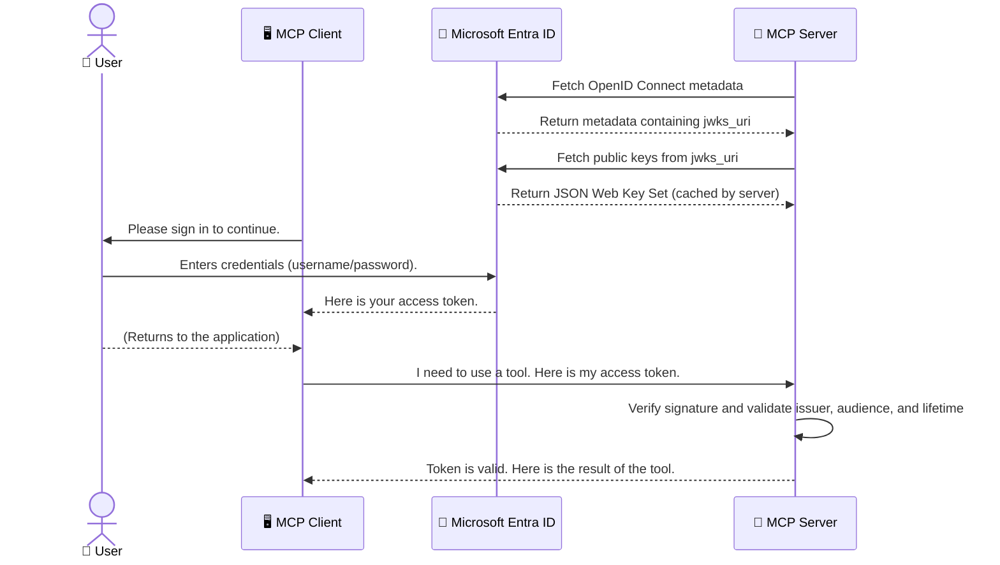

# Mengamankan Alur Kerja AI: Autentikasi Entra ID untuk Server Protokol Model Context

> [!NOTE]
> Kode server jarak jauh dalam pelajaran ini melindungi endpoint `/sse` dan `/message`
> warisan dan menargetkan MCP `2025-11-25`. Pertahankan identitas dan praktik validasi tokennya,
> tetapi gunakan transport Streamable HTTP yang kompatibel dengan `2026-07-28` untuk implementasi baru.


## Pendahuluan
Mengamankan server Model Context Protocol (MCP) Anda sama pentingnya dengan mengunci pintu depan rumah Anda. Membiarkan server MCP Anda terbuka mengekspos alat dan data Anda terhadap akses tidak sah, yang dapat menyebabkan pelanggaran keamanan. Microsoft Entra ID menyediakan solusi manajemen identitas dan akses berbasis cloud yang kuat, membantu memastikan hanya pengguna dan aplikasi yang diotorisasi yang dapat berinteraksi dengan server MCP Anda. Dalam bagian ini, Anda akan belajar cara melindungi alur kerja AI Anda menggunakan autentikasi Entra ID.

## Tujuan Pembelajaran
Pada akhir bagian ini, Anda akan mampu:

- Memahami pentingnya mengamankan server MCP.
- Menjelaskan dasar-dasar Microsoft Entra ID dan autentikasi OAuth 2.0.
- Mengenali perbedaan antara klien publik dan rahasia.
- Menerapkan autentikasi Entra ID dalam skenario server MCP lokal (klien publik) dan jarak jauh (klien rahasia).
- Menerapkan praktik keamanan terbaik saat mengembangkan alur kerja AI.

## Keamanan dan MCP

Sama seperti Anda tidak akan meninggalkan pintu depan rumah Anda dalam keadaan tidak terkunci, Anda juga tidak boleh membiarkan server MCP Anda terbuka untuk diakses siapa saja. Mengamankan alur kerja AI Anda sangat penting untuk membangun aplikasi yang kuat, dipercaya, dan aman. Bab ini akan memperkenalkan Anda pada penggunaan Microsoft Entra ID untuk mengamankan server MCP Anda, memastikan hanya pengguna dan aplikasi yang diotorisasi yang dapat berinteraksi dengan alat dan data Anda.

## Mengapa Keamanan Penting untuk Server MCP

Bayangkan server MCP Anda memiliki alat yang dapat mengirim email atau mengakses database pelanggan. Server yang tidak aman berarti siapa pun berpotensi menggunakan alat tersebut, yang dapat menyebabkan akses data tidak sah, spam, atau aktivitas berbahaya lainnya.

Dengan menerapkan autentikasi, Anda memastikan setiap permintaan ke server Anda diverifikasi, mengonfirmasi identitas pengguna atau aplikasi yang membuat permintaan tersebut. Ini adalah langkah pertama dan paling penting dalam mengamankan alur kerja AI Anda.

## Pendahuluan ke Microsoft Entra ID

[**Microsoft Entra ID**](https://adoption.microsoft.com/microsoft-security/entra/) adalah layanan manajemen identitas dan akses berbasis cloud. Anggaplah ini sebagai penjaga keamanan universal untuk aplikasi Anda. Layanan ini menangani proses kompleks dalam memverifikasi identitas pengguna (autentikasi) dan menentukan apa yang mereka diizinkan lakukan (otorisasi).

Dengan menggunakan Entra ID, Anda dapat:

- Mengaktifkan masuk yang aman untuk pengguna.
- Melindungi API dan layanan.
- Mengelola kebijakan akses dari satu lokasi pusat.

Untuk server MCP, Entra ID menyediakan solusi yang kuat dan terpercaya secara luas untuk mengelola siapa yang dapat mengakses kemampuan server Anda.

---

## Memahami Keajaiban: Cara Kerja Autentikasi Entra ID

Entra ID menggunakan standar terbuka seperti **OAuth 2.0** untuk menangani autentikasi. Walaupun rinciannya bisa kompleks, konsep inti ini sederhana dan dapat dipahami dengan analogi.

### Pengenalan Ringan ke OAuth 2.0: Kunci Valet

Anggaplah OAuth 2.0 seperti layanan valet untuk mobil Anda. Ketika Anda tiba di restoran, Anda tidak memberikan kunci utama mobil Anda ke petugas valet. Sebaliknya, Anda memberikan **kunci valet** yang memiliki izin terbatas—bisa menyalakan mobil dan mengunci pintu, tetapi tidak dapat membuka bagasi atau kompartemen sarung tangan.

Dalam analogi ini:

- **Anda** adalah **Pengguna**.
- **Mobil Anda** adalah **Server MCP** dengan alat dan data berharganya.
- **Valet** adalah **Microsoft Entra ID**.
- **Petugas Parkir** adalah **Klien MCP** (aplikasi yang mencoba mengakses server).
- **Kunci Valet** adalah **Token Akses**.

Token akses adalah string teks aman yang diterima klien MCP dari Entra ID setelah Anda masuk. Klien tersebut kemudian menyajikan token ini ke server MCP dengan setiap permintaan. Server dapat memverifikasi token untuk memastikan permintaan sah dan klien memiliki izin yang diperlukan, tanpa pernah perlu menangani kredensial asli Anda (seperti kata sandi).

### Alur Autentikasi

Berikut cara proses ini bekerja dalam praktik:



Server MCP tidak memanggil Entra ID untuk memvalidasi setiap token akses. Server
memverifikasi secara kriptografi tanda tangan JWT menggunakan kunci publik Entra ID yang di-cache,
dan memvalidasi klaim token, termasuk penerbit, audiens, dan masa berlaku.
Server membaca `jwks_uri` dari metadata OpenID Connect, mengambil kunci publik
dari URI tersebut, dan memperbaruinya secara berkala untuk menangani rotasi kunci. Gunakan
pustaka validasi token yang didukung daripada mengimplementasikan logika ini sendiri.
Untuk detail, lihat
[Memvalidasi token di platform identitas Microsoft](https://learn.microsoft.com/entra/identity-platform/access-tokens#validate-tokens).

### Memperkenalkan Microsoft Authentication Library (MSAL)

Sebelum kita masuk ke kode, penting untuk memperkenalkan komponen utama yang akan Anda lihat dalam contoh: **Microsoft Authentication Library (MSAL)**.

MSAL adalah pustaka yang dikembangkan oleh Microsoft yang membuatnya jauh lebih mudah bagi pengembang untuk menangani autentikasi. Alih-alih Anda harus menulis semua kode kompleks untuk mengelola token keamanan, manajemen masuk, dan penyegaran sesi, MSAL mengurus pekerjaan berat tersebut.

Menggunakan pustaka seperti MSAL sangat disarankan karena:

- **Aman:** Mengimplementasikan protokol standar industri dan praktik keamanan terbaik yang mengurangi risiko kerentanan pada kode Anda.
- **Menyederhanakan Pengembangan:** Mengabstraksi kompleksitas protokol OAuth 2.0 dan OpenID Connect, memungkinkan Anda menambahkan autentikasi tangguh ke aplikasi dengan hanya beberapa baris kode.
- **Terawat:** Microsoft secara aktif memelihara dan memperbarui MSAL untuk mengatasi ancaman keamanan baru dan perubahan platform.

MSAL mendukung beragam bahasa dan kerangka kerja aplikasi, termasuk .NET, JavaScript/TypeScript, Python, Java, Go, dan platform seluler seperti iOS dan Android. Ini berarti Anda dapat menggunakan pola autentikasi yang konsisten di seluruh tumpukan teknologi Anda.

Untuk mempelajari lebih lanjut tentang MSAL, Anda dapat melihat [dokumentasi ikhtisar resmi MSAL](https://learn.microsoft.com/entra/identity-platform/msal-overview).

---

## Mengamankan Server MCP Anda dengan Entra ID: Panduan Langkah demi Langkah

Sekarang, mari kita ulas cara mengamankan server MCP lokal (yang berkomunikasi melalui `stdio`) menggunakan Entra ID. Contoh ini menggunakan **klien publik**, yang cocok untuk aplikasi yang berjalan di mesin pengguna, seperti aplikasi desktop atau server pengembangan lokal.

### Skenario 1: Mengamankan Server MCP Lokal (dengan Klien Publik)

Dalam skenario ini, kita akan melihat server MCP yang berjalan secara lokal, berkomunikasi melalui `stdio`, dan menggunakan Entra ID untuk mengautentikasi pengguna sebelum mengizinkan akses ke alatnya. Server ini akan memiliki satu alat yang mengambil informasi profil pengguna dari Microsoft Graph API.

#### 1. Menyiapkan Aplikasi di Entra ID

Sebelum menulis kode apa pun, Anda perlu mendaftarkan aplikasi Anda di Microsoft Entra ID. Ini memberi tahu Entra ID tentang aplikasi Anda dan memberikan izin untuk menggunakan layanan autentikasi.

1. Navigasikan ke **[portal Microsoft Entra](https://entra.microsoft.com/)**.
2. Pergi ke **Pendaftaran aplikasi** dan klik **Pendaftaran baru**.
3. Beri nama aplikasi Anda (misalnya, "My Local MCP Server").
4. Untuk **Jenis akun yang didukung**, pilih **Akun di direktori organisasi ini saja**.
5. Anda dapat membiarkan **URI Pengalihan** kosong untuk contoh ini.
6. Klik **Daftar**.

Setelah terdaftar, catat **ID Aplikasi (klien)** dan **ID Direktori (penyewa)**. Anda akan membutuhkannya dalam kode Anda.

#### 2. Kode: Rincian

Mari kita tinjau bagian utama kode yang menangani autentikasi. Kode lengkap untuk contoh ini tersedia dalam folder [Entra ID - Lokal - WAM](https://github.com/Azure-Samples/mcp-auth-servers/tree/main/src/entra-id-local-wam) di [repositori GitHub mcp-auth-servers](https://github.com/Azure-Samples/mcp-auth-servers).

**`AuthenticationService.cs`**

Kelas ini bertanggung jawab untuk menangani interaksi dengan Entra ID.

- **`CreateAsync`**: Metode ini menginisialisasi `PublicClientApplication` dari MSAL (Microsoft Authentication Library). Ini dikonfigurasi dengan `clientId` dan `tenantId` aplikasi Anda.
- **`WithBroker`**: Ini mengaktifkan penggunaan broker (seperti Windows Web Account Manager), yang memberikan pengalaman masuk tunggal yang lebih aman dan mulus.
- **`AcquireTokenAsync`**: Ini adalah metode inti. Pertama mencoba mendapatkan token secara diam-diam (meaning pengguna tidak perlu masuk lagi jika sudah memiliki sesi yang valid). Jika token diam-diam tidak dapat diperoleh, akan memunculkan prompt masuk interaktif untuk pengguna.

```csharp
// Simplified for clarity
public static async Task<AuthenticationService> CreateAsync(ILogger<AuthenticationService> logger)
{
    var msalClient = PublicClientApplicationBuilder
        .Create(_clientId) // Your Application (client) ID
        .WithAuthority(AadAuthorityAudience.AzureAdMyOrg)
        .WithTenantId(_tenantId) // Your Directory (tenant) ID
        .WithBroker(new BrokerOptions(BrokerOptions.OperatingSystems.Windows))
        .Build();

    // ... cache registration ...

    return new AuthenticationService(logger, msalClient);
}

public async Task<string> AcquireTokenAsync()
{
    try
    {
        // Try silent authentication first
        var accounts = await _msalClient.GetAccountsAsync();
        var account = accounts.FirstOrDefault();

        AuthenticationResult? result = null;

        if (account != null)
        {
            result = await _msalClient.AcquireTokenSilent(_scopes, account).ExecuteAsync();
        }
        else
        {
            // If no account, or silent fails, go interactive
            result = await _msalClient.AcquireTokenInteractive(_scopes).ExecuteAsync();
        }

        return result.AccessToken;
    }
    catch (Exception ex)
    {
        _logger.LogError(ex, "An error occurred while acquiring the token.");
        throw; // Optionally rethrow the exception for higher-level handling
    }
}
```

**`Program.cs`**

Di sinilah server MCP disiapkan dan layanan autentikasi diintegrasikan.

- **`AddSingleton<AuthenticationService>`**: Ini mendaftarkan `AuthenticationService` dengan wadah injeksi ketergantungan, sehingga dapat digunakan oleh bagian lain aplikasi (seperti alat kita).
- **`GetUserDetailsFromGraph` alat**: Alat ini memerlukan instance `AuthenticationService`. Sebelum melakukan apa pun, ia memanggil `authService.AcquireTokenAsync()` untuk mendapatkan token akses yang valid. Jika autentikasi berhasil, ia menggunakan token untuk memanggil Microsoft Graph API dan mengambil detail pengguna.

```csharp
// Simplified for clarity
[McpServerTool(Name = "GetUserDetailsFromGraph")]
public static async Task<string> GetUserDetailsFromGraph(
    AuthenticationService authService)
{
    try
    {
        // This will trigger the authentication flow
        var accessToken = await authService.AcquireTokenAsync();

        // Use the token to create a GraphServiceClient
        var graphClient = new GraphServiceClient(
            new BaseBearerTokenAuthenticationProvider(new TokenProvider(authService)));

        var user = await graphClient.Me.GetAsync();

        return System.Text.Json.JsonSerializer.Serialize(user);
    }
    catch (Exception ex)
    {
        return $"Error: {ex.Message}";
    }
}
```

#### 3. Cara Semua Bekerja Bersama

1. Ketika klien MCP mencoba menggunakan alat `GetUserDetailsFromGraph`, alat tersebut pertama memanggil `AcquireTokenAsync`.
2. `AcquireTokenAsync` memicu pustaka MSAL untuk memeriksa token yang valid.
3. Jika tidak ditemukan token, MSAL, melalui broker, akan meminta pengguna masuk dengan akun Entra ID mereka.
4. Setelah pengguna masuk, Entra ID mengeluarkan token akses.
5. Alat menerima token dan menggunakannya untuk melakukan panggilan aman ke Microsoft Graph API.
6. Detail pengguna dikembalikan ke klien MCP.

Proses ini memastikan hanya pengguna yang diautentikasi yang dapat menggunakan alat, secara efektif mengamankan server MCP lokal Anda.

### Skenario 2: Mengamankan Server MCP Jarak Jauh (dengan Klien Rahasia)

Ketika server MCP Anda berjalan di mesin jarak jauh (seperti server cloud) dan berkomunikasi melalui protokol seperti HTTP Streaming, persyaratan keamanannya berbeda. Dalam kasus ini, Anda harus menggunakan **klien rahasia** dan **Alur Kode Otorisasi**. Ini adalah metode yang lebih aman karena rahasia aplikasi tidak pernah terekspos ke browser.

Contoh ini menggunakan server MCP berbasis TypeScript yang memakai Express.js untuk menangani permintaan HTTP.

#### 1. Menyiapkan Aplikasi di Entra ID

Penyiapan di Entra ID mirip dengan klien publik, tetapi dengan satu perbedaan utama: Anda perlu membuat **rahasia klien**.

1. Navigasikan ke **[portal Microsoft Entra](https://entra.microsoft.com/)**.
2. Dalam pendaftaran aplikasi Anda, pergi ke tab **Sertifikat & rahasia**.
3. Klik **Rahasia klien baru**, beri deskripsi, lalu klik **Tambahkan**.
4. **Penting:** Salin nilai rahasia segera. Anda tidak akan dapat melihatnya lagi.
5. Anda juga perlu mengonfigurasi **URI Pengalihan**. Pergi ke tab **Autentikasi**, klik **Tambah platform**, pilih **Web**, dan masukkan URI pengalihan untuk aplikasi Anda (misalnya `http://localhost:3001/auth/callback`).

> **⚠️ Catatan Keamanan Penting:** Untuk aplikasi produksi, Microsoft sangat menyarankan menggunakan metode **autentikasi tanpa rahasia** seperti **Managed Identity** atau **Workload Identity Federation** daripada rahasia klien. Rahasia klien berisiko terpapar atau dikompromikan. Managed identity menyediakan pendekatan yang lebih aman dengan menghilangkan kebutuhan menyimpan kredensial di kode atau konfigurasi Anda.
>
> Untuk informasi lebih lanjut tentang managed identity dan cara mengimplementasikannya, lihat [Ikhtisar Managed identities untuk sumber daya Azure](https://learn.microsoft.com/entra/identity/managed-identities-azure-resources/overview).

#### 2. Kode: Rincian

Contoh ini menggunakan pendekatan berbasis sesi. Ketika pengguna mengautentikasi, server menyimpan token akses dan token penyegaran dalam sesi dan memberikan token sesi kepada pengguna. Token sesi ini kemudian digunakan untuk permintaan berikutnya. Kode lengkap untuk contoh ini tersedia di folder [Entra ID - Klien Rahasia](https://github.com/Azure-Samples/mcp-auth-servers/tree/main/src/entra-id-cca-session) dalam [repositori GitHub mcp-auth-servers](https://github.com/Azure-Samples/mcp-auth-servers).

**`Server.ts`**

File ini menyiapkan server Express dan lapisan transport MCP.

- **`requireBearerAuth`**: Middleware ini melindungi endpoint `/sse` dan `/message`. Middleware memeriksa adanya token bearer valid dalam header `Authorization` dari permintaan.
- **`EntraIdServerAuthProvider`**: Ini adalah kelas kustom yang mengimplementasikan antarmuka `McpServerAuthorizationProvider`. Kelas ini bertanggung jawab menangani alur OAuth 2.0.
- **`/auth/callback`**: Endpoint ini menangani pengalihan dari Entra ID setelah pengguna mengautentikasi. Endpoint menukar kode otorisasi dengan token akses dan token penyegaran.

```typescript
// Simplified for clarity
const app = express();
const { server } = createServer();
const provider = new EntraIdServerAuthProvider();

// Protect the SSE endpoint
app.get("/sse", requireBearerAuth({
  provider,
  requiredScopes: ["User.Read"]
}), async (req, res) => {
  // ... connect to the transport ...
});

// Protect the message endpoint
app.post("/message", requireBearerAuth({
  provider,
  requiredScopes: ["User.Read"]
}), async (req, res) => {
  // ... handle the message ...
});

// Handle the OAuth 2.0 callback
app.get("/auth/callback", (req, res) => {
  provider.handleCallback(req.query.code, req.query.state)
    .then(result => {
      // ... handle success or failure ...
    });
});
```

**`Tools.ts`**

File ini mendefinisikan alat yang disediakan oleh server MCP. Alat `getUserDetails` mirip dengan yang ada di contoh sebelumnya, tetapi mengambil token akses dari sesi.

```typescript
// Simplified for clarity
server.setRequestHandler(CallToolRequestSchema, async (request) => {
  const { name } = request.params;
  const context = request.params?.context as { token?: string } | undefined;
  const sessionToken = context?.token;

  if (name === ToolName.GET_USER_DETAILS) {
    if (!sessionToken) {
      throw new AuthenticationError("Authentication token is missing or invalid. Ensure the token is provided in the request context.");
    }

    // Get the Entra ID token from the session store
    const tokenData = tokenStore.getToken(sessionToken);
    const entraIdToken = tokenData.accessToken;

    const graphClient = Client.init({
      authProvider: (done) => {
        done(null, entraIdToken);
      }
    });

    const user = await graphClient.api('/me').get();

    // ... return user details ...
  }
});
```

**`auth/EntraIdServerAuthProvider.ts`**

Kelas ini menangani logika untuk:

- Mengalihkan pengguna ke halaman masuk Entra ID.
- Menukar kode otorisasi dengan token akses.
- Menyimpan token di dalam `tokenStore`.
- Menyegarkan token akses ketika kadaluarsa.

#### 3. Bagaimana Semuanya Bekerja Bersama

1. Ketika pengguna pertama kali mencoba terhubung ke server MCP, middleware `requireBearerAuth` akan melihat bahwa mereka tidak memiliki sesi yang valid dan akan mengalihkan mereka ke halaman masuk Entra ID.
2. Pengguna masuk dengan akun Entra ID mereka.
3. Entra ID mengalihkan pengguna kembali ke endpoint `/auth/callback` dengan kode otorisasi.
4. Server menukar kode tersebut dengan token akses dan token penyegaran, menyimpannya, dan membuat token sesi yang dikirim ke klien.
5. Klien sekarang dapat menggunakan token sesi ini di header `Authorization` untuk semua permintaan selanjutnya ke server MCP.
6. Ketika alat `getUserDetails` dipanggil, alat itu menggunakan token sesi untuk mencari token akses Entra ID dan kemudian menggunakan token tersebut untuk memanggil Microsoft Graph API.

Alur ini lebih kompleks dibandingkan alur klien publik, tetapi diperlukan untuk endpoint yang dapat diakses dari internet. Karena server MCP jarak jauh dapat diakses melalui internet publik, mereka memerlukan langkah keamanan yang lebih kuat untuk melindungi dari akses tidak sah dan potensi serangan.


## Praktik Terbaik Keamanan

- **Selalu gunakan HTTPS**: Enkripsi komunikasi antara klien dan server untuk melindungi token agar tidak disadap.
- **Terapkan Kontrol Akses Berbasis Peran (RBAC)**: Jangan hanya memeriksa *apakah* pengguna terautentikasi; periksa *apa* yang mereka izinkan untuk lakukan. Anda dapat mendefinisikan peran di Entra ID dan memeriksanya di server MCP Anda.
- **Pantau dan audit**: Catat semua peristiwa autentikasi sehingga Anda dapat mendeteksi dan merespon aktivitas mencurigakan.
- **Tangani pembatasan dan pengaturan laju**: Microsoft Graph dan API lain menerapkan pembatasan laju untuk mencegah penyalahgunaan. Terapkan logika backoff eksponensial dan retry di server MCP Anda untuk menangani respons HTTP 429 (Terlalu Banyak Permintaan) dengan baik. Pertimbangkan untuk menyimpan cache data yang sering diakses untuk mengurangi panggilan API.
- **Penyimpanan token yang aman**: Simpan token akses dan token penyegaran dengan aman. Untuk aplikasi lokal, gunakan mekanisme penyimpanan aman sistem. Untuk aplikasi server, pertimbangkan menggunakan penyimpanan terenkripsi atau layanan manajemen kunci yang aman seperti Azure Key Vault.
- **Penanganan kadaluarsa token**: Token akses memiliki masa berlaku terbatas. Terapkan penyegaran token otomatis menggunakan token penyegaran untuk menjaga pengalaman pengguna tetap mulus tanpa perlu autentikasi ulang.
- **Pertimbangkan penggunaan Azure API Management**: Meski menerapkan keamanan langsung di server MCP memberi Anda kendali yang rinci, API Gateway seperti Azure API Management dapat menangani banyak kekhawatiran keamanan ini secara otomatis, termasuk autentikasi, otorisasi, pembatasan laju, dan pemantauan. Mereka menyediakan lapisan keamanan terpusat yang berada di antara klien Anda dan server MCP Anda. Untuk detail lebih lanjut tentang menggunakan API Gateway dengan MCP, lihat [Azure API Management Your Auth Gateway For MCP Servers](https://techcommunity.microsoft.com/blog/integrationsonazureblog/azure-api-management-your-auth-gateway-for-mcp-servers/4402690).


##  Poin Penting

- Mengamankan server MCP Anda sangat penting untuk melindungi data dan alat Anda.
- Microsoft Entra ID menyediakan solusi yang kuat dan skalabel untuk autentikasi dan otorisasi.
- Gunakan **klien publik** untuk aplikasi lokal dan **klien rahasia** untuk server jarak jauh.
- **Alur Kode Otorisasi** adalah opsi paling aman untuk aplikasi web.


## Latihan

1. Pikirkan tentang server MCP yang mungkin Anda buat. Apakah itu server lokal atau server jarak jauh?
2. Berdasarkan jawaban Anda, apakah Anda akan menggunakan klien publik atau rahasia?
3. Izin apa yang akan diminta server MCP Anda untuk melakukan aksi terhadap Microsoft Graph?


## Latihan Praktis

### Latihan 1: Mendaftarkan Aplikasi di Entra ID
Buka portal Microsoft Entra.
Daftarkan aplikasi baru untuk server MCP Anda.
Catat ID Aplikasi (klien) dan ID Direktori (tenant).

### Latihan 2: Mengamankan Server MCP Lokal (Klien Publik)
- Ikuti contoh kode untuk mengintegrasikan MSAL (Microsoft Authentication Library) untuk autentikasi pengguna.
- Uji alur autentikasi dengan memanggil alat MCP yang mengambil detail pengguna dari Microsoft Graph.

### Latihan 3: Mengamankan Server MCP Jarak Jauh (Klien Rahasia)
- Daftarkan klien rahasia di Entra ID dan buat rahasia klien.
- Konfigurasikan server Express.js MCP Anda untuk menggunakan Alur Kode Otorisasi.
- Uji endpoint yang dilindungi dan pastikan akses berbasis token.

### Latihan 4: Terapkan Praktik Terbaik Keamanan
- Aktifkan HTTPS untuk server lokal atau jarak jauh Anda.
- Terapkan kontrol akses berbasis peran (RBAC) dalam logika server Anda.
- Tambahkan penanganan kadaluarsa token dan penyimpanan token yang aman.

## Sumber Daya

1. **Dokumentasi Ringkasan MSAL**  
   Pelajari bagaimana Microsoft Authentication Library (MSAL) memungkinkan akuisisi token yang aman lintas platform:  
   [Ringkasan MSAL di Microsoft Learn](https://learn.microsoft.com/en-gb/entra/msal/overview)

2. **Repositori GitHub Azure-Samples/mcp-auth-servers**  
   Implementasi referensi server MCP yang menunjukkan alur autentikasi:  
   [Azure-Samples/mcp-auth-servers di GitHub](https://github.com/Azure-Samples/mcp-auth-servers)

3. **Ringkasan Managed Identities untuk Azure Resources**  
   Pahami cara menghilangkan rahasia dengan menggunakan managed identities yang ditetapkan sistem atau pengguna:  
   [Ringkasan Managed Identities di Microsoft Learn](https://learn.microsoft.com/en-us/entra/identity/managed-identities-azure-resources/)

4. **Azure API Management: Gerbang Auth Anda untuk Server MCP**  
   Penjelasan mendalam tentang menggunakan APIM sebagai gerbang OAuth2 aman untuk server MCP:  
   [Azure API Management Your Auth Gateway For MCP Servers](https://techcommunity.microsoft.com/blog/integrationsonazureblog/azure-api-management-your-auth-gateway-for-mcp-servers/4402690)

5. **Referensi Izin Microsoft Graph**  
   Daftar lengkap izin delegasi dan aplikasi untuk Microsoft Graph:  
   [Referensi Izin Microsoft Graph](https://learn.microsoft.com/zh-tw/graph/permissions-reference)


## Hasil Pembelajaran
Setelah menyelesaikan bagian ini, Anda akan dapat:

- Menjelaskan mengapa autentikasi sangat penting untuk server MCP dan alur kerja AI.
- Mengatur dan mengonfigurasi autentikasi Entra ID untuk skenario server MCP lokal dan jarak jauh.
- Memilih jenis klien yang tepat (publik atau rahasia) berdasarkan penempatan server Anda.
- Menerapkan praktik pengkodean yang aman, termasuk penyimpanan token dan otorisasi berbasis peran.
- Melindungi server MCP dan alatnya dengan percaya diri dari akses tidak sah.

## Selanjutnya

- [5.13 Integrasi Model Context Protocol (MCP) dengan Microsoft Foundry](../mcp-foundry-agent-integration/README.md)

---

<!-- CO-OP TRANSLATOR DISCLAIMER START -->
**Penafian**:
Dokumen ini telah diterjemahkan menggunakan layanan terjemahan AI [Co-op Translator](https://github.com/Azure/co-op-translator). Meskipun kami berupaya untuk mencapai akurasi, harap diketahui bahwa terjemahan otomatis mungkin mengandung kesalahan atau ketidakakuratan. Dokumen asli dalam bahasa aslinya harus dianggap sebagai sumber yang sah. Untuk informasi penting, disarankan menggunakan terjemahan profesional oleh manusia. Kami tidak bertanggung jawab atas kesalahpahaman atau penafsiran yang keliru yang timbul dari penggunaan terjemahan ini.
<!-- CO-OP TRANSLATOR DISCLAIMER END -->